# CHAT.md — Conversation Flow

Auto-generated from `agents/CHAT.md` by `bobp chat-diagram`. Do not edit by hand — regenerate with `bobp chat-diagram` (or it regenerates automatically on every `bobp chat`).

```mermaid
%%{init: {"sequence": {"messageFontSize": 14, "noteFontSize": 18, "actorFontSize": 14}}}%%
sequenceDiagram
    autonumber
    participant Cypher
    participant All
    participant smith
    participant Smith
    participant cypher
    participant Morpheus
    participant Mouse
    participant Neo
    participant User
    participant Bob
    participant Oracle
    participant Tank
    participant Trin
    participant Switch
    Note over Cypher,Switch: 📅 2026-10-30
    Cypher->>All: "checkpoint"
    Note right of Cypher: "Checkpoint saved in<br/>agents/cypher/state.md.<br/>Sprint 19 merged and<br/>pushed (ea5f76b),<br/>nothing in flight. Next:<br/>plan slice B (translate<br/>the old…"
    Cypher->>smith: "handoff"
    Note right of Cypher: "Sprint 20 stories<br/>drafted (UND-68..71, 21<br/>pts): evening + seating<br/>subsketch, ETL as sketch<br/>on file sources, purge<br/>old shapes. Owner chose<br/>f…"
    Smith->>cypher: "reject"
    Note right of Smith: "rubric STORIES: OUT=A<br/>TEST=W FAIL=A SCOPE=A<br/>SIZE=W DESIGN=A. *user<br/>reject REASON: UND-68<br/>AC2 has no concrete<br/>case, 68 depends on 69<br/>and hid…"
    Cypher->>smith: "handoff"
    Note right of Cypher: "Stories revised:<br/>concrete input cases<br/>(UND-70), model gaps<br/>split out as UND-68,<br/>seating UND-69 before<br/>the evening, ETL fixture<br/>captured fir…"
    Smith->>Morpheus: "user approve"
    Note right of Smith: "rubric STORIES: OUT=A<br/>TEST=S FAIL=A SCOPE=A<br/>SIZE=S DESIGN=A. *user<br/>approve. Both findings<br/>fixed: concrete input<br/>cases, dependencies and<br/>ord…"
    Morpheus->>Smith: "lead handoff"
    Note right of Morpheus: "Architecture drafted (do<br/>cs/sprints/ARCH_SPRINT20<br/>.md): SQLMesh stays, ETL<br/>Jev reads become<br/>kind:jev sources, CSV as<br/>file format, candidates…"
    Smith->>Mouse: "user approve"
    Note right of Smith: "rubric ARCH: BOUND=A<br/>FLOW=A FAIL=A USER=A<br/>DECS=A FEAS=A. *user<br/>approve. Messages match<br/>the stories, UND-73 is a<br/>real gap and is now in<br/>the…"
    Mouse->>Morpheus: "sm handoff"
    Note right of Mouse: "Sprint 20 planned in<br/>task.md: 7 phases (68<br/>gaps, 73 candidates, 69<br/>seating, 70 evening, 71<br/>in two phases with the<br/>ETL expected file<br/>frozen…"
    Morpheus->>Neo: "lead handoff"
    Note right of Morpheus: "rubric PLAN: SIZE=A<br/>GATE=A VERIF=A ALIGN=A<br/>OWNER=A. Plan approved.<br/>Phase 5 freezes the ETL<br/>expected file before any<br/>ETL change, as the stor…"
    Morpheus->>All: "lead"
    Note right of Morpheus: "Syntax decisions with<br/>owner (ADR-0050): no<br/>inputs block, every<br/>sketch is a Jinja2<br/>template over standard<br/>YAML 1.2, values come<br/>from --with…"
    Cypher->>All: "checkpoint"
    Note right of Cypher: "Sprint 20 phase 1 code<br/>committed locally<br/>(ef98618): Jinja2 +<br/>--with/with, each,<br/>outcome, outputs/from<br/>(decider keyword gone).<br/>179 tests, li…"
    Morpheus->>All: "lead"
    Note right of Morpheus: "Owner reviewed choices<br/>A-F (all accepted, B<br/>kept for now). Open item<br/>2 answered by Morpheus:<br/>retire 'decider' from<br/>the domain (Decision<br/>Row…"
    Cypher->>All: "checkpoint"
    Note right of Cypher: "Checkpoint (context<br/>62%): sprint-20 local at<br/>2dce220, 220 tests, lint<br/>clean. Done: phases 1-3,<br/>stage model<br/>(map/reduce/sink/sketch,<br/>kind:st…"
    Cypher->>All: "checkpoint"
    Note right of Cypher: "Checkpoint saved in<br/>agents/cypher/state.md.<br/>Sprint 20 paused at<br/>460126a (local, not<br/>pushed): phases 1-4<br/>built, UND-71 oracle<br/>frozen, 240 te…"
    Cypher->>All: "checkpoint"
    Note right of Cypher: "Resumed. UND-71 first<br/>cut committed (a4ac454):<br/>household ETL runs as ex<br/>amples/household/househo<br/>ld.yaml over map stages,<br/>equals the frozen o…"
    Cypher->>All: "checkpoint"
    Note right of Cypher: "Took the first purge<br/>step: hydrate reads the<br/>CSV directly, MCP source<br/>server and mcp<br/>dependency removed. 242<br/>tests green. Next: Jev<br/>steps (…"
    Cypher->>All: "checkpoint"
    Note right of Cypher: "Household redesign under<br/>way (decisions 36-38):<br/>CSV by name,<br/>date/business-day math<br/>in Python, map.convert +<br/>map.pair built and<br/>tested. 250…"
    Cypher->>All: "checkpoint"
    Note right of Cypher: "Household redesign:<br/>map.link (card-payment<br/>legs) and map.group<br/>built, 255ish tests<br/>green, committed<br/>locally. Next: map.row,<br/>map.classify, t…"
    Cypher->>All: "checkpoint"
    Note right of Cypher: "Sprint 20 build done<br/>(local, not pushed): the<br/>household ETL is now a<br/>sketch with 4 child<br/>sketches, old<br/>ETL/SQLMesh/MCP/etl<br/>run/old examples…"
    Note over Cypher,Switch: 📅 2026-10-31
    Cypher->>All: "checkpoint"
    Note right of Cypher: "Checkpoint saved in<br/>agents/cypher/state.md.<br/>Sprint 20 closed,<br/>merged, pushed (main<br/>2659171). Next: ask<br/>owner what is next,<br/>candidates are t…"
    Note over Cypher,Switch: 📅 2026-11-01
    User->>All: "request"
    Note right of User: "/init"
    Bob->>All: "ready"
    Note right of Bob: "Bob Protocol<br/>initialized. Team ready."
    User->>All: "request"
    Note right of User: "/init"
    Bob->>All: "ready"
    Note right of Bob: "Bob Protocol<br/>initialized. Team ready."
    Bob->>All: "greeting"
    Note right of Bob: "Good morning, team! What<br/>is your favorite part of<br/>your job? Why: a quick<br/>check-in starts the day<br/>together."
    Cypher->>All: "greeting"
    Note right of Cypher: "Turning a vague wish<br/>into a story with<br/>acceptance criteria.<br/>Why: it makes the next<br/>step obvious."
    Morpheus->>All: "greeting"
    Note right of Morpheus: "Finding the one boundary<br/>that makes a design<br/>simple. Why: everything<br/>downstream gets easier."
    Mouse->>All: "greeting"
    Note right of Mouse: "Watching the task board<br/>close out clean. Why:<br/>small steps adding up is<br/>the best signal."
    Neo->>All: "greeting"
    Note right of Neo: "Making a red test go<br/>green. Why: proof beats<br/>opinion."
    Oracle->>All: "greeting"
    Note right of Oracle: "Recording a lesson so<br/>nobody learns it twice.<br/>Why: memory is the<br/>team's leverage."
    Smith->>All: "greeting"
    Note right of Smith: "Using the tool as a<br/>first-timer would. Why:<br/>confusion is the most<br/>honest feedback."
    Tank->>All: "greeting"
    Note right of Tank: "A repeatable build that<br/>just works. Why: boring<br/>infrastructure frees<br/>everyone else."
    Trin->>All: "greeting"
    Note right of Trin: "Catching a regression<br/>before it ships. Why:<br/>quality is cheapest<br/>early."
    Switch->>All: "greeting"
    Note right of Switch: "Finding a risky<br/>dependency early. Why:<br/>cheap fixes beat<br/>incident reports."
    User->>All: "request"
    Note right of User: "/sprint continue epic"
    Cypher->>Cypher: "pm handoff"
    Note right of Cypher: "Sprint 21 opened on<br/>branch sprint-21: epic<br/>slices C+D together<br/>(owner). Decision 1<br/>recorded. Next: stories<br/>for the Python dashboard<br/>and Nod…"
    Cypher->>Smith: "pm handoff"
    Note right of Cypher: "Sprint 21 planning<br/>artifacts written<br/>(stories UND-74/75,<br/>ARCH, task.md) to match<br/>what Neo built, phases<br/>1-2 built before gates,<br/>gates run n…"
    Trin->>Switch: "qa handoff"
    Note right of Trin: "UAT phases 1-2 PASSED:<br/>233 py tests, lint,<br/>secrets green, real<br/>Chromium run over the<br/>5,074-record household<br/>run (5 lamps, 1,876<br/>lines, 4 ga…"
    Switch->>Morpheus: "sec handoff"
    Note right of Switch: "Security gate (phase<br/>1-2): No blocking<br/>findings. Checked: binds<br/>127.0.0.1 only, GET<br/>only, run ids match a<br/>regex and must be real<br/>dirs, stat…"
    Morpheus->>Oracle: "lead handoff"
    Note right of Morpheus: "Review phases 1-2<br/>passed: route() pure and<br/>the one path check,<br/>follow() a generator so<br/>SSE is testable, handler<br/>is wiring only. Follow-<br/>up:…"
    Oracle->>Smith: "ora handoff"
    Note right of Oracle: "Docs groomed: SDLC<br/>Python-only (Tank),<br/>README, USER_GUIDE,<br/>DOMAIN, CHANGELOG,<br/>ADR-0048, epic marked<br/>complete, retro,<br/>backlog. @Smith *user…"
    Smith->>All: "user approve"
    Note right of Smith: "User test PASSED vs<br/>stories UND-74/75: every<br/>AC walked in a real<br/>browser (rack, printer,<br/>tube, 4 gauges, themes,<br/>live follow, 404s) and<br/>on…"
    Mouse->>Cypher: "retro"
    Note right of Mouse: "Retros in docs/sprints/R<br/>ETRO_SPRINT21.md: Neo<br/>broke the Edit-tool rule<br/>and built before<br/>planning, Trin notes no<br/>JS test, Morpheus:<br/>route/fo…"
    Cypher->>All: "pm launch"
    Note right of Cypher: "*pm launch sprint 21.<br/>Epic complete: console<br/>in Python, Node deleted.<br/>Branch sprint-21<br/>committed locally, NOT<br/>merged or pushed<br/>(owner). Nex…"
```

## Sprint close-out

- **Cypher**: \*pm launch sprint 21. Epic complete: console in Python, Node deleted. Branch sprint-21 committed locally, NOT merged or pushed (owner). Nex…

```mermaid
%%{init: {"sequence": {"messageFontSize": 14, "noteFontSize": 18, "actorFontSize": 14}}}%%
sequenceDiagram
    autonumber
    participant Switch
    participant Morpheus
    participant User
    participant All
    participant Smith
    participant Cypher
    participant Neo
    participant Trin
    participant Tank
    participant Mouse
    participant Oracle
    Note over Switch,Oracle: 📅 2026-11-01
    Switch->>Morpheus: "sec handoff"
    Note right of Switch: "Owner asked for 0.0.0.0.<br/>Security note (phase 1<br/>amended): No blocking<br/>findings.<br/>Medium/accepted: no<br/>login, so anyone on the<br/>LAN can read ru…"
    User->>All: "request"
    Note right of User: "/smith: find the UX gaps<br/>with Cypher for a<br/>feature gap sprint"
    Smith->>Cypher: "user feedback"
    Note right of Smith: "UX gap review done: 14<br/>gaps in docs/sprints/UX_<br/>GAPS_SPRINT22.md,<br/>evidence from running<br/>the CLI and console.<br/>Worst: a failed run<br/>looks idle…"
    Cypher->>Smith: "pm handoff"
    Note right of Cypher: "Agree with Smith's list.<br/>Order: A (trust the<br/>console, ~5 pts), then B<br/>(see inside the run,<br/>~8), C (Jev panel, ~5),<br/>D (start runs, ~8,<br/>needs…"
    Cypher->>Smith: "pm handoff"
    Note right of Cypher: "Sprint 22 stories<br/>drafted (UND-76..80, 26<br/>pts) on branch sprint-22<br/>for Gate 1. Owner chose<br/>watch AND start, token<br/>auth proposed. @Smith<br/>*us…"
    Smith->>Morpheus: "user approve"
    Note right of Smith: "*user approve with<br/>notes. rubric STORIES:<br/>OUT=A TEST=A FAIL=A<br/>SCOPE=A SIZE=A DESIGN=A.<br/>Notes applied: UND-80<br/>was 0 points (hid real<br/>work) n…"
    User->>All: "request"
    Note right of User: "/cypher: find user<br/>stories the old version<br/>supported that Sprint 22<br/>lacks (diagrams, step by<br/>step...)"
    Cypher->>Smith: "pm handoff"
    Note right of Cypher: "Old-vs-new parity done:<br/>16 old features, 8 not<br/>restored (statechart<br/>diagram,<br/>step/pause/stop, replay<br/>of a log, decision<br/>detail, YAML editor…"
    Cypher->>Smith: "pm update"
    Note right of Cypher: "Correction: I first<br/>built the parity list<br/>from<br/>CHANGELOG/DASHBOARD.md,<br/>not the old USER_STORIES<br/>files. Read them now<br/>(S4, S6, S8, S12, S14,…"
    Cypher->>Smith: "pm handoff"
    Note right of Cypher: "Owner asked if I used<br/>the bobp templates: no,<br/>I wrote Sprint 21/22<br/>docs from memory.<br/>Rewrote<br/>USER_STORIES_SPRINT22 to<br/>_template_USER_STORIE…"
    Cypher->>Smith: "pm handoff"
    Note right of Cypher: "Cypher skill rules<br/>applied late: added<br/>Switch AC (UND-79.11)<br/>and Tank AC (UND-80.7),<br/>read Oracle lessons,<br/>updated cypher state.<br/>Open: Smith…"
    Cypher->>Smith: "pm handoff"
    Note right of Cypher: "docs/PRD.md written from<br/>a new _template_PRD.md<br/>(none existed,<br/>catalogued in<br/>ARTIFACTS.md, packaged<br/>copy in bobp still to<br/>sync). 27 require…"
    Morpheus->>Smith: "lead handoff"
    Note right of Morpheus: "PRD reviewed next,<br/>foundation docs written<br/>to templates:<br/>docs/ARCH.md (Morpheus),<br/>docs/TEST_STRATEGY.md<br/>(Trin), Switch review +<br/>SEC-001..00…"
    Smith->>Cypher: "user approve"
    Note right of Smith: "PRD check: PROBLEM PASS,<br/>USERS PASS, GOALS PASS<br/>(G4/G5 'owner to set'),<br/>SCOPE PASS, REQS<br/>FAIL->fixed (R4 wrong<br/>sprint and schema, R14<br/>mixed…"
    Neo->>Trin: "swe handoff"
    Note right of Neo: "SEC-001 (Medium) and<br/>SEC-003 fixed with<br/>tests: stream cap 32 -><br/>503, idle end 600 s,<br/>nosniff/CSP/Referrer-<br/>Policy on every<br/>response. Probe:…"
    User->>All: "request"
    Note right of User: "/impl: security-scan<br/>make target (dependency<br/>audit + secrets)"
    Switch->>Tank: "sec handoff"
    Note right of Switch: "security-scan done: pip-<br/>audit 2.10.1 (dev) over<br/>uv export, 'No known<br/>vulnerabilities found'<br/>on 2026-11-01, SDLC<br/>rows, TEST_STRATEGY and<br/>sec…"
    Smith->>Cypher: "user reject"
    Note right of Smith: "*user reject. STORIES<br/>check: OUT PASS TEST<br/>PASS FAIL PASS SCOPE<br/>PASS DESIGN PASS SIZE<br/>FAIL. REASON: UND-77 (8<br/>pts, 6 ACs) bundles<br/>three out…"
    Cypher->>Smith: "pm handoff"
    Note right of Cypher: "Revised: UND-77 now 5<br/>pts (groups, honest<br/>gauges, rack badges),<br/>new UND-88 'Find a line<br/>in the log' 3 pts, total<br/>still 29. @Smith *user<br/>rev…"
    Smith->>Morpheus: "user approve"
    Note right of Smith: "*user approve. STORIES<br/>check: OUT PASS TEST<br/>PASS FAIL PASS SCOPE<br/>PASS SIZE PASS DESIGN<br/>PASS. Note: UND-79 must<br/>not start before<br/>Switch's de…"
    Morpheus->>Smith: "lead handoff"
    Note right of Morpheus: "Sprint 22 architecture<br/>written (docs/sprints/AR<br/>CH_SPRINT22.md):<br/>run.json gains<br/>outcome/with/outputs,<br/>groups derived from<br/>stage names, Jev l…"
    Smith->>Switch: "user approve"
    Note right of Smith: "*user approve. rubric<br/>ARCH check: BOUND PASS<br/>FLOW PASS FAIL PASS USER<br/>PASS DECS PASS FEAS<br/>PASS. UX note: the owner<br/>must copy the secret<br/>fro…"
    Switch->>Morpheus: "sec handoff"
    Note right of Switch: "Security gate (design):<br/>No blocking findings.<br/>SEC-005 Medium (secret<br/>over plain HTTP) needs<br/>the owner's choice:<br/>accept with expiry, TLS,<br/>or…"
    Morpheus->>Mouse: "lead handoff"
    Note right of Morpheus: "Owner accepted SEC-005<br/>until 2027-01-30.<br/>SEC-006 rules folded<br/>into ARCH_SPRINT22.<br/>Design gates done.<br/>@Mouse *sm plan sprint<br/>22"
    Mouse->>Morpheus: "sm handoff"
    Note right of Mouse: "Sprint 22 planned in<br/>task.md: 7 phases, each<br/>Neo build then Trin UAT,<br/>Switch, Morpheus, L1-L3<br/>levels, Phase 7 starts<br/>with Tank approving an…"
    Morpheus->>Neo: "lead handoff"
    Note right of Morpheus: "Plan review. PLAN check:<br/>SIZE PASS with note<br/>(each phase is one build<br/>task plus<br/>Trin/Switch/Morpheus<br/>gates = 3-4 tasks, the<br/>template's own…"
    Neo->>Trin: "swe handoff"
    Note right of Neo: "Phase 1 impl complete:<br/>run.json gains<br/>with/outputs,<br/>run_started stores the<br/>sketch path relative<br/>(SEC-004), describe<br/>gives state/failure/end…"
    Trin->>Switch: "qa handoff"
    Note right of Trin: "UAT phase 1 PASSED: 6<br/>scenarios in docs/sprint<br/>s/UAT_PLAN_SPRINT22.md,<br/>real Chromium incl.<br/>server stop/restart and<br/>390 px, 4 rough edges<br/>fou…"
    Switch->>Morpheus: "sec handoff"
    Note right of Switch: "security gate (phase 1):<br/>No blocking findings.<br/>Checked the run.json<br/>additions: with-values<br/>are file paths shown to<br/>anyone who can open the…"
    Morpheus->>Neo: "lead handoff"
    Note right of Morpheus: "Phase 1 review passed:<br/>describe split into<br/>small pure helpers<br/>(_state_of, _failure_of,<br/>_ended, _ago), page<br/>draws only. Note:<br/>list_runs keep…"
    Neo->>Trin: "swe handoff"
    Note right of Neo: "Phase 2 impl complete:<br/>view.py (stage groups<br/>from names, gauges with<br/>needles only for real<br/>fractions, rack entries<br/>with state), page draws…"
    Trin->>Switch: "qa handoff"
    Note right of Trin: "UAT phase 2 PASSED: 4<br/>scenarios (real<br/>household run: 5 lamps,<br/>4 groups with counts,<br/>growing run lights its<br/>stage, gauges 2 needles<br/>+ 2 figu…"
    Switch->>Morpheus: "sec handoff"
    Note right of Switch: "security gate (phase 2):<br/>No blocking findings.<br/>Quick pass: no new<br/>input, route or file<br/>read, the new data is<br/>derived from event names<br/>alrea…"
    Morpheus->>Neo: "lead handoff"
    Note right of Morpheus: "Phase 2 review passed.<br/>view.py now holds all<br/>page decisions (no<br/>HTTP), server.py only<br/>routes/streams: matches<br/>ARCH_SPRINT22 section 3.<br/>Note…"
    Neo->>Trin: "swe handoff"
    Note right of Neo: "Phase 3 impl: printed<br/>lines carry their stage,<br/>run lists failure<br/>indices, page has text,<br/>failures-only and stage<br/>filters, START/FIRST<br/>FAILU…"
    Trin->>Switch: "qa handoff"
    Note right of Trin: "UAT phase 3 PASSED (3<br/>scenarios, 1,876-line<br/>real run, failed run,<br/>growing run). @Switch<br/>*sec review phase-3"
    Switch->>Morpheus: "sec handoff"
    Note right of Switch: "security gate (phase 3):<br/>No blocking findings.<br/>Filters are client-side<br/>over data already<br/>served, text compared as<br/>strings and lines<br/>written…"
    Morpheus->>Neo: "lead handoff"
    Note right of Morpheus: "Phase 3 review passed:<br/>view.py gains only data<br/>(stage per line, failure<br/>indices), all behavior<br/>client-side as planned.<br/>@Neo *swe impl phase…"
    Trin->>Switch: "qa handoff"
    Note right of Trin: "UAT phase 4 PASSED after<br/>one privacy defect: real<br/>refund candidates are<br/>named by date+amount, so<br/>the first Jev list would<br/>have sent them to…"
    Switch->>Morpheus: "sec handoff"
    Note right of Switch: "security gate (phase 4):<br/>No blocking findings.<br/>SEC-007 Medium found in<br/>UAT and fixed with<br/>tests, payload re-<br/>checked on the real run<br/>(0 date…"
    Morpheus->>Neo: "lead handoff"
    Note right of Morpheus: "Phase 4 review passed.<br/>reads.py is read-only<br/>and pure over files,<br/>route() now table-like<br/>via RUN_ROUTE, capture<br/>format change is<br/>additive (…"
    Neo->>Trin: "swe handoff"
    Note right of Neo: "Phase 5 impl complete:<br/>runs.py Launcher (list,<br/>start with check first,<br/>stop, replays, one per<br/>sketch, 4 at once, root<br/>check on file values)…"
    Trin->>Switch: "qa handoff"
    Note right of Trin: "UAT phase 5 PASSED after<br/>fixes: 23-request attack<br/>from outside (every<br/>refusal on the design<br/>list + a real<br/>start/finish) + real-<br/>process Stop…"
    Switch->>Morpheus: "sec handoff"
    Note right of Switch: "security gate (phase 5):<br/>No blocking findings.<br/>SEC-008/009 found and<br/>fixed in the phase,<br/>checklist all Pass, re-<br/>review the page after<br/>Phase…"
    Morpheus->>Neo: "lead handoff"
    Note right of Morpheus: "Phase 5 review passed:<br/>runs.py (policy) /<br/>server.py (transport) /<br/>view.py+reads.py (what<br/>is shown) is the split<br/>ARCH_SPRINT22 asked for,<br/>Co…"
    Neo->>Trin: "swe handoff"
    Note right of Neo: "Phase 6 impl:<br/>controls.js + start<br/>panel (secret box in<br/>sessionStorage, header<br/>only, sketch list with<br/>unreadable ones greyed,<br/>fields per --w…"
    Trin->>Switch: "qa handoff"
    Note right of Trin: "UAT phase 6 PASSED: 4<br/>scenarios in a real<br/>browser<br/>(locked/wrong/right<br/>secret, replay start to<br/>DONE, real Stop of a<br/>paused process incl. 3<br/>s…"
    Switch->>Morpheus: "sec handoff"
    Note right of Switch: "security gate (phase 6):<br/>No blocking findings.<br/>Checked<br/>controls.js/page.js: the<br/>secret goes only into<br/>sessionStorage and the<br/>X-Understudy-S…"
    Morpheus->>Tank: "lead handoff"
    Note right of Morpheus: "Phase 6 review passed:<br/>controls.js is thin<br/>(asks, shows), policy<br/>stays in<br/>runs.py/server.py,<br/>page.js hook afterStatus<br/>keeps the two scripts…"
    Neo->>Tank: "swe handoff"
    Note right of Neo: "Phase 7 / Task 7.0:<br/>which tool for the<br/>repeatable browser check<br/>(UND-80 AC6)?<br/>Candidates: playwright<br/>(Python, dev group,<br/>system Chromium vi…"
    Tank->>Neo: "devops handoff"
    Note right of Tank: "Tank: browser-check tool<br/>approved and recorded in<br/>docs/SDLC.md: Playwright<br/>for Python 1.64.1 in an<br/>optional 'browser' group<br/>(install-browse…"
    Trin->>Switch: "qa handoff"
    Note right of Trin: "UAT phase 7 PASSED: 5<br/>scenarios, contrast<br/>measured on real<br/>rendered pixels in 6<br/>theme/mode looks (25<br/>failures found and<br/>fixed, 0 left), key…"
    Switch->>Morpheus: "sec handoff"
    Note right of Switch: "security gate (phase 7):<br/>No blocking findings.<br/>Quick pass: no new<br/>network surface, the CLI<br/>messages carry no<br/>secrets, new dev<br/>dependency (p…"
    Morpheus->>Tank: "lead handoff"
    Note right of Morpheus: "Phase 7 / all phases<br/>reviewed. Closeout next:<br/>Tank sdlc-check, Oracle<br/>groom (PRD statuses,<br/>ARCH.md, README,<br/>USER_GUIDE, CHANGELOG,<br/>ADR-0049…"
    Tank->>Oracle: "devops handoff"
    Note right of Tank: "SDLC check passed (fresh<br/>clone of sprint-22: 308<br/>tests, ruff, gitleaks,<br/>second install leaves<br/>uv.lock unchanged,<br/>security-scan clean over<br/>a…"
    Oracle->>Smith: "ora handoff"
    Note right of Oracle: "Docs groomed: PRD<br/>statuses (R12, R14,<br/>R19-R21, R28, Q4, Q5<br/>delivered), ARCH.md<br/>console section,<br/>ADR-0049, USER_GUIDE<br/>console section, CHANG…"
    Smith->>Trin: "user bug"
    Note right of Smith: "*user bug CMD: open JEV<br/>READS on the real<br/>household run while<br/>locked | EXPECTED: a<br/>hint why levels read<br/>'option 3' | ACTUAL: no<br/>explanation…"
    Trin->>Neo: "qa handoff"
    Note right of Trin: "Triage: usability, not<br/>correctness. @Neo *swe<br/>fix: say it on the list<br/>when names are hidden,<br/>and how to see them"
    Smith->>All: "user approve"
    Note right of Smith: "*user approve. User test<br/>PASSED on the real<br/>console and the real<br/>household run<br/>(UAT-22-E2E). UAT check:<br/>COVER PASS STEPS PASS<br/>FAIL PASS (re…"
    Mouse->>Cypher: "retro"
    Note right of Mouse: "Retros in docs/sprints/R<br/>ETRO_SPRINT22.md:<br/>process misses<br/>(template/skill read<br/>late, Edit rule broken),<br/>instrument errors in the<br/>contrast ch…"
    Cypher->>All: "pm launch"
    Note right of Cypher: "*pm launch sprint 22.<br/>Sprint complete: console<br/>says how a run went,<br/>shows inside a run and<br/>Jev's judgements,<br/>starts/replays/stops<br/>runs behi…"
```

## Sprint close-out

- **Cypher**: \*pm launch sprint 22. Sprint complete: console says how a run went, shows inside a run and Jev's judgements, starts/replays/stops runs behi…

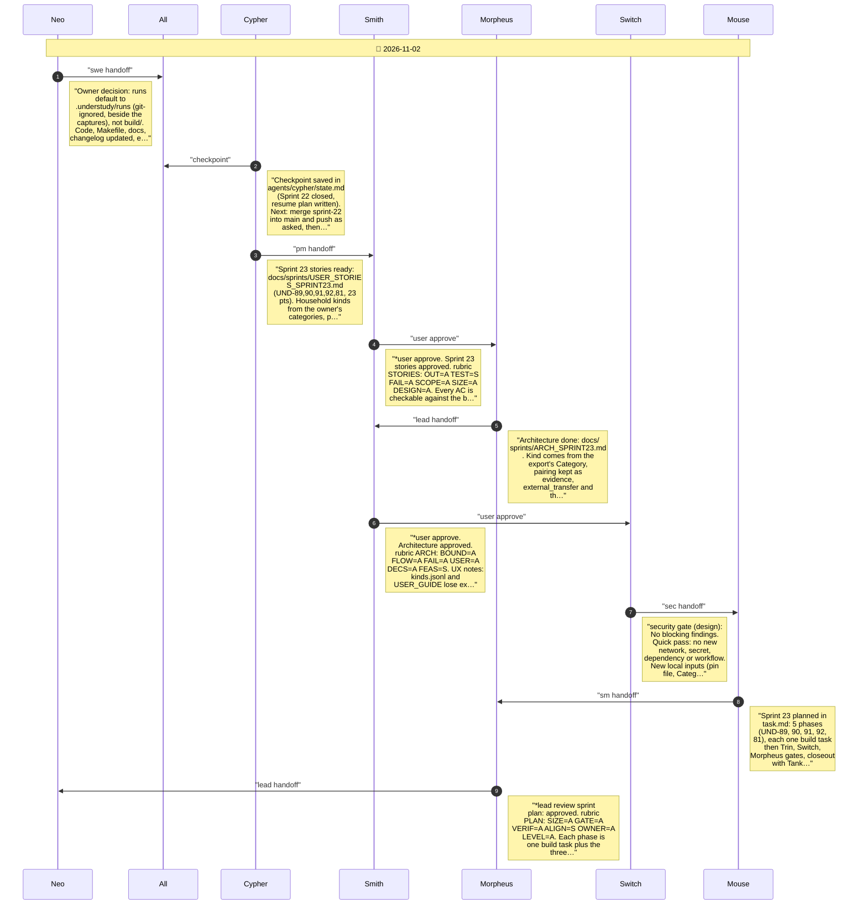

## Phase 1 starts

Phase 1: transfers come from the owner's categories (UND-89)

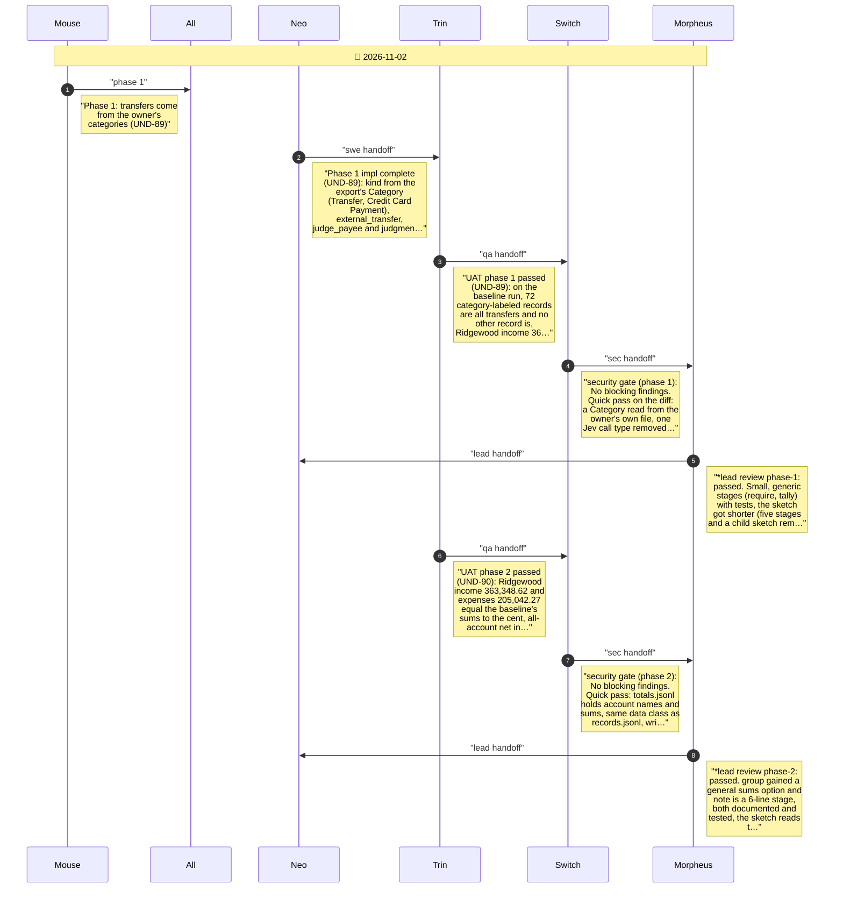

## Phase 1 close-out

- **Trin**: UAT phase 2 passed (UND-90): Ridgewood income 363,348.62 and expenses 205,042.27 equal the baseline's sums to the cent, all-account net in…
- **Switch**: security gate (phase 2): No blocking findings. Quick pass: totals.jsonl holds account names and sums, same data class as records.jsonl, wri…
- **Morpheus**: \*lead review phase-2: passed. group gained a general sums option and note is a 6-line stage, both documented and tested, the sketch reads t…

## Phase 3 starts

Phase 3: merchants for review, as a list (UND-91)

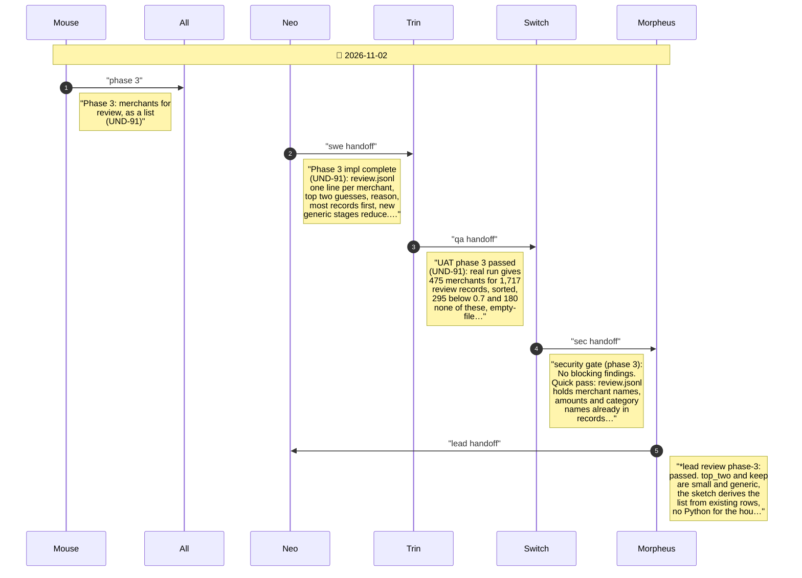

## Phase 3 close-out

- **Trin**: UAT phase 3 passed (UND-91): real run gives 475 merchants for 1,717 review records, sorted, 295 below 0.7 and 180 none of these, empty-file…
- **Switch**: security gate (phase 3): No blocking findings. Quick pass: review.jsonl holds merchant names, amounts and category names already in records…
- **Morpheus**: \*lead review phase-3: passed. top\_two and keep are small and generic, the sketch derives the list from existing rows, no Python for the hou…

## Phase 4 starts

Phase 4: pinned categories are kept (UND-92)

## Phase 4 close-out

- **Neo**: Phase 4 impl complete (UND-92): optional file source for pins (default .understudy/pinned.jsonl), pins checked in two states before any Jev…
- **Trin**: UAT phase 4 passed (UND-92): real run, Amazon 296 and Duane Reade 53 records placed by pin, out of review, bad pins, missing paths and abse…
- **Morpheus**: \*lead review phase-4: passed. Optional source is one schema key, one loader line, one check line, one read branch, all tested, pin checks s…

## Phase 5 starts

Phase 5: the run tells its story (UND-81)

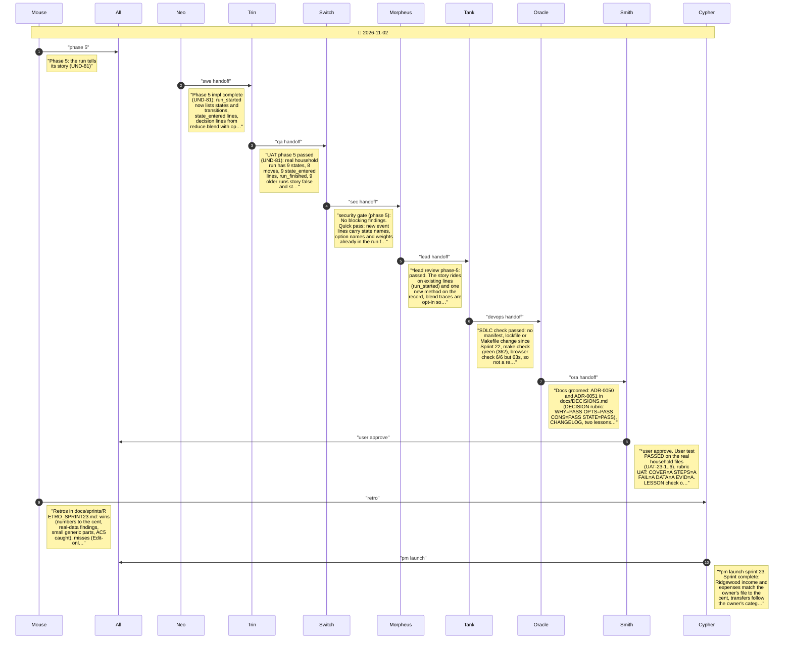

## Phase 5 close-out

- **Tank**: SDLC check passed: no manifest, lockfile or Makefile change since Sprint 22, make check green (362), browser check 6/6 but 63s, so not a re…
- **Oracle**: Docs groomed: ADR-0050 and ADR-0051 in docs/DECISIONS.md (DECISION rubric: WHY=PASS OPTS=PASS CONS=PASS STATE=PASS), CHANGELOG, two lessons…
- **Smith**: \*user approve. User test PASSED on the real household files (UAT-23-1..6). rubric UAT: COVER=A STEPS=A FAIL=A DATA=A EVID=A. LESSON check o…

## Sprint close-out

- **Cypher**: \*pm launch sprint 23. Sprint complete: Ridgewood income and expenses match the owner's file to the cent, transfers follow the owner's categ…

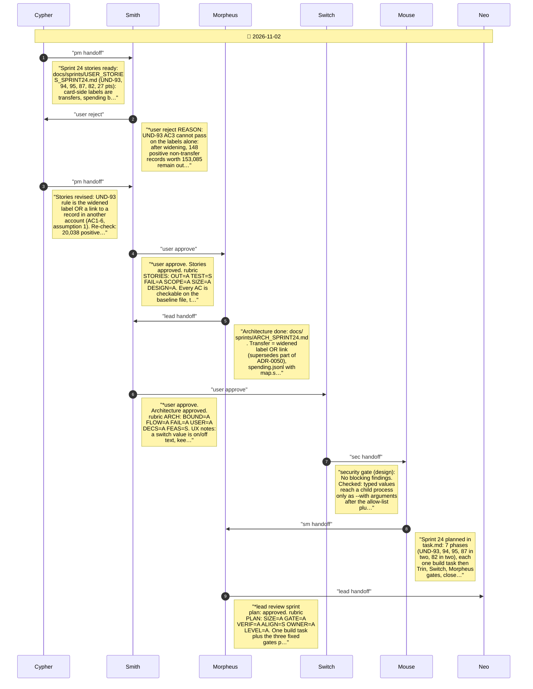

## Phase 1 starts

Phase 1: card payments and moves between accounts are not spending (UND-93)

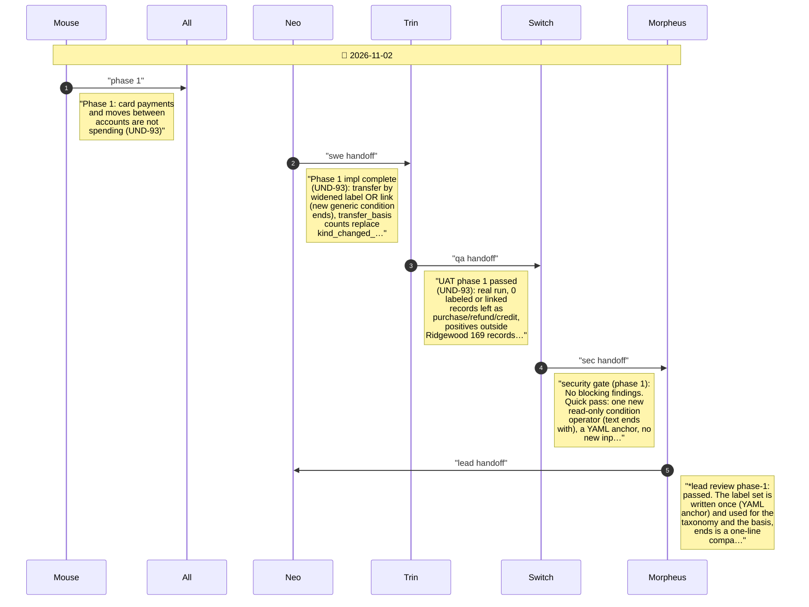

## Phase 1 close-out

- **Trin**: UAT phase 1 passed (UND-93): real run, 0 labeled or linked records left as purchase/refund/credit, positives outside Ridgewood 169 records…
- **Switch**: security gate (phase 1): No blocking findings. Quick pass: one new read-only condition operator (text ends with), a YAML anchor, no new inp…
- **Morpheus**: \*lead review phase-1: passed. The label set is written once (YAML anchor) and used for the taxonomy and the basis, ends is a one-line compa…

## Phase 2 starts

Phase 2: where the money goes (UND-94)

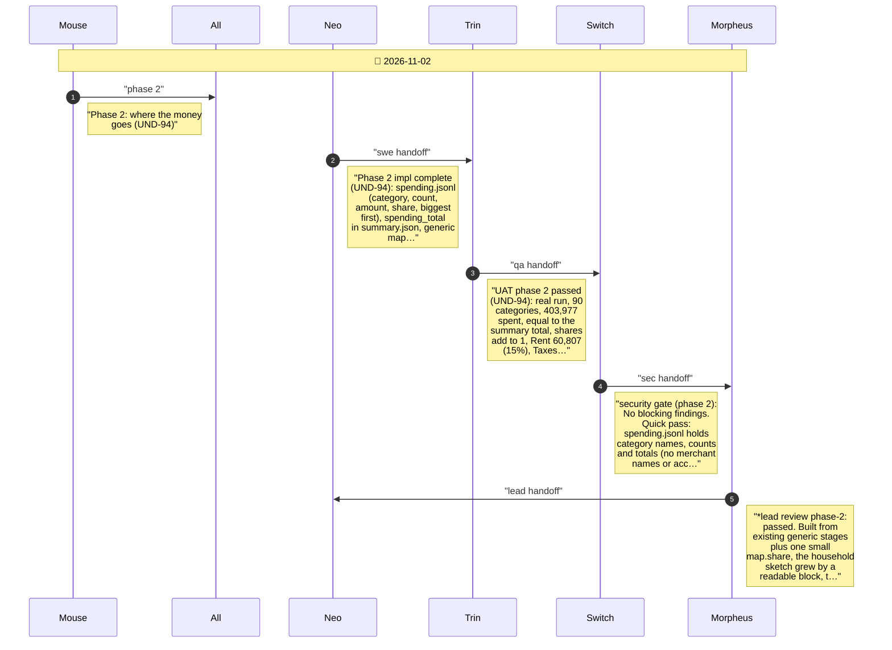

## Phase 2 close-out

- **Trin**: UAT phase 2 passed (UND-94): real run, 90 categories, 403,977 spent, equal to the summary total, shares add to 1, Rent 60,807 (15%), Taxes…
- **Switch**: security gate (phase 2): No blocking findings. Quick pass: spending.jsonl holds category names, counts and totals (no merchant names or acc…
- **Morpheus**: \*lead review phase-2: passed. Built from existing generic stages plus one small map.share, the household sketch grew by a readable block, t…

## Phase 3 starts

Phase 3: the console shows what the money goes on (UND-95)

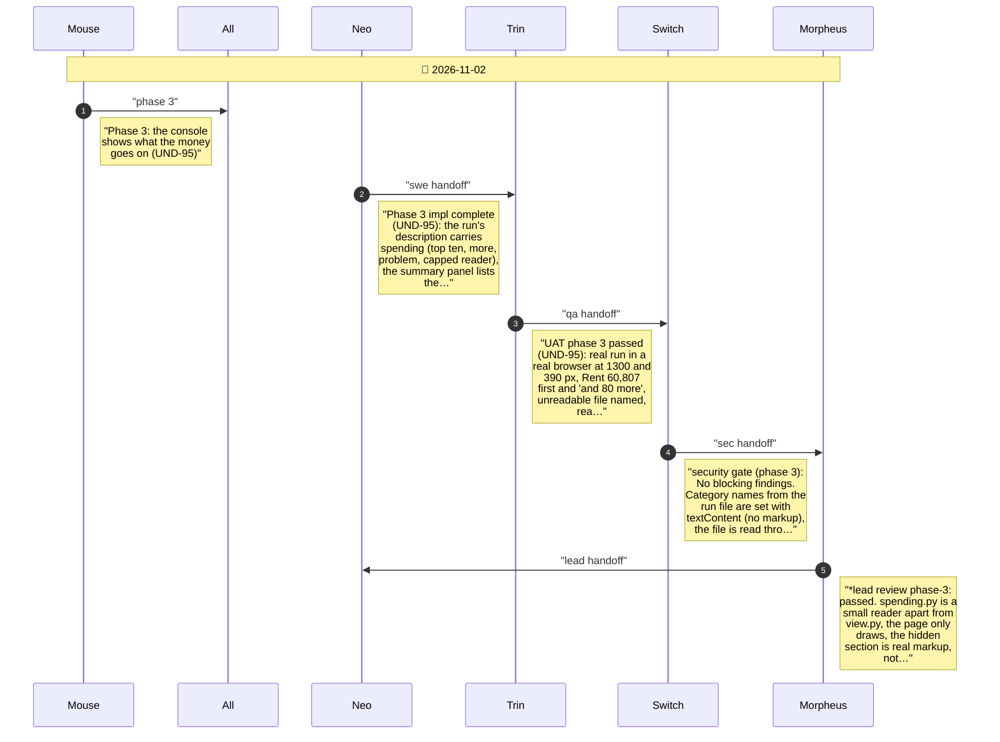

## Phase 3 close-out

- **Neo**: Phase 3 impl complete (UND-95): the run's description carries spending (top ten, more, problem, capped reader), the summary panel lists the…
- **Trin**: UAT phase 3 passed (UND-95): real run in a real browser at 1300 and 390 px, Rent 60,807 first and 'and 80 more', unreadable file named, rea…
- **Morpheus**: \*lead review phase-3: passed. spending.py is a small reader apart from view.py, the page only draws, the hidden section is real markup, not…

## Phase 4 starts

Phase 4: inputs are declared (UND-87 part 1)

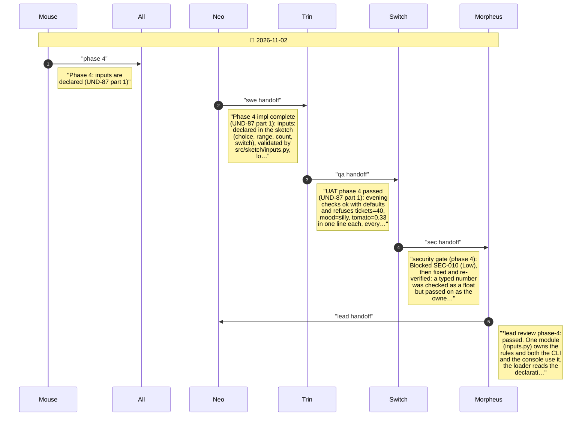

## Phase 4 close-out

- **Trin**: UAT phase 4 passed (UND-87 part 1): evening checks ok with defaults and refuses tickets=40, mood=silly, tomato=0.33 in one line each, every…
- **Switch**: security gate (phase 4): Blocked SEC-010 (Low), then fixed and re-verified: a typed number was checked as a float but passed on as the owne…
- **Morpheus**: \*lead review phase-4: passed. One module (inputs.py) owns the rules and both the CLI and the console use it, the loader reads the declarati…

## Phase 5 starts

Phase 5: the right control for each value (UND-87 part 2)

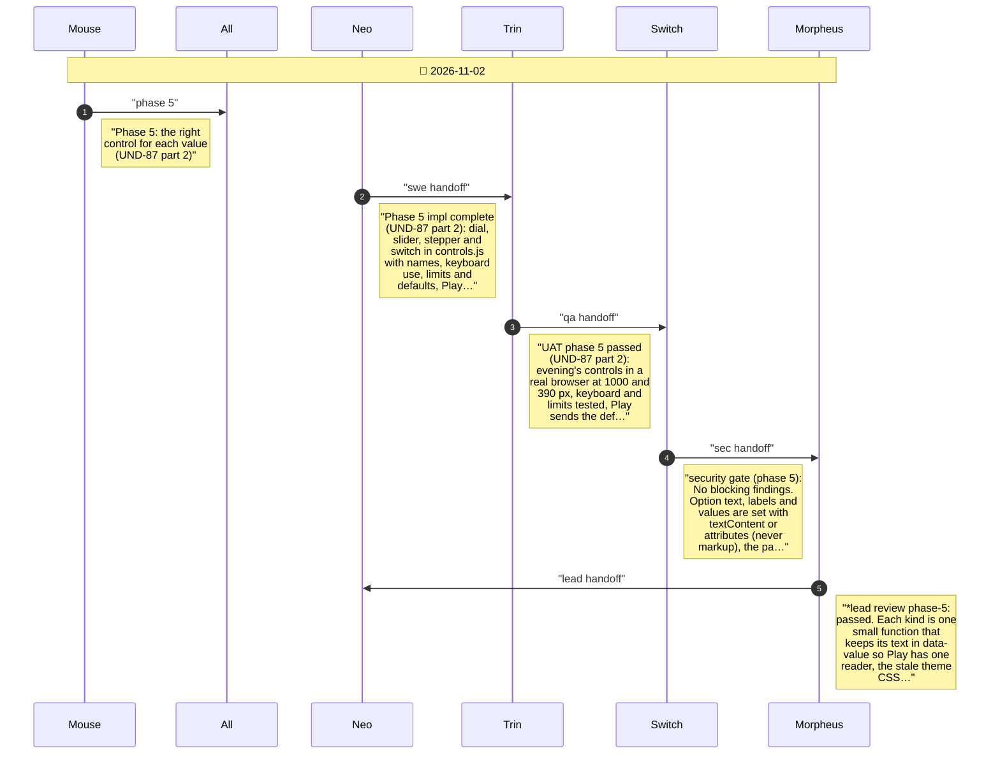

## Phase 5 close-out

- **Neo**: Phase 5 impl complete (UND-87 part 2): dial, slider, stepper and switch in controls.js with names, keyboard use, limits and defaults, Play…
- **Trin**: UAT phase 5 passed (UND-87 part 2): evening's controls in a real browser at 1000 and 390 px, keyboard and limits tested, Play sends the def…
- **Morpheus**: \*lead review phase-5: passed. Each kind is one small function that keeps its text in data-value so Play has one reader, the stale theme CSS…

## Phase 6 starts

Phase 6: the statechart is laid out (UND-82 part 1)

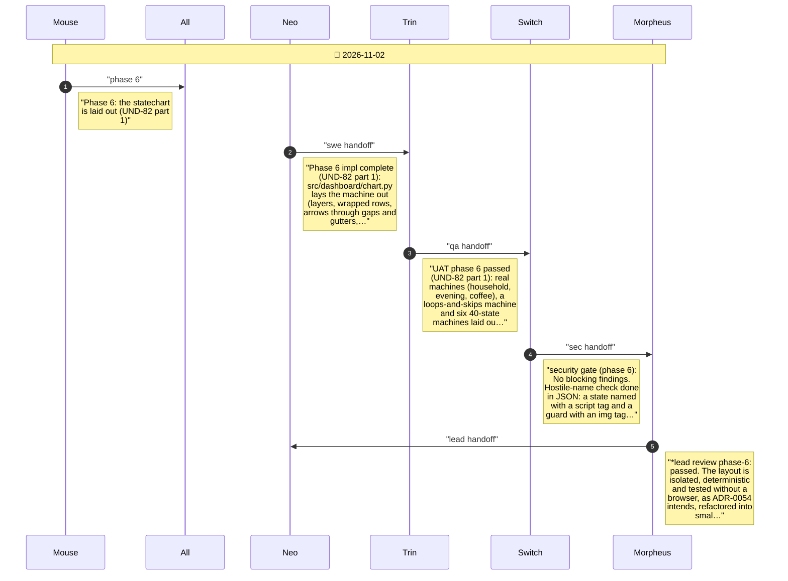

## Phase 6 close-out

- **Neo**: Phase 6 impl complete (UND-82 part 1): src/dashboard/chart.py lays the machine out (layers, wrapped rows, arrows through gaps and gutters,…
- **Trin**: UAT phase 6 passed (UND-82 part 1): real machines (household, evening, coffee), a loops-and-skips machine and six 40-state machines laid ou…
- **Morpheus**: \*lead review phase-6: passed. The layout is isolated, deterministic and tested without a browser, as ADR-0054 intends, refactored into smal…

## Phase 7 starts

Phase 7: see the statechart (UND-82 part 2)

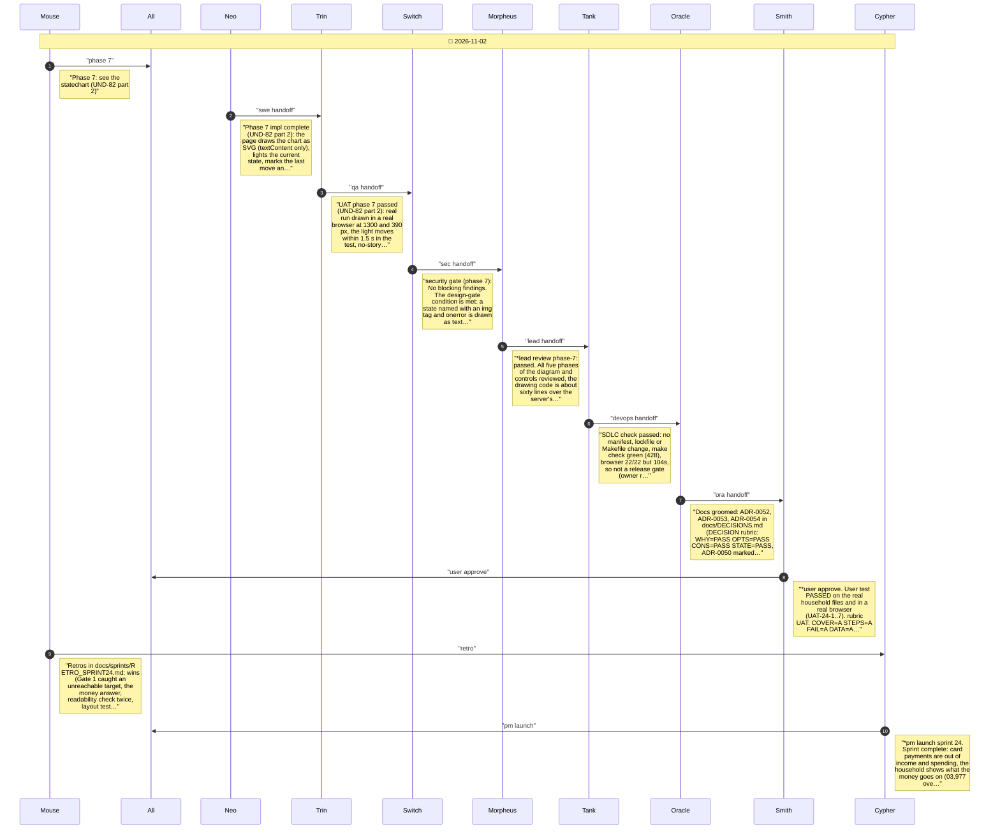

## Phase 7 close-out

- **Tank**: SDLC check passed: no manifest, lockfile or Makefile change, make check green (428), browser 22/22 but 104s, so not a release gate (owner r…
- **Oracle**: Docs groomed: ADR-0052, ADR-0053, ADR-0054 in docs/DECISIONS.md (DECISION rubric: WHY=PASS OPTS=PASS CONS=PASS STATE=PASS, ADR-0050 marked…
- **Smith**: \*user approve. User test PASSED on the real household files and in a real browser (UAT-24-1..7). rubric UAT: COVER=A STEPS=A FAIL=A DATA=A…

## Sprint close-out

- **Cypher**: \*pm launch sprint 24. Sprint complete: card payments are out of income and spending, the household shows what the money goes on (03,977 ove…

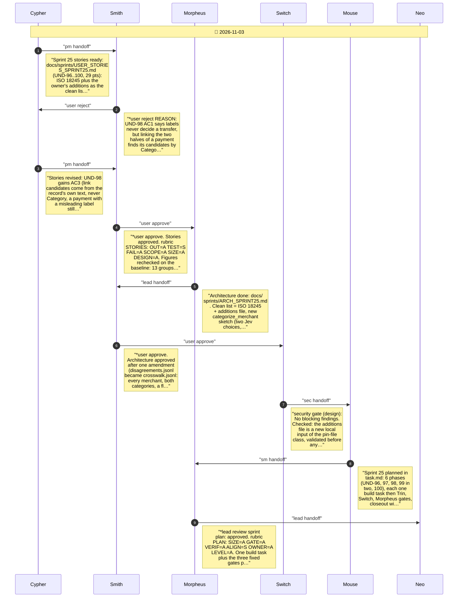

## Phase 1 starts

Phase 1: a clean list of categories (UND-96)

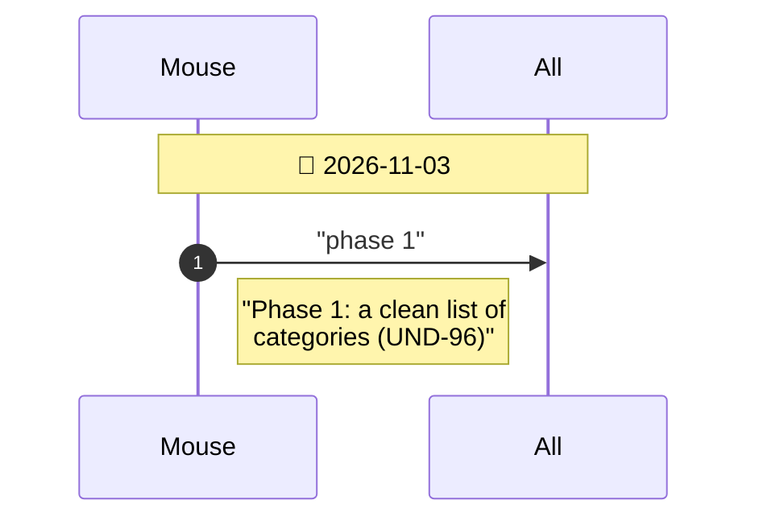
