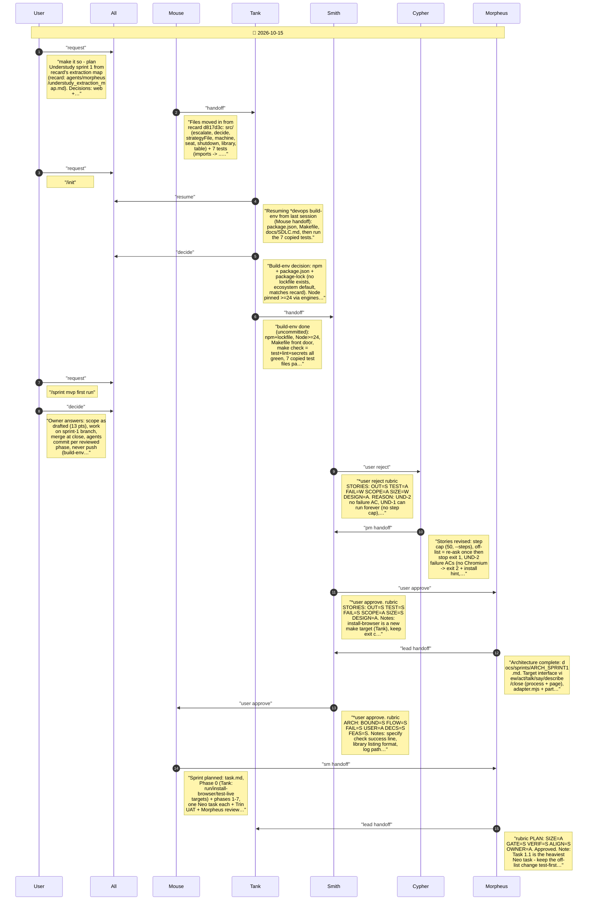
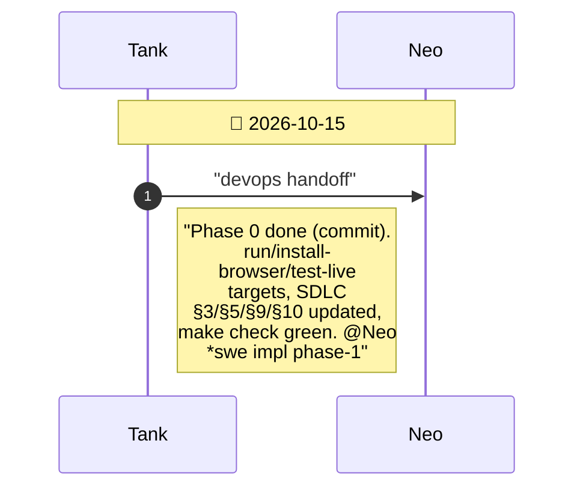
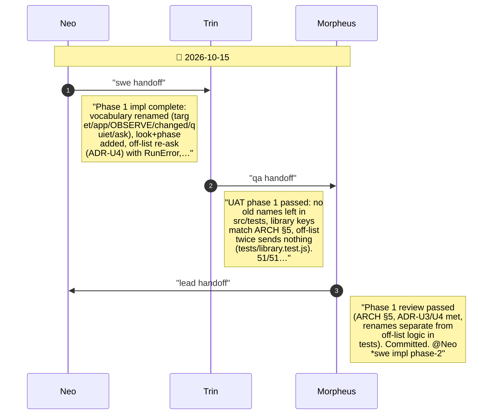
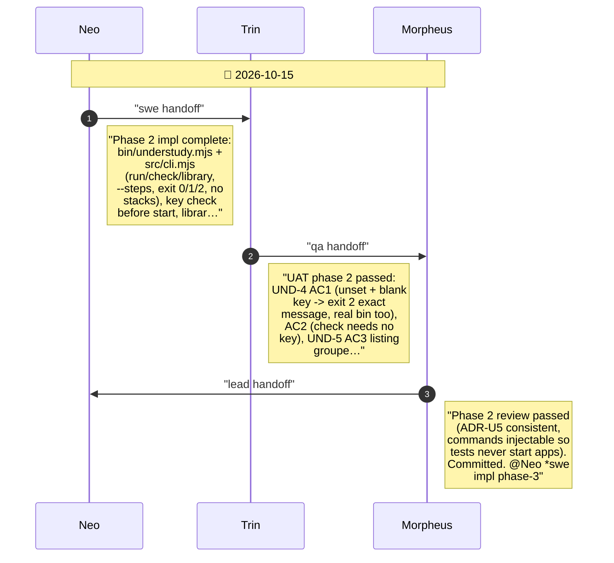
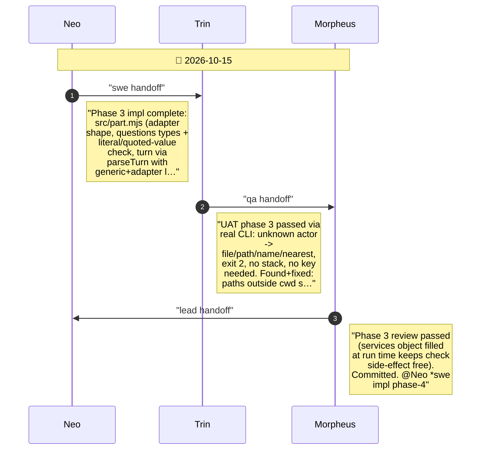
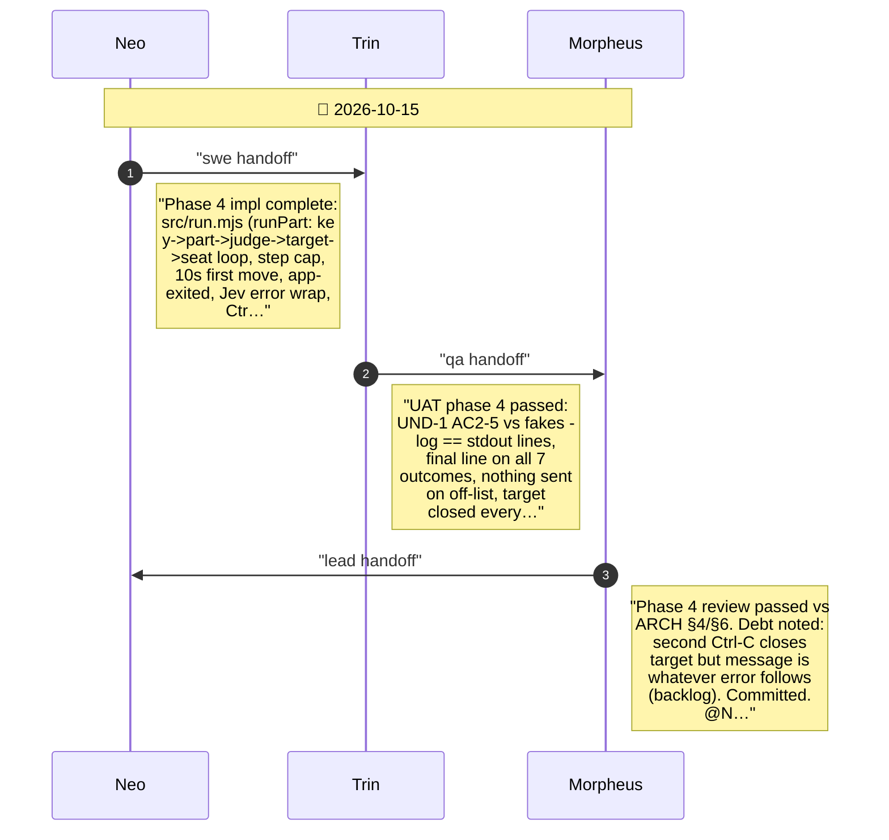
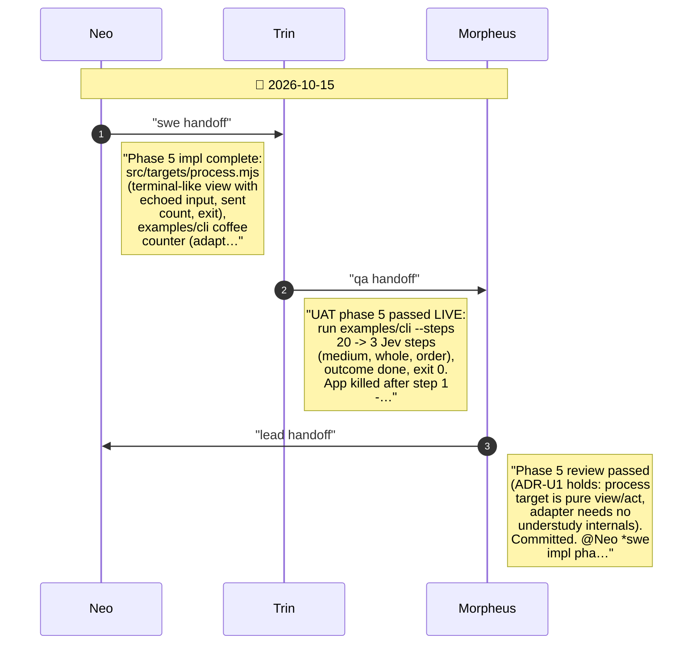
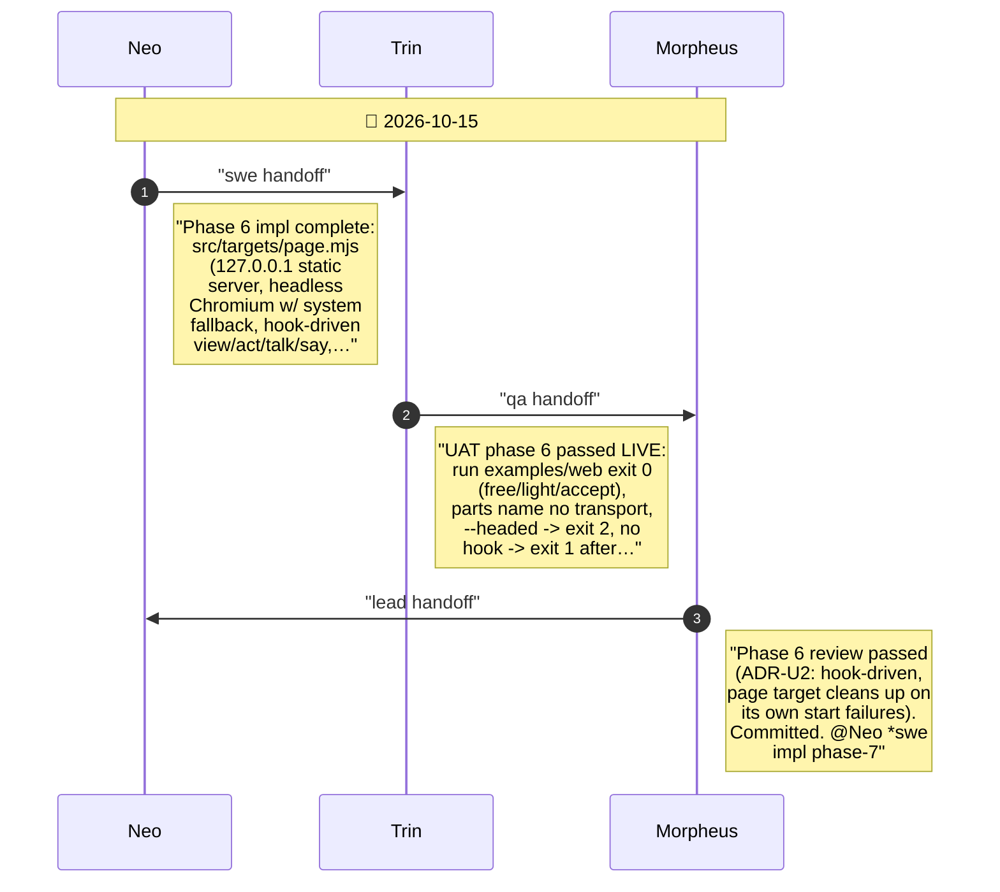
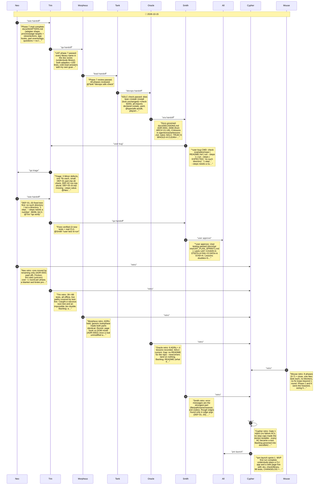

# CHAT_SPRINT_1 — Sprint Archive

## Summary

Sprint 1 (MVP first run): Tank built the npm/Makefile env and SDLC; Smith rejected then approved stories (step cap, failure ACs) and approved the architecture (target interface, page hook, generic look/phase, off-list re-ask, exit 0/1/2). Phases 0-7 each passed Trin UAT and Morpheus review: vocabulary, CLI, part check, run loop, process target + CLI example (live), page target + web example (live), ADAPTERS.md. Close: SDLC check green, 6 ADRs + 4 lessons, Smith found 3 minor defects (fixed), retro fed docs/BACKLOG.md, Cypher launched. Merge/tag await owner.

---

## Planning

---

## Phase 0

Phase 0: make targets run/install-browser/test-live + SDLC update

---

## Phase 1

Phase 1: generic vocabulary + look/phase + off-list re-ask

---

## Phase 2

Phase 2: understudy command, key check, library listing

---

## Phase 3

Phase 3: part loader and understudy check

---

## Phase 4

Phase 4: the run loop with test doubles

---

## Phase 5

Phase 5: process target + CLI example, live Jev

---

## Phase 6

Phase 6: page target + web example

---

## Phase 7

Phase 7: docs/ADAPTERS.md

