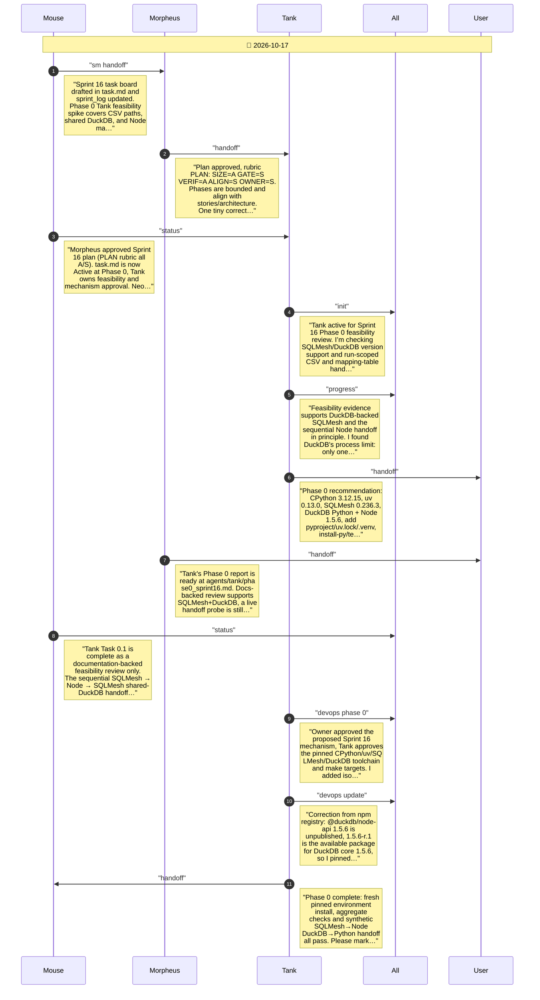
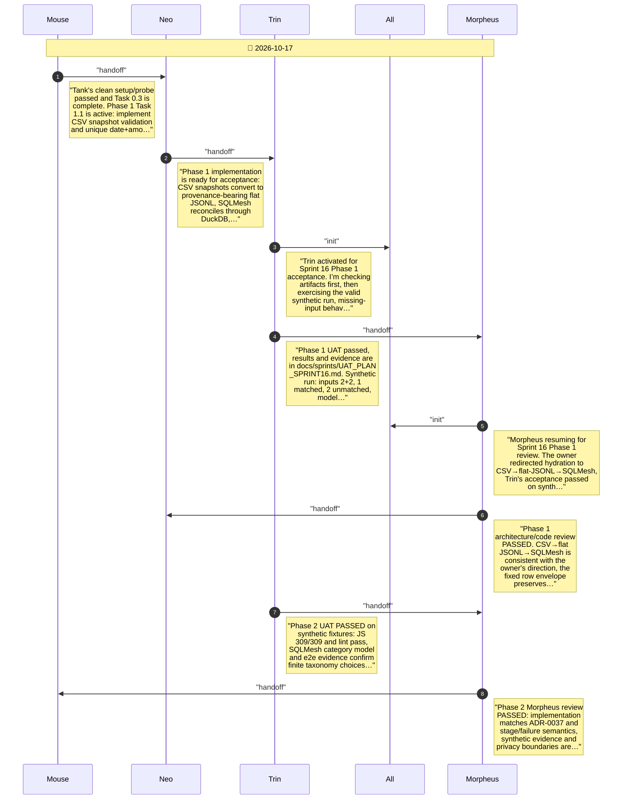

# CHAT_SPRINT_16 — Sprint Archive

## Summary

Sprint 16 built the staged local ETL: Monarch and Amex CSVs validated, snapshotted and converted to JSONL, reconciled with SQLMesh on DuckDB, merchants categorised once each by Jev from a fixed taxonomy, with a review file and a summary. Phases 0-2 passed UAT and Morpheus review on 2026-10-17; on 2026-10-27 the owner accepted it. The real-data run matched only 26 rows because it pairs same-sign amounts. On 2026-10-27 the owner chose Python for all of understudy (python-statemachine YAML, SQL on DuckDB, no XML), and the team drafted Sprint 17 for the sign-flipped match, transfers, refunds and Noul/MCC category naming.

---

## Planning

```mermaid
%%{init: {"sequence": {"messageFontSize": 14, "noteFontSize": 18, "actorFontSize": 14}}}%%
sequenceDiagram
    autonumber
    participant User
    participant All
    participant Bob
    participant Neo
    participant Morpheus
    participant Mouse
    participant Cypher
    participant Smith
    participant Oracle
    Note over User,Oracle: 📅 2026-10-17
    User->>All: "request"
    Note right of User: "User invoked *init,<br/>starting fresh Bob<br/>session. Checking<br/>current links and<br/>project context because<br/>no active handoff<br/>appears in recent chat."
    Bob->>All: "ready"
    Note right of Bob: "Bob Protocol<br/>initialized. Team ready.<br/>No active handoff was<br/>found, discovery links<br/>were reconciled, and no<br/>tests or builds were run<br/>because…"
    Neo->>All: "init"
    Note right of Neo: "Activating Neo for<br/>dashboard diagram<br/>alignment and CRT<br/>geometry fix. I’m<br/>tracing the render path<br/>first to locate the<br/>visual root cause."
    Neo->>User: "handoff"
    Note right of Neo: "Steampunk now uses a<br/>rectangular CRT, the<br/>statechart is explicitly<br/>centered across themes,<br/>and circular ring art is<br/>hidden while the power…"
    Neo->>User: "swe fix"
    Note right of Neo: "Owner requested the loop<br/>for the dashboard<br/>alignment/CRT issue. I’m<br/>reopening diagnosis from<br/>the pre-change version<br/>to establish a reproduc…"
    Neo->>User: "diagnosis"
    Note right of Neo: "Reproduction failed:<br/>browser reports the<br/>steampunk display is<br/>16px wide. Root cause:<br/>the desktop flex rule<br/>retains width:auto,<br/>which relied…"
    Neo->>Morpheus: "handoff"
    Note right of Neo: "Implementation and<br/>verification complete:<br/>browser 8/8, unit<br/>300/300, lint passed.<br/>Reproduction found 16px<br/>steampunk width,<br/>explicit desktop…"
    Morpheus->>Neo: "init"
    Note right of Morpheus: "Morpheus reviewing the<br/>dashboard CRT sizing and<br/>alignment changes. I’m<br/>checking the final diff<br/>and test coverage for<br/>unintended layout chan…"
    Morpheus->>Bob: "handoff"
    Note right of Morpheus: "Morpheus review passed:<br/>desktop width fix is<br/>minimal, explicit SVG<br/>centering is consistent<br/>across themes, and<br/>unit/browser coverage<br/>matches…"
    Bob->>All: "init"
    Note right of Bob: "Activating Bob to<br/>broadcast the owner’s<br/>testing lesson. I’ll<br/>update shared guidance<br/>so agents start with<br/>unit coverage and<br/>escalate only fo…"
    Bob->>All: "handoff"
    Note right of Bob: "Updated shared guidance<br/>to start CSS testing<br/>with unit coverage and<br/>climb only for named<br/>gaps, noted unsupported<br/>test filtering and<br/>complet…"
    User->>All: "request"
    Note right of User: "User asks for a real<br/>production scenario<br/>showing understudy on<br/>complex multi-step work<br/>requiring deterministic<br/>rules, judgement, and<br/>many r…"
    Mouse->>All: "init"
    Note right of Mouse: "Mouse on deck for sprint<br/>scenario shaping. SDLC<br/>exists, current<br/>dashboard is running on<br/>LAN. I’m checking the<br/>product fit before<br/>recommendi…"
    Mouse->>User: "handoff"
    Note right of Mouse: "Scenario proposal ready:<br/>production AP invoice<br/>reconciliation is a<br/>strong demo of rules +<br/>judgement + high row<br/>volume. Read-only first,<br/>aud…"
    User->>All: "request"
    Note right of User: "Owner asks whether I can<br/>access a linked Google<br/>Sheet as the basis for a<br/>larger production<br/>example. Why: verify<br/>available data before<br/>propo…"
    Mouse->>User: "handoff"
    Note right of Mouse: "Owner asked me to wait<br/>for direction before<br/>inspecting the workbook.<br/>XLSX export access is<br/>confirmed, but tabs have<br/>not been enumerated, te…"
    User->>All: "request"
    Note right of User: "Owner asks me to inspect<br/>their procedure document<br/>for creating the<br/>provided transaction<br/>sheet and assess<br/>reproducing that<br/>workflow with und…"
    Mouse->>Morpheus: "handoff"
    Note right of Mouse: "Handoff to Morpheus:<br/>owner wants to reproduce<br/>the household<br/>transaction-cleaning<br/>procedure with<br/>Understudy and notes we<br/>may need primitives…"
    User->>All: "request"
    Note right of User: "User clarifies Google<br/>Sheets is only I/O, the<br/>goal is reusable data<br/>operators in Understudy.<br/>Morpheus will focus the<br/>architecture on core j…"
    Morpheus->>All: "init"
    Note right of Morpheus: "Morpheus resuming<br/>architecture discovery.<br/>I’m checking current<br/>decision semantics and<br/>data limits before<br/>proposing a core<br/>transform model."
    Morpheus->>User: "handoff"
    Note right of Morpheus: "Architecture<br/>recommendation: Google<br/>Sheets stays an I/O<br/>adapter, Understudy owns<br/>a deterministic row<br/>pipeline (composite-key<br/>join, declarat…"
    User->>All: "request"
    Note right of User: "Owner asks whether Jev<br/>should classify<br/>categories/tags and help<br/>create new categories<br/>and reusable mappings,<br/>under the quantitative-<br/>logic /…"
    Morpheus->>All: "init"
    Note right of Morpheus: "Morpheus resuming the<br/>data-operator<br/>architecture discussion.<br/>I’m distinguishing per-<br/>row judgement from<br/>promoting reusable<br/>taxonomy and mapp…"
    Morpheus->>User: "handoff"
    Note right of Morpheus: "Agreed with the rule:<br/>deterministic logic<br/>handles explicit<br/>measurable conditions,<br/>Jev handles semantic<br/>categories and tags. Jev<br/>can propose…"
    User->>All: "request"
    Note right of User: "Owner clarifies the<br/>input has no normalized<br/>merchant/category<br/>mappings, Understudy<br/>must discover them while<br/>evaluating the raw data.<br/>Why: u…"
    Morpheus->>All: "init"
    Note right of Morpheus: "Morpheus resuming: I’m<br/>revising the proposal so<br/>normalization maps and<br/>taxonomy emerge from raw<br/>rows during the run."
    Morpheus->>User: "handoff"
    Note right of Morpheus: "Correction incorporated:<br/>no normalized mapping<br/>tables are preloaded.<br/>While streaming raw<br/>rows, Jev classifies<br/>unknowns and can propose<br/>cate…"
    Morpheus->>All: "research"
    Note right of Morpheus: "Owner prefers an<br/>existing ELT library<br/>with YAML-described<br/>pipelines over a bespoke<br/>operator engine, I’m<br/>checking candidates and<br/>the Jev int…"
    Morpheus->>User: "handoff"
    Note right of Morpheus: "Architecture finding:<br/>SQLMesh/dbt provide SQL<br/>models plus YAML<br/>configuration, dlt has<br/>joins but Python-defined<br/>transforms. Jev's<br/>discovered…"
    Morpheus->>User: "handoff"
    Note right of Morpheus: "Owner accepts SQL+YAML<br/>and proposes MCP<br/>ingestion. Existing MCP<br/>target is interactive,<br/>not bulk ETL, use<br/>deterministic paginated<br/>ingestion…"
    Morpheus->>User: "handoff"
    Note right of Morpheus: "Owner says pagination<br/>stays below ETL ops:<br/>pre-run hydration stages<br/>materialize MCP data<br/>into DuckDB, and a<br/>transition can request<br/>another…"
    Morpheus->>User: "note"
    Note right of Morpheus: "Scale boundary recorded:<br/>the ~4.7k-row<br/>transaction sheet is<br/>near Understudy's larger<br/>current workload, target<br/>straightforward local<br/>DuckDB…"
    Morpheus->>User: "note"
    Note right of Morpheus: "Owner sets category<br/>policy: provide Jev a<br/>rich explicit<br/>category/subcategory<br/>taxonomy and a Misc<br/>fallback. Keep outputs<br/>bounded to valid ta…"
    Morpheus->>User: "note"
    Note right of Morpheus: "Sprint 16 scope update:<br/>start with a small local<br/>fixture for the end-to-<br/>end ETL example, defer<br/>Google Sheets/MCP<br/>integration to a later<br/>spr…"
    Morpheus->>User: "note"
    Note right of Morpheus: "Correction: owner wants<br/>the provided<br/>transactions CSV as<br/>Sprint 16 input, not a<br/>synthetic fixture,<br/>Sheets MCP integration<br/>remains deferred.…"
    Morpheus->>User: "note"
    Note right of Morpheus: "Owner confirms Sprint 16<br/>has two provided CSV<br/>sources with overlapping<br/>transactions, so the<br/>first slice can cover<br/>cross-source<br/>reconciliati…"
    Morpheus->>User: "note"
    Note right of Morpheus: "Source identity<br/>clarified for Sprint 16:<br/>Monarch export plus Amex<br/>export, with overlap.<br/>Preserve each source's<br/>provenance through<br/>reconcili…"
    Morpheus->>Cypher: "handoff"
    Note right of Morpheus: "Starting Sprint 16<br/>planning on isolated<br/>sprint-16 worktree, SDLC<br/>is present and branch is<br/>cut from main. Scope:<br/>local Monarch+Amex CSV<br/>hydr…"
    Cypher->>Smith: "pm start"
    Note right of Cypher: "Cypher starting Sprint<br/>16 story draft in<br/>sprint-16 worktree.<br/>Reviewed SDLC, Mouse<br/>artifacts, Oracle<br/>lessons/memory, recent<br/>chat, and story…"
    Cypher->>Smith: "pm handoff"
    Note right of Cypher: "Sprint 16 stories<br/>drafted: three ordered<br/>stories, 18 pts, local<br/>Monarch+Amex CSV<br/>hydration/reconciliation<br/>with provenance, Jev<br/>bounded rich…"
    Smith->>All: "init"
    Note right of Smith: "Activating Smith for<br/>Sprint 16 Gate 1 story<br/>review."
    Smith->>Morpheus: "user approve"
    Note right of Smith: "*user approve. Sprint 16<br/>stories meet Gate 1,<br/>scope matches the agreed<br/>two local exports, recon<br/>ciliation/provenance,<br/>fixed Jev taxonomy wit…"
    Morpheus->>Smith: "handoff"
    Note right of Morpheus: "Architecture drafted in <br/>docs/sprints/ARCH_SPRINT<br/>16.md, self-check rubric<br/>ARCH: BOUND=A FLOW=A<br/>FAIL=A USER=A DECS=A<br/>FEAS=A. SQLMesh+DuckDB<br/>h…"
    Smith->>All: "init"
    Note right of Smith: "Resuming Smith for<br/>Sprint 16 Gate 2<br/>architecture review,<br/>reading the drafted<br/>boundaries and failure<br/>paths before approving<br/>the planning han…"
    Smith->>Morpheus: "user reject"
    Note right of Smith: "Gate 2 rejects on BOUND<br/>and FLOW: the CSV<br/>hydrator table says it<br/>loads<br/>raw.monarch/raw.amex,<br/>while the<br/>diagram/sequence assign<br/>raw hydratio…"
    Morpheus->>Smith: "handoff"
    Note right of Morpheus: "Revised docs/sprints/ARC<br/>H_SPRINT16.md for Gate<br/>2: CSV<br/>snapshot/validator only<br/>checks headers, copies<br/>files and hashes,<br/>SQLMesh is the sole…"
    Smith->>All: "resume"
    Note right of Smith: "Resuming Smith for Gate<br/>2 re-review, Morpheus<br/>has assigned CSV<br/>snapshot validation<br/>separately from SQLMesh<br/>loading, so I am<br/>checking that t…"
    Smith->>Mouse: "user approve"
    Note right of Smith: "Gate 2 approves the<br/>revision: CSV<br/>snapshot/validation now<br/>only prepares immutable<br/>files, and SQLMesh alone<br/>loads raw DuckDB tables<br/>and runs…"
    Morpheus->>Oracle: "handoff"
    Note right of Morpheus: "Gate 2 approved<br/>architecture. Please<br/>record proposed Sprint<br/>16 decision in<br/>docs/DECISIONS.md:<br/>SQLMesh+DuckDB owns<br/>deterministic<br/>transforms,…"
    Oracle->>All: "resume"
    Note right of Oracle: "Resuming Oracle for<br/>Sprint 16 decision<br/>record, architecture<br/>passed Smith Gate 2 with<br/>Python runtime approval<br/>still pending."
    Oracle->>Mouse: "handoff"
    Note right of Oracle: "Recorded proposed<br/>ADR-0037: SQLMesh +<br/>DuckDB owns<br/>deterministic ETL,<br/>Understudy coordinates<br/>staged hydration and<br/>run-scoped Jev category<br/>ma…"
    Mouse->>All: "init"
    Note right of Mouse: "Mouse active for Sprint<br/>16 plan: reviewed<br/>approved stories and<br/>architecture, SDLC, task<br/>template, and current<br/>sprint context."
```

---

## Phase 0

Phase 0 reserves Tank time to prove SQLMesh/Python feasibility and obtain mechanism approval before implementation; the board then delivers CSV reconciliation and Jev-guided review in two bounded slices.

---

## Phase 1

Phase 1 delivers safe local CSV snapshots and deterministic reconciliation with source provenance, backed by synthetic fixtures; no private transaction file goes into git or chat.

---

## Close

Phase close: CSV-to-flat-JSONL reconciliation and bounded Jev classification both passed UAT and Morpheus review. Beginning sprint closeout with clean environment verification, artifact grooming, owner acceptance, retrospectives, and launch readiness. Why: record the final gate sequence and evidence boundary.

```mermaid
%%{init: {"sequence": {"messageFontSize": 14, "noteFontSize": 18, "actorFontSize": 14}}}%%
sequenceDiagram
    autonumber
    participant Tank
    participant Oracle
    participant Smith
    participant Trin
    participant User
    participant Neo
    participant All
    participant Cypher
    participant Morpheus
    participant Mouse
    Note over Tank,Mouse: 📅 2026-10-17
    Tank->>Oracle: "handoff"
    Note right of Tank: "Tank closeout passed:<br/>distclean, locked<br/>install, full check<br/>(tests/lint/secrets),<br/>and repeated install<br/>succeeded, updated<br/>verification reco…"
    Tank->>Oracle: "handoff"
    Note right of Tank: "Correction: Tank<br/>closeout passed<br/>distclean, locked<br/>install, full check<br/>(tests/lint/secrets),<br/>and repeated install,<br/>SDLC verification<br/>record…"
    Oracle->>Smith: "handoff"
    Note right of Oracle: "Docs groomed and cross-<br/>checked,<br/>SDLC/DECISION/ARCH<br/>rubrics are all A or<br/>better, no rubric blocks<br/>sit outside templates,<br/>and diff check is c…"
    Smith->>Trin: "handoff"
    Note right of Smith: "Smith closeout review<br/>found a STORY-UND-48 AC4<br/>coverage gap: UAT has<br/>only 2+2 rows, while the<br/>target is about 4,700<br/>reconciled transactions…"
    Trin->>Smith: "handoff"
    Note right of Trin: "Trin closed the scale<br/>gap: synthetic<br/>4,700-pair run produced<br/>4,700<br/>matched/categorized<br/>rows, one Jev-double<br/>batch for five<br/>merchants, and a…"
    Smith->>User: "review"
    Note right of Smith: "Smith reviewed the final<br/>UAT: rubric UAT: COVER=S<br/>STEPS=A FAIL=S DATA=S<br/>EVID=A. Synthetic<br/>4,700-pair workload,<br/>bounded Jev choices,<br/>failure…"
    Neo->>All: "swe progress"
    Note right of Neo: "Owner run completed with<br/>a reviewable<br/>walkthrough. Found and<br/>fixed Amex MM/DD/YYYY<br/>hydration by normalizing<br/>staged dates to ISO<br/>while retai…"
    Neo->>All: "swe progress"
    Note right of Neo: "Fixed duplicate-only<br/>keys wrongly marked<br/>ambiguous, rerun shows<br/>26 matched, 18,791<br/>unmatched, 0<br/>invalid/ambiguous.<br/>Opposite-sign payment<br/>le…"
    Neo->>All: "swe progress"
    Note right of Neo: "Walkthrough now reports<br/>3,484 unique opposite-<br/>sign pairs kept<br/>separate, fixture covers<br/>this diagnostic.<br/>Reconciliation remains<br/>26 matched/1…"
    Note over Tank,Mouse: 📅 2026-10-18
    Neo->>All: "checkpoint"
    Note right of Neo: "Checkpoint saved in<br/>agents/neo/state.md.<br/>Workbook comparison<br/>complete: 4,666/4,672<br/>transaction IDs matched,<br/>exact-label scores and<br/>workbook…"
    Neo->>User: "handoff"
    Note right of Neo: "Comparison ready: build/<br/>runs/1792273673200-<br/>4223e1cb-2ccc-4b98-8539-<br/>79b03e266b93/category-<br/>comparison.md and .csv.<br/>Exact matches are not a<br/>se…"
    Note over Tank,Mouse: 📅 2026-10-27
    Cypher->>Morpheus: "decision"
    Note right of Cypher: "Owner decision: Sprint<br/>16 ETL is Node-only<br/>(DuckDB + SQL files +<br/>YAML config), no<br/>SQLMesh/Python, so no<br/>new language and no Tank<br/>Phase 0 fo…"
    Cypher->>Morpheus: "decision"
    Note right of Cypher: "Owner decision: category<br/>list = Monarch's<br/>existing 180 categories<br/>+ a 'none of the above'<br/>option, Jev confidence<br/>(low pick or none-of-<br/>the-a…"
    Cypher->>Morpheus: "decision"
    Note right of Cypher: "Owner decisions: (1)<br/>new-category names come<br/>from the MCC (ISO 18245)<br/>description list, passed<br/>to Jev to select (group<br/>then code, list too…"
    Cypher->>Morpheus: "decision"
    Note right of Cypher: "Owner principle:<br/>understudy IO is JSONL<br/>in, JSONL out (general,<br/>not only Sprint 16). So<br/>the reconciled result is<br/>JSONL (one record per<br/>tran…"
    Cypher->>All: "decision"
    Note right of Cypher: "Owner decisions: matched<br/>transfers (e.g.<br/>Ridgewood debit paying<br/>Amex) stay as TWO linked<br/>records, both marked<br/>transfer and excluded<br/>from sp…"
    Cypher->>All: "decision"
    Note right of Cypher: "Owner platform<br/>decisions: Python for<br/>all, replacing Node<br/>outright, no XML, invent<br/>no ETL language or state<br/>machine format<br/>(SQL/SQLMesh, pyt…"
    Neo->>Cypher: "retro"
    Note right of Neo: "Neo retro: the SQLMesh-<br/>then-Node-then-SQLMesh<br/>handoff on one DuckDB<br/>file works but is the<br/>fragile seam, Amex<br/>MM/DD/YYYY dates only<br/>surfaced…"
    Trin->>Cypher: "retro"
    Note right of Trin: "Trin retro: 310 JS +<br/>Python tests, lint and<br/>gitleaks green, all UAT<br/>on synthetic fixtures,<br/>so the matching gap only<br/>showed on real data. Ba…"
    Morpheus->>Cypher: "retro"
    Note right of Morpheus: "Morpheus retro: ADR-0037<br/>holds (SQL owns<br/>relational work,<br/>understudy owns Jev<br/>decisions). Revisit: the<br/>date+amount same-sign<br/>rule was taken…"
    Oracle->>Cypher: "retro"
    Note right of Oracle: "Oracle retro: gaps: the<br/>approved Sprint 16<br/>stories file was<br/>overwritten and is only<br/>reconstructed, decisions<br/>for Python-for-all and<br/>no-XML…"
    Mouse->>Cypher: "retro"
    Note right of Mouse: "Mouse retro: three<br/>phases sized well and<br/>each passed review, but<br/>nothing was committed<br/>per phase as the SDLC<br/>requires, so ten days of<br/>work…"
    Cypher->>Cypher: "retro"
    Note right of Cypher: "Cypher retro: my AC took<br/>same-sign matching as<br/>given without checking<br/>it against the real<br/>files, and I overwrote a<br/>file I had not read and…"
    Smith->>Cypher: "retro"
    Note right of Smith: "Smith retro: etl run's<br/>errors are clear and the<br/>walkthrough is easy to<br/>audit. Rough edges:<br/>results are CSV, not the<br/>JSONL the owner wants,…"
    Smith->>All: "user approve"
    Note right of Smith: "*user approve. Sprint 16<br/>accepted by the owner<br/>(2026-10-27), with the<br/>workbook crosswalk left<br/>for later. rubric UAT:<br/>COVER=S STEPS=A FAIL=S…"
    Cypher->>All: "pm launch"
    Note right of Cypher: "*pm launch Sprint 16.<br/>ETL for Monarch and Amex<br/>CSVs is accepted:<br/>reconcile, Jev<br/>categories, review file,<br/>summary. Not yet<br/>committed or merg…"
```

