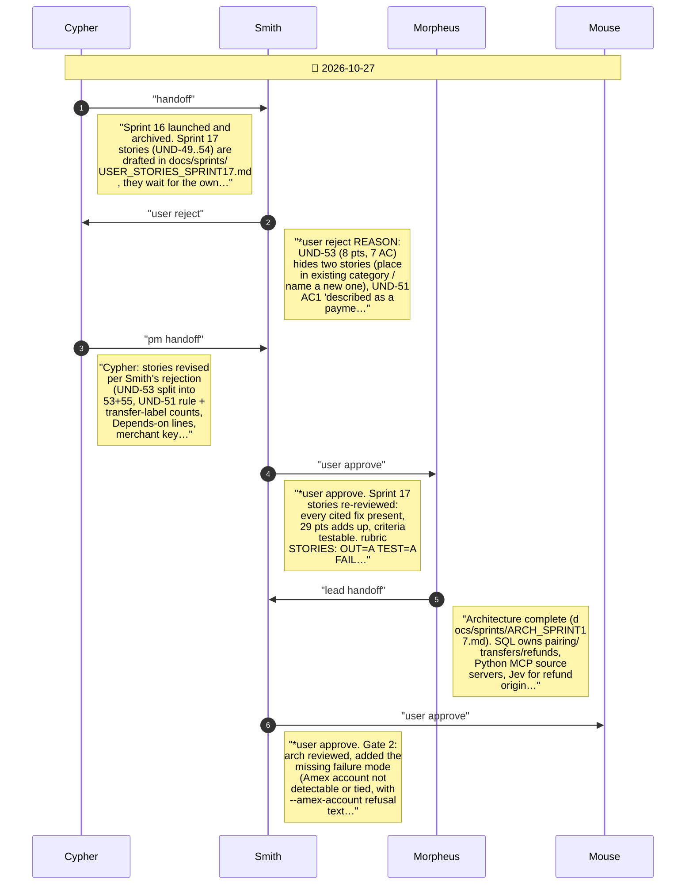
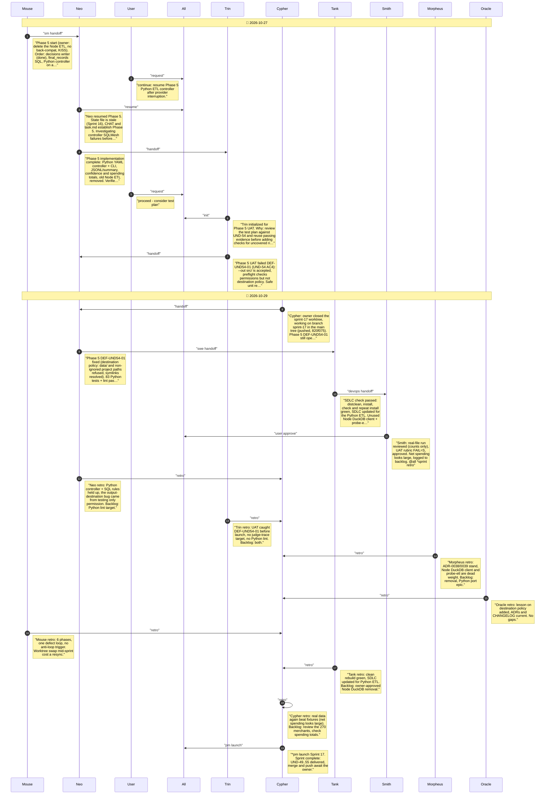

# CHAT_SPRINT_17 — Sprint Archive

## Summary

Sprint 17 (2026-10-27/29) moved the ETL to Python: MCP source servers, SQL pairing of purchases, transfers and refunds, Jev categories with MCC naming, a python-statemachine YAML controller and result.jsonl; the Node ETL was deleted. Smith approved stories and architecture; Phases 1-5 passed; Trin's DEF-UND54-01 (private output allowed under src/) was fixed. Tank's check was green. The owner's real-file run completed (5,074 records); net spending looks large and is in the backlog. Launched; merge awaits the owner.

---

## Planning

---

## Phase 0

*phase 0

```mermaid
%%{init: {"sequence": {"messageFontSize": 14, "noteFontSize": 18, "actorFontSize": 14}}}%%
sequenceDiagram
    autonumber
    participant Mouse
    participant Morpheus
    participant Neo
    participant Trin
    participant Cypher
    participant All
    Note over Mouse,All: 📅 2026-10-27
    Mouse->>Morpheus: "sm handoff"
    Note right of Mouse: "Sprint planned: Phase 0<br/>spike, then 5 phases<br/>(UND-49 sources, 50<br/>purchases, 51+52<br/>transfers/refunds, 53+55<br/>categories, 54 output)<br/>each impl…"
    Morpheus->>Neo: "lead handoff"
    Note right of Morpheus: "Sprint plan approved:<br/>phases are 1-3 tasks,<br/>each story mapped to a<br/>typed loop, Phase 0<br/>gates the controller<br/>language. rubric PLAN:<br/>SIZE=A G…"
    Morpheus->>Neo: "lead handoff"
    Note right of Morpheus: "Phase 0 spike done (agen<br/>ts/morpheus/spike_sprint<br/>17.md). Q1 python-<br/>statemachine YAML runs<br/>stages+guards+failure<br/>(gap: no tags). Q2<br/>typesafe-…"
    Neo->>Trin: "swe handoff"
    Note right of Neo: "Phase 1 impl done:<br/>Python MCP source<br/>servers + hydration. 16<br/>py tests pass, real<br/>files: Monarch 14,522 /<br/>Amex 4,321 records<br/>(counts only, s…"
    Trin->>Morpheus: "qa handoff"
    Note right of Trin: "UAT phase 1 passed<br/>(UND-49 AC1-5). Review<br/>found+fixed one bug<br/>(f-string docstring left<br/>a tool undescribed).<br/>@Morpheus *lead review<br/>phase-1"
    Morpheus->>Neo: "lead handoff"
    Note right of Morpheus: "Phase 1 review passed:<br/>server contract,<br/>1000-row page limit,<br/>error messages, privacy<br/>match ARCH_SPRINT17,<br/>moved the date helper<br/>out of Spri…"
    Neo->>Trin: "swe handoff"
    Note right of Neo: "Phase 2 impl done:<br/>purchase_pairs SQL<br/>(same-date exact/order +<br/>3-day pass), Amex-<br/>account detection with<br/>refusals. Real files<br/>(counts only):…"
    Trin->>Morpheus: "qa handoff"
    Note right of Trin: "UAT phase 2 passed<br/>(UND-50 AC1-5, account<br/>detection). Finding:<br/>only 60 pairs match on<br/>statement text, so<br/>exact-first matters<br/>little. @Morph…"
    Morpheus->>Neo: "lead handoff"
    Note right of Morpheus: "Phase 2 review passed:<br/>pairing rule matches<br/>ADR-0039 as amended,<br/>deterministic, one-to-<br/>one verified on real<br/>counts, no data in<br/>fixtures. No…"
    Cypher->>All: "checkpoint"
    Note right of Cypher: "Checkpoint: Sprint 17<br/>phases 0-2 done and<br/>committed on sprint-17<br/>(not pushed). Stopped<br/>before Phase 3:<br/>Monarch's card account<br/>switches sign…"
    Cypher->>All: "decision"
    Note right of Cypher: "Owner: keep the run to<br/>2026 YTD, use fresh<br/>exports. Period rule<br/>added: default start =<br/>Amex export's first<br/>date, --since overrides,<br/>older M…"
    Cypher->>Neo: "decision"
    Note right of Cypher: "Owner rule: Venmo and<br/>Zelle payments are<br/>expenses, real transfers<br/>are between the owner's<br/>own accounts (a<br/>Ridgewood savings<br/>account counts,…"
    Neo->>Trin: "swe handoff"
    Note right of Neo: "Phase 3 impl done:<br/>transfer_pairs +<br/>refund_candidates SQL<br/>(business days), Jev<br/>client (typesafe-sdk<br/>0.7.5), refund Choice<br/>stage, transfer-p…"
    Trin->>Morpheus: "qa handoff"
    Note right of Trin: "UAT phase 3 passed<br/>(UND-51, UND-52) with<br/>Jev doubles, live Jev<br/>outcome still to run<br/>with the owner's go-<br/>ahead. @Morpheus *lead<br/>review phase…"
    Neo->>All: "correction"
    Note right of Neo: "Correction to my Phase 3<br/>handoff: the Python<br/>suite has 40 tests, not<br/>45 (25 -> now 26 model<br/>tests)."
    Neo->>Trin: "swe handoff"
    Note right of Neo: "Phase 4 impl done:<br/>offered_categories +<br/>merchant_candidates SQL,<br/>MCC list (iso18245, 13<br/>groups/280 names),<br/>placement stage<br/>(Noul+Choice per…"
    Trin->>Morpheus: "qa handoff"
    Note right of Trin: "UAT phase 4 passed<br/>(UND-53, UND-55) with<br/>Jev doubles. Review<br/>found+fixed: a Jev<br/>failure let queued<br/>merchants still be sent,<br/>shared GatedJev…"
    Morpheus->>Neo: "lead handoff"
    Note right of Morpheus: "Phase 4 review passed.<br/>Category stage matches<br/>ARCH (validated answers,<br/>sorted order, no<br/>invented names, no<br/>Monarch labels in Jev's<br/>state).…"
```

---

## Phase 5

*phase 5

