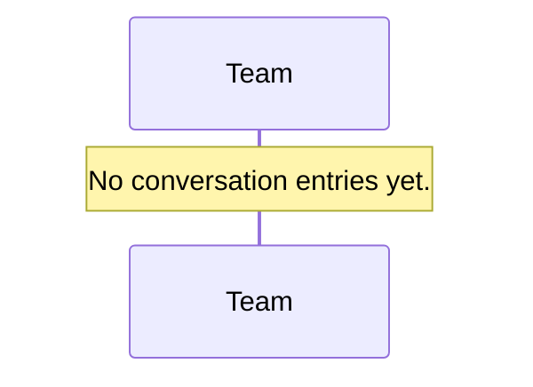
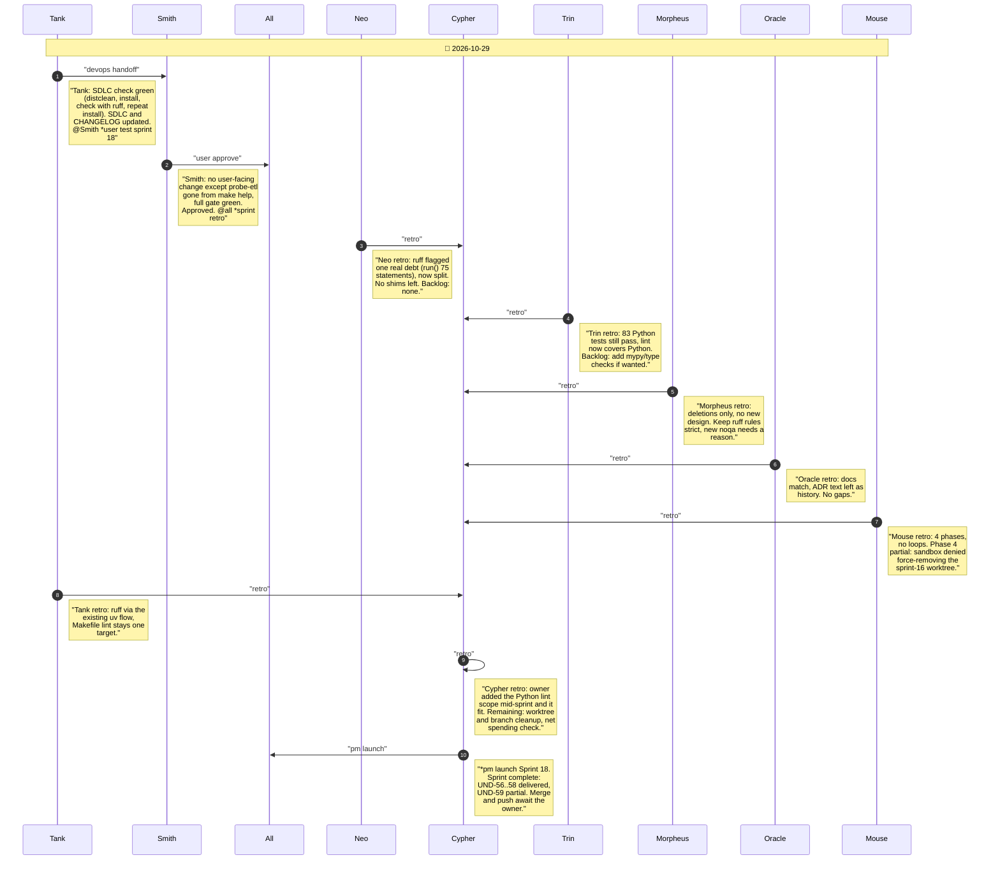

# CHAT_SPRINT_18 — Sprint Archive

## Summary

Sprint 18 (2026-10-29), tech-debt cleanup under no-back-compat, YAGNY and DRY: deleted dead Sprint 16 ETL code, the unused Node DuckDB client and probe-etl; added ruff with a broad rule set to make lint (owner asked mid-sprint) and split the ETL run() it flagged; deleted merged sprint-1..15 branches. The sprint-16 worktree and sprint-16/17 branches remain pending the owner. Launched; merge awaits the owner.

---

## Planning

---

## Phase 0

Sprint 18 (tech-debt cleanup, Tier 2) started on branch sprint-18 in the main tree (no worktree). SDLC present. Candidate scope from the Sprint 17 backlog: remove unused Node DuckDB client + probe-etl, dead Sprint 16 Python/SQL leftovers, add a Python lint target, prune merged branches/worktree. @Cypher *pm story+arch tier-2

_No messages in this phase._

---

## Phase 1

Sprint 18 planned (UND-56..59), owner approved mechanism changes ('go 18'). Phase 1: deleting dead Sprint 16 ETL code. @Neo *refactor phase-1

