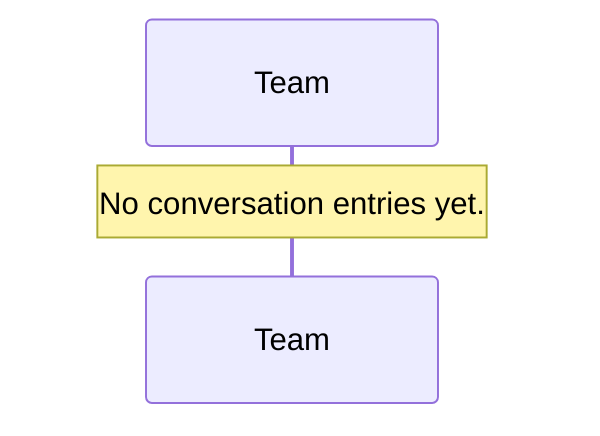
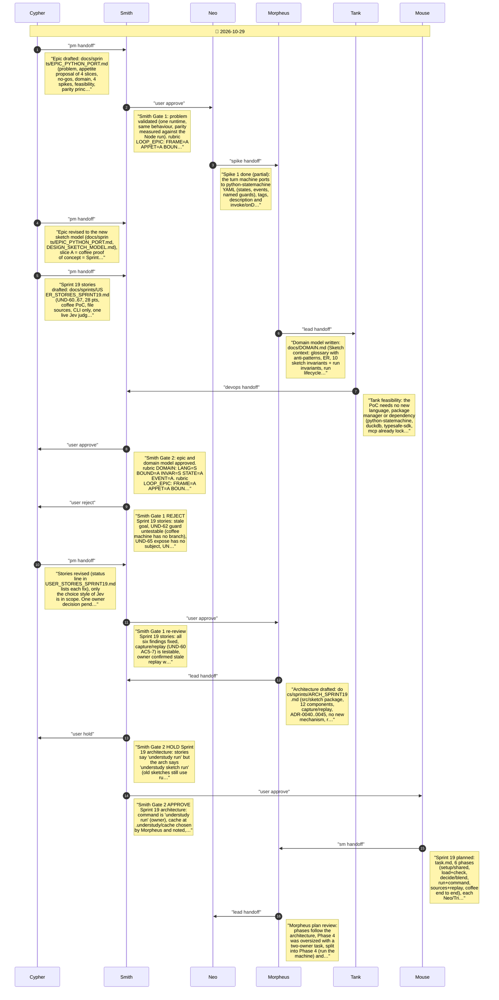
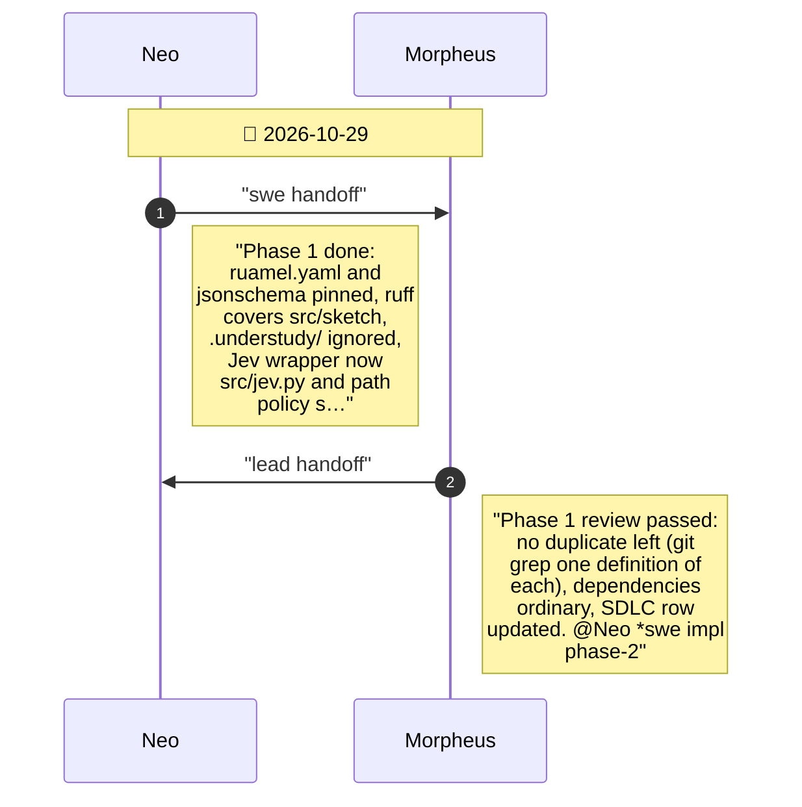
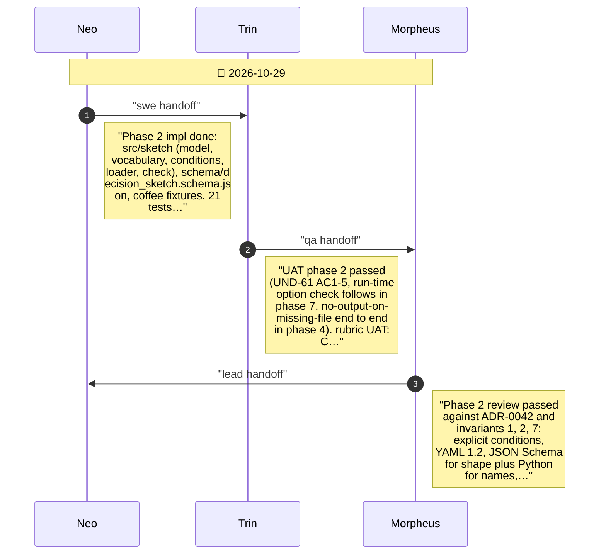
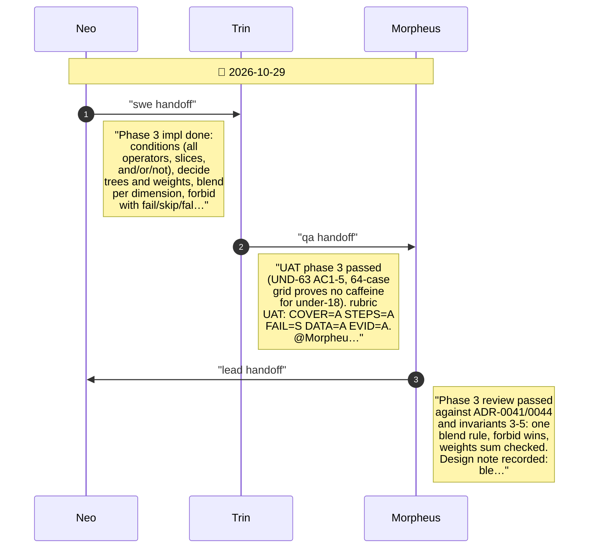
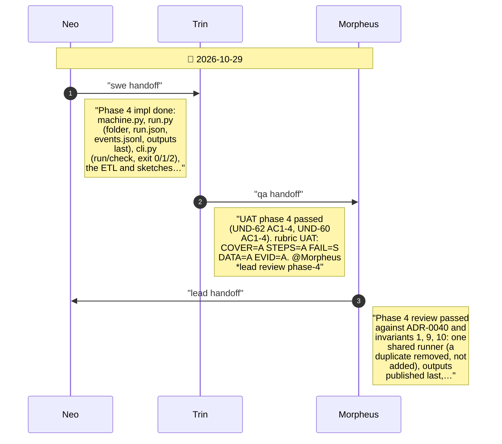
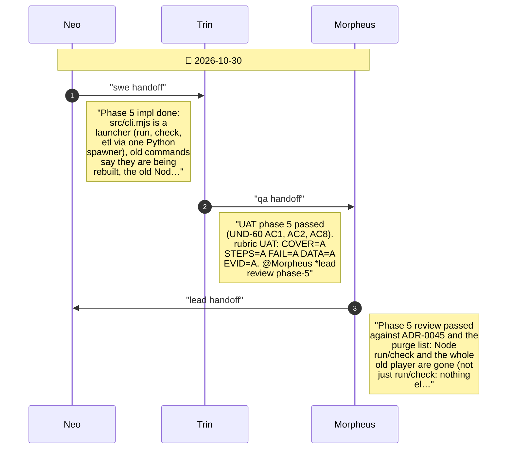
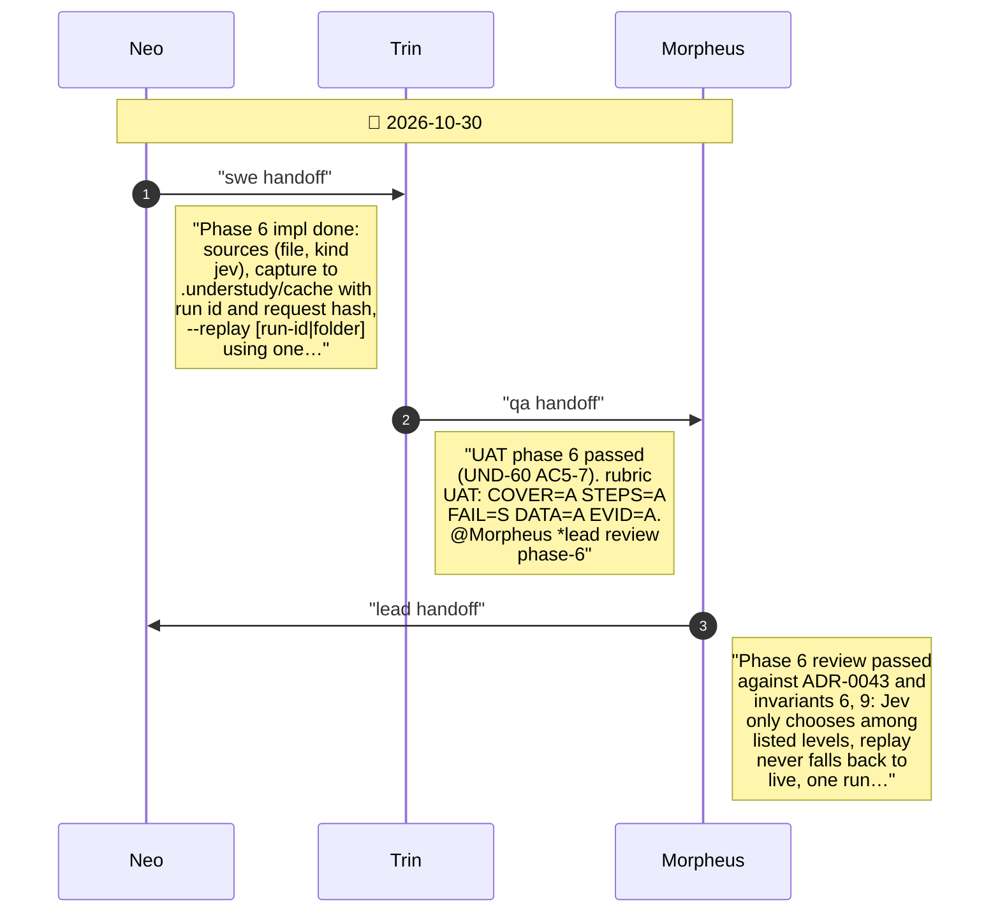
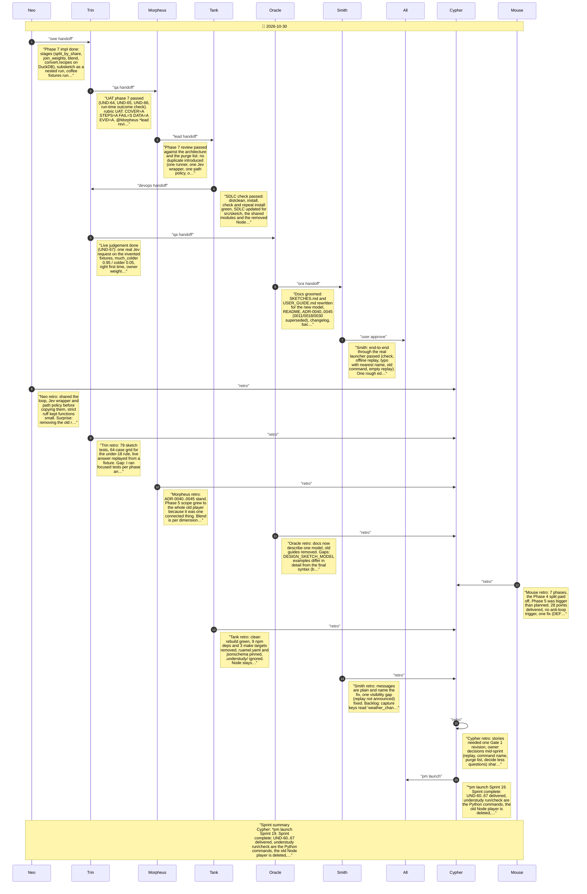

# CHAT_SPRINT_19 — Sprint Archive

## Summary

Sprint 19 (2026-10-29/30) shaped and built the new sketch model as slice A of the Python-port epic. With the owner, one-question-at-a-time: user-written state machines, deciders returning weighted rows, one per-dimension blend, explicit YAML conditions, weights as numbers or if/then/else, Jev as a kind: jev source with a rubric, capture and replay for every non-file source, file sources only, command understudy run, a purge list as the epic exit gate. Smith rejected the stories once (six findings), then approved stories, architecture (after the command name was settled) and the plan. Seven phases passed UAT and review: shared Jev wrapper and path policy, load and check, decide and blend, run the machine on one shared runner, replace the old Node commands (the whole old player went), sources and replay, the coffee example end to end. Tank's check was green; one real Jev judgement (much_colder 0.95) is committed as a replay fixture; Smith found one rough edge (DEF-19-01, fixed). Launched; merge awaits the owner.

---

## Planning

---

## Phase 0

Sprint 19 planning started on branch sprint-19 (from main 357c85b, no worktree). SDLC present. Scope pending the owner. @Cypher *pm plan sprint

---

## Phase 1

Phase 1

---

## Phase 2

Phase 2

---

## Phase 3

Phase 3

---

## Phase 4

Phase 4

---

## Phase 5

Phase 5

---

## Phase 6

Phase 6

---

## Phase 7

Phase 7

