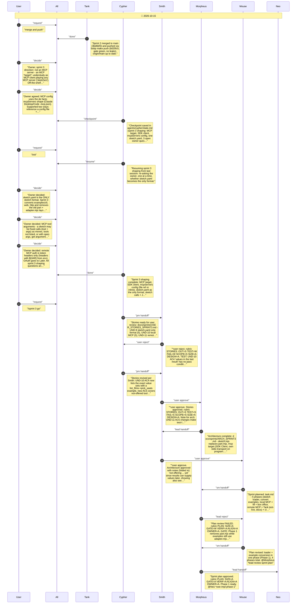
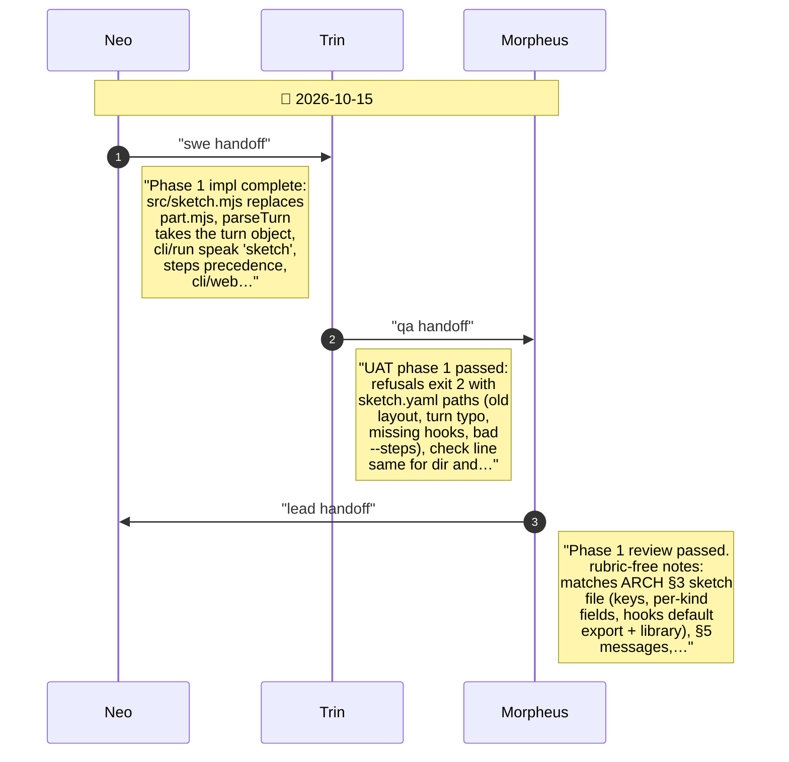
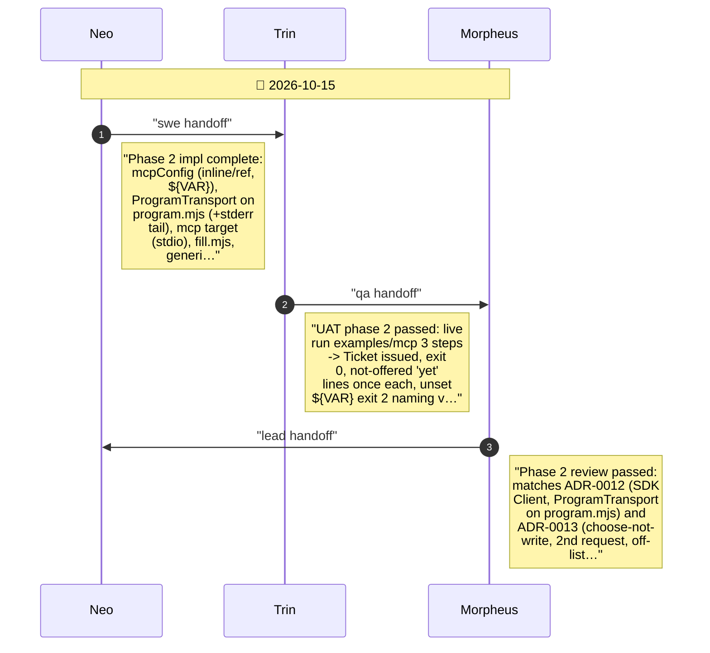
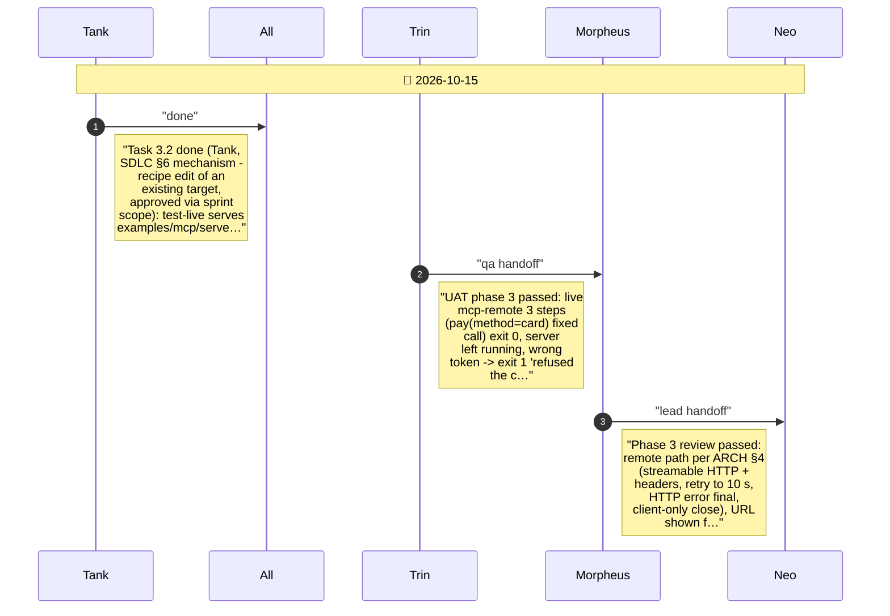
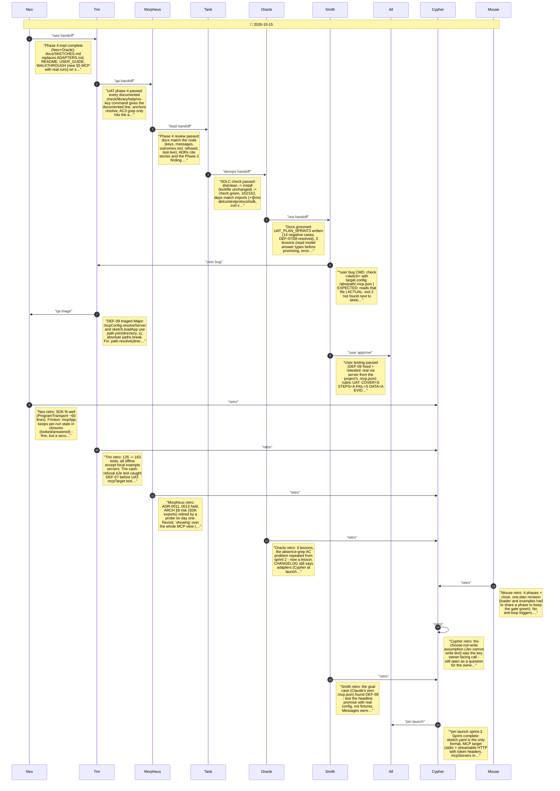

# CHAT_SPRINT_3 — Sprint Archive

## Summary

Sprint 3: owner shaped an MCP target (understudy as MCP client, SDK, mcpServers config inline or by reference, token headers) and one sketch.yaml as the only format; Cypher's stories rejected once by Smith (argument values, nothing-offerable), then approved with the architecture (ProgramTransport on program.mjs, generic MCP app, Jev chooses arguments). Plan revised once (loader + examples in one phase). Phases 1-4 passed UAT and review: sketch loader + converted examples, local MCP + box office (DEF-07: candidates from last non-error result), remote MCP + test-live (Tank), docs (SKETCHES.md, ADR-0011..0013). Close: SDLC check green, 3 lessons, Smith played a real server from .mcp.json and found DEF-09 (absolute config paths) - fixed. Launched; merge awaits owner.

---

## Planning

---

## Phase 1

Phase 1: sketch loader and the three examples converted (UND-9)

---

## Phase 2

Phase 2: local MCP target, generic MCP app, argument filling, box office (UND-10)

---

## Phase 3

Phase 3: remote MCP over HTTP with token headers (UND-11)

---

## Phase 4

Phase 4: docs teach sketches and the MCP target (UND-12)

