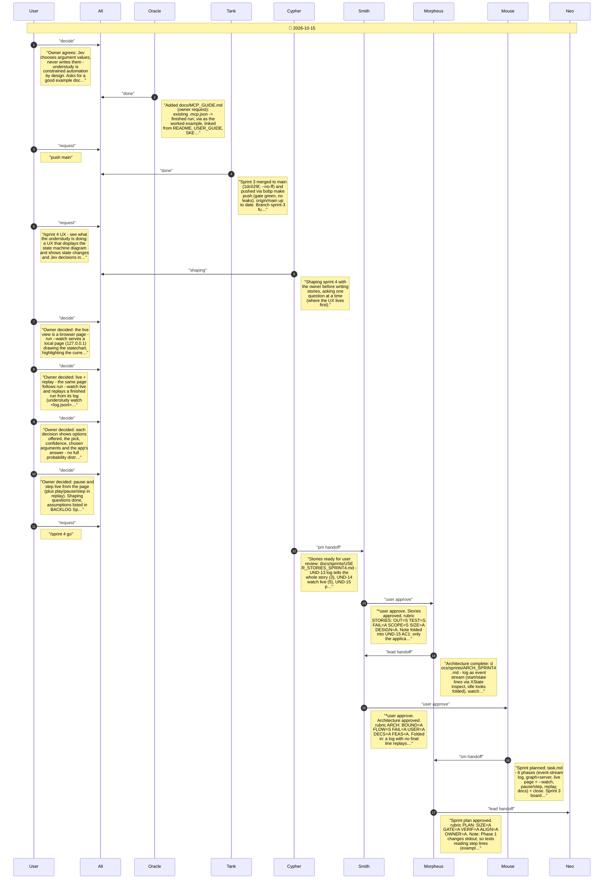
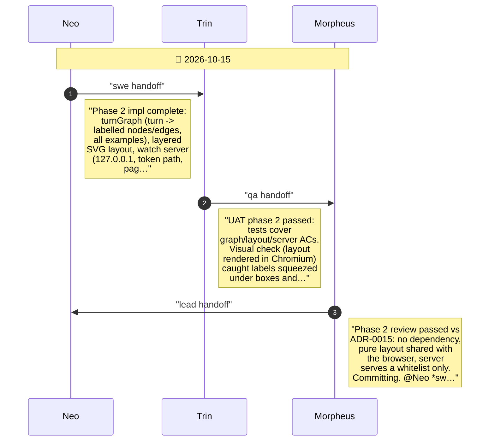
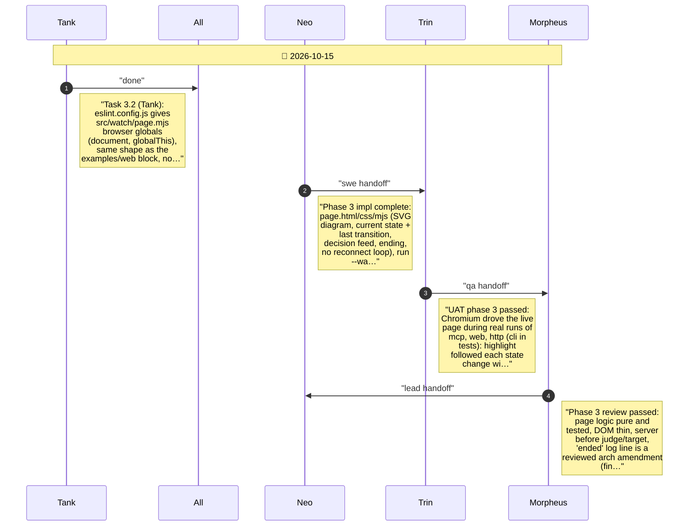
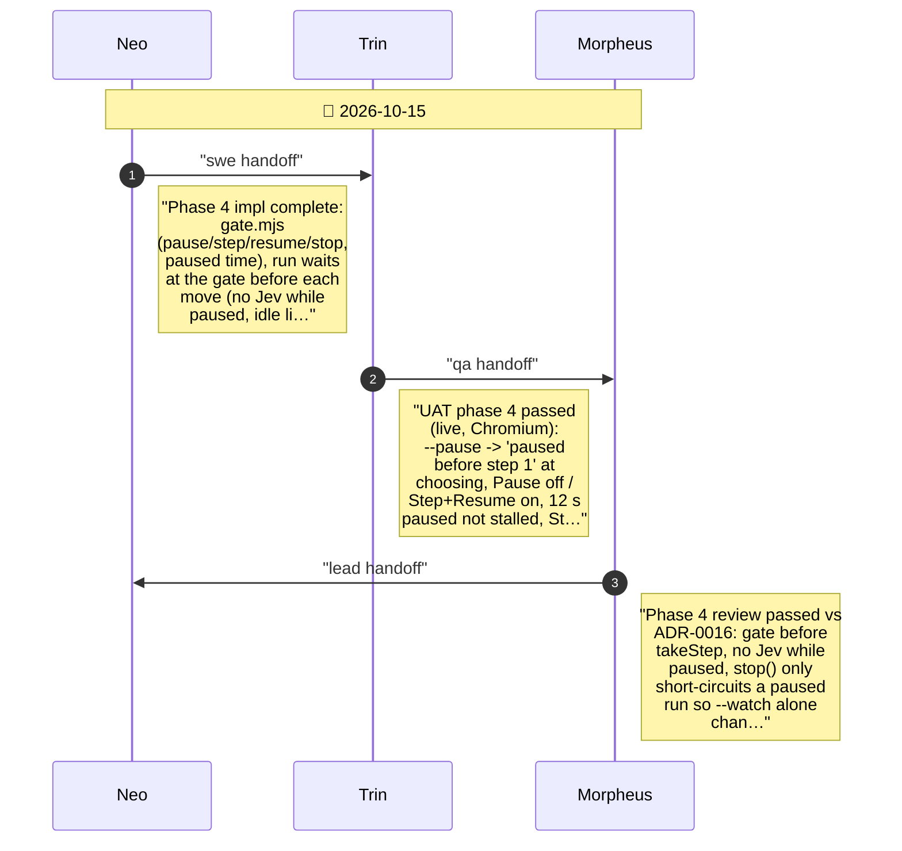
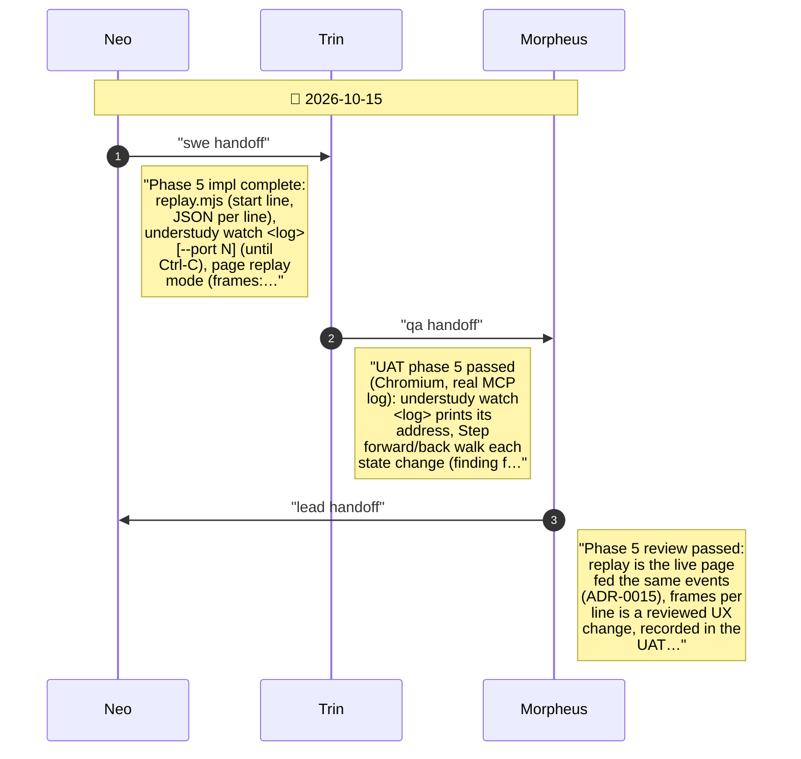
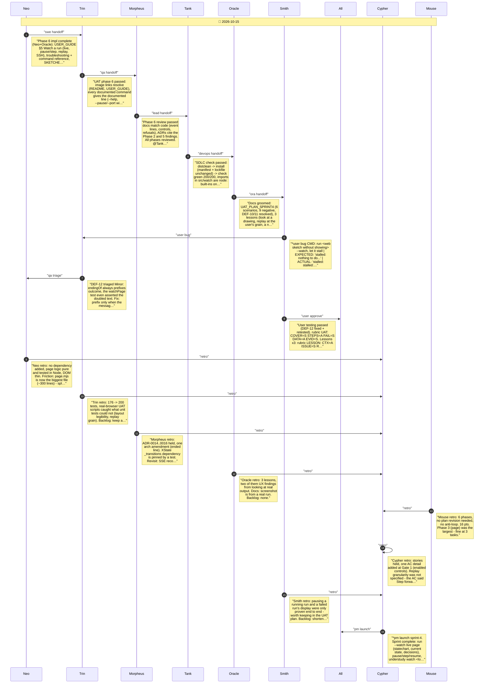

# CHAT_SPRINT_4 — Sprint Archive

## Summary

Sprint 4: owner asked for a live view of the understudy; shaping settled a browser page, live + replay, pick + confidence, pause/step. Smith approved stories (control-enabled note) and architecture (cut-short log note): event-stream log via XState inspection, node:http + SSE server with own SVG layout (Mermaid rejected, 122 MB), pause gate before each move. Six phases passed UAT (real Chromium) and review; findings fixed: layout legibility (visual check), replay grain (frames per line), Ctrl-C while paused. Close: SDLC green, 3 lessons, Smith found DEF-12 (outcome doubled) - fixed. Launched; merge awaits owner.

---

## Planning

---

## Phase 1

Phase 1: the log tells the whole story (UND-13)

---

## Phase 2

Phase 2: graph layout and the watch server (UND-14 server side)

---

## Phase 3

Phase 3: the live page and run --watch (UND-14)

---

## Phase 4

Phase 4: pause and step a live run (UND-15)

---

## Phase 5

Phase 5: replay a finished run (UND-16)

---

## Phase 6

Phase 6: docs show how to watch (UND-17)

