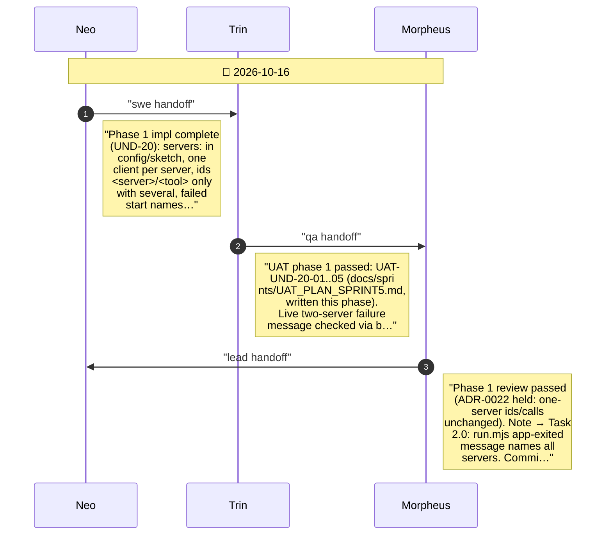
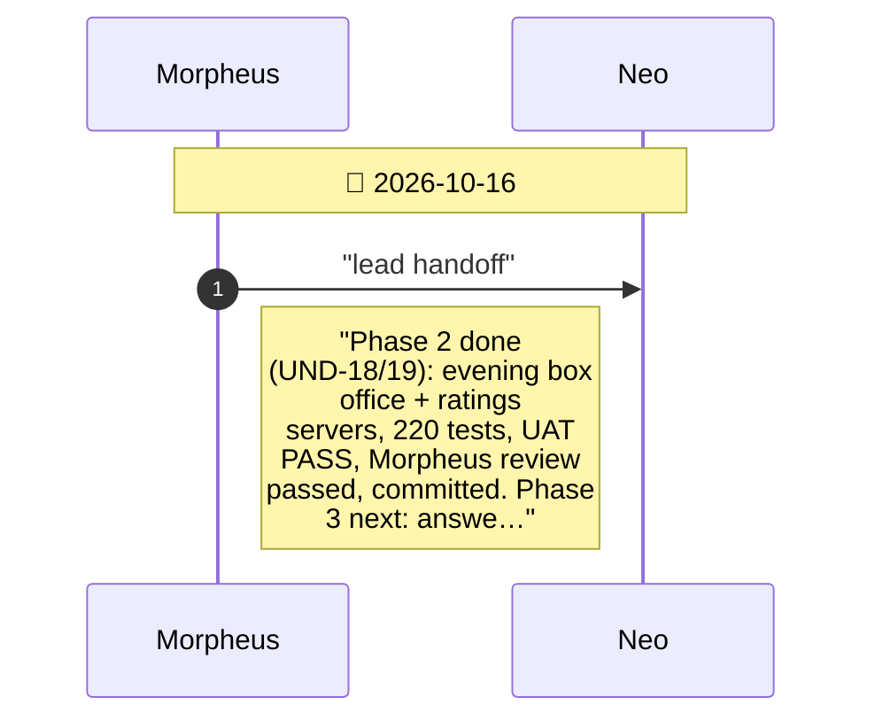
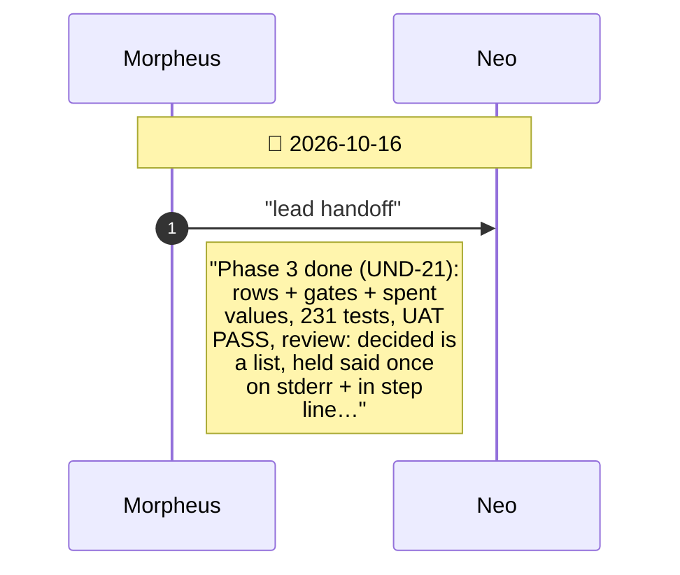
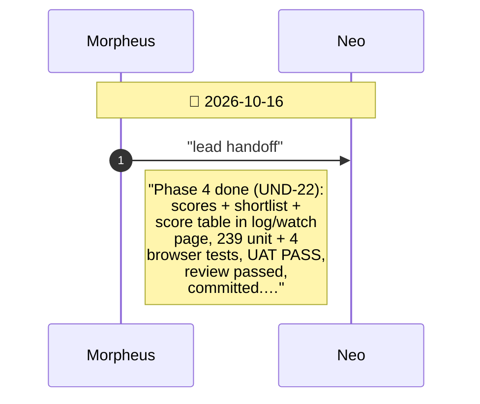
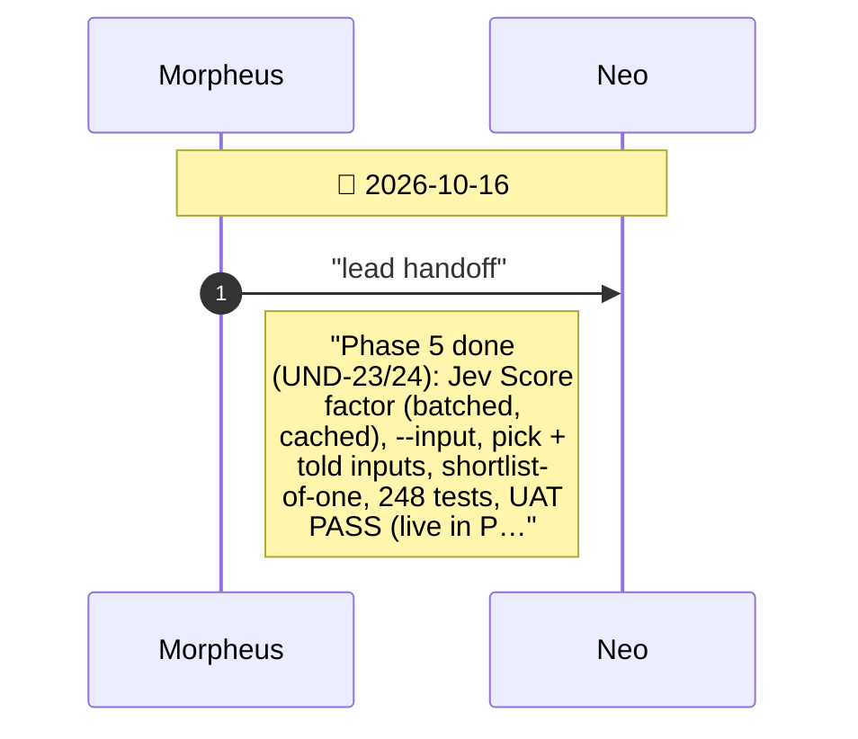
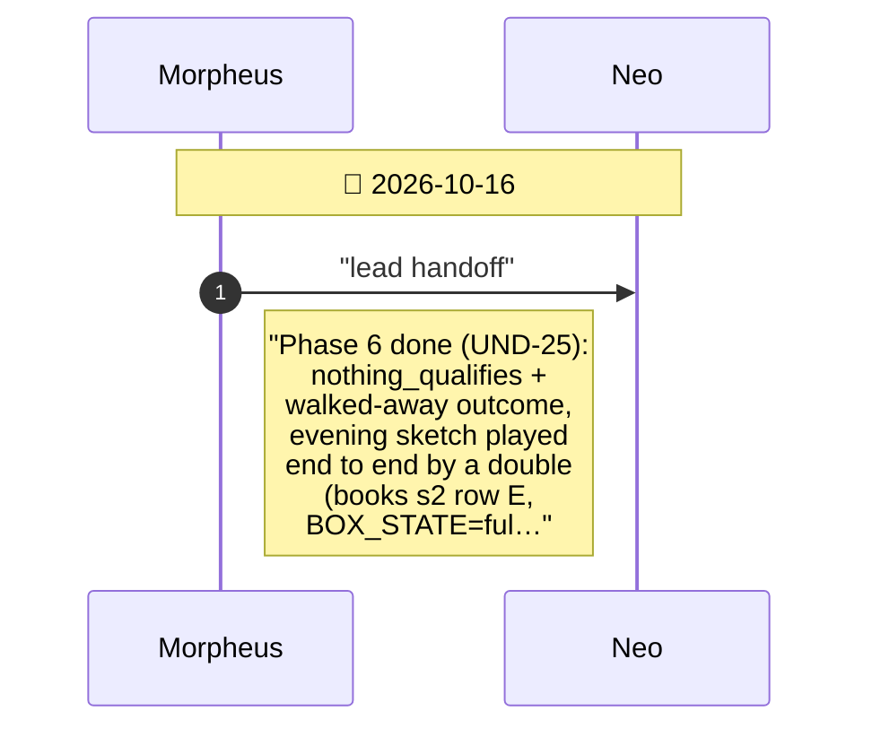
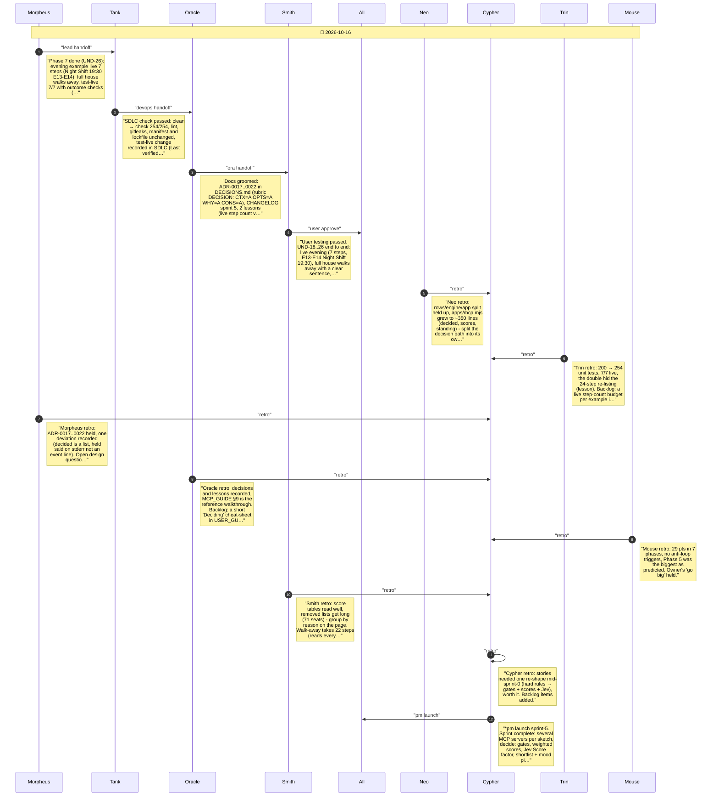

# CHAT_sprint-5 — Sprint Archive

## Summary

Sprint 5 turned the owner's cinema preferences into a decision engine. Shaping moved from all-hard-rules to gates + weight-shaped scores multiplied + a Jev Score factor + a shortlist the final Jev Choice picks from in a mood, with inputs set by --input and a walk-away end (exit 0). Seven phases: several MCP servers, evening box office and ratings servers, answer rows and gates, scores and shortlist, Jev Score/inputs/pick, walk away, the evening example with docs and outcome-checked test-live. A live run exposed Jev re-listing films (24 steps); showing earlier answers cut it to 7. Owner question pending: should a decision wait while values are held back.

---

## Planning

```mermaid
%%{init: {"sequence": {"messageFontSize": 14, "noteFontSize": 18, "actorFontSize": 14}}}%%
sequenceDiagram
    autonumber
    participant User
    participant All
    participant Bob
    participant Mouse
    participant Trin
    participant Morpheus
    participant Cypher
    participant Tank
    participant Smith
    participant Neo
    Note over User,Neo: 📅 2026-10-16
    User->>All: "request"
    Note right of User: "I need to bind to the<br/>nic to test (owner,<br/>after /remote-control):<br/>the watch page must be<br/>reachable from another<br/>device."
    User->>All: "decide"
    Note right of User: "Owner: stop one-off<br/>verifications - use<br/>tests. From now on<br/>checks are committed<br/>tests, scratch<br/>Playwright/ad-hoc runs<br/>are not evidence."
    Bob->>All: "note"
    Note right of Bob: "Correction: 'no one-off<br/>verifications' is<br/>already AGENTS.md<br/>principle 1 (Automation<br/>First, no uncaptured<br/>shell) and the<br/>impl/bloop CAPTURE/…"
    User->>All: "request"
    Note right of User: "now please - turn sprint<br/>4's scratch browser<br/>checks into committed<br/>tests behind a make<br/>target"
    Mouse->>All: "plan"
    Note right of Mouse: "Follow-up on sprint-4<br/>(owner-approved): Tank<br/>adds make test-browser<br/>(npm run test:browser<br/>over tests/browser/,<br/>Chromium, no Jev), Trin<br/>writ…"
    Trin->>Morpheus: "qa handoff"
    Note right of Trin: "Trin: tests/browser/watc<br/>hPage.test.js (4 tests,<br/>headless Chromium, Jev<br/>double) replaces the<br/>sprint 4 scratch UAT<br/>scripts, layout<br/>legibility…"
    Morpheus->>All: "lead approve"
    Note right of Morpheus: "Review passed: browser<br/>tests drive the real<br/>page against real<br/>example runs, no<br/>Jev/key, make test stays<br/>browser-free (ADR-0006).<br/>Committing…"
    User->>All: "request"
    Note right of User: "Owner: add more logic to<br/>the box office - prefers<br/>horror films, evenings,<br/>only if row E, F or D is<br/>available (in that<br/>order), seats togethe…"
    User->>All: "decide"
    Note right of User: "Owner decided: all<br/>preferences are hard<br/>rules in sketch.yaml<br/>(filters + orderings on<br/>the values Jev may<br/>choose), not Jev's<br/>judgment."
    User->>All: "decide"
    Note right of User: "Owner decided: rules<br/>filter (orderings keep<br/>the best available), Jev<br/>picks among what is<br/>left."
    User->>All: "decide"
    Note right of User: "Owner: bring in more MCP<br/>servers for enrichment<br/>(a sketch plays several<br/>servers), wants the<br/>Rotten Tomatoes score.<br/>Noted: no open RT API,<br/>O…"
    Cypher->>All: "checkpoint"
    Note right of Cypher: "Owner decided: fake<br/>ratings only (in-repo<br/>ratings MCP server,<br/>made-up scores).<br/>Checkpoint: Cypher state<br/>has the open shaping<br/>questions (rul…"
    User->>All: "decide"
    Note right of User: "Owner: follow the MCP<br/>pattern - the ratings<br/>service is its own MCP<br/>server, named like the<br/>box office (mcpServers<br/>entry), enrichment is<br/>tool…"
    User->>All: "decide"
    Note right of User: "Owner decided: rules are<br/>code-free YAML on<br/>answers - a rule tests<br/>fields of the answer<br/>object a value came<br/>from, from any server<br/>(is, in, a…"
    User->>All: "decide"
    Note right of User: "Owner decided: nothing<br/>passes -> the understudy<br/>walks away and the run<br/>succeeds (an end state<br/>for leaving, exit 0, the<br/>log says what was ru…"
    User->>All: "request"
    Note right of User: "merge and push sprint 4"
    Tank->>All: "done"
    Note right of Tank: "Sprint 4 merged to main<br/>(51fa684, --no-ff) and<br/>pushed via bobp make<br/>push (gate green, no<br/>leaks). origin/main up<br/>to date. sprint-4 fully<br/>mer…"
    Cypher->>All: "checkpoint"
    Note right of Cypher: "Checkpoint saved in<br/>agents/cypher/state.md<br/>(sprint 5 shaped in<br/>BACKLOG, not started,<br/>main = 51fa684). Next:<br/>on /sprint 5 go, cut<br/>sprint-5 a…"
    User->>All: "request"
    Note right of User: "/init"
    Cypher->>All: "resume"
    Note right of Cypher: "Resuming sprint 5<br/>planning from last<br/>session. Shaping is done<br/>in docs/BACKLOG.md,<br/>waiting on the owner's<br/>go to cut sprint-5 and<br/>write the u…"
    User->>All: "request"
    Note right of User: "/sprint 5 go"
    Cypher->>Smith: "pm handoff"
    Note right of Cypher: "Sprint 5 stories ready: <br/>docs/sprints/USER_STORIE<br/>S_SPRINT5.md<br/>(UND-18..23, 20 pts,<br/>Tier 1) on sprint-5.<br/>Self-check rubric<br/>STORIES: OUT=S TES…"
    User->>All: "decide"
    Note right of User: "Owner: tomato 70 is<br/>about right for horror,<br/>above 90 is an automatic<br/>yes (from a tomato meter<br/>perspective)."
    Cypher->>Smith: "pm handoff"
    Note right of Cypher: "Stories revised for<br/>owner's tomato rule:<br/>horror >=70 OR any film<br/>>90 (UND-21 gains an<br/>'any' group, UND-19<br/>scores cover both).<br/>Open: centre…"
    User->>All: "decide"
    Note right of User: "Owner confirmed: above<br/>90 is an automatic yes<br/>for film selection only,<br/>evening and seat rules<br/>still apply."
    User->>All: "decide"
    Note right of User: "Owner: 'not too far from<br/>centre' depends on<br/>theatre size - scale it,<br/>closer to centre is<br/>better, add a centreness<br/>metric."
    Cypher->>All: "update"
    Note right of Cypher: "Stories revised: box<br/>office answers 'centre'<br/>0..1 per seat scaled by<br/>row width (screens of<br/>different sizes),<br/>example cutoff<br/>centre>=0.6 (as…"
    User->>All: "decide"
    Note right of User: "Owner (general case):<br/>each factor gets a range<br/>-> score in YAML,<br/>weights across factors<br/>are adjustable (e.g.<br/>centre matters more than<br/>nearn…"
    User->>All: "decide"
    Note right of User: "Owner: a factor's weight<br/>shapes its curve (score<br/>= position^weight, e.g.<br/>rows E/F/D) - the option<br/>wanted most has the<br/>biggest bearing."
    User->>All: "decide"
    Note right of User: "Owner: factor scores<br/>multiply into the total,<br/>a zero anywhere drops<br/>the value, and if every<br/>value is zero the<br/>understudy walks away."
    User->>All: "decide"
    Note right of User: "Owner: Jev's qualitative<br/>part is a Score question<br/>declared in YAML<br/>(looks_at, instructions,<br/>levels), its 0-1 answer<br/>is a weighted factor. F…"
    User->>All: "decide"
    Note right of User: "Owner: scores make a<br/>shortlist, the final<br/>pick is Jev's Choice<br/>among the shortlist,<br/>coloured by a mood input<br/>from a few listed<br/>options (fun…"
    User->>All: "decide"
    Note right of User: "Owner: preferences are<br/>inputs - mood, and each<br/>weight within a range.<br/>Vision: a steampunk<br/>operations dashboard<br/>(knobs, toggles, chunky<br/>slid…"
    Cypher->>All: "update"
    Note right of Cypher: "Shaping captured in<br/>docs/BACKLOG.md: Sprint<br/>5 = decision engine<br/>(gates, weight-shaped<br/>scores multiplied, Jev<br/>Score factor, shortlist<br/>+ mood…"
    User->>All: "decide"
    Note right of User: "Owner: the shortlist is<br/>everything that<br/>qualifies, the sketch<br/>can bound it with the<br/>same words (at_most /<br/>at_least)."
    Cypher->>All: "update"
    Note right of Cypher: "Example defaults<br/>recorded in BACKLOG:<br/>weights in [0,3], row<br/>E/F/D w2, centre [0.3,1]<br/>w3, tomato [70,100] w1,<br/>audience Score w2, mood<br/>fun, s…"
    Cypher->>Smith: "pm handoff"
    Note right of Cypher: "Sprint 5 stories<br/>rewritten: docs/sprints/<br/>USER_STORIES_SPRINT5.md,<br/>UND-18..26 (box office,<br/>ratings+reviews, several<br/>servers, gates,<br/>weighted…"
    User->>All: "queue"
    Note right of User: "*queue idea: weight<br/>knobs that go to 11 - at<br/>11, a value scoring 100%<br/>on that factor wins<br/>outright, no other<br/>factor matters.<br/>Dashboard: hig…"
    User->>All: "request"
    Note right of User: "go big or go home -<br/>/sprint 5 go"
    User->>All: "decide"
    Note right of User: "Owner decided: keep the<br/>whole sprint 5 scope (29<br/>pts, UND-18..26) -<br/>nothing moves to sprint<br/>6."
    Smith->>Morpheus: "user approve"
    Note right of Smith: "*user approve. Sprint 5<br/>stories approved. rubric<br/>STORIES: OUT=S TEST=A<br/>FAIL=S SCOPE=S SIZE=A<br/>DESIGN=A. Two notes<br/>folded in: weight 0<br/>switch…"
    Morpheus->>Smith: "lead handoff"
    Note right of Morpheus: "Architecture complete: d<br/>ocs/sprints/ARCH_SPRINT5<br/>.md. Answer rows + joins<br/>(rows.mjs), pure engine<br/>(gates, position^weight<br/>curves multiplied,…"
    Smith->>Mouse: "user approve"
    Note right of Smith: "*user approve.<br/>Architecture approved.<br/>rubric ARCH: BOUND=S<br/>FLOW=S FAIL=A USER=A<br/>DECS=S FEAS=A. One fix<br/>folded into §4:<br/>nothing_qualifies fi…"
    Mouse->>Morpheus: "sm handoff"
    Note right of Mouse: "Sprint 5 planned in<br/>task.md: 7 phases of 2-3<br/>tasks (servers → evening<br/>servers → rows+gates →<br/>scores → Jev<br/>Score+inputs → walk away<br/>→ exampl…"
    Morpheus->>Neo: "lead handoff"
    Note right of Morpheus: "Sprint plan approved.<br/>rubric PLAN: SIZE=A<br/>GATE=S VERIF=S ALIGN=S<br/>OWNER=S. Phases follow<br/>ARCH dependencies (rows<br/>before scores before Jev<br/>be…"
```

---

## Phase 1

Several servers in one sketch - UND-20

---

## Phase 2

The evening's servers - UND-18, UND-19

---

## Phase 3

Answer rows and gates - UND-21

---

## Phase 4

Scores and the shortlist - UND-22

---

## Phase 5

Jev's Score, inputs and the final pick - UND-23, UND-24

---

## Phase 6

Walk away - UND-25

---

## Phase 7

The owner's evening - UND-26

