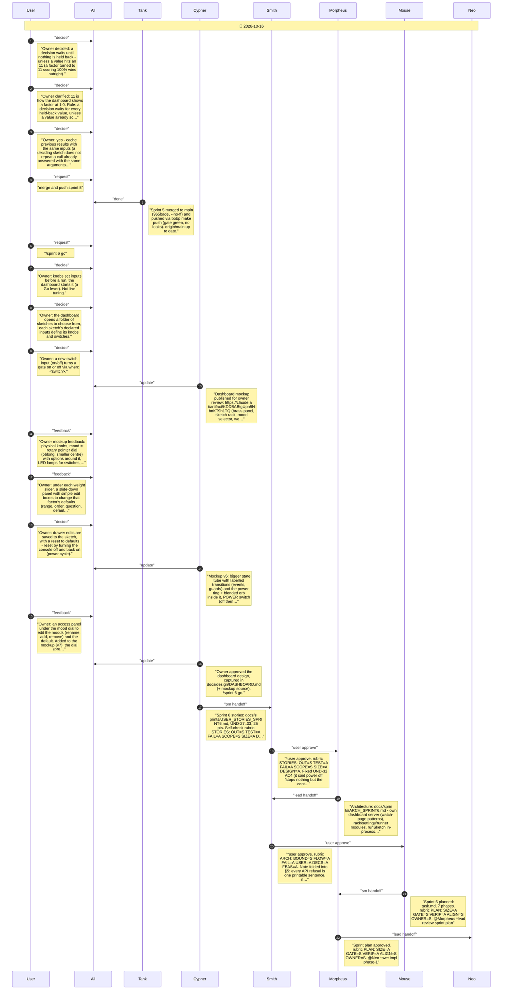
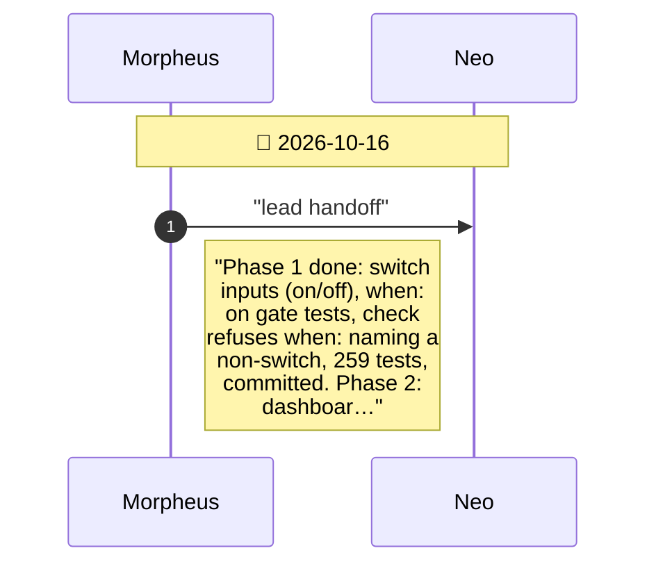
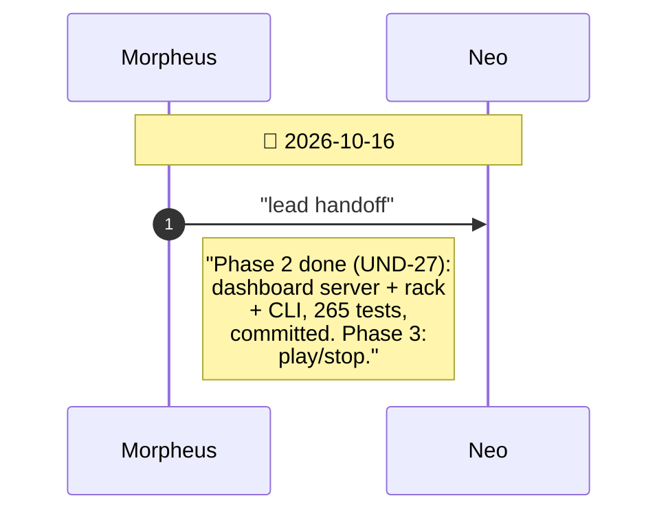
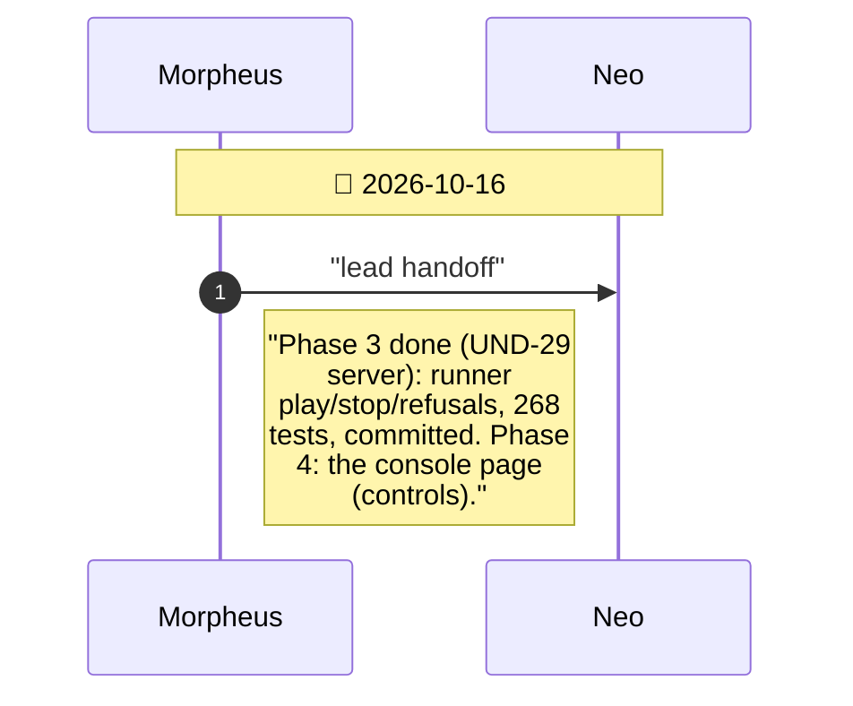
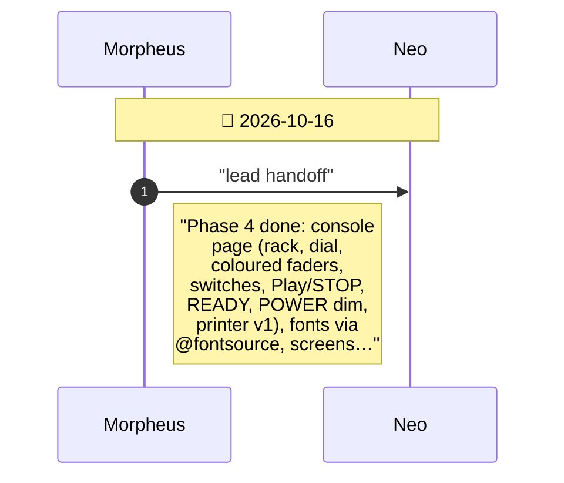
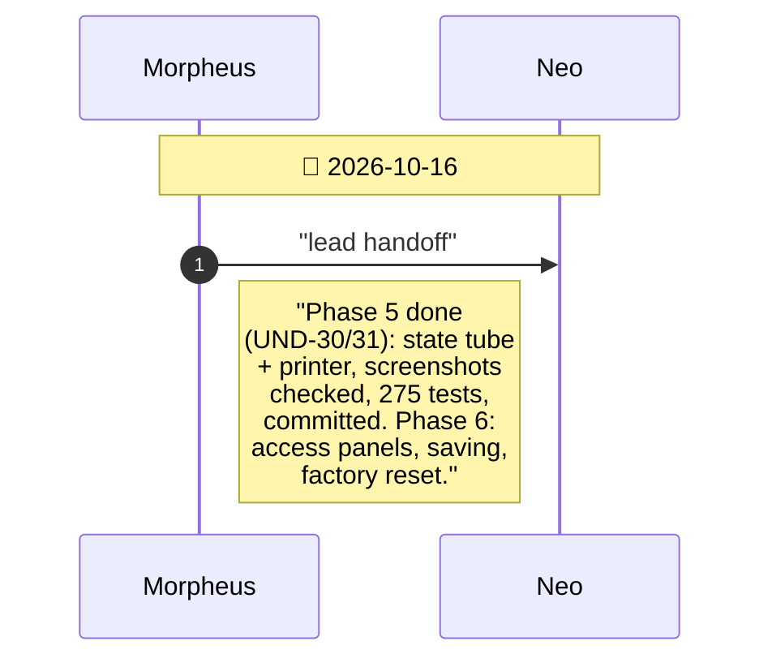
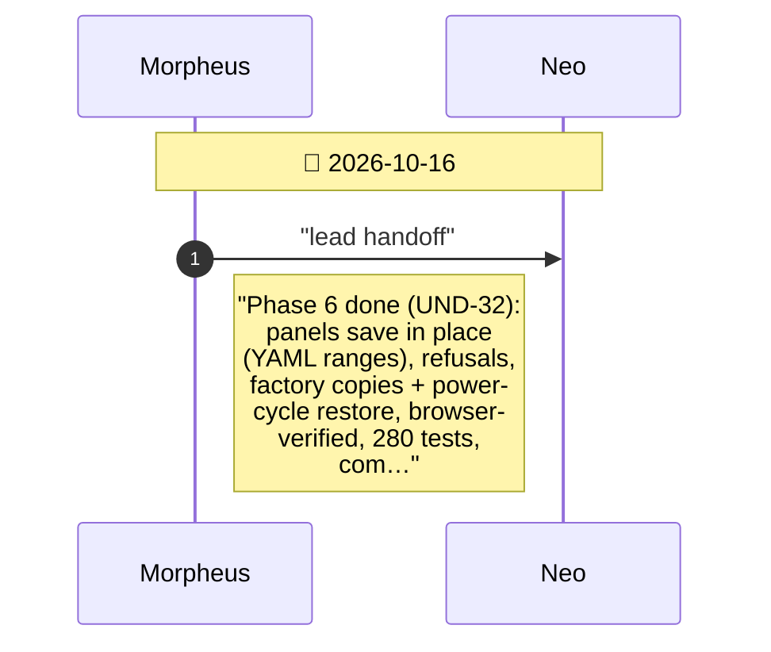
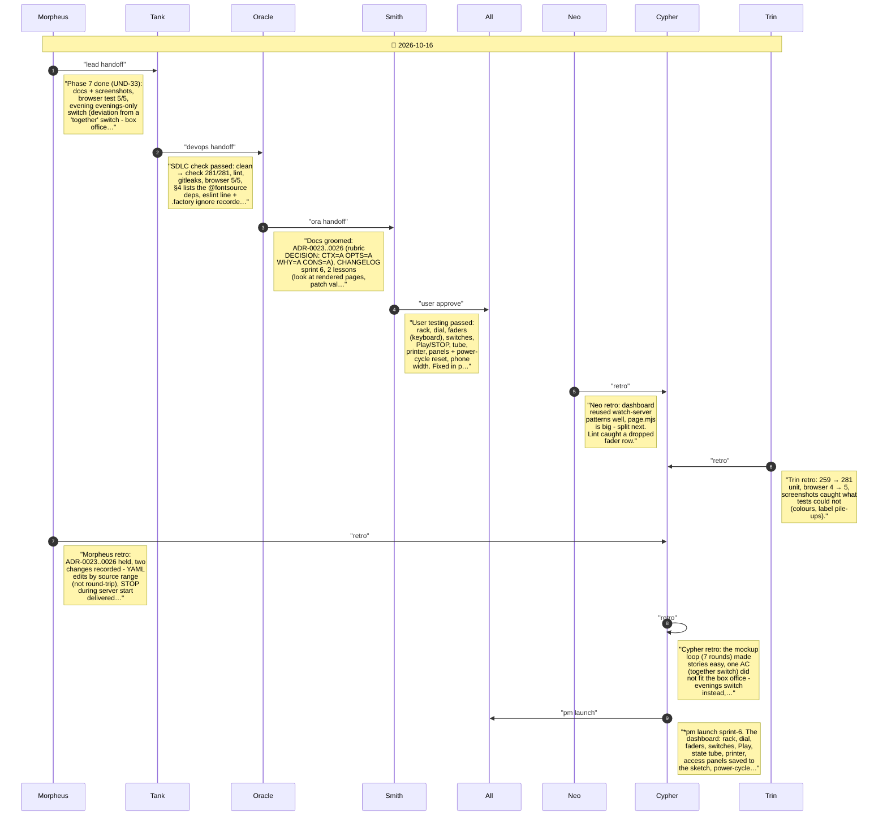

# CHAT_sprint-6 — Sprint Archive

## Summary

Sprint 6 built the dashboard the owner shaped on a clickable steampunk mockup: understudy dashboard <folder> with a sketch rack, a mood dial, coloured analog faders with Nixie readouts (11 at the top), switch inputs with LED lamps and when: on gates, a square lit Play with a green READY lamp, a round state tube with labelled transitions and a blended power ring, a printer log, and access panels that save edits to sketch.yaml in place with a POWER off/on factory reset. Seven phases; screenshots caught colour and label issues the unit tests could not; YAML edits switched from round-trip to in-place patches.

---

## Planning

---

## Phase 1

Switch inputs and when: - UND-28

---

## Phase 2

The dashboard server and the rack - UND-27

---

## Phase 3

Play and Stop - UND-29

---

## Phase 4

The console's controls - UND-28, UND-29 (page)

---

## Phase 5

The state tube and the printer - UND-30, UND-31

---

## Phase 6

Access panels, saving, factory reset - UND-32

---

## Phase 7

Docs, browser tests, the evening's switch - UND-33

