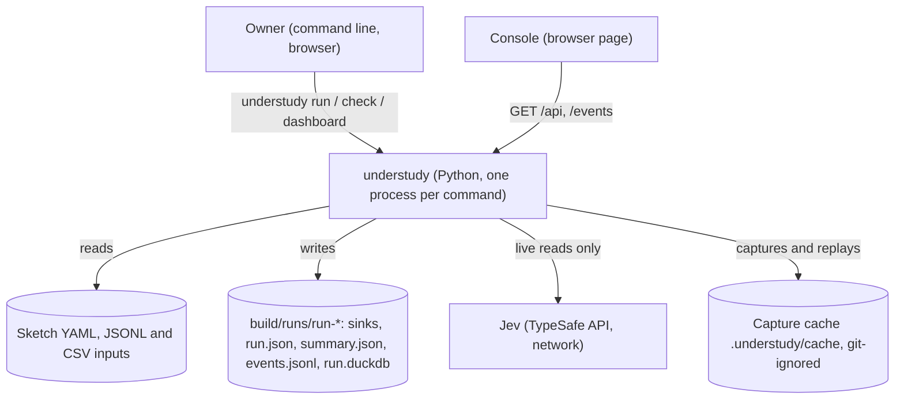
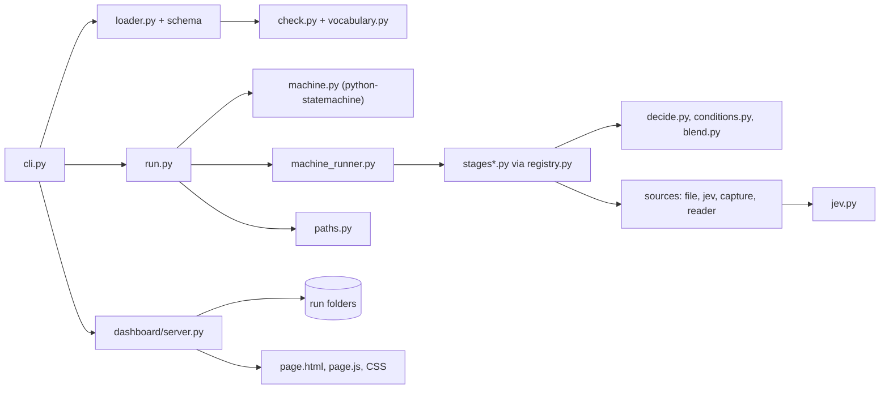

# Architecture Document: understudy (project-wide)

*   **Status**: Active (written 2026-11-01 from the code at `main` 5cd0927; earlier per-sprint architecture files stay as history)
*   **Author**: Morpheus
*   **Last Updated**: 2026-11-01
*   **Scope**: Project-wide ARCH.md. Requirements: [PRD.md](PRD.md). Vocabulary and invariants: [DOMAIN.md](DOMAIN.md). Reference for sketch authors: [SKETCHES.md](SKETCHES.md). Decisions: [DECISIONS.md](DECISIONS.md). Build and gates: [SDLC.md](SDLC.md).

---

## 1. Executive Summary & System Overview

understudy runs a **sketch**: one YAML file in which the owner writes where data comes from, what can be decided, the rules and weights that decide it, and the state machine that connects the steps. A run reads files, applies the owner's rules in Python stages, asks Jev (the TypeSafe judgement model) only to choose among options the owner listed, writes output files, and records what happened. A separate read-only console shows runs.

**Key drivers** (from the PRD): reproducibility (same inputs and Jev answers give the same bytes), judgement kept bounded (Jev chooses, never writes), one runtime, private data kept out of tracked folders, every mistake caught before a run starts.

**Non-goals** of this design: playing apps, live sources other than files, multi-user access, a hosted service (PRD section 4).

## 2. System Context & Boundaries

* **Trust domains:** the owner's files and the machine are trusted; Jev's answers are untrusted text, constrained to the listed options before use; the console's network clients are untrusted (read-only, no login: SEC-002).
* **Network boundaries:** the only outbound call is to Jev, made by a run, never by the console. The console listens on 0.0.0.0, port 4180 (owner's decision; Sprint 21 decision 4).
* **Process model:** each command is one Python process. A run and the console share nothing but the run folder on disk. The run database (`run.duckdb`) is opened by one process at a time.

## 3. Component & Container Architecture

### Component Inventory

| Component | Responsibility | Inputs | Outputs |
|---|---|---|---|
| `src/sketch/cli.py` | The command line: `run`, `check`, `dashboard`; maps failures to one `understudy: <message>` line and exit 1 or 2 | argv | stdout lines, exit code |
| `loader.py` | Reads a sketch (YAML 1.2 via ruamel, Jinja2 expansion with `--with`), validates against the JSON Schema, builds the typed `Sketch` | file path, `--with` values | `Sketch` or `SketchError` |
| `model.py`, `vocabulary.py` | The typed domain objects; every name a sketch may use, in one place | n/a | dataclasses, name lists |
| `check.py` | Whole-sketch checks before anything runs (stages exist, transitions reach a final state, outcomes declared, names validated) | `Sketch` | list of one-line problems |
| `machine.py` | Builds the owner's state machine for python-statemachine | `Sketch` | machine class |
| `machine_runner.py` | The one loop: the machine picks the next state; each state names a stage; records stage start, completion or failure | machine, stages, a record | stage results, outcome |
| `registry.py`, `stages.py`, `stages_rows.py`, `stages_pair.py` | General typed stages registered with `@stage`; the function signature is the YAML contract | stage name, `with:` values, rows | rows or a value |
| `decide.py`, `conditions.py`, `blend.py` | The owner's if/then/else trees, explicit conditions, weighted blend and hard `forbid` rules | rows, tree | weighted rows |
| `sources/file.py`, `jev.py`, `reader.py` | Read a source: JSONL/CSV file, or Jev (live or replayed) | source declaration | rows |
| `sources/capture.py` | Capture every live non-file read; replay from one complete capture | a read | stored read / replayed read |
| `jev.py` | The one Jev client: bounded questions, typed answers | rubric, options, text | probabilities |
| `run.py` | One run: folder, stage context, parts written then published last, `run.json`, `summary.json`, `events.jsonl` | `Sketch`, capture | `RunResult` |
| `paths.py` | The project root and the rule that private output never goes to tracked folders or `data/` | an output path | allowed path or `OutputPathError` |
| `dashboard/server.py` | Read-only console: `/api/runs`, `/api/runs/<id>`, `/events/<id>` (server-sent events), page files | run folders | JSON, event stream, static files |
| `dashboard/page.js` and CSS | Draws the server's data; themes and mode; no decisions of its own | API JSON | the page |

## 4. Runtime Interaction & Critical Flows

**A run** (`understudy run sketch.yaml --with ...`):

1. `cli.py` loads and checks the sketch (`loader`, `check`); any problem is printed one per line and the command exits 2 before anything starts.
2. A capture is chosen: live (Jev client created only if the sketch needs Jev) or replay (a complete capture must exist, else exit 2).
3. `run.py` makes the run folder (refused under `data/` or tracked folders), writes `run_started`, and builds the machine.
4. `machine_runner` walks the machine. For each state it runs the named stage: sources are read (file, or Jev through capture), `decide` and `blend` turn rows into weighted rows, `sink` stages write `<file>.part`.
5. Each stage start, completion or failure is appended to `events.jsonl` and `run.json`.
6. On reaching a final state the `.part` files are renamed to their names and `run_finished` is written; on a failure no file is published and the command exits 1.

**Watching a run:** the page requests `/api/runs` and `/api/runs/<id>`, then, for a running run, `/events/<id>`; the server re-reads `events.jsonl` every half second and sends each new printed line until `run_finished`.

## 5. Interface & Contract Specifications

* **Commands:** `understudy run <sketch> [--with name=value]... [--source name.path=file]... [--out folder] [--replay[=run-id|folder]]`; `understudy check <sketch> [...]`; `understudy dashboard [runs-folder] [--port N]`. Exit codes: 0 done, 1 a stage failed after start, 2 refused before start. Every failure is one `understudy: <message>` line.
* **Run folder:** `build/runs/run-<stamp>-<id>/` holds the sink files, `run.json` (status, per-stage state, mode), `summary.json` (counts only), `events.jsonl` (`run_started`, `stage_started`, `stage_completed`, `stage_failed`, `run_finished`; one JSON object per line with `event` and `at`), `run.duckdb`.
* **Console API** (GET only, JSON): `/api/runs` list; `/api/runs/<id>` the run as drawn (tube, gauges, printed lines); `/events/<id>` server-sent events; page files from an allow-list. A run id must match `run-[0-9A-Za-z-]+` and be a folder under the root.
* **Sketch format:** [SKETCHES.md](SKETCHES.md) and `schema/decision_sketch.schema.json`.

## 6. Cross-Cutting Concepts & Resilience

### Failure Modes & Error Handling

| Failure Mode | Trigger / Condition | System Behavior | User / Client Impact | Blast Radius |
|---|---|---|---|---|
| Invalid sketch | Unknown stage, option or name; bad YAML | `check` fails before a run; message names file, path, bad value, nearest valid | one line each, exit 2 | none (nothing written) |
| Jev unavailable or key missing | no `TYPESAFE_API_KEY`, network error | refused before start (exit 2) or the stage fails (exit 1) | clear message; `--replay` still works | the run; earlier stage files stay, no sink published |
| Jev answers outside the list | model returns an unlisted option | asked once more, then the stage fails | stage failure reason | the stage |
| A rule empties a choice | `forbid` removes every option | run fails naming the rule and the input unless the stage opts into `fallback`, `skip` or `walk_away` | failure reason | the run |
| Forbidden output path | `--out` under `data/` or a tracked folder | refused before start | one line, exit 2 | none |
| Console loses a run's files | missing or half-written `events.jsonl` | a half-written last line is skipped; missing files read as empty | the run shows empty; other runs unaffected | one run in the page |
| Console overload | many open event streams | currently one thread each, no cap | console may stop answering | the console only (SEC-001) |

### Security & Privacy

* **Trust / access boundaries:** the console has no authentication (SEC-002, accepted until 2026-12-01); starting runs will require an access secret (Sprint 22). Details: [security review](../agents/switch/reviews/2026-11-01-console-and-run-pipeline.md).
* **Sensitive data:** the owner's transactions stay in input files and in sink files under `build/runs`; `summary.json` and the console show counts and names only; capture files live in git-ignored `.understudy/`; `paths.py` refuses private output in tracked folders.
* **Reproducibility:** two replays of one capture are byte-identical (DOMAIN invariant 9).

## 7. Technical Stack & SDLC / Build Impact

* **Languages & Runtime:** Python 3.12.15 (uv 0.13.0). The browser page is plain HTML, CSS and JavaScript with committed fonts; there is no Node (ADR-0048).
* **Core Libraries & Tools:** python-statemachine (the machine), DuckDB (SQL helper stages), ruamel.yaml and jsonschema (sketch files), Jinja2 (templates), dateparser and holidays (dates), iso18245 (MCC names), typesafe-sdk (Jev), ruff (lint), unittest (tests), gitleaks (secrets). The console server is the standard-library `http.server`.
* **Build-Environment Check (CRITICAL):**
  * Does this document add a new language, package manager, runtime version, or external tool? **No** (it describes the current system).
  * All dependencies follow `docs/SDLC.md` change classes.

## 8. Architectural Decisions (ADRs) & Technical Debt

### Decision Records
* ADR-0040 (a sketch is the owner's pipeline; the loop is plain Python), ADR-0041 (one decider contract, the weighted blend), ADR-0042 (explicit conditions, YAML 1.2), ADR-0043 (Jev is a source; non-file sources capture and replay), ADR-0044 (weights are numbers or if/then/else), ADR-0045 (`run` and `check` are the Python commands), ADR-0047 (the household is a sketch; SQLMesh and the MCP source servers removed), ADR-0048 (Node removed; console served by Python). Full list in [DECISIONS.md](DECISIONS.md).
* **No ADR yet** records the owner's decision "Python for all of understudy" (2026-10-27); it lives in `agents/cypher/platform_decision_2026-10-27.md`. Oracle to record it.

### Acknowledged Technical Debt & Trade-offs
* **Thin event stream:** `events.jsonl` has five event kinds and no state changes or decisions; the diagram, step, replay and decision detail stories (Sprint 23, UND-81 first) all depend on enriching it.
* **No stream limits or security headers in the console** (SEC-001, SEC-003): fix before Sprint 22 builds on it.
* **`page.js` is untested by machine:** every decision is made in Python and tested; the DOM is checked by hand (ADR-0048, UND-80 adds a written browser check).
* **Gauge needles with arbitrary scales** (JEV, ELAPSED): replaced in Sprint 22 UND-77.
* **Dependencies unaudited:** no `security-scan` make target yet (Tank, next sprint).
* **One process per run, one database writer:** fine for one owner; a second concurrent run in the same folder is not supported.
