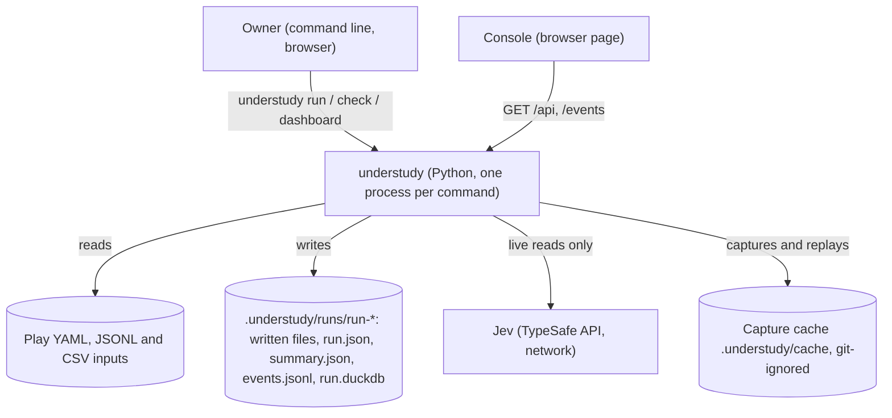
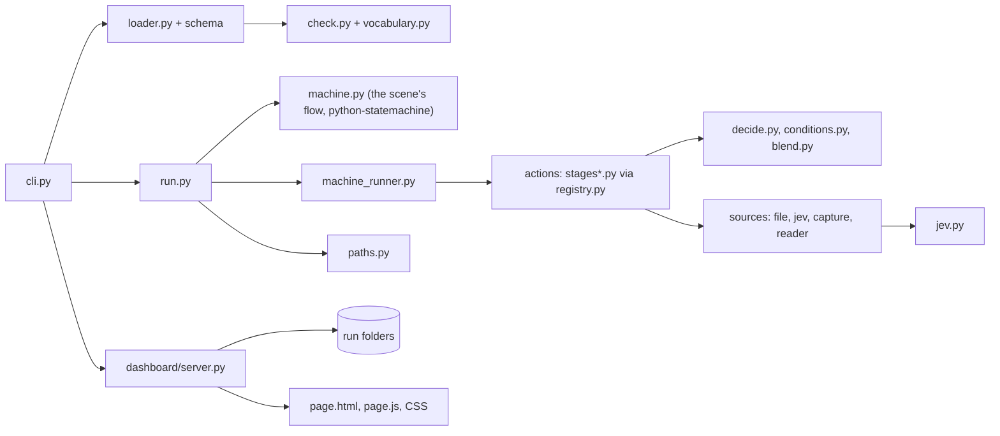

# Architecture Document: understudy (project-wide)

*   **Status**: Active (written 2026-11-01 from the code at `main` 5cd0927; earlier per-sprint architecture files stay as history)
*   **Author**: Morpheus
*   **Last Updated**: 2026-11-01
*   **Scope**: Project-wide ARCH.md. Requirements: [PRD.md](PRD.md). Vocabulary and invariants: [DOMAIN.md](DOMAIN.md). Reference for play authors: [PLAYS.md](PLAYS.md). Decisions: [DECISIONS.md](DECISIONS.md). Build and gates: [SDLC.md](SDLC.md).

---

## 1. Executive Summary & System Overview

understudy performs a **play**: one YAML file in which the owner writes a **stage** (the props it takes and the files it reads and writes), what can be decided, the rules and weights that decide it, and a **scene** of **beats** that connects the steps. A run reads files, applies the owner's rules in Python actions, asks Jev (the TypeSafe judgement model) only to choose among options the owner listed, writes output files, and records what happened. A separate read-only console shows runs.

**Key drivers** (from the PRD): reproducibility (same inputs and Jev answers give the same bytes), judgement kept bounded (Jev chooses, never writes), one runtime, private data kept out of tracked folders, every mistake caught before a run starts.

**Non-goals** of this design: playing apps, live sources other than files, multi-user access, a hosted service (PRD section 4).

## 2. System Context & Boundaries

* **Trust domains:** the owner's files and the machine are trusted; Jev's answers are untrusted text, constrained to the listed options before use; the console's network clients are untrusted (read-only, no login: SEC-002).
* **Network boundaries:** the only outbound call is to Jev, made by a run, never by the console. The console listens on 0.0.0.0, port 4180 (owner's decision; Sprint 21 decision 4).
* **Process model:** each command is one Python process. A run and the console share the run folder on disk; since Sprint 22 the console can also start runs, as child processes of its own user (an argument list, no shell, their own session; at most one per play and four in all) and stop only the ones it started. The run database (`run.duckdb`) is opened by one process at a time.

## 3. Component & Container Architecture

### Component Inventory

| Component | Responsibility | Inputs | Outputs |
|---|---|---|---|
| `src/play/cli.py` | The command line: `run`, `check`, `dashboard`, `runs`; maps failures to one `understudy: <message>` line and exit 1 or 2 | argv | stdout lines, exit code |
| `loader.py` | Reads a play (YAML 1.2 via ruamel, Jinja2 expansion with `--with`), validates against the JSON Schema, and turns stage + scene into what the engine runs (`engine_view`: stage files and beats without `to:` become sources, files written become sinks, flow beats become states); binds a called play's files (`bound_pieces`) | file path, `--with` values | `Play` or `PlayError` |
| `model.py`, `vocabulary.py` | The typed domain objects; every name a play may use, in one place | n/a | dataclasses, name lists |
| `check.py` | Whole-play checks before anything runs (actions exist, the flow reaches a final beat, outcomes declared, write rules, names validated); reports each path as the play writes it (`outward`) | `Play` | list of one-line problems |
| `machine.py` | Builds the scene's flow for python-statemachine | `Play` | machine class |
| `machine_runner.py` | The one loop: the flow picks the next beat; records beat start, completion or failure | machine, beats, a record | beat results, outcome |
| `registry.py`, `stages.py`, `stages_rows.py`, `stages_pair.py` | General typed actions registered with `@stage`; the function signature is the YAML contract. Since Sprint 25 they include `map.allocate` (oldest-first allocation of charges to payments, in whole cents, never past a payment's amount; ADR-0057) and `map.top` (the largest few rows per group) | stage name, `with:` values, rows | rows or a value |
| `decide.py`, `conditions.py`, `blend.py` | The owner's if/then/else trees, explicit conditions, weighted blend and hard `forbid` rules | rows, tree | weighted rows |
| `sources/file.py`, `jev.py`, `reader.py` | Read a piece: a JSONL/CSV stage file, a beat performed when read, or a Jev beat (live or replayed); a call's bound files are provided rows | the engine's source | rows |
| `sources/capture.py` | Capture every live Jev read; replay from one complete capture | a read | stored read / replayed read |
| `jev.py` | The one Jev client: bounded questions, typed answers | rubric, options, text | probabilities |
| `run.py` | One run: folder, beat context, files written then published last, `run.json`, `summary.json`, `events.jsonl`; a called play's writes are kept in memory as the call beat's result | `Play`, capture | `RunResult` |
| `paths.py` | The project root and the rule that private output never goes to tracked folders or `data/` | an output path | allowed path or `OutputPathError` |
| `dashboard/server.py` | HTTP only: routes, page files, event streams (capped), the origin and body checks for POST, security headers (no login) | requests | JSON, event stream, static files |
| `dashboard/view.py` | Everything the page shows about a run: state, failure, summary, beat groups, gauges, printed lines, the rack | run folders | dicts for the API |
| `dashboard/reads.py` | The Jev list from a run's captured answers (level names shown as captured) | capture files | list, gauge figures |
| `dashboard/runs.py` | `Launcher`: lists plays, checks then starts, replays and stops runs; the allow-lists and limits | plays folder, requests | run ids, refusals |
| `dashboard/page.js`, `controls.js`, CSS | Draw what the server returns; themes and mode; the start panel; no decisions of their own | API JSON | the page |

## 4. Runtime Interaction & Critical Flows

**A run** (`understudy run play.yaml --with ...`):

1. `cli.py` loads and checks the play (`loader`, `check`); any problem is printed one per line and the command exits 2 before anything starts.
2. A capture is chosen: live (Jev client created only if the play has a Jev beat) or replay (a complete capture must exist, else exit 2).
3. `run.py` makes the run folder (refused under `data/` or tracked folders), writes `run_started` (with the play's plan from `src/play/plan.py`: its pieces, beats, who reads what, and the moves between beats; ADR-0062), and builds the scene's flow.
4. `machine_runner` walks the flow. Each flow beat performs its action; a piece it reads is a stage file, or a beat without `to:` performed on first read (Jev through capture); `decide` and `blend` turn rows into weighted rows; `write` beats write `<file>.part`. A `play` beat performs another play in memory: its bound files are provided rows and what it writes is the beat's result.
5. Each beat start, completion or failure is appended to `events.jsonl` and `run.json`; a completion also says what the beat read, made and wrote (names, rows and column names, never values).
6. On reaching a final beat the `.part` files are renamed to their names and `run_finished` is written; on a failure no file is published and the command exits 1.

**Watching a run:** the page requests `/api/runs` and `/api/runs/<id>`, then, for a running run, `/events/<id>`; the server re-reads `events.jsonl` every half second and sends each new printed line until `run_finished`.

## 5. Interface & Contract Specifications

* **Commands:** `understudy run <play> [--with name=value]... [--out folder] [--replay[=run-id|folder]]`; `understudy check <play> [...]`; `understudy dashboard [runs-folder] [--port N] [--plays DIR]`. `--with` gives a prop its value or a stage file its path. Exit codes: 0 done, 1 a beat failed after start, 2 refused before start. Every failure is one `understudy: <message>` line.
* **Run folder:** `.understudy/runs/run-<stamp>-<id>/` (git-ignored, outside `build/` so `make clean` cannot delete it) holds the files the play writes, `run.json` (status, `beats`, `failed_beat`, mode), `summary.json` (counts only), `events.jsonl` (`run_started` with the `play` and its flow `beats`, `beat_entered`, `beat_started`, `beat_completed`, `beat_failed`, `paused`, `resumed`, `decision`, `run_finished`; one JSON object per line with `event` and `at`), `run.duckdb`.
* **Console API, open to read** (GET, JSON): `/api/runs` list; `/api/runs/<id>` the run as drawn (state, failure, summary, beat groups, gauges, printed lines, failure indices); the JSON keys still say `sketch` and `stage` (debt, below); `/api/runs/<id>/jev` the Jev reads; `/api/sketches`, `/api/replays`, `/api/session`; `/events/<id>` server-sent events; page files from an allow-list. A run id must match `run-[0-9A-Za-z-]+` and be a folder under the root.
* **Console API, no login** (POST, JSON object under 8 KB, same-origin only): `/api/start {sketch, with, replay?, hold?, hold_at?}` and `/api/stop {run}`. Refusals are `{problem}` with 400, 403, 404, 409 or 413. `GET /api/replays` lists each captured run with the `play` that made it, and `GET /api/sketches` gives each play's `files` with their defaults.
* **Command line:** `understudy run | check | dashboard [RUNS] [--port] [--plays] | runs [FOLDER]`.
* **Play format:** [PLAYS.md](PLAYS.md) and `schema/play.schema.json`.

## 6. Cross-Cutting Concepts & Resilience

### Failure Modes & Error Handling

| Failure Mode | Trigger / Condition | System Behavior | User / Client Impact | Blast Radius |
|---|---|---|---|---|
| Invalid play | Unknown action, option or name; bad YAML; a key from the old sketch shape | `check` fails before a run; message names file, path, bad value, nearest valid | one line each, exit 2 | none (nothing written) |
| Jev unavailable or key missing | no `TYPESAFE_API_KEY`, network error | refused before start (exit 2) or the beat fails (exit 1) | clear message; `--replay` still works | the run; no written file published |
| Jev answers outside the list | model returns an unlisted option | asked once more, then the beat fails | beat failure reason | the beat |
| A rule empties a choice | `forbid` removes every option | run fails naming the rule and the input unless the beat opts into `fallback` or `skip` | failure reason | the run |
| Forbidden output path | `--out` under `data/` or a tracked folder | refused before start | one line, exit 2 | none |
| Console loses a run's files | missing or half-written `events.jsonl` | a half-written last line is skipped; missing files read as empty | the run shows empty; other runs unaffected | one run in the page |
| Console overload | many open event streams | at most 32; a further one gets 503; a silent stream ends after 10 minutes | "too many watchers" | the console only (SEC-001, fixed) |
| Start refused | another origin, a play outside the folder, an unknown name, a file outside the project, a second Play, a fifth run, a failing check | 403, 400 or 409 with one sentence; nothing is started | the page shows the sentence | none |
| Run killed before its first beat | Stop, or `kill` | the launcher marks it stopped; a run killed elsewhere reads "stalled" after 10 minutes | STOPPED or STALLED | one run |

### Security & Privacy

* **Trust / access boundaries:** reading, starting, replaying and stopping are all open to the network with no login (owner decision 44, 2026-11-06; supersedes SEC-002, SEC-005, SEC-007 and SEC-008, which assumed a secret). Details of the earlier design: [baseline review](../agents/switch/reviews/2026-11-01-console-and-run-pipeline.md), [design gate](../agents/switch/reviews/2026-11-01-sprint-22-design-gate.md), [phase 5 review](../agents/switch/reviews/2026-11-01-sprint-22-phase-5.md); decisions in [ARCH_SPRINT22](sprints/ARCH_SPRINT22.md) and ADR-0049.
* **Sensitive data:** the owner's transactions stay in input files and in the files a play writes under `.understudy/runs`; `summary.json` and the console show counts and names only; capture files live in git-ignored `.understudy/`; `paths.py` refuses private output in tracked folders.
* **Reproducibility:** two replays of one capture are byte-identical (DOMAIN invariant 9).

## 7. Technical Stack & SDLC / Build Impact

* **Languages & Runtime:** Python 3.12.15 (uv 0.13.0). The browser page is plain HTML, CSS and JavaScript with committed fonts; there is no Node (ADR-0048).
* **Core Libraries & Tools:** python-statemachine (the scene's flow), DuckDB (SQL helper actions), ruamel.yaml and jsonschema (play files), Jinja2 (templates), dateparser and holidays (dates), iso18245 (MCC names), typesafe-sdk (Jev), ruff (lint), unittest (tests), gitleaks (secrets). The console server is the standard-library `http.server`.
* **Build-Environment Check (CRITICAL):**
  * Does this document add a new language, package manager, runtime version, or external tool? **No** (it describes the current system).
  * All dependencies follow `docs/SDLC.md` change classes.

## 8. Architectural Decisions (ADRs) & Technical Debt

### Decision Records
* ADR-0061 (plays: a stage that is the play's interface, a scene of beats, one kind of step; supersedes the sketch words of the ADRs below), ADR-0040 (a sketch is the owner's pipeline; the loop is plain Python), ADR-0041 (one decider contract, the weighted blend), ADR-0042 (explicit conditions, YAML 1.2), ADR-0043 (Jev is a source; non-file sources capture and replay), ADR-0044 (weights are numbers or if/then/else), ADR-0045 (`run` and `check` are the Python commands), ADR-0047 (the household is a sketch; SQLMesh and the MCP source servers removed), ADR-0048 (Node removed; console served by Python). Full list in [DECISIONS.md](DECISIONS.md).
* **No ADR yet** records the owner's decision "Python for all of understudy" (2026-10-27); it lives in `agents/cypher/platform_decision_2026-10-27.md`. Oracle to record it.

### Acknowledged Technical Debt & Trade-offs
* **The engine keeps its old internal names behind `engine_view`:** `Play.sources`, `sinks`, `machine`, a state's `then`, an action's `source` parameter. The play file and every message use the new words; renaming the internals is a separate refactor (Sprint 28 retro).
* **The console API keeps `sketch` and `stage` JSON keys** between server and page (the labels on the page say play and beat).
* **Browser check outside the gate:** `bobp make test-browser` (Playwright, system Chromium) covers the page's behavior, keyboard reach and text contrast in all six looks, but is not part of `check` (SDLC section 9).
* **The launcher's lock is held while it checks a play** (up to 60 s), so a Stop can wait behind a slow check.
* **A console restart forgets the children it started;** they keep running and stay visible by their files, but Stop is unavailable for them.
* **The console has no login** (owner decision 44): anyone on the network can start and stop runs and read Jev's level names. Accepted for a home network; the origin check still keeps another site's page from starting a run. If the machine ever sits on a network that is not trusted, bind the console to 127.0.0.1 or put a proxy with a login in front.
* **One process per run, one database writer:** fine for one owner; a second concurrent run in the same folder is not supported.
