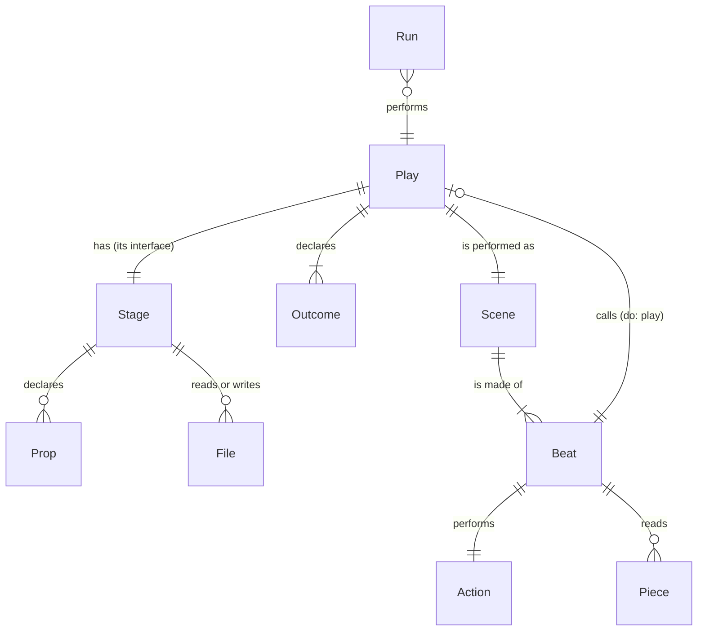
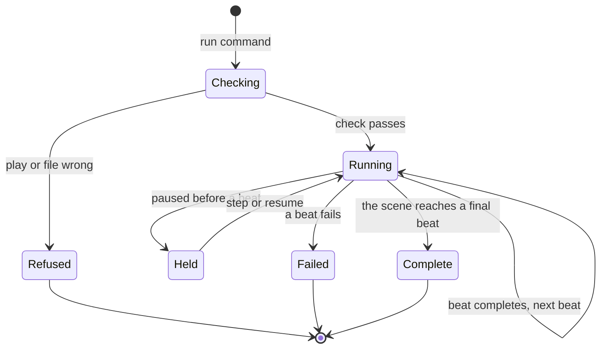

# Domain Model: Plays (the decision platform)

*   **Bounded Context**: `Play` (the decision model, `src/play/`)
*   **Status**: Active. Sketches became plays in Sprint 28 (owner decisions 19 to 42; ADR-0061)
*   **Domain Owners**: Cypher (*pm), Morpheus (*lead)
*   **Last Updated**: 2026-11-05

---

## 1. Executive Summary & Strategic Context

A play is a person's written-down way of deciding something, and understudy is the actor who performs it in their place: files in, a decision made by the owner's own rules, files out. The theater words carry the model: a play has a **stage** (everything it takes and gives) and a **scene** of **beats** (what happens); each beat is a character doing one action with its props. Counting and converting are plain SQL; the owner's judgement is `decide` logic with weights; Jev is asked only for a qualitative reading of supplied text against a rubric. The **console** is a page over a run's `events.jsonl`.

* **In-Scope Capabilities:** loading and checking a play; performing its scene; deciding, blending, filtering; stage files read and written; calling a play from a play; the run folder and its output.
* **Out-of-Scope:** fetching data over a network (MCP, HTTP); acts (a play of several scenes).
* **Upstream Contexts:** `Jev` (typesafe-sdk, wrapped in `src/jev.py`), `DuckDB/SQL`, `python-statemachine`.
* **Downstream Consumers:** the owner (command line and console).

---

## 2. Ubiquitous Language (Glossary)

| Business Term | Kind | Definition & Business Rules | Code Mapping |
|---|---|---|---|
| **Play** | Entity (Aggregate Root) | One YAML file: `name`, `description`, `stage`, `outcomes`, `data`, `scene`. Identity is its file path. The outermost configuration of an automation, and a reusable piece when another play calls it. | `Play` |
| **Stage** | Value Object | The play's interface: every prop it takes, every file it reads, every file it writes. Running a play means providing its stage. | `stage:` (props: `Play.inputs`; files: `Play.sources` of kind file and `Play.sinks`) |
| **Prop** | Value Object | A typed value the play takes (`choice`, `range`, `count`, `switch`) with a default; given with `--with` or a call's `with:`. | `inputs.py` |
| **Piece** | Value Object | Anything a beat reads by name: a stage file, or another beat's result. | a name in `with:` (`from:`) |
| **Scene** | Value Object | The play's body: `initial` and its `beats`. Its flow is the beats with `to:`/`transitions:`. | `scene:` (`Play.machine` behind `engine_view`) |
| **Beat** | Value Object | One step: a character doing one action with its props. In the flow (it has `to:`, `transitions:` or `final`) it is performed in order; otherwise it is performed when another beat first reads it, once. | `scene.beats` |
| **Character** | Value Object | A beat's name. Flow beats are named as roles (`pin_checker`, `record_writer`); a beat performed when read keeps a data name (`merged`). | beat key |
| **Action** | Value Object | What a beat does: `map.*`, `reduce.*` (a registered function), `write`, `play`, `jev`. | `registry.STAGES`, `@stage` |
| **Outcome** (dimension) | Value Object | A declared dimension of a decision: an enumeration, or options read from a piece's rows. | `outcomes:` |
| **Decision Row** | Value Object | One combination of outcome values with a `weight`; the weights for one input sum to 1. A decide tree, a lookup, a called play or a Jev reading can produce them. | weighted rows |
| **Blend** | Policy | The single combination rule: the weighted average of the Decision Rows its entries produce, weights normalized. | `blend()` |
| **Filter** (`forbid`) | Policy | An explicit condition that drops options; survivors are renormalized; a forbid always wins over a preference. | `forbid()` |
| **Rubric** | Value Object | The levels Jev picks among when reading supplied text (`criteria`), or options read from rows. | Jev beat `with:` |
| **Jev Answer** | Value Object | Probabilities over a question's options or levels; never a free value. | `Chosen` |
| **Run** | Entity | One performance of a play with its props; owns a run folder. | `run_sketch` |
| **Run Folder** | Value Object | `.understudy/runs/run-<stamp>-<id>/`: the written files, `run.json`, `events.jsonl`, `summary.json`. | run directory |

### Anti-Patterns (Forbidden & Deprecated Terminology)

| Forbidden / Deprecated Term | Preferred Ubiquitous Term | Rationale |
|---|---|---|
| sketch, subsketch | play; a play another play calls | Sprint 28: one file type, named for the metaphor (decision 20, 28). |
| `sources`, `sinks`, `inputs` (sections) | the stage: files read, files written (`access: write`), props | One place lists everything a play takes and gives (decisions 21, 34, 42). |
| `machine`, `states`, `then` | scene, beats, `to:` | Decisions 22, 26, 27. |
| `kind: stage` / `kind: jev` source; "stage" for a step | a beat without `to:`; a Jev beat | A computed source and a state were the same thing (decision 30). |
| `source:` (the main input prop) | `from:` | A prop is named for its role, not its type (decision 38). |
| `sink` action, `outputs:`, `{input, output}` pairs, `unpair` | `write`; what a called play writes is the call beat's result | Decision 42 and the Sprint 28 amendments. |
| performance (for a run) | run | Owner, decision 33. |
| `gates`, `scores`, `position ^ weight` | Filter, Decision Row, Blend | The old multiplicative scoring is dropped; vetoes are explicit filters. |
| Jev "writes", "generates" | Jev chooses | Jev only picks among the owner's listed options (ADR-0013). |

---

## 3. Tactical Domain Model & Entity Relationships

### Entities vs. Value Objects Summary

* **Entities (Identity-based):** `Play` (identity is its file path; a called play is a play), `Run` (identity is its run id).
* **Value Objects (Attribute-based):** `Stage`, `Prop`, `File`, `Scene`, `Beat`, `Action`, `Outcome`, `DecisionRow`, `Rubric`, `RunFolder`. Immutable; equality by value.

---

## 4. Aggregates & Business Invariants

### Aggregate Root: `Play`

* **Boundary Members:** `Stage` (props, files), `Outcome`, `Scene`, `Beat`, `Rubric`.
* **Invariants:**
  1. *Checked before run:* every action a beat names exists; every `to:` target is a flow beat; every flow beat can reach a final one; any mistake names the file, the path inside it as the play writes it, the bad value and the nearest good one.
  2. *One name, one thing:* a stage entry and a beat never share a name.
  3. *Declared outcomes only:* the Decision Rows a blend receives use only declared dimensions and options; an unknown key is an error naming the beat.
  4. *Weights:* the weights of one input's rows sum to 1 after every blend and every filter.
  5. *Forbid wins:* a `forbid` is applied after the blend and cannot be outweighed.
  6. *No silent gaps:* a filter that empties an input fails the run, unless the beat opts in to `fallback` or `skip`.
  7. *Jev chooses:* a Jev beat returns probabilities over listed options or levels; nothing Jev says is used as a value. A Jev beat is performed when read and never sits in the flow.
  8. *Write-once:* a file the play writes has one writer and no beat reads it; it is published only when the run succeeds (decision 7).
  9. *A called play sees only its stage:* a call binds its props and files; it cannot read its caller's other pieces, and it touches no disk (what it writes is the call beat's result; under `each`, each written row carries the row it was played for).
  10. *Reproducible:* the same files and the same Jev answers give byte-identical output.
  11. *Private output stays out of tracked folders and `data/`* (UND-54 AC4).

### Aggregate Root: `Run`

* **Boundary Members:** `RunFolder`, the beats' results, the manifest.
* **Invariants:** written files are published only after the scene reaches a final beat; a failed beat leaves no output file; the manifest records each flow beat as complete, or the beat that failed.

---

## 5. Lifecycle & State Machine Transitions

A **play's own scene** is the owner's and varies by play. The **run** has one fixed lifecycle:

### State Transition Matrix
| Current State | Triggering Event | Next State | Guard Condition / Invariant |
|---|---|---|---|
| Checking | check fails | Refused | exit 2; no output |
| Checking | check passes | Running | every stage file read exists, or is optional, or is bound by a call |
| Running | beat completes | Running | the flow's guard picks the next beat |
| Running | hold before a beat | Held | the beat in flight finishes first |
| Running | beat fails | Failed | exit 1; no output file |
| Running | final beat reached | Complete | exit 0; written files published last; `outcome:` recorded when the final beat names one |

Any transition not shown is rejected.

---

## 6. Domain Events & Side-Effects

The run's `events.jsonl` is the one side channel; the console reads it.

| Event Name | Trigger Condition | Key Payload Properties | Primary Consumers |
|---|---|---|---|
| `run_started` | check passed | `play`, `mode`, `initial`, flow `beats`, `transitions` | console (story, scene chart) |
| `beat_entered` | the scene moves to a flow beat | `beat`, `caused_by` | console (scene chart) |
| `beat_started` / `beat_completed` / `beat_failed` | a beat begins / ends / raises | `beat` (called plays: `caller.play[n].beat`), `reason` | command line, manifest, console |
| `paused` / `resumed` | a hold before a beat | `beat` | console |
| `decision` | a blend decides one input row and dimension | `beat`, `row`, `dimension`, `options`, `pick`, `probability` | console (decisions panel) |
| `run_finished` | the scene ends | `outcome` | command line, console |

Delivery is synchronous, in order, one process. A log whose first line does not name its play (one written before plays) is shown as unreadable.
