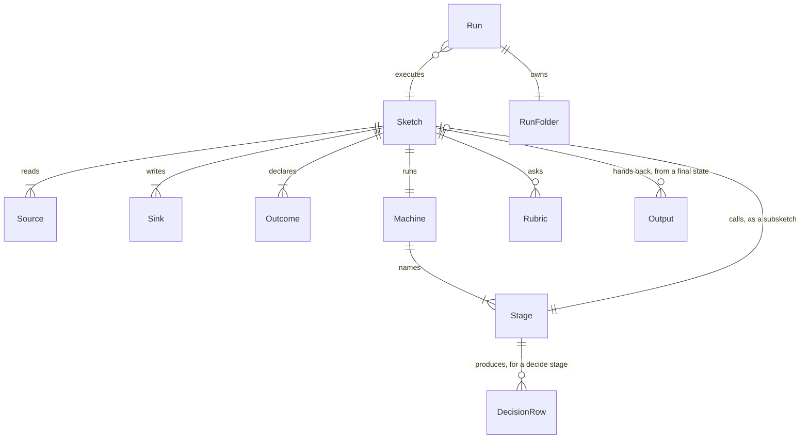
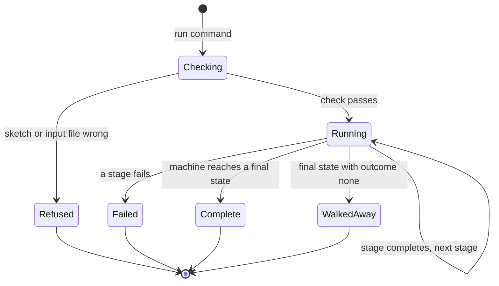

# Domain Model: Sketches (the decision platform)

*   **Bounded Context**: `Sketch` (the new Python sketch model, Python port epic)
*   **Status**: Draft (epic shaping, 2026-10-29); becomes Active when Sprint 19 builds the first slice
*   **Domain Owners**: Cypher (*pm), Morpheus (*lead)
*   **Last Updated**: 2026-10-29

---

## 1. Executive Summary & Strategic Context

A sketch is a shop owner's written-down way of deciding something, run by understudy: files in, a decision made by the owner's own rules, files out. Counting and converting are plain SQL; the owner's judgement is `decide` logic with weights; Jev is called only for a qualitative reading of supplied text against a rubric. This context replaces the old "play an app like a person" model; the Node player is deleted at the end of the epic.

* **In-Scope Capabilities:** loading and checking a sketch; running its machine; deciders, blending, filtering; sources and sinks as files; subsketches; the run folder and its output.
* **Out-of-Scope:** the dashboard and watch page (a later slice; they will consume the run event stream); fetching data over a network (MCP, HTTP); the Monarch/Amex ETL is now just a sketch, `examples/household/household.yaml` (Sprint 20), built from the same parts as the rest and in no context of its own.
* **Upstream Contexts:** `Jev` (typesafe-sdk, wrapped in `src/jev.py`), `DuckDB/SQL`, `python-statemachine`.
* **Downstream Consumers:** the owner (command line), later the Dashboard context.

---

## 2. Ubiquitous Language (Glossary)

Code mappings are the proposed symbols for the new package; Morpheus confirms the module layout in the Sprint 19 architecture.

| Business Term | Kind | Definition & Business Rules | Code Mapping |
|---|---|---|---|
| **Sketch** | Entity (Aggregate Root) | One YAML file: its sources, sinks, outcomes, data, questions and machine. Identity is its file path. | `Sketch` |
| **Subsketch** | Entity | A sketch used as a stage of another. Has its own inputs and named outputs; the parent sees only the outputs. | `Sketch` called through `SubsketchStage` |
| **Machine** | Value Object | The owner's python-statemachine YAML: states, events, guards. Defines which stage runs next. | `Machine` |
| **Stage** | Value Object | One unit of work a state names: ETL, a decide tree, a conversion, a subsketch call or a sink write. | `Stage` |
| **Source** | Value Object | A named, read-only input yielding JSONL, with a `kind` (file only in this epic) and params. | `Source` |
| **Sink** | Value Object | A named output that accepts JSONL. | `Sink` |
| **Input** | Value Object | A value the person sets for a run (a fader, switch, count or choice), or passes to a subsketch. | `Input` |
| **Outcome** (dimension) | Value Object | A declared dimension of a decision: an enumeration, or discrete numeric steps. Candidates may be read from source rows. | `Outcome` |
| **Output** | Value Object | A name a sketch lists in `outputs:` on a final state: the rows it hands back to whoever called it. What an output holds is for the consumer to accept: a `blend` takes Decision Rows; an `each` pairs it with the row it ran for. | `Output` (a name; no class) |
| **Decision Row** | Value Object | One combination of outcome values with a `weight`; the weights for one input sum to 1. A decide tree, an ETL lookup, a subsketch or a Jev source can all produce them. | `DecisionRow` |
| **Blend** | Policy | The single combination rule: the weighted average of the Decision Rows its entries produce, weights normalised. | `blend()` |
| **Filter** (`forbid`) | Policy | An explicit YAML condition (field, operator, value) that drops rows; survivors are renormalised; a forbid always wins over a preference. | `forbid()` |
| **Empty Result** | Policy | A filter that empties every row for an input fails the run, unless the stage says `fallback`, `skip` or `walk_away`. | `OnEmpty` |
| **Segment** | Value Object | A group of customers with a share of the trade, from the owner's rough demographics. | `Segment` |
| **Rubric** | Value Object | An ordered list of levels Jev picks among when reading supplied text. | `Rubric` |
| **Jev Answer** | Value Object | Probabilities over a question's options or levels; never a free value. | `Chosen` (existing) |
| **Run** | Entity | One execution of a sketch with its inputs; owns a run folder. | `Run` |
| **Run Folder** | Value Object | The folder under `build/runs/` holding stage files, the manifest and the output. | `RunFolder` |

### Anti-Patterns (Forbidden & Deprecated Terminology)

| Forbidden / Deprecated Term | Preferred Ubiquitous Term | Rationale |
|---|---|---|
| `turn`, `look`, `play`, "the understudy plays" | Machine, Stage, Run | The sketch is the owner's own pipeline, not an actor performing in an app. |
| `gates`, `scores`, `position ^ weight` | Filter, Decision Row, Blend | The old multiplicative scoring is dropped; vetoes are explicit filters. |
| "decider" as a schema keyword or a type | Decision Row (what is produced), Blend (what combines them) | Owner, 2026-10-30: "decider" is a name an author may choose, not part of the schema. |
| `bind`, `extends` | Source / Sink with `kind` in place | Decided against: the declaration holds its own configuration. |
| `target` (process/http/mcp/page) | Source, Sink | Nothing is played or driven; data goes in and out. |
| "record" for a row | Decision Row, source row | "Record" leaks storage detail. |
| "history", per-customer rows | Segment, total sales | The owner has totals and rough demographics, not customer files. |
| Jev "writes", "generates" | Jev chooses | Jev only picks among the owner's listed options (ADR-0013). |

---

## 3. Tactical Domain Model & Entity Relationships

### Entities vs. Value Objects Summary
* **Entities (Identity-based):**
  * `Sketch`: identity is its file path; a subsketch is a sketch.
  * `Run`: identity is its run id (timestamp plus short id); has a lifecycle (section 5).
* **Value Objects (Attribute-based):** `Machine`, `Stage`, `Source`, `Sink`, `Input`, `Outcome`, `DecisionRow`, `Segment`, `Rubric`, `RunFolder`. Immutable; equality by value.

---

## 4. Aggregates & Business Invariants

### Aggregate Root: `Sketch`

* **Root Entity:** `Sketch`
* **Boundary Members:** `Source`, `Sink`, `Outcome`, `Machine`, `Stage`, `Rubric`, `Segment`, `Input`.
* **Business Invariants (Must ALWAYS Be True):**
  1. *Checked before run:* every stage a state names exists; every transition target exists; every path ends in a final state; any mistake names the file, the path inside it, the bad value and the nearest good one.
  2. *Declared outcomes only:* the Decision Rows a blend receives use only dimensions and options in `outcomes` (or, for source-backed outcomes, keys read from the source); an unknown key is an error naming the stage that produced it, never ignored.
  3. *Weights:* the weights of one input's rows sum to 1 after every blend and every filter; a missing option has weight 0.
  4. *Forbid wins:* a `forbid` is applied after the blend and cannot be outweighed by a preference.
  5. *No silent gaps:* a filter that empties an input fails the run naming the rule and the input, unless the stage opts in to `fallback`, `skip` or `walk_away`.
  6. *Jev chooses:* a Jev stage returns probabilities over listed options or levels; nothing Jev says is used as a value; an answer outside the list is refused and asked once more, then the stage fails.
  7. *Sources are read-only:* a side effect is a stage, never a source.
  8. *A subsketch exposes only its named outputs;* its inputs reach the person only if the parent lists them under `expose`.
  9. *Reproducible:* the same files and the same Jev answers give byte-identical output.
  10. *Private output stays out of tracked folders and `data/`* (UND-54 AC4).

### Aggregate Root: `Run`

* **Boundary Members:** `RunFolder`, the stage results, the manifest.
* **Invariants:** the output sink is written only after every stage completed; a failed stage leaves no output file; the manifest records each stage as complete or failed.

---

## 5. Lifecycle & State Machine Transitions

A **sketch's own machine** is the owner's and varies by sketch. The **run** has one fixed lifecycle, driven by the Python loop:

### State Transition Matrix
| Current State | Triggering Event | Next State | Guard Condition / Invariant |
|---|---|---|---|
| Checking | check fails | Refused | exit 2; no run folder content beyond the manifest; no output |
| Checking | check passes | Running | all required source files exist |
| Running | stage completes | Running | the machine's guard picks the next stage |
| Running | stage fails | Failed | exit 1; no output file; earlier stage files kept for inspection |
| Running | final state reached | Complete | exit 0; output written last |
| Running | final state with `outcome: none` | WalkedAway | exit 0 only where the sketch says `walk_away`; no output |

Any transition not shown is rejected.

---

## 6. Domain Events & Side-Effects

The run event stream (JSON lines, stdout and the run folder) is the only side channel; the later dashboard will read it.

| Event Name | Trigger Condition | Key Payload Properties | Primary Consumers / Subscribers |
|---|---|---|---|
| `run_started` | check passed | run id, sketch path, inputs | command line, dashboard (later) |
| `stage_started` | a state's stage begins | run id, stage name | command line, dashboard (later) |
| `jev_asked` | a stage sends a question to Jev | run id, stage, question, options | summary counts |
| `stage_completed` | a stage finishes | run id, stage, rows in/out | manifest |
| `stage_failed` | a stage raises | run id, stage, reason | command line, manifest |
| `run_finished` | machine ends | run id, outcome (`complete`, `walked_away`, `failed`), output path | command line, dashboard (later) |

Delivery is synchronous, in order, one process.
