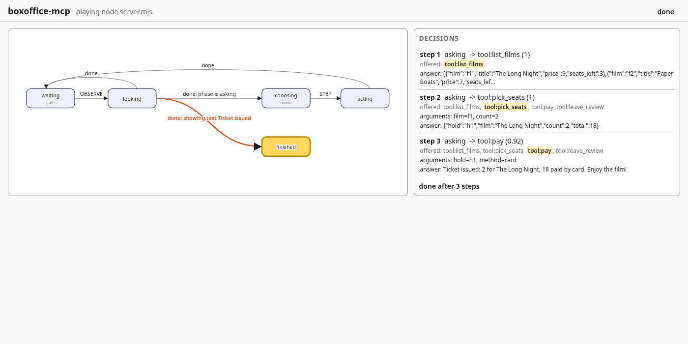
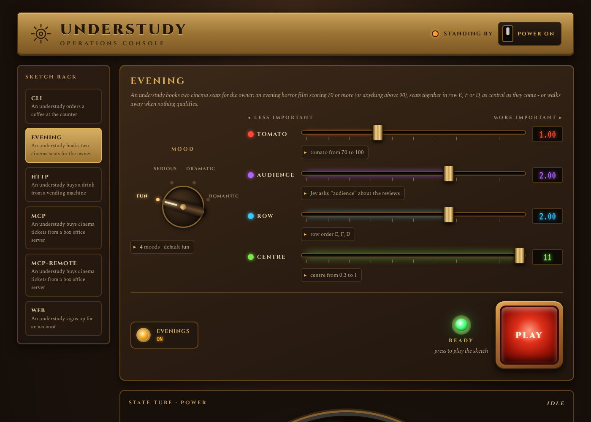
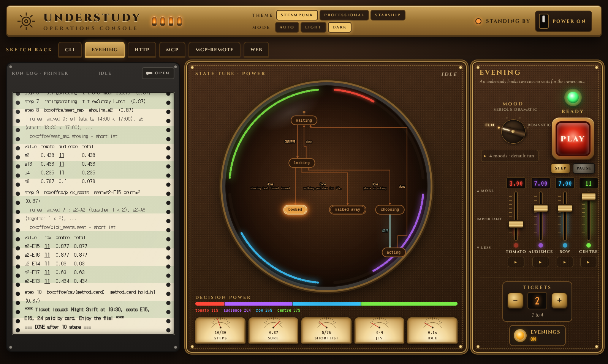

# understudy User Guide

How to install understudy, run a sketch against an app, read what it did, write a sketch for
your own app, and fix what goes wrong.

TLDR:
    Setup: `bobp make install`, set `TYPESAFE_API_KEY`, `bobp make install-browser` for web apps.
    Run: `bobp make run ARGS="run <sketch>"`; check without running: `ARGS="check <sketch>"`.
    Output: one JSON line per step on stdout and in build/runs/<sketch name>/; exit 0 / 1 / 2.
    Watch: `run <sketch> --watch` serves a live page (statechart + decisions); `watch <log>` replays a run.
    Your own app: copy an example directory, edit its sketch.yaml (and hooks.mjs if it has one), `check` until OK.
    Web pages and MCP servers need no code at all: their generic apps play them.
    Reference: docs/SKETCHES.md. Worked example: docs/WALKTHROUGH.md. MCP servers: docs/MCP_GUIDE.md.

## Contents

1. [Concepts](#1-concepts)
2. [Install](#2-install)
3. [Run an example](#3-run-an-example)
4. [Read the output](#4-read-the-output)
5. [Watch a run](#5-watch-a-run)
   - [The dashboard](#the-dashboard)
6. [Write a sketch for your own app](#6-write-a-sketch-for-your-own-app)
7. [Troubleshooting](#7-troubleshooting)
8. [Command reference](#8-command-reference)

---

## 1. Concepts

| Word | Meaning |
|---|---|
| **understudy** | the stand-in that plays your app: it looks, decides with Jev, and moves |
| **app** | the thing being played - a command-line program, a web page, a JSON API or an MCP server |
| **target** | how understudy sees and moves the app: `process` (stdin/stdout), `page` (headless Chromium, read like a screen reader), `http` (requests) or `mcp` (tool calls, as an MCP client) |
| **sketch** | one directory with one `sketch.yaml`: its name, target, the **turn** (a statechart: when to look, when to move, when it is over) and the **questions** Jev is asked |
| **hooks** | `hooks.mjs`, only for programs and APIs: which phase the app is in, what Jev should know, which moves are on offer, how to make one. Pages and MCP servers have generic hooks built in |
| **Jev** | TypeSafe's judgment model; it only ever picks among the moves on offer - and for an MCP tool, among the values each argument may take |

A run repeats one loop: **look** at the app → if the turn says it is the understudy's move,
**ask Jev** to pick one of the offered moves → **make the move** → look again, until the turn
reaches its end state.

## 2. Install

You need Node 24, `make`, the `bobp` CLI and a TypeSafe API key.

```sh
bobp make install            # npm ci into node_modules/ - nothing is installed globally
export TYPESAFE_API_KEY=...  # needed by `run` only; `check` and `library` work without it
bobp make install-browser    # only for web apps, and only if no Chromium is installed
```

Check it worked:

```sh
bobp make test                              # expect "fail 0"
bobp make run ARGS="check examples/cli"     # expect "examples/cli: sketch OK - ..."
```

`bobp make` writes each command's full output to `build/build.out` and posts a status line to
the team chat; the last lines are shown in your terminal.

## 3. Run an example

```sh
bobp make run ARGS="run examples/cli"              # the coffee counter (a program)
bobp make run ARGS="run examples/web"              # the sign-up wizard (an unmodified web page)
bobp make run ARGS="run examples/http"             # the vending machine (a JSON API)
bobp make run ARGS="run examples/mcp"              # the box office (an MCP server over stdio)
bobp make run ARGS="run examples/cli --steps 5"    # stop after at most 5 moves
bobp make test-live                                # every example, real Jev, 20-step cap
```

`examples/mcp-remote` plays the same box office over HTTP with a token; it needs the server
started first - see [its README](../examples/mcp-remote/README.md).

Each Jev decision is one paid API call (an MCP move with open arguments is two); a cap
(`--steps`, else the sketch's `steps:`, else 50) keeps a confused sketch from running up a
bill. **Ctrl-C** once stops at the next safe point (the run finishes the move it is in); a
second Ctrl-C closes the app at once.

For a guided tour of what happens during those runs, read [WALKTHROUGH.md](WALKTHROUGH.md).

## 4. Read the output

**stderr** - for you to watch:

```text
understudy: playing coffee-cli (node app.mjs) - log build/runs/coffee-cli/2026-10-15T19-55-29.042Z.jsonl
understudy: step 1 asking -> size:medium (0.95)
```

The first line says what is being played and where the log is. Then one line per move:
step number, the phase, the move Jev picked, and its confidence. An MCP sketch may also say,
once per tool, that a tool is `not offering ... yet` and why.

**stdout and the log file** - for tools: one JSON object per line, identical in both.

```json
{"step":1,"phase":"asking","options":["size:small","size:medium","size:large"],"picked":"size:medium","move":"size:medium","confidence":0.95,"state":"waiting", "...": "..."}
{"final":true,"outcome":"done","steps":3,"state":"finished"}
```

| Field | Meaning |
|---|---|
| `options` | the moves offered at this step |
| `picked` / `move` | what Jev chose / what was actually sent (they differ only if a confidence floor fell back) |
| `confidence` | Jev's confidence in the pick, 0-1 |
| `offList`, `answer` | present when Jev's first pick was not on offer; `answer` is what it said (it was asked again) |
| `response` | how the app answered: `{ status }` for an API; `{ call: { tool, arguments }, isError, text }` for an MCP server |
| `state` | where the turn's statechart is after the step |
| `event` lines | the run's story for the watch page and replays - the first line (`start`: the sketch and its statechart), each state change (`state`), and why a run that failed ended (`ended`); tools that only want steps skip any line with an `event` field ([SKETCHES.md §7](SKETCHES.md#7-running)) |
| `final` line | always last: `outcome` is `done`, `step-cap`, `stalled`, `app-exited`, `connection-lost`, `refused`, `control-gone`, `off-list`, `no-first-move`, `jev-error`, `interrupted` or `error` - or `walked-away` (exit 0) when a deciding sketch found nothing the person would accept |

**Exit code**: `0` the sketch reached its end state; `1` the run started but could not finish
(the final line says why); `2` refused before anything started (the message says what to fix).

Logs accumulate in `build/runs/<sketch name>/`; `bobp make clean` removes them.

## 5. Watch a run

Add `--watch` to any run and open the address it prints:

```sh
bobp make run ARGS="run examples/mcp --watch"
```

```text
understudy: watch at http://127.0.0.1:41207/w/kJ3m9xT2vQ8pLr1n/
understudy: playing boxoffice-mcp (node server.mjs) - log build/runs/boxoffice-mcp/....jsonl
```



The page has three parts:

- **The statechart**, drawn from the sketch's own `turn:` - every state and transition, labelled
  the way the log names them (`OBSERVE`, `STEP`, `done: phase is asking`). The state the
  understudy is in is highlighted, and the transition it just took is marked.
- **The decisions**: one entry per step - the options on offer with Jev's pick highlighted, its
  confidence, an off-list retry if there was one, the arguments Jev chose for an MCP tool, and
  the app's answer (an HTTP status, or the tool result's first line).
- **The status** (top right): running, paused, or how the run ended - `done`, or the outcome
  with its reason (`ended: stalled`, and the message under the decisions).

Watching changes nothing about the run: the same steps, log and exit code, and the run does not
wait for the page. Open the page late, or reload it, and it shows everything so far, then
follows. The page is served by understudy itself - no internet needed - on `127.0.0.1` only,
with a fresh address each run. A free port is picked; `--port 4173` chooses one (a port in use
refuses the run before anything starts).

**Pause and step.** While a run is going, **Pause** stops it before its next move (a move
being made finishes first). Then **Step** lets exactly one move happen, and **Resume** lets it run
on. `--pause` starts the run paused, so you can read the statechart before anything happens:

```sh
bobp make run ARGS="run examples/http --watch --pause"
```

```text
understudy: paused - step or resume from the page, or Ctrl-C
```

While paused, Jev is not asked anything, and the 10-second first-move and stall limits do not
count. Ctrl-C stops a paused run at once (`interrupted`); closing the page does not resume it.

**Replay a finished run.** Every run's log holds everything the page needs, so any log -
yours, or one someone sent you - can be watched again, with no sketch, app, key or network:

```sh
bobp make run ARGS="watch build/runs/boxoffice-mcp/2026-10-16T03-05-39.092Z.jsonl"
```

```text
understudy: replaying build/runs/boxoffice-mcp/2026-10-16T03-05-39.092Z.jsonl at http://127.0.0.1:46027/w/.../ - Ctrl-C to stop
```

**Play** walks through the run; **Step forward** and **Step back** move one state change at a
time; click a decision to jump to it (decisions still to come are faded). Ctrl-C stops the
server. Logs written before sprint 4 have no `start` line and are refused.

**From another machine.** The page listens on `127.0.0.1` only, unless you say otherwise. If
understudy runs on a machine without a screen (a Raspberry Pi, a server), either forward the
port over SSH and open the printed address on your own machine:

```sh
ssh -L 4173:127.0.0.1:4173 pi@raspberrypi      # then, on the Pi:
bobp make run ARGS="run examples/cli --watch --port 4173"
```

or listen on the machine's network address with `--host` (works for `watch <log>` too):

```sh
bobp make run ARGS="run examples/cli --watch --host 0.0.0.0"     # every interface
```

```text
understudy: watch at http://192.168.86.69:41207/w/kJ3m9xT2vQ8pLr1n/ or http://127.0.0.1:41207/w/kJ3m9xT2vQ8pLr1n/
```

With `--host`, anyone on that network who has the printed address can watch the run and pause
it - the random part of the address is the only guard. Use it on a network you trust.

### The dashboard

For sketches with inputs - the evening example's mood, weights and switch - the dashboard is a
console to play them from instead of a command line:

```bash
bobp make run ARGS="dashboard examples"      # understudy dashboard <folder> [--port N] [--host ADDR]
```

It prints `understudy: dashboard at http://127.0.0.1:<port>/d/<token>/`; open it. Like the watch
page it is served by understudy alone (no internet), on 127.0.0.1 unless you give `--host`, behind
an unguessable path. Ctrl-C stops it (and any run).



- **Sketch rack** (left): every directory in the folder holding a `sketch.yaml`. One that fails
  `check` is greyed out with its message.
- **Controls**: each of the sketch's `inputs:` as a control - a `choose` input is a pointer dial,
  a `weight` a fader (left = less important, right = more; each its own colour; the readout shows
  `OFF` at 0 and `11` at the top), a `count` a brass stepper (− and + round a Nixie number, e.g. the
  evening's number of tickets), a `switch` a toggle with a lamp. They start at the defaults.
- **Access panels**: the ▸ under a fader or the mood dial opens edit boxes for that factor's range
  or order, its Jev question, its default, or the moods. Each change is checked and **saved to the
  sketch's `sketch.yaml`** (only that value's text changes; comments stay). A change the checks
  would refuse is not saved; the box turns red and says why.
- **POWER**: off stops a run and dims the console; **off and on again puts every sketch you edited
  back to how it was** before your first edit (the copies live in `<folder>/.factory/`, git-ignored).
- **PLAY**: starts the sketch with the controls' values (as `--input`), logged like any run under
  `build/runs/`; the READY lamp turns from green to orange and the button reads STOP (Ctrl-C for
  that run). Settings are locked while it runs. A run that cannot start (no `TYPESAFE_API_KEY`, a
  value out of range) prints why.



- **State tube**: the sketch's statechart on a circle, from its initial state; final states inside.
  Every transition is labelled with its event and guard. The current state glows; the transition
  just taken flows. Around the rim, one arc per weight in its colour; the transition into the
  state that plays a move, and the orb in the middle, carry the weights' colours mixed in the
  faders' ratio, with each weight's share.
- **Printer**: the run log on tractor-feed paper - each step, what the rules removed, Jev's scores,
  each score table (a perfect 1.0 prints as `11`), the ticket and the outcome.
- **Behind the printer**: **REMOVE** takes the printer off and shows the sketch's whole
  `sketch.yaml` in an edit box, with a cheat-sheet sticker of the keys, the `turn:` shapes and the
  input kinds. Half a second after you stop typing, the text is checked and **saved**, and the
  tube, controls and rack redraw from it - add or rename a state and watch it appear. Text the
  checks would refuse is not saved: the box turns red, says why in one line, and the tube keeps the
  last good sketch. The box is read-only while a run plays. **REFIT PRINTER** puts the printer back
  (the run log kept printing behind it). POWER off and on puts the factory sketch back, as for the
  access panels.

## 6. Write a sketch for your own app

The fastest route is to copy the example closest to your app and change it.

**1. Copy an example.**

```sh
cp -r examples/cli examples/myapp     # a program; examples/web for a page, examples/http for an API, examples/mcp for an MCP server
```

**2. Point the target at your app** (`examples/myapp/sketch.yaml`), and give it a new `name`:

```yaml
name: myapp
target: { kind: process, command: python3, args: [myapp.py] }
# a web page:    { kind: page, root: public, page: index.html }
# an API:        { kind: http, command: node, args: [server.mjs], url: 'http://127.0.0.1:{port}', state: /status }
#                (leave out command to play a service already running at a fixed url)
# an MCP server: { kind: mcp, server: { command: node, args: [server.mjs] } }
#                or { kind: mcp, config: servers.json, server: myserver } - a file in Claude's mcpServers shape
```

A program, API server or local MCP server is started in the sketch directory. A web page is
played as it is - nothing needs adding to it.

**For a web page or an MCP server, there is no code to write:** the generic page app offers
every button, link, checkbox, radio button and list option a person could choose; the generic
MCP app offers every tool and lets Jev choose its arguments. Skip to step 4, and end the turn
with a `showing` guard (text your last screen or last tool answer shows) - see
`examples/web/sketch.yaml` or `examples/mcp/sketch.yaml`.

For an MCP server, [MCP_GUIDE.md](MCP_GUIDE.md) walks through this step by step. In short: the
arguments Jev may choose come from the tool's schema (enums, booleans,
small number ranges) or the last answer; for anything else - free text especially - list
values in the sketch, and fix whole calls if you like:

```yaml
values:
  add_note: { text: ['Buy milk', 'Call the dentist'] }
calls:
  - { tool: pay, arguments: { method: card } }
```

A remote server's token goes in a header from the environment, never in the file:
`"headers": { "Authorization": "Bearer ${MY_TOKEN}" }` ([SKETCHES.md §2](SKETCHES.md#kind-mcp--an-mcp-server-with-understudy-as-its-client)).

**3. Teach the hooks to read your app** (programs and APIs). Four functions in `hooks.mjs`,
which `sketch.yaml` names with `app: hooks.mjs` (details in
[SKETCHES.md §3](SKETCHES.md#3-hooksmjs--what-the-view-means-program-and-json-api)):

- `phase(view)` - return a name such as `'asking'`, `'done'` or `'waiting'`. Only return the
  "it is my move" phase when there is something not yet answered.
- `project(view)` - the facts Jev should see, as a small object with clear names.
- `options(state)` - the moves on offer: `[{ id: 'size:large', what: 'answer large', value: 'large' }]`.
- `act(move)` - how to make one: `{ actions: [{ input: move.value }] }` for a program,
  `{ actions: [{ method: 'POST', path: '/order', body: { ... } }] }` for an API.

**4. Edit the turn and the questions.** Keep the statechart from the example; change the
phase names in the `phase` guards to the ones your `phase()` returns. Rewrite `questions:` so
Jev knows who it is playing and what it wants - refer to your `project()` fields in backticks,
and never put a number or a quoted value in the prose.

**5. Check until it is clean.** `check` starts nothing and needs no key:

```sh
bobp make run ARGS="check examples/myapp"
```

**6. Run it with a small cap**, then raise it (or set `steps:` in the sketch):

```sh
bobp make run ARGS="run examples/myapp --steps 3"
```

`bobp make run ARGS="library examples/myapp"` lists every name your turn may use, including
any your hooks add.

## 7. Troubleshooting

Every error is one line starting `understudy:`. The common ones:

| Message | Exit | What to do |
|---|---|---|
| `understudy run needs a TypeSafe key: set TYPESAFE_API_KEY` | 2 | `export TYPESAFE_API_KEY=...` |
| `<path>: no such sketch - give a directory holding sketch.yaml` | 2 | give the sketch directory, e.g. `examples/cli` |
| `<dir>: no sketch.yaml - adapter.mjs and part/ are no longer read` | 2 | an old example directory: write a `sketch.yaml` ([SKETCHES.md §1](SKETCHES.md#1-sketchyaml) maps the pieces) |
| `.../sketch.yaml: adapter: not a sketch key (known: ...)` | 2 | remove or rename the key |
| `.../sketch.yaml: app: a process target needs hooks that read the app` | 2 | add `app: hooks.mjs` and write the hooks |
| `.../hooks.mjs: options must be a function` | 2 | the hooks are missing that one |
| `.../sketch.yaml: turn.states.looking.invoke.src: no actor "lok" - did you mean "look"?` | 2 | fix the name at that path |
| `.../sketch.yaml: questions.answer.instructions: carries a number in the question...` | 2 | move the value into `project()` and refer to it by path in backticks |
| `.../sketch.yaml: not valid YAML - ... at line 4, column 1` | 2 | fix the YAML at that line |
| `.../sketch.yaml: target.server: no server "x" in servers.json (it has: ...)` | 2 | use one of the names the file has |
| `.../servers.json: ${MCP_TOKEN} is not set` | 2 | `export MCP_TOKEN=...`, or give a default `${MCP_TOKEN:-value}` |
| `--steps must be a positive whole number` | 2 | `--steps 20` |
| `port 4173 is in use - choose another with --port` | 2 | another watch page (or program) has it: pick another, or leave `--port` out for a free one |
| `cannot listen on <addr> - give an address this machine has` | 2 | `--host` named an address this machine does not have; use `0.0.0.0` or one `ip addr` lists |
| `--pause needs --watch` / `--port needs --watch` / `--host needs --watch` | 2 | add `--watch` - the page is where you pause and step |
| `<log>: no start line - replay needs a log written by understudy run (sprint 4 or later)` | 2 | the log is older than the watch page; replay a new run's log |
| `<log>: line N is not JSON - this is not a run log` | 2 | give a `.jsonl` file from `build/runs/<sketch>/` |
| `stopped by Ctrl-C while paused, after N steps` | 1 | you stopped a paused run; nothing was cut short mid-move |
| `Chromium is not installed - run: bobp make install-browser` | 2 | run it (or install your distribution's Chromium) |
| `stopped after 50 steps without reaching the end state (last state: X)` | 1 | the turn never reached `type: final`: check that `phase()` returns your done phase (or the `showing` text appears), or raise the cap |
| `<command> exited with code N before the end state` | 1 | the app quit or crashed; run it by hand to see why |
| `<command> exited with code N before the MCP handshake - it printed: ...` | 1 | the MCP server could not start; its last stderr lines say why |
| `no first move from <app> within 10 s - ...` | 1 | nothing to do from the start: `phase()` never returned the move phase; for a page, nothing choosable appeared; for an API or remote MCP server, nothing answered; for an MCP server, no tool could be offered (each one is named, with why) |
| `stalled: nothing to do for 10 s after step N ... add a showing guard` | 1 | the app stopped offering moves; if that screen is the end, add a `showing` guard for it |
| `the MCP server at <url> refused the connection (HTTP 401)` | 1 | the token (or the URL) is wrong |
| `lost the connection to <app>: ...` | 1 | the API or MCP server went away mid-run; check it is still up |
| `step N: could not press button "X" - it is no longer on the page` | 1 | the page changed between the look and the move; usually a page still loading |
| `step N: in phase "X" Jev answered off the list twice (...)` | 1 | the question or options confuse Jev: clarify the instructions or option wording (for an MCP argument, list `values:` for it) |
| `step N: Jev request failed: ...` | 1 | network or key problem; the SDK's message says which |
| `unexpected error: ...` | 1 | a bug in understudy or in the hooks' code - please report it with the command line |

## 8. Command reference

```text
understudy run <sketch> [--steps N] [--input name=value]... [--watch [--port N] [--host ADDR] [--pause]]
                                      play the sketch against its app (needs TYPESAFE_API_KEY);
                                      --input sets one of the sketch's inputs (e.g. --input mood=romantic);
                                      --watch serves the live page, --pause starts it paused
understudy check <sketch>             check the sketch without starting anything
understudy library [<sketch>]         list every name a sketch may use, with its meaning
understudy watch <log.jsonl> [--port N] [--host ADDR]
                                      replay a finished run's log on the watch page
understudy dashboard <folder> [--port N] [--host ADDR]
                                      the console: choose a sketch, set its inputs, press Play
understudy --help
```

`<sketch>` is a directory holding `sketch.yaml` (e.g. `examples/cli`) or the file itself. Run
them as `bobp make run ARGS="<command> ..."`.

| Make target (`bobp make <target>`) | Does |
|---|---|
| `install` | install dependencies (network) |
| `install-browser` | download Chromium for web targets (network) |
| `run` | `ARGS="run|check|library ..."` |
| `test-live` | play every example with real Jev, 30-step cap, each outcome checked; `examples/evening` again with `BOX_STATE=full` (walks away); serves the box office over HTTP for `mcp-remote` |
| `test` / `lint` / `check` | unit tests / eslint / the full gate |
| `test-browser` | the watch page in headless Chromium (needs `install-browser`; no key) |
| `clean` | remove `build/` (logs included) |
