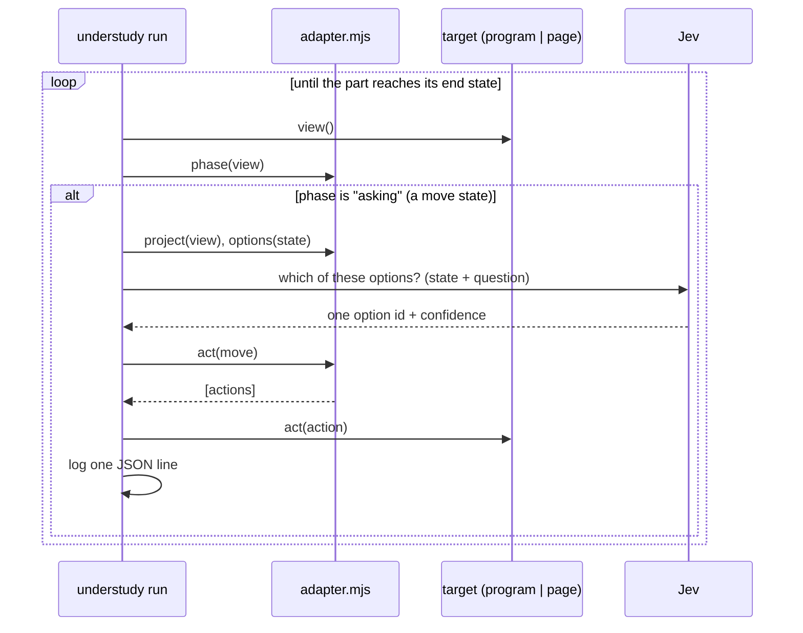
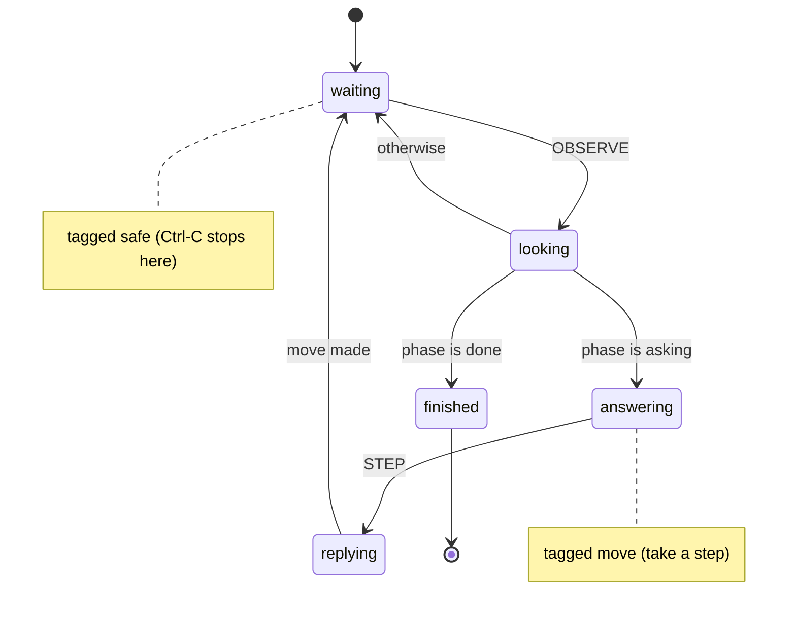

# Walkthrough: the two examples, taken apart

A guided tour of `examples/cli` and `examples/web`: the app, its adapter, its part, what Jev
is actually asked, and a real run of each - then a few ways to break them on purpose.

TLDR:
    Both examples have the same three pieces: an app, adapter.mjs, part/ (turn.yaml + questions.yaml).
    The part's statechart is identical in both; only the adapter knows "terminal" or "web page".
    Each step: look -> phase() says "asking" -> options() offered -> Jev picks one -> act() sends it.
    Real runs below: 3 Jev calls each, exit 0, a JSON line per step plus a final line.
    Break-it exercises show every kind of refusal and failure with its exact message.

## Contents

1. [The loop in one picture](#1-the-loop-in-one-picture)
2. [The CLI example: a coffee counter](#2-the-cli-example-a-coffee-counter)
3. [The web example: a sign-up wizard](#3-the-web-example-a-sign-up-wizard)
4. [Same part, different stage](#4-same-part-different-stage)
5. [Break it on purpose](#5-break-it-on-purpose)

---

## 1. The loop in one picture



The run loop, the statechart and Jev are understudy's; the adapter is the only code you write.

---

## 2. The CLI example: a coffee counter

### The app - `examples/cli/app.mjs`

An ordinary interactive program with no idea understudy exists. Try it yourself (type
`medium`, `oat`, `order`):

```text
$ node examples/cli/app.mjs
Welcome to the coffee counter.
? size [small|medium|large]
> medium
? milk [none|whole|oat]
> oat
Your order: a medium coffee, milk: oat.
? confirm [order|start over]
> order
Order placed: a medium coffee, milk: oat. Goodbye.
```

Each question is one line, `? <topic> [a|b|c]`, then a `> ` prompt. A wrong answer gets
`! "x" is not on the menu for size` and the question again; `start over` goes back to size.

### What understudy sees - the process target

The target turns the terminal into a **view**. Right after start-up it is:

```js
{ lines: ['Welcome to the coffee counter.', '? size [small|medium|large]', '> '],
  seq: 61, sent: 0, exited: null }
```

The unfinished prompt `> ` is included, and after a move the answer is echoed where it was
typed (`> medium`) - exactly what a person would see. `sent` counts the answers given so far.

### The adapter - `examples/cli/adapter.mjs` (51 lines)

```js
target: { kind: 'process', command: 'node', args: ['app.mjs'] },
```

starts `node app.mjs` in `examples/cli/`. Then the four hooks:

- **`phase(view)`** - `done` once a line starts `Order placed`; otherwise `asking` **only while
  more questions have been printed than answers sent**. That comparison is what stops the
  understudy answering the same question twice when it looks again before the program has
  replied.
- **`project(view)`** - what Jev reads:

  ```js
  { topic: 'size', choices: ['small', 'medium', 'large'],
    answered_so_far: [], counter_says: ['Welcome to the coffee counter.'] }
  ```

- **`options(state)`** - one option per choice: `{ id: 'size:medium', what: 'answer medium', value: 'medium' }`.
  The part before `:` (`size`) is the option's **kind**.
- **`act(move)`** - `{ actions: [{ input: 'medium' }] }`: the target writes `medium` + newline to
  the program's stdin.

### The part - `examples/cli/part/turn.yaml`



- `waiting` is where the understudy idles; each look sends `OBSERVE`.
- `looking` invokes the library actor `look`, which calls the adapter's `phase()`; the `phase`
  guards route on the answer.
- `answering` is tagged `move`, so the run takes a step: `STEP` → `replying`, which invokes
  `play` with `question: answer`.
- `finished` is `type: final`: the run ends, exit 0.

### The question - `examples/cli/part/questions.yaml`

```yaml
answer:
  type: choice
  instructions: >-
    You are a person ordering a coffee at a counter. The counter is asking about
    `topic`; `answered_so_far` is what you already chose and `counter_says` is what it
    last told you. Pick the answer you would give if you wanted a coffee you would
    enjoy, and place the order once it looks right.
  criteria:
    size: answer this size
    milk: answer this milk choice
    confirm: answer this to the confirmation question
```

The prose names state **by path** (`topic`, `answered_so_far`) and never by value. At step 1
the options are worded from `criteria` by kind, with each value in backticks, so Jev is asked:

```text
state:    { topic: "size", choices: [...], answered_so_far: [], counter_says: [...] }
question: You are a person ordering a coffee ... (the instructions above)
options:  size:small  -> answer this size (`small`)
          size:medium -> answer this size (`medium`)
          size:large  -> answer this size (`large`)
```

Jev must return one of those three ids - nothing else is ever sent to the program.

### A real run

```sh
bobp make run ARGS="run examples/cli"
```

```text
understudy: playing coffee-cli (node app.mjs) - log build/runs/coffee-cli/2026-10-15T19-55-29.042Z.jsonl
understudy: step 1 asking -> size:medium (0.95)
understudy: step 2 asking -> milk:whole (0.73)
understudy: step 3 asking -> confirm:order (0.96)
```

and the log (`build/runs/coffee-cli/2026-10-15T19-55-29.042Z.jsonl`, same as stdout; `at` and
the empty `checks`/`asked` fields trimmed here):

```json
{"step":1,"phase":"asking","options":["size:small","size:medium","size:large"],"picked":"size:medium","move":"size:medium","confidence":0.95,"state":"waiting"}
{"step":2,"phase":"asking","options":["milk:none","milk:whole","milk:oat"],"picked":"milk:whole","move":"milk:whole","confidence":0.73,"state":"waiting"}
{"step":3,"phase":"asking","options":["confirm:order","confirm:start over"],"picked":"confirm:order","move":"confirm:order","confidence":0.96,"state":"waiting"}
{"final":true,"outcome":"done","steps":3,"state":"finished"}
```

Three Jev calls; the milk choice was the least certain (0.73) - Jev may pick differently on
your run. After step 3 the program prints `Order placed`, exits 0, the next look finds phase
`done`, and the machine reaches `finished`.

---

## 3. The web example: a sign-up wizard

### The app - `examples/web/index.html` + `app.js`

A plain page with three steps, each a question and some buttons: **plan** (Free / Pro (paid
monthly)), **look** (Light / Dark), **terms** (Accept / Decline). Declining shows "You need to
accept the terms to sign up." and asks again; accepting shows "Welcome aboard!".

To be played, the page exposes a hook - the only understudy-specific code in the app:

```js
globalThis.__understudy = {
  view: () => ({ screen, seq, prompt, note, buttons: [{ id: 'free', label: 'Free' }, ...] }),
  act: ({ press }) => document.querySelector(`#${press}`).click(),   // presses a real button
};
```

The hook only reads the page and clicks what is on it, so a run exercises the real UI.

### What understudy sees - the page target

`kind: 'page'` serves `examples/web/` on `127.0.0.1` (random port, nothing outside the folder),
opens `index.html` in headless Chromium, waits up to 10 s for `window.__understudy`, and then
`view()` / `act()` are calls to the hook. The view at step 1:

```js
{ screen: 'plan', seq: 1, prompt: 'Which plan would you like?', note: '',
  buttons: [{ id: 'free', label: 'Free' }, { id: 'pro', label: 'Pro (paid monthly)' }] }
```

### The adapter - `examples/web/adapter.mjs` (24 lines)

- **`phase`** - `done` on the `welcome` screen, `asking` while there are buttons. (The page
  re-renders synchronously on a click, so it can never show a stale question.)
- **`project`** - `{ step: 'plan', question: 'Which plan would you like?', note: '', answers: [...buttons] }`.
- **`options`** - `{ id: 'plan:free', what: 'answer Free', value: 'Free' }` per button.
- **`act`** - `{ actions: [{ press: 'free' }] }`, which the hook turns into a click.

### The part

`examples/web/part/turn.yaml` is the **same statechart** as the CLI example's, state for
state. Only the descriptions differ. The question casts Jev as "a careful new user signing up
for an app you want to try before paying for anything", with `criteria` worded for the
`plan`, `theme` and `terms` kinds.

### A real run

```sh
bobp make run ARGS="run examples/web"
```

```text
understudy: playing signup-web (http://127.0.0.1:45137/index.html) - log build/runs/signup-web/2026-10-15T19-55-32.321Z.jsonl
understudy: step 1 asking -> plan:free (1)
understudy: step 2 asking -> theme:light (0.86)
understudy: step 3 asking -> terms:accept (0.94)
```

```json
{"step":1,"phase":"asking","options":["plan:free","plan:pro"],"picked":"plan:free","move":"plan:free","confidence":1,"state":"waiting"}
{"step":2,"phase":"asking","options":["theme:light","theme:dark"],"picked":"theme:light","move":"theme:light","confidence":0.86,"state":"waiting"}
{"step":3,"phase":"asking","options":["terms:accept","terms:decline"],"picked":"terms:accept","move":"terms:accept","confidence":0.94,"state":"waiting"}
{"final":true,"outcome":"done","steps":3,"state":"finished"}
```

"Try before paying" made Free a certain pick (1.0). When the run ends the browser and the
local server are closed, however it ended.

---

## 4. Same part, different stage

| | CLI example | Web example |
|---|---|---|
| App | `node app.mjs` | `index.html` in headless Chromium |
| Target | `process` | `page` |
| View | terminal lines + `sent` | whatever the page's hook returns |
| Move action | `{ input: 'medium' }` → stdin | `{ press: 'free' }` → button click |
| "Don't answer twice" | questions printed > answers sent | page re-renders synchronously |
| Adapter | 51 lines | 24 lines |
| `turn.yaml` | waiting → looking → answering → replying → finished | identical |
| Library names used | `look`, `phase`, `play` | identical |

Neither part says "terminal", "program", "page" or "click": the part is about the
**conversation** (something is asked, answer it, stop when done); the adapter is about the
**stage**. That split is what lets one part format cover both - and an HTTP target next.

---

## 5. Break it on purpose

Copy an example to a scratch folder and change one thing at a time
(`cp -r examples/cli /tmp/cli-broken`). None of these need a key except where a run starts.

| Change | Command | What you get (exit) |
|---|---|---|
| `src: look` → `src: lok` in `part/turn.yaml` | `bobp make run ARGS="check /tmp/cli-broken"` | `.../part/turn.yaml: states.looking.invoke.src: no actor "lok" - did you mean "look"?` (2) |
| `Pick the answer` → `Pick 2 answers` in `part/questions.yaml` | `... check ...` | `.../part/questions.yaml: answer.instructions carries a number in the question; put the number in state and refer to it by path` (2) |
| delete `options` from `adapter.mjs` | `... check ...` | `.../adapter.mjs: app.options must be a function - see docs/ADAPTERS.md` (2) |
| unset `TYPESAFE_API_KEY` | `bobp make run ARGS="run examples/cli"` | `understudy run needs a TypeSafe key: set TYPESAFE_API_KEY` (2) - nothing started |
| nothing - just cap it | `bobp make run ARGS="run examples/cli --steps 1"` | `stopped after 1 step without reaching the end state (last state: answering)` (1) |
| `process.exit(4)` after an answer in `app.mjs` | `... run /tmp/cli-broken ...` | `node app.mjs exited with code 4 before the end state` (1) |
| rename `__understudy` in the web example's `app.js` | `... run /tmp/web-broken ...` | after 10 s: `no first move from http://127.0.0.1:.../index.html within 10 s - the page never exposed window.__understudy (it showed: "...")` (1) |

Every failure after a run starts still writes the final log line (with its `outcome`) and
closes the program or browser. Next: [USER_GUIDE.md §5](USER_GUIDE.md#5-write-a-part-for-your-own-app)
to write a part for your own app, and [ADAPTERS.md](ADAPTERS.md) for the full reference.
