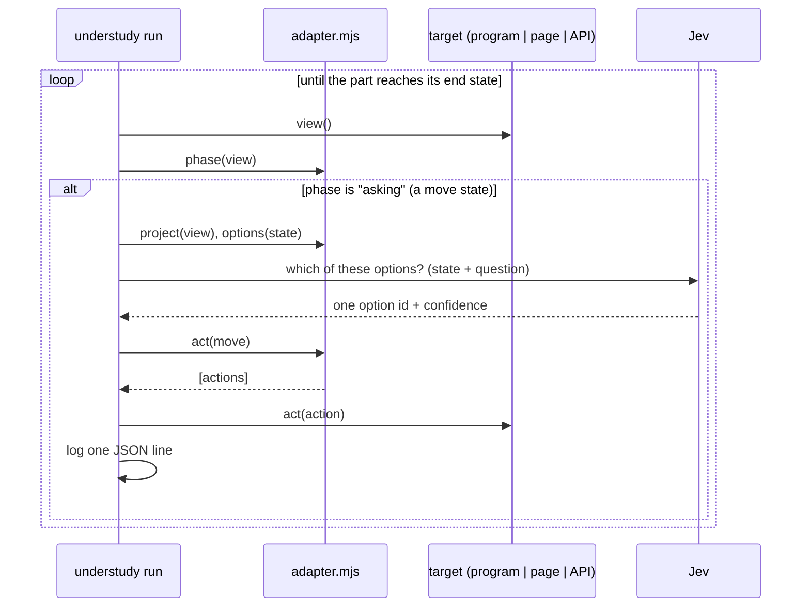
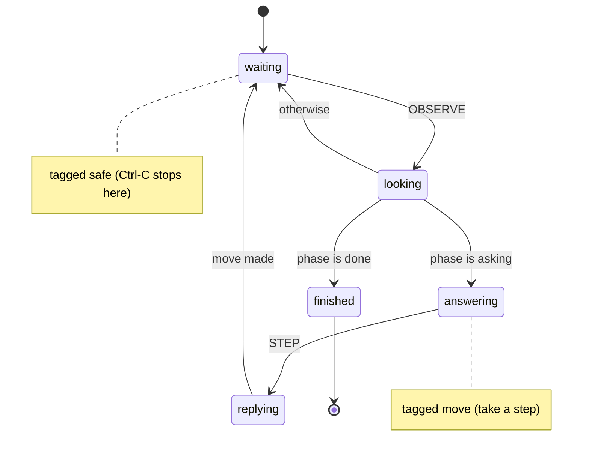

# Walkthrough: the three examples, taken apart

A guided tour of `examples/cli`, `examples/web` and `examples/http`: the app, its adapter, its
part, what Jev is actually asked, and a real run of each - then a few ways to break them on
purpose.

TLDR:
    Each example has the same pieces: an app, adapter.mjs, part/ (turn.yaml + questions.yaml).
    The statechart is the same shape in all three; only the target knows terminal, page or API.
    The web page is unmodified and its adapter is 4 lines: understudy reads it like a screen reader.
    Each step: look -> phase() says "asking" -> options() offered -> Jev picks one -> act() sends it.
    Real runs below: 2-3 Jev calls each, exit 0, a JSON line per step plus a final line.
    Break-it exercises show every kind of refusal and failure with its exact message.

## Contents

1. [The loop in one picture](#1-the-loop-in-one-picture)
2. [The CLI example: a coffee counter](#2-the-cli-example-a-coffee-counter)
3. [The web example: a sign-up wizard, unmodified](#3-the-web-example-a-sign-up-wizard-unmodified)
4. [The HTTP example: a vending machine API](#4-the-http-example-a-vending-machine-api)
5. [Same part, different stage](#5-same-part-different-stage)
6. [Break it on purpose](#6-break-it-on-purpose)

---

## 1. The loop in one picture



The run loop, the statechart and Jev are understudy's; the adapter is the only code you write.

---

## 2. The CLI example: a coffee counter

### The app - `examples/cli/app.mjs`

An ordinary interactive program with no idea understudy exists. Try it yourself (type
`medium`, `oat`, `order`):

```text
$ node examples/cli/app.mjs
Welcome to the coffee counter.
? size [small|medium|large]
> medium
? milk [none|whole|oat]
> oat
Your order: a medium coffee, milk: oat.
? confirm [order|start over]
> order
Order placed: a medium coffee, milk: oat. Goodbye.
```

Each question is one line, `? <topic> [a|b|c]`, then a `> ` prompt. A wrong answer gets
`! "x" is not on the menu for size` and the question again; `start over` goes back to size.

### What understudy sees - the process target

The target turns the terminal into a **view**. Right after start-up it is:

```js
{ lines: ['Welcome to the coffee counter.', '? size [small|medium|large]', '> '],
  seq: 61, sent: 0, exited: null }
```

The unfinished prompt `> ` is included, and after a move the answer is echoed where it was
typed (`> medium`) - exactly what a person would see. `sent` counts the answers given so far.

### The adapter - `examples/cli/adapter.mjs` (51 lines)

```js
target: { kind: 'process', command: 'node', args: ['app.mjs'] },
```

starts `node app.mjs` in `examples/cli/`. Then the four hooks:

- **`phase(view)`** - `done` once a line starts `Order placed`; otherwise `asking` **only while
  more questions have been printed than answers sent**. That comparison is what stops the
  understudy answering the same question twice when it looks again before the program has
  replied.
- **`project(view)`** - what Jev reads:

  ```js
  { topic: 'size', choices: ['small', 'medium', 'large'],
    answered_so_far: [], counter_says: ['Welcome to the coffee counter.'] }
  ```

- **`options(state)`** - one option per choice: `{ id: 'size:medium', what: 'answer medium', value: 'medium' }`.
  The part before `:` (`size`) is the option's **kind**.
- **`act(move)`** - `{ actions: [{ input: 'medium' }] }`: the target writes `medium` + newline to
  the program's stdin.

### The part - `examples/cli/part/turn.yaml`



- `waiting` is where the understudy idles; each look sends `OBSERVE`.
- `looking` invokes the library actor `look`, which calls the adapter's `phase()`; the `phase`
  guards route on the answer.
- `answering` is tagged `move`, so the run takes a step: `STEP` → `replying`, which invokes
  `play` with `question: answer`.
- `finished` is `type: final`: the run ends, exit 0.

### The question - `examples/cli/part/questions.yaml`

```yaml
answer:
  type: choice
  instructions: >-
    You are a person ordering a coffee at a counter. The counter is asking about
    `topic`; `answered_so_far` is what you already chose and `counter_says` is what it
    last told you. Pick the answer you would give if you wanted a coffee you would
    enjoy, and place the order once it looks right.
  criteria:
    size: answer this size
    milk: answer this milk choice
    confirm: answer this to the confirmation question
```

The prose names state **by path** (`topic`, `answered_so_far`) and never by value. At step 1
the options are worded from `criteria` by kind, with each value in backticks, so Jev is asked:

```text
state:    { topic: "size", choices: [...], answered_so_far: [], counter_says: [...] }
question: You are a person ordering a coffee ... (the instructions above)
options:  size:small  -> answer this size (`small`)
          size:medium -> answer this size (`medium`)
          size:large  -> answer this size (`large`)
```

Jev must return one of those three ids - nothing else is ever sent to the program.

### A real run

```sh
bobp make run ARGS="run examples/cli"
```

```text
understudy: playing coffee-cli (node app.mjs) - log build/runs/coffee-cli/2026-10-15T19-55-29.042Z.jsonl
understudy: step 1 asking -> size:medium (0.95)
understudy: step 2 asking -> milk:whole (0.73)
understudy: step 3 asking -> confirm:order (0.96)
```

and the log (`build/runs/coffee-cli/2026-10-15T19-55-29.042Z.jsonl`, same as stdout; `at` and
the empty `checks`/`asked` fields trimmed here):

```json
{"step":1,"phase":"asking","options":["size:small","size:medium","size:large"],"picked":"size:medium","move":"size:medium","confidence":0.95,"state":"waiting"}
{"step":2,"phase":"asking","options":["milk:none","milk:whole","milk:oat"],"picked":"milk:whole","move":"milk:whole","confidence":0.73,"state":"waiting"}
{"step":3,"phase":"asking","options":["confirm:order","confirm:start over"],"picked":"confirm:order","move":"confirm:order","confidence":0.96,"state":"waiting"}
{"final":true,"outcome":"done","steps":3,"state":"finished"}
```

Three Jev calls; the milk choice was the least certain (0.73) - Jev may pick differently on
your run. After step 3 the program prints `Order placed`, exits 0, the next look finds phase
`done`, and the machine reaches `finished`.

---

## 3. The web example: a sign-up wizard, unmodified

### The app - `examples/web/index.html` + `app.js`

A plain page with three steps, each a question and some buttons: **plan** (Free / Pro (paid
monthly)), **look** (Light / Dark), **terms** (Accept / Decline). Declining shows "You need to
accept the terms to sign up." and asks again; accepting shows "Welcome aboard!". There is no
understudy code in it at all.

### What understudy sees - the page target

`kind: 'page'` serves `examples/web/` on `127.0.0.1` (random port, nothing outside the folder)
and opens `index.html` in headless Chromium. Each look reads the page's **accessibility
snapshot** - what a screen reader would announce. At step 1 Playwright prints:

```text
- heading "Sign up" [level=1]
- paragraph: Which plan would you like?
- button "Free"
- button "Pro (paid monthly)"
```

and understudy turns it into the view:

```js
{ path: '/index.html', title: 'Sign up', seq: ...,
  text: ['Sign up', 'Which plan would you like?'],
  controls: [{ role: 'button', name: 'Free' }, { role: 'button', name: 'Pro (paid monthly)' }] }
```

Hidden and disabled controls never appear. A move presses a control by role and visible name,
exactly as a person would find it.

### The adapter - `examples/web/adapter.mjs` (4 lines)

```js
export default { name: 'signup-web', target: { kind: 'page', page: 'index.html' } };
```

No `app` hooks, so understudy uses its **generic page app**: the page is `asking` whenever it
has a control; Jev reads `{ page, says, controls }`; each control is an option named by kind and
label (`button:Free`, `button:Pro (paid monthly)`); acting presses it.

### The part

`examples/web/part/turn.yaml` has the same states as the CLI part. The one difference is how it
knows it is done: the generic app has no `done` phase, so the part ends on what the page
**shows**:

```yaml
- { target: finished, guard: { type: showing, params: { text: Welcome aboard } } }
```

The question casts Jev as "a careful new user signing up for an app you want to try before
paying for anything", with `criteria` worded per control kind (`button: press this button`,
`option: pick this from the list`, ...).

### A real run

```sh
bobp make run ARGS="run examples/web"
```

```text
understudy: playing signup-web (http://127.0.0.1:43929/index.html) - log build/runs/signup-web/2026-10-15T22-30-18.189Z.jsonl
understudy: step 1 asking -> button:Free (1)
understudy: step 2 asking -> button:Light (0.94)
understudy: step 3 asking -> button:Accept (0.98)
```

```json
{"step":1,"phase":"asking","options":["button:Free","button:Pro (paid monthly)"],"picked":"button:Free","move":"button:Free","confidence":1,"state":"waiting"}
{"step":2,"phase":"asking","options":["button:Light","button:Dark"],"picked":"button:Light","move":"button:Light","confidence":0.94,"state":"waiting"}
{"step":3,"phase":"asking","options":["button:Accept","button:Decline"],"picked":"button:Accept","move":"button:Accept","confidence":0.98,"state":"waiting"}
{"final":true,"outcome":"done","steps":3,"state":"finished"}
```

"Try before paying" made Free a certain pick (1.0). When the run ends the browser and the
local server are closed, however it ended.

---

## 4. The HTTP example: a vending machine API

### The app - `examples/http/server.mjs`

A small JSON API with no idea understudy exists:

| Request | Does |
|---|---|
| `GET /machine` | credit, items (name, price, stock), what it dispensed, its last message |
| `POST /coins` `{ "coin": 1 }` | adds credit (1 and 2 only; anything else is `400`) |
| `POST /select` `{ "item": "tea" }` | dispenses it - `402` without enough credit, `409` when sold out |
| `POST /refund` | returns the credit |

### What understudy sees - the http target

```js
target: { kind: 'http', command: 'node', args: ['server.mjs'], url: 'http://127.0.0.1:{port}', state: '/machine' }
```

understudy picks a free port, starts `node server.mjs` with `PORT` set, waits until `GET
/machine` answers, and stops the server at the end. (Leave out `command` and give a full `url`
to play a service that is already running - it is left running.) The view is the state plus
the answer to the last move:

```js
{ status: 200, body: { credit: 0, items: [...], dispensed: [], message: 'Insert coins, then choose a drink.' },
  seq: 1, last: null, exited: null }
```

### The adapter - `examples/http/adapter.mjs` (36 lines)

- **`phase`** - `done` once anything was dispensed; otherwise always `asking` (an API is
  always ready for the next request).
- **`project`** - `{ credit, items: [{ name, price, left }], machine_says }`, where
  `machine_says` is the last error (e.g. "tea costs 2, credit is 0") or the machine's message.
- **`options`** - insert a 1 or 2 coin, buy each drink still in stock, or ask for a refund
  (the last option, the safe fallback): `coin:1`, `buy:tea`, `refund:all`.
- **`act`** - one request: `{ method: 'POST', path: '/coins', body: { coin: 1 } }`.

A refused move is not a failure: buying without credit gets `402`, the step's log line keeps
`"response": { "status": 402 }`, `machine_says` tells Jev why, and the run goes on.

### A real run

```text
understudy: playing vending-http (node server.mjs at http://127.0.0.1:45391) - log build/runs/vending-http/2026-10-15T22-26-45.097Z.jsonl
understudy: step 1 asking -> coin:1 (0.86)
understudy: step 2 asking -> buy:water (0.75)
```

```json
{"step":1,"phase":"asking","options":["coin:1","coin:2","buy:water","buy:tea","refund:all"],"picked":"coin:1","move":"coin:1","confidence":0.86,"response":{"status":200},"state":"waiting"}
{"step":2,"phase":"asking","options":["coin:1","coin:2","buy:water","buy:tea","refund:all"],"picked":"buy:water","move":"buy:water","confidence":0.75,"response":{"status":200},"state":"waiting"}
{"final":true,"outcome":"done","steps":2,"state":"finished"}
```

Coffee is sold out, so it is never offered. Jev paid exactly for water (price 1) - two calls.

---

## 5. Same part, different stage

| | CLI example | Web example | HTTP example |
|---|---|---|---|
| App | `node app.mjs` | `index.html`, unmodified | `node server.mjs` |
| Target | `process` | `page` | `http` |
| View | terminal lines + `sent` | accessibility snapshot: text + controls | state JSON + last answer |
| Move action | `{ input: 'medium' }` → stdin | `{ role: 'button', name: 'Free' }` → press | `{ method, path, body }` → request |
| "Don't answer twice" | questions printed > answers sent | the snapshot is current after a press | each request is answered before the next look |
| How it ends | `phase` is `done` | part's `showing` guard | `phase` is `done` |
| Adapter | 51 lines | 4 lines (generic page app) | 36 lines |
| Library names used | `look`, `phase`, `play` | `look`, `phase`, `showing`, `play` | `look`, `phase`, `play` |

No part says "terminal", "page", "click" or "request": the part is about the **conversation**
(something is asked, answer it, stop when done); the target and adapter are about the **stage**.

---

## 6. Break it on purpose

Copy an example to a scratch folder and change one thing at a time
(`cp -r examples/cli /tmp/cli-broken`). None of these need a key except where a run starts.

| Change | Command | What you get (exit) |
|---|---|---|
| `src: look` → `src: lok` in `part/turn.yaml` | `bobp make run ARGS="check /tmp/cli-broken"` | `.../part/turn.yaml: states.looking.invoke.src: no actor "lok" - did you mean "look"?` (2) |
| `Pick the answer` → `Pick 2 answers` in `part/questions.yaml` | `... check ...` | `.../part/questions.yaml: answer.instructions carries a number in the question; put the number in state and refer to it by path` (2) |
| delete `options` from `adapter.mjs` | `... check ...` | `.../adapter.mjs: app.options must be a function - see docs/ADAPTERS.md` (2) |
| unset `TYPESAFE_API_KEY` | `bobp make run ARGS="run examples/cli"` | `understudy run needs a TypeSafe key: set TYPESAFE_API_KEY` (2) - nothing started |
| nothing - just cap it | `bobp make run ARGS="run examples/cli --steps 1"` | `stopped after 1 step without reaching the end state (last state: answering)` (1) |
| `process.exit(4)` after an answer in `app.mjs` | `... run /tmp/cli-broken ...` | `node app.mjs exited with code 4 before the end state` (1) |
| delete the `showing` line from the web example's `part/turn.yaml` | `... run /tmp/web-broken ...` | after the last screen: `stalled: nothing to do for 10 s after step 3 (last state: waiting) - the app showed: {...Welcome aboard!...} - if this is where the part should end, add a showing guard (docs/ADAPTERS.md)` (1) |
| add `hook: 'x'` to the web example's `target` | `... check /tmp/web-broken` | `.../adapter.mjs: target.hook is not a page target field (known: root, page)` (2) |

Every failure after a run starts still writes the final log line (with its `outcome`) and
closes the program, browser or server it started. Next: [USER_GUIDE.md §5](USER_GUIDE.md#5-write-a-part-for-your-own-app)
to write a part for your own app, and [ADAPTERS.md](ADAPTERS.md) for the full reference.
