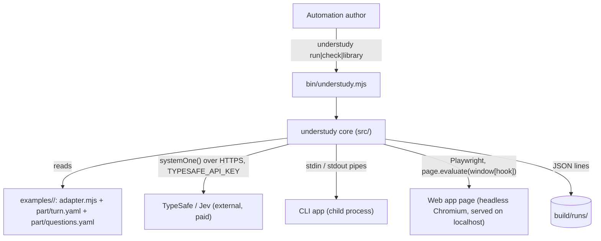

# Architecture Document: Understudy Sprint 1 — one actor, two kinds of stage

*   **Status**: Approved at Smith Gate 2 (2026-10-15), output notes folded in
*   **Author**: Morpheus
*   **Last Updated**: 2026-10-15
*   **Scope**: Sprint 1 Architecture (stories: `docs/sprints/USER_STORIES_SPRINT1.md`)

---

## 1. Executive Summary & System Overview

Understudy runs a **part** (a YAML statechart plus the questions Jev answers) against a real
app through a small **adapter**. The core moved in from recard (`machine`, `seat`, `decide`,
`escalate`, `library`, `strategyFile`) already does the thinking; sprint 1 adds what recard
welded to its card table: a transport-neutral **target** (how to look at and act on an app),
a generic **run loop** with a step cap and step log, a **part loader** that refuses bad parts
before anything starts, and the `understudy` command. Two targets ship — a child process
(CLI) and a headless Chromium page (web) — and two tiny example apps prove the same part
format drives both.

## 2. System Context & Boundaries



Trust: the adapter and part are the author's own code and files (trusted, local). The app
under test is local and run with the author's privileges. Jev is the only network call; the
key comes from the environment and is never logged. The static server binds `localhost` and
refuses paths outside the example root (kept from recard US-152).

## 3. Component & Container Architecture

### Component Inventory

| Component | Responsibility | Inputs | Outputs |
|---|---|---|---|
| `bin/understudy.mjs` | Parse `run <dir> [--steps N]`, `check <dir>`, `library`; map errors to exit codes; never print a stack for a `UsageError` | argv, env | exit code 0/1/2, stderr messages |
| `src/part.mjs` (new) | Load `<dir>/adapter.mjs` and `<dir>/part/`; check questions (types, no literals) and turn file (via `machine.parseTurn`) against generic + adapter library | example dir | `{ adapter, questions, machine }` or `UsageError` |
| `src/run.mjs` (new, from `seed/.../runner.mjs`) | Check key → load part → start target → seat → step loop with cap, first-move timeout, unexpected-exit check → log → close target however it ends | part, options, `makeJudge` | exit status, step records |
| `src/targets/process.mjs` (new) | Spawn the CLI app; buffer stdout lines; `act({ input })` writes a line to stdin; report exit | `{ command, args, cwd }` | target interface |
| `src/targets/page.mjs` (new, from `seed/.../multiplayer.mjs`) | `startStaticServer(root)`, `launchChromium()`, open page, wait for `window[hook]`; `view/act/talk/say` call the hook | `{ root, page, hook }` | target interface |
| `src/library.mjs` (generalized) | The vocabulary: guards/actions/actors with one-line docs. `services.peer`→`services.target`, `services.game`→`services.app`; adds `look` actor + `phase` guard; `play` re-asks once on an off-list answer | services | library |
| `src/seat.mjs` (generalized) | "Is it my move?" / "take one step" over the machine; event `TABLE`→`OBSERVE`; change detection from `view.seq` | machine, services | `'move'|'wait'|'done'`, records |
| `src/machine.mjs`, `decide.mjs`, `escalate.mjs`, `strategyFile.mjs`, `shutdown.mjs` | Unchanged except vocabulary in messages ("bot"→"understudy", "table"→"app") | — | — |
| `src/table.mjs` | Optional conversation-channel helpers (`askPeer` etc.); used only when a target has `talk` | — | — |
| `examples/cli/` | `app.mjs` (tiny interactive program), `adapter.mjs`, `part/` | — | — |
| `examples/web/` | `index.html` + `app.js` exposing `window.__understudy`, `adapter.mjs`, `part/` | — | — |

## 4. Runtime Interaction & Critical Flows

### `understudy run <dir>`

```mermaid
sequenceDiagram
    participant U as bin/understudy
    participant R as run.mjs
    participant P as part.mjs
    participant T as Target (process | page)
    participant S as MachineSeat
    participant J as Jev (systemOne)
    U->>R: run(dir, { steps: 50 })
    R->>R: TYPESAFE_API_KEY set? else UsageError (exit 2)
    R->>P: loadPart(dir)  (sync, no app started)
    P-->>R: { adapter, questions, machine } or UsageError (exit 2)
    R->>T: start(adapter.target)  (Chromium missing -> UsageError, exit 2)
    loop until seat says done, cap reached, or failure
        R->>S: nextMove()
        S->>T: view(), talk()   (async)
        S->>S: send OBSERVE {view, changed, ...}; settle until not busy
        alt state tagged move
            R->>S: step()
            S->>J: systemOne({ state, questions: { <choice>: options } })
            J-->>S: { choice, confidence }
            S->>T: act(move)  (only an offered move)
            S-->>R: record
            R->>R: stdout JSON line, stderr summary, append .jsonl
        end
        R->>T: exited? (process target)  -> unexpected exit = exit 1
    end
    R->>R: final summary line (stdout + .jsonl)
    R->>T: close()  (kill child / close browser + server) - always, in finally
```

Calls are sequential and async; there is one actor and no concurrency. `nextMove` paces itself
(`pollMs`, default 250 ms for understudy — recard's 1500 ms was tuned for a human table).

### Step budget and timeouts

- **Step cap**: counts `step()` calls. Default 50, `--steps N` (positive integer, else exit 2).
  On reaching it: stop, write the final line, exit 1 with
  `stopped after N steps without reaching the end state (last state: <state>)`.
- **First move**: if no state tagged `move` and no final state is reached within 10 s of the
  target starting, exit 1 naming the target (`describe()`: command line or URL) and the last view.
- **Off-list answer** (`play` in `library.mjs`): if Jev's choice is not one of the offered ids,
  the record carries `"offList": true, "answer": <raw>`, Jev is asked once more; a second
  off-list answer throws `RunError` naming the step and both answers → exit 1. Nothing is sent
  to the app in either case.

## 5. Interface & Contract Specifications

### Adapter module — `examples/<app>/adapter.mjs` (default export)

```js
export default {
  name: 'coffee-cli',                       // log folder: build/runs/coffee-cli/
  target: { kind: 'process', command: 'node', args: ['app.mjs'] },   // cwd = the example dir
  //   or { kind: 'page', root: '.', page: 'index.html', hook: '__understudy' }
  app: {
    phase(view, context) {},                // -> a phase name the part's `phase` guard tests
    project(view, context, phase) {},       // -> the state object Jev sees
    options(state, phase, context) {},      // -> [{ id, what }] offered moves; last = safe default
    act(move, state, view, context) {},     // -> { actions: [<target action>], tracks? }
  },
  library: { guards: {}, actions: {}, actors: {} },   // optional app-specific names, each with `doc`
};
```

### Target interface (what `seat`/`library` call)

| Method | Process target | Page target |
|---|---|---|
| `view()` | `{ lines: [...stdout lines], seq: lines.length, exited: null | { code } }` | `await window[hook].view()` plus `seq` from the hook |
| `act(action)` | `{ input: 'text' }` → writes `text\n` to stdin | `await window[hook].act(action)` |
| `talk()` / `say()` | `[]` / no-op (no conversation channel) | hook's `talk`/`say` if present, else `[]` / no-op |
| `describe()` | `node app.mjs` | page URL |
| `close()` | kill child (SIGTERM, then `waitUntilDead`) | close browser, close server |

An HTTP target (next sprint) is a third row: `view` = GET, `act` = request; nothing above changes.

### Part files

- `part/turn.yaml` — the statechart, checked by `machine.parseTurn`. Events the seat sends:
  `OBSERVE` (each look), `STEP` (take the move), `QUIT` (Ctrl-C; leaves at the next `safe` state).
- `part/questions.yaml` — TypeSafe question definitions; prose checked by `strategyFile.checkInstruction`
  (no numbers / quoted values outside backticks), refusal names the question.

### Library changes (vocabulary)

| Recard name | Understudy name | Why |
|---|---|---|
| event `TABLE` | `OBSERVE` | "a look at the app", not a card table |
| guard `table_changed` | `changed` | |
| guard `quiet_table` | `quiet` | |
| actor `ask_table` | `ask` | only usable with a talk channel |
| guard `<game>_phase` (per game) | `phase` (`is: <name>`) | generic; value from `adapter.app.phase` |
| actor `<game>_look` (per game) | `look` | generic; calls `adapter.app.phase` |

### CLI output

- stdout: one JSON line per step `{ step, at, state, options, picked, move, confidence, offList? }`,
  then one final line `{ final: true, outcome: 'done'|'step-cap'|'app-exited'|'off-list'|'no-first-move'|'error', steps, state }`.
- stderr: first line `understudy: playing coffee-cli (node app.mjs) - log build/runs/coffee-cli/<ts>.jsonl`;
  then `understudy: step 3 ordering -> picked large (0.82)`; errors as `understudy: <message>`.
- `understudy check <dir>` success (stdout, exit 0):
  `examples/cli: part OK - 6 states, 2 questions, adapter coffee-cli (process)`.
- `understudy library` (stdout, exit 0): grouped by kind, one line per name —
  `guards:` / `  changed - the app's view moved since the last look` / `actions:` / `actors:`.
  With `<dir>` it also lists that adapter's own names under `<adapter name>:`.
- Exit codes, every command: **0** done, **1** the run failed after starting, **2** refused before starting.

## 6. Cross-Cutting Concepts & Resilience

### Failure Modes & Error Handling

| Failure Mode | Trigger / Condition | System Behavior | User / Client Impact | Blast Radius |
|---|---|---|---|---|
| Missing key | `TYPESAFE_API_KEY` unset/blank on `run` | `UsageError` before part load | `understudy run needs a TypeSafe key: set TYPESAFE_API_KEY`, exit 2 | Nothing started |
| Bad part | unknown name, missing question, literal in prose, bad YAML | `UsageError` from `part.mjs` | file, path, bad name, nearest name; exit 2; no stack | Nothing started |
| Bad `--steps` | not a positive integer | `UsageError` | names the flag and value; exit 2 | Nothing started |
| Chromium missing | Playwright launch fails with "Executable doesn't exist" | `UsageError` | `Chromium is not installed - run: bobp make install-browser`, exit 2 | Server closed |
| No first move | no `move`/final state within 10 s | `RunError` | names target + last view, exit 1 | target closed |
| App exits early | process target `exited` while seat not done | `RunError` | `<command> exited with code <n> before the end state`, exit 1 | log closed with final line |
| Step cap | `steps` reached | `RunError` | cap message with last state, exit 1 | target closed |
| Off-list twice | Jev picks a non-offered id twice | `RunError` | step + both answers, exit 1 | nothing sent to app |
| Jev API error | network / 4xx / 5xx / SDK timeout | `RunError` wrapping SDK message (no key) | `Jev request failed: <message>`, exit 1 | target closed |
| Ctrl-C | SIGINT | send `QUIT`; leave at next `safe` state; second Ctrl-C closes at once | exit 1, final line `outcome: 'interrupted'` | target closed |

Every `run` path closes the target in `finally`; the process target kills its child and waits
for it (`shutdown.waitUntilDead`), the page target closes browser then server.

### Security & Privacy

- The key is read by the SDK from the environment; understudy never prints or logs it. Logs
  hold app state and Jev answers only.
- The static server serves only the example root on `localhost` (path traversal → 404).
- `make secrets` (gitleaks) stays in the gate.

## 7. Technical Stack & SDLC / Build Impact

- **Ordinary dependencies** (SDLC §4, Neo adds them in the phase that imports them):
  `@typesafe-ai/sdk ^0.6.0` (Jev), `playwright ^1.62.1` (page target). Same ranges as recard.
- **Mechanism changes → Tank Phase 0** (flagged per sprint skill):
  1. `bin` entry in `package.json` → `bin/understudy.mjs`, and a `run` make target
     (`node bin/understudy.mjs $(ARGS)`).
  2. `install-browser` make target (`npx playwright install chromium`) — a second
     network-touching target; SDLC §3 must say so.
  3. Known deviation: Playwright's browser lives in `~/.cache/ms-playwright` (Playwright's
     default, same as recard), outside the project.
  4. Quality-gate split: `make test` must never call Jev or launch Chromium. Live checks go in
     a separate `test-live` target (CLI + web examples, live Jev, capped steps) run at UAT only.
- No new language, runtime or package manager.

## 8. Architectural Decisions (ADRs) & Technical Debt

### Decision Records

- **ADR-U1 — Target interface is `view/act/talk/say/describe/close`.** Kept recard's `peer`
  shape (what `seat`/`library` already call) rather than inventing a new one, so the moved code
  changes by renaming only. Alternative: an event-stream interface (push observations) — more
  natural for CLIs, but would rewrite `seat`'s change detection. Consequence: a process target
  must buffer output and expose a `seq` counter.
- **ADR-U2 — Web target drives a page hook (`window[hook]`), not the DOM.** Recard precedent
  and extraction map; it keeps adapters tiny and assertions exact. Alternative: generic DOM
  reading (buttons/text) needs no app cooperation but makes `options` fuzzy and adapters
  larger. Consequence: an app must expose a hook to be played; DOM mode is backlog.
- **ADR-U3 — Generic `look` actor + `phase` guard replace per-game look/phase names.** Every
  recard game wrote its own pair; one generic pair driven by `adapter.app.phase` keeps parts
  readable and adapters short. Recard's migration renames its uses (no back-compat shims).
- **ADR-U4 — Off-list answer: re-ask once, then stop.** (Story UND-1 AC3.) Recard silently
  played the fallback; for a test tool a silent substitute hides a bad part. Alternative:
  fallback-and-continue — rejected, it can mask a broken question.
- **ADR-U5 — Exit codes 0/1/2 across every command** (Smith Gate 1 note): 2 = refused before
  starting anything, 1 = failed after starting, 0 = done.
- **ADR-U6 — `make test` never calls Jev or Chromium;** unit tests inject a judge double via
  `run({ makeJudge })` and a fake target. Live runs live in `make test-live`.

### Acknowledged Technical Debt & Trade-offs

- `seed/` stays until each file is generalized; this sprint consumes `runner.mjs` and the
  static-server/Chromium parts of `multiplayer.mjs` and deletes those two seed files (and
  `botRequests.mjs`, which stays recard's). The rest waits for later sprints.
- No HTTP target, no MCP server, no multi-actor scenarios (out of scope).
- Recard's turn files will need the vocabulary renames above when recard migrates.
