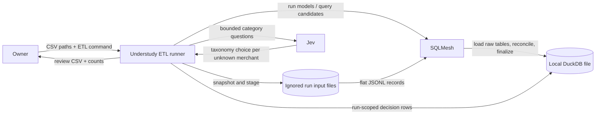
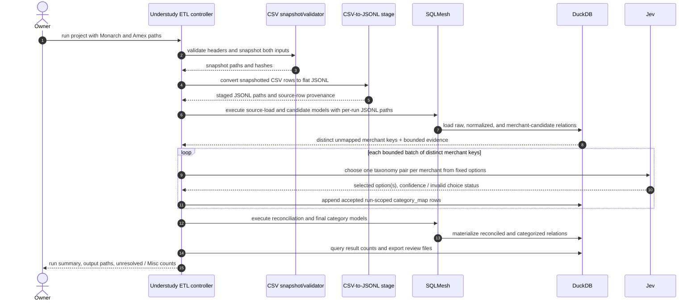

# Architecture: Sprint 16 Staged Local ETL with Jev-Guided Categories

*   **Status**: Approved at Smith Gate 2; Python runtime/toolchain approved by Tank and owner on 2026-10-17
*   **Author**: Morpheus
*   **Last Updated**: 2026-10-17
*   **Scope**: Sprint 16 Architecture

## 1. Executive Summary & System Overview

Understudy coordinates a local transaction-cleanup run; SQLMesh and DuckDB perform the deterministic relational work, and Jev assigns a category/subcategory to each previously unseen merchant key from a fixed taxonomy. Two local CSV inputs (Monarch and Amex) are snapshotted, converted to flat JSONL records, and loaded by SQLMesh into a per-run DuckDB database; Jev decisions are recorded in a run-scoped mapping relation and replayed across repeated rows. The design is deliberately sized for about 4,700 reconciled transactions on one development machine, not as an enterprise data platform.

## 2. System Context & Boundaries

**Inside the Sprint 16 boundary:** CSV input validation and run snapshotting; SQLMesh models; a local DuckDB database; the small orchestration path that moves between hydration, reconciliation, category judgement, and final models; run-scoped decisions and review output.

**Outside the boundary:** Google Sheets and MCP source/sink integration; calendars and trip logic; hosted databases, distributed jobs, multi-user concurrency, and permanent cross-run merchant catalogs. Future connectors can supply a named relation to a hydration stage without changing SQL models. Pagination, if introduced by a future MCP source, belongs inside that connector/hydration stage and is not visible to SQL operations.

## 3. Component & Container Architecture

| Component | Responsibility | Inputs | Outputs |
|---|---|---|---|
| ETL command/controller | Validate paths, create a run id, coordinate explicit stages, prevent a later stage from running before its dependencies are ready, and ensure only one process writes the run DB at a time | CLI flags, project YAML | Stage status and run result |
| CSV snapshot/validator | Validate required headers, copy the two original exports into ignored run storage, and record file hashes | Monarch CSV, Amex CSV | Immutable per-run CSV snapshots and run metadata |
| CSV-to-JSONL hydration | Convert each flat CSV row to a JSONL record with normalized transaction fields, source identity, stable source row number, and the original row object | Snapshotted CSVs and validated header maps | Flat per-run JSONL snapshots |
| SQLMesh project | Own the only JSONL-to-DuckDB load path, then define deterministic type normalization, candidate grouping, reconciliation, and final output as SQL models with YAML project configuration | Staged JSONL paths, run-scoped `category_map` | `raw.*`, candidate, reconciled, and final relations |
| Jev category step | Classify each distinct, not-yet-mapped merchant key from bounded choices in the fixed category/subcategory taxonomy | Merchant text and limited transaction context; allowed category pairs | A decision row per merchant key, with chosen taxonomy code and decision provenance |
| DuckDB run store | Hold staged raw tables, intermediate results, decision rows, and outputs for this one local run | Hydration and model/decision stages | Local queryable tables |
| Review output | Export reconciled rows, classification/match status, and aggregate counts for owner inspection | Final relation and run metadata | Local CSV/report under ignored run output |

The Jev step operates on **distinct unknown merchant keys**, not each transaction. Distinct merchant questions are sent in sequential batches of five; each request contains the allowed category/subcategory pairs and only the merchant descriptors plus transaction counts. One accepted choice is stored in `category_map` and reused through a deterministic join for every row with that key. The key is conservative: trim whitespace and compare case-insensitively while preserving punctuation and the full original descriptor. Keep the source and original descriptor on each raw record; do not apply fuzzy merchant merging in this sprint.

The fixed taxonomy is configuration/data, not generated SQL. Each option is a valid `(category, subcategory)` pair; `Misc / Other or not yet classified` is always present. An off-list or empty answer cannot enter the map and falls back to `Misc` with a review marker. The taxonomy supplied to Jev, accepted decision, confidence, and model name are retained with the run output so the result is auditable.

## 4. Runtime Interaction & Critical Flows

### Normal run

Hydration is a named stage boundary: the CSV snapshot/validator makes immutable inputs ready, the converter emits flat JSONL records, and SQLMesh alone loads those staged records into raw DuckDB relations. The JSONL record has fixed transaction fields (`source`, `source_row_number`, `transaction_date`, `amount`, `merchant`) plus `raw_record` containing the original flat CSV row. This is an internal normalized interchange format; users still provide the Monarch and Amex CSV files. It does not imply support for arbitrary or nested JSONL input. All inputs required by the next SQL model must be present before that model is run. The controller can represent a later state requesting another named dataset/stage; its source adapter makes that input ready before the transition advances. Sprint 16 exercises staged readiness with the two CSV sources. It does not implement an MCP connector or remote pagination.

Tank's Phase 0 probe established dynamic run paths and the sequential SQLMesh/Node/DuckDB handoff. Use a fresh DuckDB file per run. The controller converts CSV snapshots into internal JSONL records before SQLMesh loads those records into tables. SQLMesh runs and exits after producing merchant candidates; then Node opens that database to read candidates and append `category_map`, closes every connection, and only then starts SQLMesh again for the final models. Declare `category_map` as a SQLMesh external model so SQLMesh knows its schema without managing or recreating the Node-written relation. A run lock/stage guard prevents overlap; DuckDB does not support concurrent writer processes.

### Reconciliation rule

Start with transaction date plus amount as the overlap key, as stated in the stories. Pair only keys that occur exactly once in each source. Emit one reconciled row containing both source references for those pairs. Keep one-sided rows unchanged. If either side has more than one candidate for a key, keep the source rows separate and mark them ambiguous; never select a pairing by incidental row order. Preserve the original CSV rows in `raw.*` and include a stable source-row reference on all downstream rows.

### Category decision rule

SQL creates one merchant-candidate row per conservative merchant key, with a small summary of source names and representative raw descriptors. Understudy asks Jev to select a valid category/subcategory pair from the supplied taxonomy. The controller records the complete offered taxonomy version, selected pair, merchant key, and run id. It does not use `decide:` answer-row joins as the transaction store: current generic answer memory is capped at 500 rows (ADR-0017), while SQL/DuckDB own all row-scale processing. Repeated rows use the run-scoped map relation and make no further Jev call.

## 5. Interface & Contract Specifications

* **Command shape:** `understudy etl run --monarch <csv> --amex <csv>`.
* **Project files:** SQLMesh `config.yaml`, SQL `.sql` models, and a YAML taxonomy of allowed category/subcategory pairs. No bespoke YAML syntax for joins or group operations.
* **Run directory:** `build/runs/<run-id>/` holds snapshotted private inputs, local DuckDB state, model logs, and review outputs. `build/` is ignored. SQLMesh reports raw source row counts after loading; the run summary includes those counts, matched/unmatched/ambiguous counts, classified count, `Misc` count, and stage outcomes without printing transaction contents or account identifiers.
* **Input contract:** users provide CSV files; required headers are validated per source before conversion. Every flat source row becomes one JSONL record, and original columns and values are preserved in `raw_record`. Date and amount parsing failures are surfaced as invalid/unreconciled rows or a source validation failure according to the field's use; they are never silently dropped.
* **Output contract:** one local review CSV of reconciled/categorized rows plus a compact machine-readable run summary. No spreadsheet writes.
* **Decision contract:** Jev may select only an offered taxonomy pair. Empty, off-list, or failed judgements become `Misc` plus an explicit review status; no unvalidated free text is persisted.

## 6. Cross-Cutting Concepts & Resilience

| Failure Mode | System Behavior | User Impact | Blast Radius |
|---|---|---|---|
| Missing/unreadable CSV or missing required header | Fail before model/decision stages; identify the source and field | No complete output is reported | This run only |
| Invalid/ambiguous date+amount key | Keep original row(s), set reconciliation status, include in review | Cannot silently lose or incorrectly merge a transaction | Affected rows only |
| SQLMesh/model failure | Stop before final export; mark run failed and identify stage | No stale/partial output is labeled complete | This run only |
| Jev returns an off-list/empty choice | Validate against taxonomy; store `Misc` with review flag | Row remains visible for owner review | Merchant key only |
| Jev service unavailable | Stop category stage and do not mark the final output complete; retain hydrated run for retry | Clear failure stage; no silent blanket categorization | This run only |
| Interrupted run | Leave the run marked incomplete; start a new run from the original CSV inputs | Owner can distinguish partial artifacts from completed results | This run only |

**Privacy:** the CSVs contain personal financial data. Original inputs, transaction-bearing DuckDB files, and row-level output stay under ignored `build/runs/`; never add them to git or CHAT. Chat/log summaries contain counts and statuses only. A run should limit Jev context to the merchant descriptor and the minimum transaction examples needed; omit full account, card, and other unrelated columns.

**Determinism:** file snapshots and hashes establish which inputs were read. SQL transformations and reconciliation are deterministic. Jev's accepted decisions are persisted for the current run and reused rather than re-asked for duplicate merchant keys. A new run starts from the supplied CSVs and may make different Jev choices, which are visible in its run manifest and output.

## 7. Technical Stack & SDLC / Build Impact

* **Existing runtime:** Node.js 24 ESM for Understudy controller and Jev integration.
* **Transformation engine:** SQLMesh with DuckDB, SQL model files, YAML configuration. Dynamic per-run JSONL files are snapshots outside version control, not SQLMesh's project-bundled static seed files. SQLMesh's source models read those records using DuckDB's JSON reader and materialize the `raw.*` relations. References: [SQLMesh connections](https://sqlmesh.readthedocs.io/en/stable/guides/connections/), [SQL models](https://sqlmesh.readthedocs.io/en/stable/concepts/models/sql_models/), [external models](https://sqlmesh.readthedocs.io/en/stable/concepts/models/external_models/), [seed models](https://sqlmesh.readthedocs.io/en/stable/concepts/models/seed_models/), [prerequisites](https://sqlmesh.readthedocs.io/en/stable/prerequisites/).
* **Build-Environment Check (CRITICAL):** Does the design add a new language/runtime? **Yes — Python for SQLMesh.** The owner and Tank approved CPython 3.12.15, uv 0.13.0, SQLMesh 0.236.3, DuckDB Python 1.5.6, and Node `@duckdb/node-api` 1.5.6. The isolated environment and repeatable make targets are in place; clean installation, project checks, idempotent reinstall, and the sequential SQLMesh/Node/DuckDB handoff probe passed in Phase 0. See [Phase 0 findings](../../agents/tank/phase0_sprint16.md) and `docs/SDLC.md`.
* **Alternative considered:** dbt + DuckDB also provides SQL models and YAML configuration, but is likewise Python-based; it does not avoid the SDLC change. Implementing joins/maps directly in JavaScript was rejected because it duplicates mature SQL functionality and would make Understudy own the relational engine.
* **Phase 0 feasibility result:** the pinned SQLMesh/DuckDB/Node sequential handoff probe passed. No custom operator layer is needed for this workload.

## 8. Architectural Decisions & Technical Debt

* **Accepted decision:** [ADR-0037](../DECISIONS.md#adr-0037-sqlmesh-owns-deterministic-etl-understudy-coordinates-jev-decisions) — SQLMesh + local DuckDB owns deterministic row transforms; Understudy owns stage transitions, bounded Jev judgement, run-scoped decision persistence, and result reporting.
* **Accepted reconciliation rule:** match on date + amount only for this first slice; uncertain many-to-many keys remain separately visible and are not auto-paired.
* **Accepted category rule:** classify each distinct conservative merchant key once per run against a fixed taxonomy, with `Misc` fallback; do not learn permanent mappings.
* **Acknowledged debt:** SQLMesh brings a Python runtime into a Node project and introduces a second toolchain. Tank packaged it through the SDLC as an isolated, pinned environment. A future native Node SQLMesh-equivalent is not being developed here.
* **Acknowledged debt:** this sprint's source is local CSV; the source hydration contract must be sufficient for later MCP/sheets adapters without embedding pagination into SQL models.
