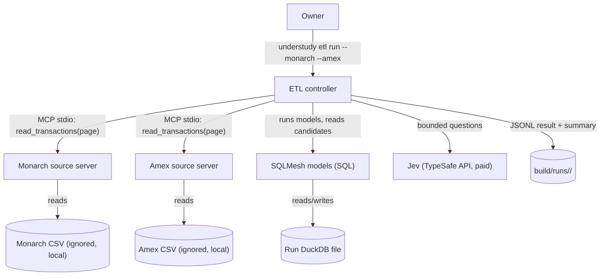
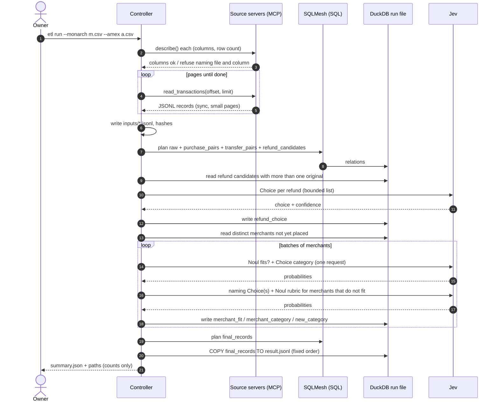

# Architecture: Sprint 17 Dedupe, transfers, refunds and new categories

*   **Status**: Draft — awaiting Smith Gate 2
*   **Author**: Morpheus
*   **Last Updated**: 2026-10-27
*   **Scope**: Sprint 17 Architecture (stories `USER_STORIES_SPRINT17.md`, UND-49 to 55)

---

## 1. Executive Summary & System Overview

Sprint 17 turns Sprint 16's "reconcile and categorise" ETL into the owner's real cleanup: each export is served by its own source server as JSONL; purchases are merged across sources with the sign flipped; transfers are paired and kept out of spending; refunds are linked to their merchant; merchants are placed in one of the 180 Monarch categories or given a new one named from the MCC list; and the result is JSONL. The relational rules stay SQL on DuckDB (SQLMesh) because they are joins and ranks; Jev only supplies judgments (does it fit, which category, which name, which original charge). The owner decided on 2026-10-27 that understudy moves to Python for all, so new code is Python wherever it does not depend on understudy's Node core, and the one decision that depends on unverified facts (the controller's language) is settled by a Phase 0 spike, not assumed.

## 2. System Context & Boundaries

**Inside the boundary:** two source servers, the controller and its stages, SQLMesh models, the run database, the MCC and category lists as data files, and the output files. **Outside:** Google Sheets or any sink, writing back to Monarch or Amex, calendar and trip logic, and the Node sketch core (`sketch.yaml` runs, the dashboard); the Python port of that core is a separate epic. Trust domains: the CSVs are private; they stay on this machine under ignored paths and only counts leave it (chat, logs).

## 3. Component & Container Architecture

| Component | Responsibility | Inputs | Outputs |
|---|---|---|---|
| Source servers (UND-49) | One MCP server per export. Own the file format, the page cursor and row identity. Validate required columns before serving any page. Written in Python with the official `mcp` SDK. | A CSV path given at start | Tool `read_transactions(offset, limit)` returning JSONL records `{source, source_row_number, transaction_date, amount, merchant, account, raw_record}`; tool `describe()` returning row count and columns |
| Hydration stage | Pages each server to the end, writes an immutable per-run JSONL snapshot per source, records counts and file hashes. | Source servers | `inputs/<source>.jsonl`, run manifest |
| SQLMesh models | All relational rules as SQL. `raw_*` load the JSONL; `purchase_pairs` (UND-50); `transfer_pairs` (UND-51); `refund_candidates` (UND-52); `merchant_candidates` (UND-53); `final_records` (UND-54). | Staged JSONL, controller-written decision tables | Relations in the run DuckDB |
| Jev stages (controller) | Ask bounded questions about distinct things only: refund originals, merchant fit and category, new-category names. Validate every answer against its offered list. Write decision tables. | Candidate relations, category and MCC lists | `refund_choice`, `merchant_fit`, `merchant_category`, `new_category` tables |
| Controller state machine | Order the stages, gate each on the previous one's completion, stop the run on a failed stage. | CLI flags | Stage status, run manifest |
| Output stage | `COPY` the final relation to JSONL in a fixed order; write the summary (counts only). | `final_records`, manifest | `result.jsonl`, `summary.json` |

Key decisions in the data model:

- **Purchase pairing (UND-50).** Within the Amex account, an Amex row pairs with a Monarch row when the amounts are equal with opposite sign and the dates are equal. Rows in the same (date, absolute amount) group are paired one-to-one: exact statement-text matches first, then by source row number only to break ties among rows that are otherwise indistinguishable. A third pass pairs what is left when the dates are up to three business days apart (nearest date first, each row used at most once, a tie stays unpaired); on the fresh real files (2026-10-27) that gives 68 near-date pairs, 4,392 same-date pairs and 29 Amex rows left unpaired. **Business days (owner):** `etl.business_calendar` marks Monday to Friday that are not US federal holidays and keeps a running business-day index; a weekend or holiday shares the index of the business day before it, so the gap between two dates is the difference of their indices. Holidays come from the `etl.us_federal_holidays` seed (`sqlmesh/seeds/us_federal_holidays.csv`, 2024 to 2030), generated from the MIT `holidays` package (pinned `holidays==0.107`, observed days included); a Python test asserts the seed equals the package's output, and the calendar covers 2024-01-01 to 2030-12-31 (dates outside it do not pair). Unpaired rows stay as single records. This replaces Sprint 16's "repeated key is ambiguous" rule, because two real $4.50 coffees must remain two records.
- **Period (owner: 2026 year to date).** The run covers the period of the Amex export: `period_start` defaults to its first date and `--since <date>` overrides it. `purchase_pairs` and the later models read period-scoped copies of both sources (rows before the start are dropped, rows without a date are kept as `invalid_key`); the `period_scope` model counts rows read, in period, before the period and without a date per source for the summary. Account detection looks only at rows in the period. Reason: Monarch's card history before November 2025 was uploaded from Amex files with Amex's sign (charges positive) and Amex's category style, while synced rows use Monarch's convention, the two styles overlap around the switch, and the owner's workbook is 2026 only (all 4,182 of its card rows are the synced style). Inside 2026 only 2 of 4,339 card rows carry the older style.
- **Which Monarch account is the Amex card.** Auto-detected as the Monarch account holding the most sign-flipped matches, reported in the summary, overridable with `--amex-account <text>`. Matching without this restriction pairs 27 unrelated rows from other accounts by coincidence in the owner's data.
- **Transfers (UND-51)** run on the post-merge records, so an Amex payment already merged with its Monarch copy is one leg. Candidates: Monarch category containing "transfer" or "payment", or an Amex description containing "payment received". Pairing: different account, opposite amount, within 3 business days (same calendar as above), one-to-one in up to three rounds, nearest date first. Both legs are kept and flagged; neither enters the spending summary.
- **Refunds (UND-52).** A refund is a credit that is not a transfer. Candidates are earlier charges with the same merchant key and amount at least the refund's. None: marked "no original". One: linked. More than one: Jev chooses among the five most recent; the choice and its confidence are stored.
- **Categories (UND-53, 55).** One Noul ("does the merchant fit one of the offered categories") and one Choice (which) are asked together per distinct merchant, in batches. Fit above 0.7 uses the Choice; below 0.3 goes to naming; between goes to review. Naming asks a Choice over the MCC groups, then a Choice over the names in that group, then a Noul against the naming rubric for the top three names by probability; the best above 0.7 wins. New categories are appended to the offered list for later batches. Merchants are processed in a fixed order so a run is repeatable.
- **Merchant key** is Sprint 16's: trimmed, case-insensitive, punctuation kept. Matched purchases use Monarch's cleaned merchant, which brings the real workload to about 2,900 distinct merchants (3,826 across both exports).

## 4. Runtime Interaction & Critical Flows

DuckDB allows one writing process at a time; stages run strictly in sequence (SQLMesh exits before the controller writes a decision table, as in Sprint 16). If Phase 0 selects a Python controller, the Python process owns the file throughout and the Node handoff disappears.

## 5. Interface & Contract Specifications

- **Command:** `understudy etl run --monarch <csv> --amex <csv> [--amex-account <text>] [--since <date>] [--out <dir>]` (extends Sprint 16's command; `--out` defaults to `build/runs/<run-id>/`, never `data/` or a tracked folder).
- **Source server contract:** tools `describe()` and `read_transactions(offset, limit)`; records as in section 3; `limit` at most 1,000; a short or empty page means the end. A second source is added by writing another server with the same two tools.
- **Output:** `result.jsonl`, one record per transaction with date, amount, merchant, category, `kind` (purchase, transfer, refund), links to the counterpart, and every source row; `summary.json` with the counts listed in UND-54; a short stderr summary. No transaction text in chat or logs.
- **Determinism:** inputs are hashed; SQL ordering is explicit; Jev answers are stored per run, so a rerun that reuses a stored decision file is byte-identical. A new run may choose differently.
- **Breaking change from Sprint 16:** the run's `review.csv` is replaced by `result.jsonl` (the owner's JSONL-in, JSONL-out principle) and its `summary.json` gains the Sprint 17 counts. No compatibility output is kept (owner: no back-compat); anything reading `review.csv` must read `result.jsonl`, which carries every column the review file had plus the pairing and category fields. The CHANGELOG and USER_GUIDE say so at launch.
- **Errors the owner sees:** the file and column for a bad source, the stage that failed, "Jev could not be reached at <stage>", "MCC list not found at <path>"; exit 2 for bad input and 1 for a failed run, as in Sprint 16.

## 6. Cross-Cutting Concepts & Resilience

| Failure mode | Behaviour | Left behind |
|---|---|---|
| CSV missing, unreadable or lacking a column | `describe()` refuses; controller stops before paging; names file and column | No run directory results |
| Source server crashes or returns a malformed page | Hydration fails at the page offset with the server's message | Run marked failed; no result files |
| Jev unreachable or errors | Stage stops, says which; no blanket fallback category | Hydrated inputs and earlier decision tables kept for inspection; no `result.jsonl` or summary |
| Jev answer off the offered list | Treated as no answer: refund goes unlinked-with-note; merchant goes to review | Merchant or refund only |
| No Monarch account has any sign-flipped match with the Amex rows, or two accounts tie | Stops before pairing: "could not tell which Monarch account is the Amex card (candidates: <account names, no numbers>); pass --amex-account <text>" | Hydrated inputs kept; no result |
| `--amex-account` text matches no account or more than one | Same refusal, listing the Monarch account names it did find | Hydrated inputs kept; no result |
| Output directory cannot be written | Refuses before reading either file, naming the path | Nothing created |
| MCC list missing | Stops before naming | Nothing published |
| Ambiguous or unmatched rows | Kept, flagged, listed for review | The rows themselves |
| Interrupted run | Marked incomplete; start again from the CSVs | This run's directory only |

Scale: about 18.8k rows load in seconds on DuckDB. The cost driver is Jev: about 2,900 to 3,800 distinct merchants for the fit question, plus naming for the merchants that do not fit. The controller prints the distinct-merchant count and the number of requests before the first Jev call, and the summary reports decisions made and reused. There is no hard cap (assumption in the stories); a `--max-jev-requests` flag is cheap to add if the owner wants one.

Privacy is unchanged from Sprint 16: private inputs, databases and row-level output stay under ignored run directories; Jev context for a merchant is its text, a transaction count and up to three example amounts, with no account identifiers.

## 7. Technical Stack & SDLC / Build Impact

- **Build-Environment Check:** this design adds no new language, package manager or runtime version. Python and SQLMesh were approved in Sprint 16. Added Python packages go through the routine path in `docs/SDLC.md` section 4 (`uv add`, commit `pyproject.toml` and `uv.lock`): `mcp` (source servers and client), and, if Phase 0 passes, `typesafe-sdk` and `python-statemachine`. No new standard make target is needed: the source servers are started by the controller, tests ride `test-py` and `test-etl`. If Phase 0 shows a new target is wanted, Mouse schedules it as a Tank task.
- **Phase 0 spike (blocking, ~1 phase):** answer four questions before any code. (1) Can `python-statemachine`'s YAML representation express the controller's stages with gates and a failure branch, with the stage list in a YAML file rather than code? (2) Does `typesafe-sdk` return per-answer probabilities for Noul and Choice, and what are its batching, timeout and error behaviours? (3) Does the official `mcp` Python SDK serve and call a paged tool over stdio with the sizes we need? (4) Where does the MCC list come from, and is it free to use and commit? The spike uses synthetic data; a live Jev probe needs the owner's go-ahead and key.
- **Controller-language gate after Phase 0:** if (1) to (3) pass, the controller is written in Python and replaces `src/etl/run.mjs`, `categories.mjs`, `csv.mjs` and the ETL's use of `src/jev.mjs` outright (owner: no back-compat), removing the Node-DuckDB seam. If any fails, the controller stays Node for this sprint with the same stage contract and the failure goes to the Python epic's risk list. The stories and the SQL do not change either way.
- **Alternatives considered:** keep Sprint 16's Node controller and only add SQL (smallest change, keeps the two-runtime seam against the owner's direction); build the sign-flipped match as a Jev judgment (rejected: matching is arithmetic, and thousands of rows would cost money for a deterministic answer); SCXML for the stage machine (rejected by the owner: no XML).

## 8. Architectural Decisions & Technical Debt

- **ADR-0038 (to record, Oracle):** relational rules stay SQL on DuckDB; each export is served by a Python MCP source server; the controller's language is set by the Phase 0 gate. Positive: language-neutral rules survive the Python port; adding a source is adding a server. Negative: two small servers where a CSV reader would do; a spike phase before value.
- **ADR-0039 (to record, Oracle):** purchases pair one-to-one inside a (date, amount) group, replacing Sprint 16's "repeats are ambiguous" rule. Trade-off: for identical-looking rows the pairing is arbitrary among equals, but it is harmless because their date and amount agree; only merchant text may differ, and exact matches win first.
- **Debt acknowledged:** the Sprint 16 Node ETL code is superseded if the gate passes; the `turn:` statechart in sketches is still XState YAML until the port epic decides its representation; the 3-day transfer window and the "transfer"/"payment" label rule are tuned to one household's data.
