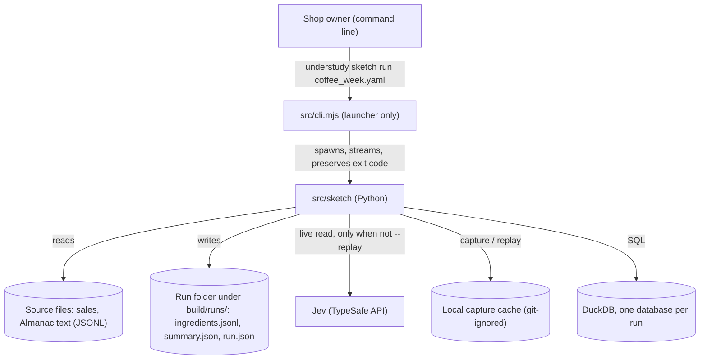
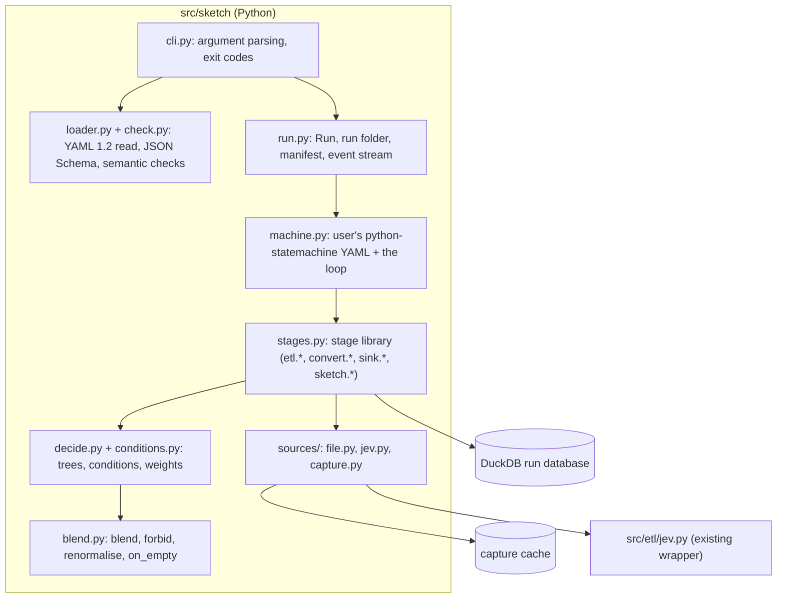
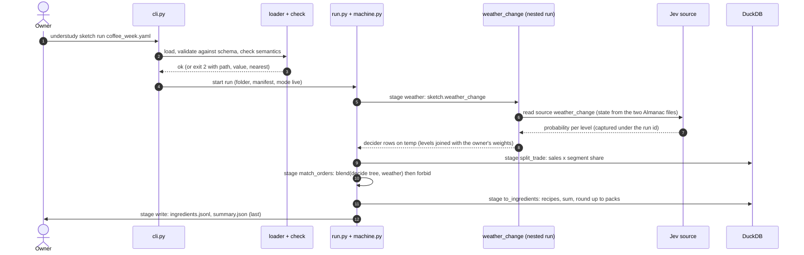

# Architecture Document: Sprint 19, the coffee proof of concept

*   **Status**: Draft — awaiting Smith Gate 2
*   **Author**: Morpheus
*   **Last Updated**: 2026-10-29
*   **Scope**: Sprint 19 Architecture (slice A of `EPIC_PYTHON_PORT.md`; stories `USER_STORIES_SPRINT19.md`; model `DESIGN_SKETCH_MODEL.md`; domain `docs/DOMAIN.md`)

---

## 1. Executive Summary & System Overview

Sprint 19 adds a new Python package, `src/sketch/`, that runs the owner's decision sketches: it reads a YAML file, checks it, runs the owner's own python-statemachine machine, and writes an ingredient file. Rules are the owner's (`decide` trees with explicit YAML conditions), counts and conversions are DuckDB SQL, and Jev is one more kind of source, captured on every live read so any run can be replayed offline. The old Node player is untouched and keeps working until slice D; the two share nothing except the `understudy` command, which gains a `sketch` subcommand that launches the Python package.

## 2. System Context & Boundaries

* **Trust boundary:** the only network call is to Jev, and only on a live run. Source files, captures and outputs are local. The capture cache and run folders hold real shop data and are git-ignored (`.understudy/` and `build/`).
* **Not in this system:** the Node player and dashboard, the Monarch/Amex ETL (`src/etl`), MCP/HTTP sources.

## 3. Component & Container Architecture

### Component Inventory
| Component | Responsibility | Inputs | Outputs |
|---|---|---|---|
| `cli.py` | `sketch run` and `sketch check`: parse flags (`--source`, `--replay`, `--out`), map errors to exit codes 0/1/2, print one line per stage | argv | exit code, stage lines, final output line |
| `loader.py` | read the sketch with ruamel.yaml (YAML 1.2, so slices stay text), resolve paths relative to the file, build the model | sketch path, `--source` overrides | `Sketch` (immutable) |
| `check.py` | JSON Schema (`schema/decision_sketch.schema.json`) then semantic checks: stages/transitions exist and reach a final state, outcomes declared, segment shares sum to 1, every referenced source exists; errors name file, path, bad value, nearest good one | `Sketch` | a list of problems, or none |
| `model.py` | dataclasses: `Sketch`, `Source`, `Sink`, `Outcome`, `Segment`, `Stage` (the domain terms) | loader | typed objects |
| `run.py` | `Run`: run id, run folder (`build/runs/run-<stamp>-<id>/`), manifest (`run.json`: stage status, mode), event stream, DuckDB database; publishes outputs last; reuses the output-destination policy of `src/etl/controller.py` | `Sketch`, flags | folder, outputs |
| `machine.py` | build the owner's python-statemachine from the sketch's `machine` block (conditions become named guards) and run the loop: enter a state, run its stage, send the result as an event | `Sketch`, `Run` | final state, outcome |
| `stages.py` | the stage library; each stage is a function over the run's tables: `etl.split_by_share`, `etl.join_weights`, `convert.recipes`, `sink.<name>`, `sketch.<file>` (a subsketch as a nested run sharing the run id and folder) | run tables, stage config | new tables or output rows |
| `conditions.py` | evaluate explicit YAML conditions on a row: `eq ne lt le gt ge in not_in has`, `and or not`, slices | condition, row | bool |
| `decide.py` | evaluate a `decide` tree on a row: choose a leaf, evaluate its weight (number or `if/then/else`) | tree, row | list of `DecisionRow` |
| `blend.py` | weighted average of deciders' rows, `forbid` (drop, renormalise), `on_empty` (default fail) | decider outputs, weights | final rows per input |
| `sources/file.py` | read a JSONL file; a bare path means `kind: file` | path | rows |
| `sources/jev.py` | the `kind: jev` source: build `Choice(instructions, criteria)` and the `state` dict from `from:` sources, call Jev through `src/etl/jev.py`, return one row per option with its probability | source config, other sources' rows | rows `{level, probability}` |
| `sources/capture.py` | capture and replay for every non-file source (section 5) | source name, kind, request, rows | cache entries, replayed rows |

## 4. Runtime Interaction & Critical Flows

The coffee run, live (replay differs only in step 6):

A failed stage ends the run with exit 1, removes any partial output and records the stage in `run.json`.

## 5. Interface & Contract Specifications

* **Command:** `understudy sketch run <sketch.yaml>` and `understudy sketch check <sketch.yaml>` (the Node launcher passes them to Python; `check` loads and checks and starts nothing). The new subcommand is `sketch` because `understudy run` still plays the old Node sketches; slice D drops the word `sketch`.
* **Flags:**
  * `--source <name>.path=<file>`: replace one file source for this run (repeatable); the sketch file is unchanged.
  * `--replay [run-id|dir]`: every non-file source reads its capture and never goes live; no key, no network.
  * `--out <folder>`: where the run folder goes; default `build/runs/`; refused under `data/` or any non-ignored project path (same policy as the ETL).
* **Exit codes:** 0 done, 1 a stage failed, 2 refused before starting (bad sketch, missing file, missing `TYPESAFE_API_KEY` on a live run). Every failure ends with one `understudy: <message>` line saying what to fix.
* **Run folder:** `run.json` (mode, stages complete/failed, stale flag), `summary.json` (counts only: total drinks, drinks per segment, Jev requests, weather weights, `mode`, `stale`), `ingredients.jsonl` (written last), `run.duckdb`, stage tables.
* **Sketch schema:** `schema/decision_sketch.schema.json` covers the file's shape: `sources`, `sinks`, `outcomes`, `data`, `machine`, conditions (a field, one operator, a value; slices as `a:b`), weights (a number or `if/then/else`), blends. It is separate from the old `schema/sketch.schema.json` until slice D.
* **Capture cache:** `.understudy/cache/<run-id>/<source>.jsonl` plus `<source>.meta.json` (run id, source, kind, request hash, captured at). The last 5 runs are kept, pruned together after each successful live run. A capture is written only after a complete, successful read. `--replay` uses the latest run that has a capture for every non-file source in the sketch, or the named run, or the files in `dir`; if none qualifies it stops naming the missing source and saying to do a live run first. It never falls back to live. The request hash (for Jev: instructions, criteria, state) is compared to the sketch; a mismatch sets `stale: true` and prints one line, and the run carries on.
* **Decider contract (code):** `Decider = Callable[[Row], list[DecisionRow]]`; `DecisionRow = {dimension: option, ..., "weight": float}`; weights of one input sum to 1 (checked after every blend and filter). Options are checked against `outcomes`; unknown ones raise a check error naming the decider.

## 6. Cross-Cutting Concepts & Resilience

### Failure Modes & Error Handling
| Failure | Behaviour |
|---|---|
| Sketch fails the schema or semantic check | exit 2, no run folder content beyond nothing written; message names file, path, value, nearest good value |
| Source file missing | exit 2 before any stage; no output |
| `TYPESAFE_API_KEY` missing on a live run | exit 2 before any stage |
| Jev unavailable or a call fails | the Jev source raises; the stage fails; run exit 1; no output; the gate stops further Jev requests after the first failure (the existing `GatedJev`) |
| Replay with no run covering every non-file source | exit 2, names the missing source |
| `forbid` empties a segment | run fails naming the rule and the segment unless the stage sets `on_empty: fallback` or `skip` |
| Weights do not sum to 1 | internal error naming the stage; never silently rescaled outside `blend`/`forbid` |
| Stale replay | prints one line, `stale: true` in `summary.json`, continues |

### Security & Privacy
* The capture cache, run folders and DuckDB files hold real data; they live under git-ignored `.understudy/` and `build/` and are never printed or posted. Output is refused in tracked folders and `data/`.
* The Jev key comes from `TYPESAFE_API_KEY` only; nothing is read from a file in the sketch. Jev receives only the `state` the sketch builds from its `from:` sources.
* Committed test fixtures contain invented data only.

## 7. Technical Stack & SDLC / Build Impact

* Python 3.12 in `.venv` with `uv`; no new language or package manager. New direct dependencies, both already installed transitively and now pinned in `pyproject.toml` through the existing `lock-py` flow (ordinary dependencies, not a mechanism change): `ruamel.yaml` (YAML 1.2) and `jsonschema`. python-statemachine, duckdb and typesafe-sdk are already direct.
* SQL runs directly on DuckDB from the stages; SQLMesh is not used here (its models and plans suit the ETL's multi-stage store, not these three small queries).
* `bobp make` front door unchanged. Existing targets cover this slice: `test-py` runs the new tests, `lint` gains `src/sketch` in its ruff paths (an edit to an existing target), `bobp make run ARGS="sketch run ..."` runs it. No new make target; Tank confirms at the SDLC check.
* `.gitignore` gains `.understudy/`.
* Node side: `src/cli.mjs` gets the `sketch` subcommand that spawns Python the way `etl run` does; its tests extend `tests/cli.test.js`.

## 8. Architectural Decisions (ADRs) & Technical Debt

### Decision Records
* **ADR-0040: A sketch is the owner's own pipeline; the loop is plain Python.** No built-in turn machine; the machine is the sketch's python-statemachine YAML. Replaces `turn:` for new sketches (ADR-0011 stays for the Node player until slice D).
* **ADR-0041: One decider contract and one combination rule.** One row in, weighted rows out; the weighted blend is the only rule; vetoes are `forbid` filters. Replaces ADR-0018's multiplicative scoring for new sketches.
* **ADR-0042: Conditions are explicit YAML, read as YAML 1.2.** Field, operator, value; `in` takes a list or a slice; `has` is contains; `and`/`or`/`not` combine; no text expressions; ruamel.yaml loads sketches because PyYAML turns `70:30` into 4230.
* **ADR-0043: Jev is a source kind, and non-file sources capture and replay.** `kind: jev` with `instructions`, `criteria`, `state`; one `--replay` flag; replay uses one complete run and never goes live.
* **ADR-0044: Weights are numbers or `if/then/else`.** No expression language.
* **ADR-0045: `understudy sketch …` is the new command until slice D.** A subcommand of the Node launcher that runs the Python package; `understudy run` keeps playing old sketches.

### Acknowledged Technical Debt & Trade-offs
* The Jev wrapper stays in `src/etl/jev.py` and the output-destination policy in `src/etl/controller.py`; `src/sketch` imports both. Phase 1 moves each to a shared module (`src/jev.py`, `src/paths.py`) so neither context depends on the other (DRY), and the ETL imports the shared ones.
* Two sketch schemas and two commands exist side by side until slice D.
* Replay keeps one sample per source per run and does not handle a source read several times with different params (YAGNY).
* The capture cache location (`.understudy/cache/`) survives `bobp make clean` by design; the owner can delete it by hand.
