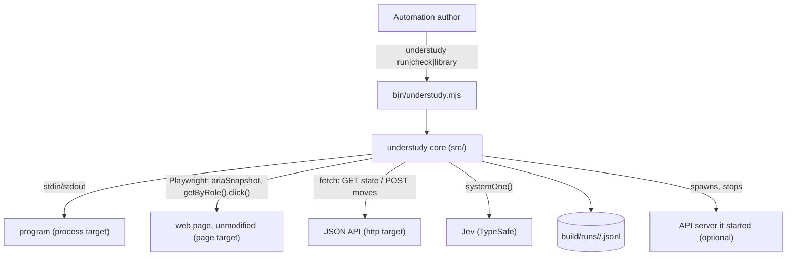
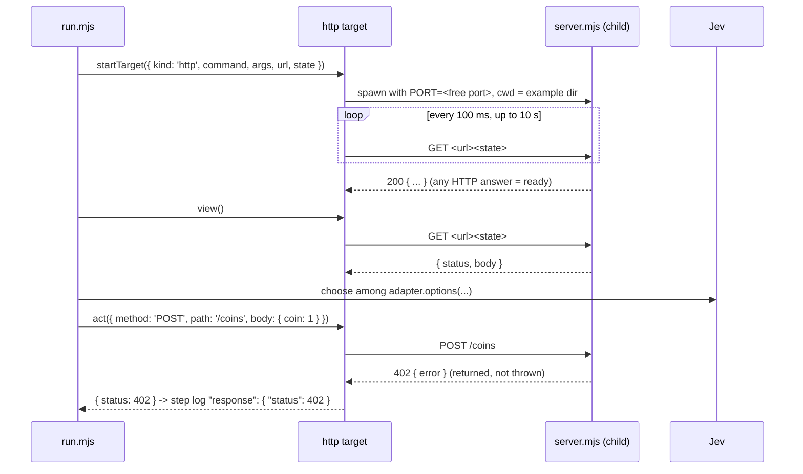

# Architecture Document: Understudy Sprint 2 — an HTTP target, and web pages without a hook

*   **Status**: Approved at Smith Gate 2 (2026-10-15), notes folded in
*   **Author**: Morpheus
*   **Last Updated**: 2026-10-15
*   **Scope**: Sprint 2 Architecture (stories: `docs/sprints/USER_STORIES_SPRINT2.md`)

---

## 1. Executive Summary & System Overview

Two changes behind the target interface of ADR-0001, plus one run-loop rule. (1) A third target,
`http`, plays a JSON API: a look is a GET of the app's state, a move is a request. (2) The `page`
target stops calling `window.__understudy` and reads the page's **accessibility snapshot** (roles
and names, as a screen reader sees it); moves click or choose controls by role and name. A built-in
**generic page app** supplies `phase/project/options/act` when a web adapter gives none, and a new
library guard `showing` lets a part say what the end looks like. (3) The run loop gains a
**stalled** rule for every target. No back-compat: the hook code, option and docs are deleted.

## 2. System Context & Boundaries



Trust as in sprint 1. The HTTP target talks only to the URL the adapter names; a server it starts
binds `127.0.0.1` on a free port. Nothing is sent to an API except the adapter's own actions.

## 3. Component & Container Architecture

| Component | Change | Responsibility |
|---|---|---|
| `src/targets/program.mjs` (new) | extracted from `process.mjs` | start a command in the example dir, report `exited`, stop it (`close`); shared by `process` and `http` |
| `src/targets/process.mjs` | uses `program.mjs` | unchanged behaviour |
| `src/targets/http.mjs` (new) | — | optional server start + wait-ready, `view` = GET state, `act` = request, error statuses returned not thrown, lost connection → `RunError` |
| `src/targets/page.mjs` | hook removed | serve + headless Chromium as before; `view` = parsed accessibility snapshot; `act` = click/check/select by role + name |
| `src/targets/aria.mjs` (new) | — | pure: accessibility-snapshot text → `{ title, text[], controls[] }` |
| `src/apps/page.mjs` (new) | — | the generic page app: `phase/project/options/act` over the parsed view |
| `src/part.mjs` | adapter checks | `app` optional for `page` (generic app filled in); `target` fields checked per kind, unknown fields refused naming the known ones |
| `src/library.mjs` | additions | guard `showing { text }`; `look` also outputs `view`; `play` records the last non-empty act result as `response` |
| `src/run.mjs` | stall rule | after the first move, `stallMs` (10 s) with nothing offered and the part not ended → `RunError` outcome `stalled` |
| `examples/http/` (new) | — | `server.mjs` (vending machine API), `adapter.mjs`, `part/` |
| `examples/web/` | hook deleted | `app.js` has no understudy code; `adapter.mjs` = name + target; part ends with `showing` |

## 4. Runtime Interaction & Critical Flows

### HTTP target start and a step



- `url` may contain `{port}`; when a `command` is given the target picks a free port, passes it as
  `PORT`, and substitutes it. With no `command`, `url` must be complete and nothing is started or
  stopped (attach mode).
- Ready = any HTTP response to the state GET within 10 s, else `RunError` `no-first-move` naming the
  URL; the started server is stopped.
- A request that cannot connect (ECONNREFUSED, reset, timeout 10 s) → `RunError` outcome
  `connection-lost`, naming the URL. A started server that has exited is reported by `exited()`
  first, as for a program.

### Page target: look and move

1. `view()` = `page.locator('body').ariaSnapshot()` parsed by `aria.mjs`:
   ```js
   { url, title, seq,
     text: ['Sign up', 'Which plan would you like?', ...],          // headings, paragraphs, text
     controls: [{ role: 'button', name: 'Free' }, { role: 'option', name: 'Large', list: 'Size' }, ...] }
   ```
   Hidden elements are absent from the snapshot; `[disabled]` controls are dropped. Choosable roles:
   `button, link, checkbox, radio, option` (an `option` carries its `combobox` as `list`); `textbox`
   is out of scope. `seq` = hash of the snapshot text.
2. `act({ role, name, list? })`: `getByRole(role, { name, exact: true }).first()` →
   `click()` (button, link), `check()` (checkbox, radio), or `getByRole('combobox', { name: list })
   .selectOption(name)` (option).
3. Start: serve + launch + `goto`; no hook wait. The first-move rule (10 s) and the new stall rule
   cover "no controls".

### Generic page app (`src/apps/page.mjs`)

| Hook | Behaviour |
|---|---|
| `phase(view)` | `'asking'` if any control, else `'waiting'` |
| `project(view)` | `{ page: title, says: text (last 20 lines), choices: ['button Free', ...] }` |
| `options(state)` | one per control: `id: '<role>:<name>'`, `what: '<verb> <name>'` (press / follow / tick / pick), `value: name` |
| `act(move)` | `{ actions: [{ role, name, list }] }` |

`part.mjs` fills in this app when a `page` adapter has no `app`; an adapter may still supply its own
`app` (used whole, not mixed). `check` then reports `adapter <name> (page, generic page app)`. Log ids read as `button:Pro (paid monthly)` (UND-7 AC3).

### Ending a hookless part

The generic `phase` cannot know a page's end, so the part says it, with the new guard:

```yaml
looking:
  invoke:
    src: look
    onDone:
      - { target: finished, guard: { type: showing, params: { text: Welcome aboard } } }
      - { target: answering, guard: { type: phase, params: { is: asking } } }
      - { target: waiting }
```

`showing { text }` is true when any string in the view `look` returned contains `text` (works for
all three targets). Literal text in `turn.yaml` is allowed (the no-literals rule is for question
prose).

### Stall rule (all targets) — `run.mjs`

After step 1, each `wait` checks `clock() - lastMoveAt >= stallMs` (10 s). Hit →
`stalled: nothing to do for 10 s after step N (last state: S) - the app showed: <view, 200 chars> - if
this is where the part should end, add a showing guard (docs/ADAPTERS.md)`,
outcome `stalled`, exit 1; the target is closed as for every outcome.

## 5. Interface & Contract Specifications

### Adapters

```js
// page - all an adapter needs now
export default { name: 'signup-web', target: { kind: 'page', page: 'index.html' } };

// http
export default {
  name: 'vending-http',
  target: { kind: 'http', command: 'node', args: ['server.mjs'], url: 'http://127.0.0.1:{port}', state: '/machine' },
  //  or attach: { kind: 'http', url: 'http://127.0.0.1:8080', state: '/machine' }
  app: { phase, project, options, act },   // act -> { actions: [{ method: 'POST', path: '/coins', body: { coin: 1 } }] }
};
```

Target fields per kind (anything else is refused, naming the known fields):
`process`: `command`, `args` · `page`: `root`, `page` · `http`: `command`, `args`, `url`, `state`.

### HTTP view

```js
{ status: 200, body: { ...state JSON }, seq, last: { method, path, status, body } | null, exited: null | { code } }
```

### Step log additions

`response: { status }` when the target's `act` returned one (HTTP). New outcomes: `stalled`,
`connection-lost`.

## 6. Cross-Cutting Concepts & Resilience

### Failure Modes & Error Handling

| Failure Mode | Trigger | Behaviour | User sees (exit) | Blast radius |
|---|---|---|---|---|
| API never ready | no HTTP answer in 10 s | stop started server | `no first move from <url> within 10 s - nothing answered GET <state>` (1) | started server stopped |
| API server exits | child exits before end | as program | `node server.mjs exited with code N before the end state` (1) | — |
| Error status on a move | 4xx/5xx | returned, logged | step line `response.status`; run continues | none |
| Connection lost | refused/reset/10 s timeout | `RunError` | `lost the connection to <url>: <reason>` (1), outcome `connection-lost` | started server stopped |
| Stalled | nothing offered 10 s after a move | `RunError` | `stalled: nothing to do for 10 s after step N ...` (1) | target closed |
| No controls at start | page shows nothing choosable | first-move rule | `no first move from <url> within 10 s - last view: ...` (1) | browser + server closed |
| Control vanished before click | page changed between look and move | Playwright timeout 5 s → `RunError` | `step N: could not press button "X" - it is no longer on the page` (1) | closed |
| Unknown target field | e.g. `hook` | `UsageError` at check | `adapter.mjs: target.hook is not a page target field (known: root, page)` (2) | nothing started |

### Security & Privacy

The HTTP target sends only adapter-defined requests to the adapter's URL; logs hold status and the
API's JSON (the example has no secrets). No auth support this sprint (out of scope).

## 7. Technical Stack & SDLC / Build Impact

No new dependency, language or make target: `fetch` and `AbortSignal.timeout` are Node built-ins,
`ariaSnapshot`/`getByRole` are in the installed Playwright 1.62.1 (verified with a probe). `make
test-live` already loops `examples/*/`, so `examples/http` joins it. **No Tank Phase 0.**
`make test` stays offline: the HTTP target is tested against a local `node:http` server in-process;
`aria.mjs` against recorded snapshot text; page actions against a fake page.

## 8. Architectural Decisions (ADRs) & Technical Debt

- **ADR-0007 — Pages are read through the accessibility snapshot; the page hook is removed**
  (supersedes ADR-0002). Drivers: play unmodified pages (owner), "as a person would". Options:
  (a) accessibility snapshot + role/name actions; (b) raw DOM walk with CSS selectors; (c) keep the
  hook. (a): stable names a person sees, Playwright-native, hidden/disabled handled. (b) brittle
  selectors, own visibility logic. (c) owner rejected. Cost: free-text fields deferred; names must
  be unique enough (`.first()` on duplicates, noted as debt).
- **ADR-0008 — HTTP target: GET-state view, request moves, error statuses are app behaviour.**
  Options: (a) adapter-defined requests, error status logged and play continues; (b) treat 4xx/5xx
  as run failure. (a) chosen: an API refusing a bad move is exactly what a test wants to see; the
  step cap bounds loops.
- **ADR-0009 — The part declares the end (`showing`), not the generic adapter.** Options: (a) a
  library guard over the view; (b) a `done` field on the adapter; (c) a Jev question every look.
  (a) keeps adapters at name + target, works for every target, costs no Jev calls.
- **ADR-0010 — One stall rule in the run loop for all targets** (Smith Gate 1).

### Debt
- Duplicate control names on a page: the first visible one is used.
- Free-text input, auth headers/cookies: later sprints.
- `showing` matches substrings of any view string - simple, may over-match on large views.
