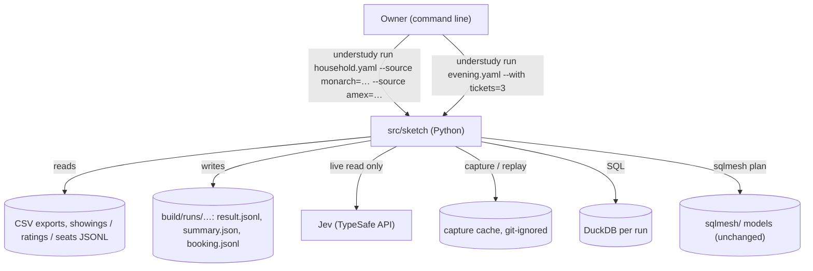
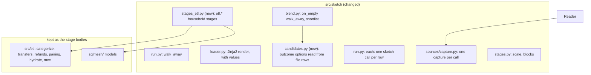

# Architecture Document: Sprint 20, the evening and the household ETL as sketches

*   **Status**: Draft — awaiting Smith Gate 2
*   **Author**: Morpheus
*   **Last Updated**: 2026-10-30
*   **Scope**: Sprint 20 (slice B of `EPIC_PYTHON_PORT.md`; stories `USER_STORIES_SPRINT20.md`; model `DESIGN_SKETCH_MODEL.md`; builds on `ARCH_SPRINT19.md`)

---

## 1. Executive Summary & System Overview

Sprint 19 proved the sketch model on one example. Sprint 20 proves it on the two pipelines the owner actually runs. No new package: the work extends `src/sketch/` in four places (run control, candidates read from file rows, `each:` to run a sketch once per row) and then moves the household ETL's stage code behind sketch stages so the ETL's separate controller, MCP source servers and command can be deleted. The SQLMesh models stay as they are (they hold the pairing rules and are the ETL's parity oracle); the sketch calls them.

Two sketches result: `examples/evening/` (`evening.yaml` calling `seating.yaml`, with file fixtures) and `sketches/household.yaml` (the owner's pipeline over his own CSV files).

## 2. System Context & Boundaries

* **Trust boundary:** unchanged from Sprint 19: only Jev is networked, only on a live run. Real CSVs, captures and outputs are git-ignored and never printed.
* **Leaves the system:** `understudy etl run`, `src/etl/controller.py`, `stages.yaml`, `source_server.py`, MCP paging in `sources.py`, the Node box office and ratings servers.

## 3. Component & Container Architecture

### Component Inventory
| Component | Responsibility | Inputs | Outputs |
|---|---|---|---|
| `run.py` / `blend.py` | `on_empty: walk_away` ends the run with outcome `walked_away` (exit 0, no sink output) | sketch | run outcome |
| `loader.py` | every sketch file is a Jinja2 template (StrictUndefined) rendered with `--with` values, or with a call's `with`, then read as YAML 1.2; the variables a file uses are collected for the unused-name check (ADR-0050) | file, values | `Sketch` |
| `candidates.py` | an outcome dimension may be `from: <source>, key: <field>`: its options are that source's rows; the blend and `forbid` then work over them like declared options | source rows | option set |
| shortlist | `shortlist: {at_most: n}` on a `blend` keeps the n highest-weight options of a dimension | blend result | n options |
| `kind: jev` with `options:` | a Jev source whose levels are a stage's shortlist at run time, not a fixed `criteria`; returns `{option, probability}` rows; the run takes the top option | rubric, shortlist | one chosen option |
| `reader.py` / `capture.py` | a source read again with other params keeps one sample per (source, request hash); replay answers each by hash | source, params | rows |
| `etl.hydrate` | reads each CSV named under `sources:` with the existing normaliser (`src/etl/sources.py` column aliases, dates, `raw_record`) and writes the JSONL snapshot, so a bad file fails with the file and column; no new source syntax | CSV path | JSONL |
| `stages_etl.py` | `etl.hydrate`, `etl.pair`, `etl.transfers`, `etl.plan_spending`, `etl.refunds`, `etl.categories`, `etl.publish`: thin async wrappers over the existing functions, reading Jev through the run's sources | `StageContext` | rows, summary |
| `examples/evening/*` | `evening.yaml`, `seating.yaml`, fixtures `showings.jsonl`, `ratings.jsonl`, `reviews.jsonl`, `seats.jsonl` | | booking |

## 4. Runtime Interaction & Critical Flows

**Evening.** `showings` → filter (`forbid`: afternoon unless `evenings`; genre/tomato rule) → deciders `tomato` (scaled 70-100, weight input), `audience` (Jev reads each showing's reviews: one call per showing, with params) → blend → shortlist 5 → Jev pick (options = shortlist, in the mood) → `seating` subsketch for that showing → blocks of adjacent free seats ≥ tickets (DuckDB gaps-and-islands) → `forbid` rows outside E/F/D → deciders `row` (order E, F, D) and `centre` (scaled) → shortlist 5 → Jev pick → returns `hold`. Empty after any `forbid` with `on_empty: walk_away` ends the run with exit 0; seating returns `none` and the parent routes the same way.

**Household.** The machine of `stages.yaml` moves into the sketch unchanged in order (`hydrate → pair → transfers → plan_spending → refunds → categories → output`) except that the explicit `failed` state goes: the shared loop already raises and records the failure. Each stage calls the same functions as today. The three Jev judgements (payee, refund choice, merchant category) are `kind: jev` sources read once per item, so capture and replay cover every one; the Jev wrapper (`GatedJev`) is the run's, not a second copy.

## 5. Interface & Contract Specifications

* `--with name=value` (top sketch) and `with: { name: value }` on a state that calls a sketch are the one way to pass values; the file receives them as Jinja2 variables, defaults written `{{ name | default(x) }}`. A name the receiving file does not use is a `check` error with the nearest used name. Standard YAML 1.2 (anchors, aliases) works unchanged. A child sees only what its call passes; one sketch may be called many times.
* `blend` gains `shortlist: {at_most: n}`; `forbid` gains the policy `on_empty: walk_away`; the CLI prints `walked away at <stage>` and exits 0.
* Source `kind: jev` gains `options: {from: <stage>, key: <field>}` as an alternative to `criteria`; exactly one of them.
* Outcome dimension `{from: <source>, key: <field>}` instead of a fixed list.
* Exit codes unchanged (0 done or walked away, 1 failed, 2 sketch invalid).
* Parity contract (UND-71): the sketch's `result.jsonl` equals `tests/fixtures/etl/expected/result.jsonl` as sorted records and the summary numbers match; the expected files are captured from the current ETL before any ETL change.

## 6. Cross-Cutting Concepts & Resilience

### Failure Modes & Error Handling
| Failure | Handling |
|---|---|
| Bad CSV column or unreadable file | `check` fails naming file and column; nothing written |
| Stage fails mid-ETL | loop records the stage in `run.json`, removes `result.jsonl(.part)` and `summary.json`; exit 1 |
| Jev pick outside the shortlist | refused; run fails naming the option |
| Replay stale (rubric changed) | announced as today; the run stays offline |
| Walk away | exit 0, `run.json` outcome `walked_away`, no sink files |
| Real-file run | counts and paths only on the terminal |

### Security & Privacy
Merchant names, amounts and account text stay in git-ignored folders (`build/`, `.understudy/`); `check_writable` still refuses private output under `src/`; capture files of the household sketch hold real merchants, like the ETL's own decision store did.

## 7. Technical Stack & SDLC / Build Impact

No new dependency or make target. Removed: nothing from the stack in this sprint (SQLMesh stays). Tests: `unittest` under the existing targets; expected files under `tests/fixtures/etl/expected/`; the evening fixtures under `tests/fixtures/evening/` (the example folder holds the runnable copy). Tank's Phase 0 is not needed.

## 8. Architectural Decisions (ADRs) & Technical Debt

### Decision Records
| Decision | Why | Alternative rejected |
|---|---|---|
| ADR-0046: SQLMesh models stay; the sketch calls them | the owner asked for the sketch, not a rewrite of the rules; parity is provable only if the rules do not move | replace with DuckDB SQL stages: bigger change, risks the parity |
| ADR-0047: loops are explicit: `each: <source>` runs a sketch once per row, and nothing else loops implicitly; a list passed anywhere else is one input (owner, 2026-10-30) | one loop, one way to pass values (`with:`), one capture rule (per call); a loop body is a whole sketch that can be run and tested alone | hidden loops inside stages; a loop that can run a stage or bare source (three body kinds) |
| ADR-0048: option sets can come from file rows, with a shortlist and a Jev pick over it | the evening's showings and seat blocks exist only at run time; Jev still only chooses among listed options | Jev writes values: against the owner's rule |
| ADR-0050: sketches are Jinja2 templates over standard YAML; `--with` and a call's `with` pass values (owner, 2026-10-30) | one standard way to name, default and pass values, and any sketch can be composed into another; no `inputs:` block or reference wrapper | an `inputs:` block with typed kinds; YAML tags; m4 (quoting and built-in names clash with YAML) |

### Acknowledged Technical Debt & Trade-offs
* The ETL keeps a Python wrapper layer (`stages_etl.py`) over SQLMesh and a subprocess; a later sprint could move the rules to plain DuckDB SQL.
* Stage names in the household sketch repeat the ETL's, not the user's mental model ("pair", "plan_spending"); renaming is cheap later.
* Candidate outcomes make `check` unable to verify a decider's options statically; they are verified at run time (the same run-time half as `_validate`).
* Net spending ($433k) is carried over unfixed; see backlog.
