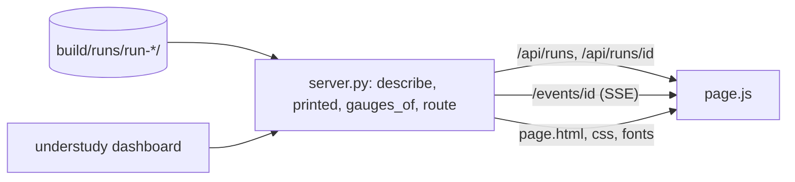

# Architecture: Sprint 21, the console in Python

*   **Status**: Built; reviewed in the phase gates
*   **Author**: Morpheus
*   **Scope**: stories UND-74, UND-75

## 1. Overview

One module, `src/dashboard/server.py`, beside the browser files in `src/dashboard/`. It reads three files per run (`run.json`, `summary.json`, `events.jsonl`) and answers a handful of GET routes. The browser script only draws what the API returns.

## 2. Components

| Part | Does |
|---|---|
| `printed(event)` | one event to `{text, tone}`; unknown kinds still print |
| `gauges_of(run, summary, events)` | four real readings, each a 0-1 level and text |
| `describe(dir)` / `list_runs(root)` | the page's data for one run / the rack |
| `route(root, path)` | pure: path to `json`, `static`, `events` or `missing`; the only place paths are checked |
| `follow(dir, poll)` | generator of SSE chunks; ends after `run_finished` |
| `make_handler`, `serve` | wiring only |

## 3. Failure and safety

* Run ids must match `run-[0-9A-Za-z-]+` and be a directory under the root; static names come from one allow-list regex; anything else is 404. Nothing but GET exists.
* A half-written last line of `events.jsonl` is skipped until complete.
* Binds 127.0.0.1 only. No secrets are read; run files already hold counts, and private values live in sink files the console never opens.
* A client that disconnects ends its stream (broken pipe caught).

## 4. Decisions

* ADR-0048: Node is removed; browser JavaScript stays as plain scripts with no build, lint or test runner; logic that needs tests lives in Python.
* Stdlib `http.server`, threaded, instead of a web framework (no dependency; read-only; one local user).

## 5. Build environment

Removes the Node mechanism from the SDLC (Tank Phase 0 equivalent: done with the sprint, `sdlc-check` at close). No new dependency.
