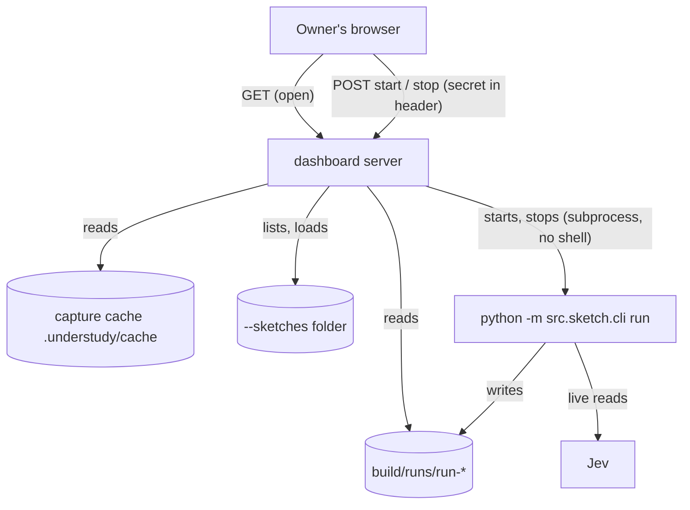
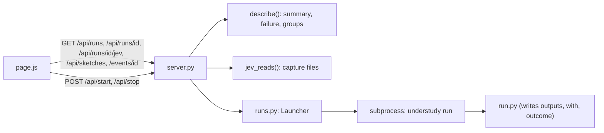

# Architecture Document: Sprint 22, the console you can trust, see into, and start runs from

*   **Status**: Draft — awaiting Smith Gate 2, then Switch's design gate
*   **Author**: Morpheus
*   **Last Updated**: 2026-11-01
*   **Scope**: Sprint 22 Architecture (stories `USER_STORIES_SPRINT22.md`; builds on the project-wide [ARCH.md](../ARCH.md); findings SEC-001 to SEC-004 in `agents/switch/findings/`)

---

## 1. Executive Summary & System Overview

Sprint 22 changes the console from a viewer of five event kinds into a console that explains a run (summary, failure, nested stages, Jev answers) and can start one. Three drivers shape it: (1) most new screens read facts the run already writes, so the run folder gains only three small fields; (2) the console is reachable from the whole network, so everything that starts a process sits behind one secret and one allow-list; (3) Python decides, the page draws (ADR-0048), so every new decision lives in `server.py` or a new `runs.py` and is unit-tested.

**Non-goals:** a diagram, step or pause, replay of a log's story, decision detail, a sketch editor (Sprints 23 and 24); accounts or more than one secret; running sketches from outside the chosen folder.

## 2. System Context & Boundaries

* **Trust boundary:** every `GET` stays open to the network (SEC-002, accepted until 2026-12-01). Every `POST` requires the access secret printed in the terminal that started the console. The secret never appears in a URL, a page, a log or an event.
* **New process boundary:** the console starts `understudy run` as a child process of its own user. It never builds a shell command; it passes an argument list.

## 3. Component & Container Architecture

### Component Inventory

| Component | Responsibility | Inputs | Outputs |
|---|---|---|---|
| `run.py` (changed) | Also record `outcome`, `with` values and `outputs` (file name to row count) in `run.json` when the run publishes | `RunResult`, sinks | `run.json` fields |
| `server.py` `describe` (changed) | Run state (running, done, failed, stopped), failure `{stage, reason, line}`, summary panel, nested stage groups with iteration counts, gauges whose needles are real fractions or absent | run files | JSON for the page |
| `server.py` `jev_reads` (new) | For one run, the captured Jev reads: source key (stage path), each level with its probability, the top level and its margin, flagged below the review threshold; says which captures are missing or no longer kept | `CaptureStore` | JSON list |
| `server.py` `route` (changed) | Adds `POST` routes, checks the secret before any `POST` handler runs, 405 for other methods | method, path, header | route kind |
| `runs.py` `Launcher` (new) | Lists sketches in the folder (name, description, `--with` names, check result), starts and stops runs, one per sketch, tracks child processes, keeps the last 2 KB of a failed start's stderr, marks a stopped run `stopped` in its `run.json` | sketches folder, request | run id or refusal message |
| `cli.py` (changed) | `dashboard --sketches DIR`; one-line errors for a busy port or missing folder; `runs` command; run ends by printing the run id | argv | lines, exit codes |
| `page.js` (changed) | Draws status, banner, summary, groups, filters, Jev list, sketch list and start form; keeps the secret in `sessionStorage` and sends it as a header | API JSON | the page |

## 4. Runtime Interaction & Critical Flows

**Start a run**

1. The owner opens the console; the page loads `/api/sketches` (open) and shows each sketch, greyed with its check message if it fails `check`.
2. The owner chooses a sketch, fills one field per `--with` name and presses Play. The page sends `POST /api/start {sketch, with}` with the secret in `X-Understudy-Secret`.
3. The server compares the secret with `hmac.compare_digest`; a wrong or missing secret is a 401 and a one-second pause (the pause is per client address to slow guessing). Nothing else is read.
4. `Launcher` resolves the sketch path and refuses it unless it is a `.yaml` file inside the sketches folder (symlinks resolved first); refuses unknown `--with` names; refuses a second start while that sketch's child is alive.
5. `Launcher` first runs the same check as `understudy check` with these values; a failure returns its lines to the page and starts nothing. This is how a missing input file is caught before Play (story UND-79 criterion 4).
6. It then starts `[sys.executable, "-m", "src.sketch.cli", "run", <sketch>, "--with", "name=value", ...]` with `shell` off, `cwd` the project root and `start_new_session=True`, stdout and stderr piped to a bounded buffer.
7. The page shows the new run in the rack within a poll (the run folder appears when the child makes it) and follows it with the existing event stream. If the child exits before it made a folder, the response says why using its stderr line.

**Stop a run:** `POST /api/stop {run}` with the secret; `Launcher` sends `SIGTERM` to the child's process group, waits briefly, then `SIGKILL`; it writes `status: stopped` into that run's `run.json` (the child cannot, having been killed).

**Replay:** the start form offers the capture runs `CaptureStore.runs()` holds for the sketch (the last 5) and adds `--replay=<run-id>`.

**Read the Jev list:** `GET /api/runs/<id>/jev` reads `.understudy/cache/<id>/*.jsonl`. A capture holds the levels and probabilities only (the text Jev read is stored as a hash, never the text), so the list shows the source key, the levels and the top one; the question text comes from the sketch's rubric if the sketch file still exists.

## 5. Interface & Contract Specifications

* **New GET routes (open):** `/api/sketches` → `[{name, file, description, with: [names], ok, problem}]`; `/api/runs/<id>/jev` → `{kept: bool, reads: [{source, levels: [{level, probability}], top, margin, flagged}], missing: [source...]}`; `/api/replays?sketch=<file>` → capture run ids.
* **New POST routes (secret required):** `/api/start`, `/api/stop`. Bodies are JSON no larger than 8 KB. Responses: 200 `{run}` or `{problem}`, 400, 401, 403 (sketch outside the folder), 409 (already running), 413, 503 (too many watchers, existing).
* **Header:** `X-Understudy-Secret`. A custom header means a browser page on another site cannot send it without a CORS preflight, which the server never grants (it sends no CORS headers). `Content-Security-Policy` already forbids framing.
* **Command line:** `understudy dashboard [runs-folder] [--port N] [--sketches DIR]`; on start it prints the address and the secret once. `understudy runs` lists runs. A busy port or missing folder prints one `understudy: <message>` line and exits 2.
* **Run folder additions:** `run.json` gains `outcome`, `with` (name to value as given) and `outputs` (file name to row count). Existing readers ignore unknown keys.

## 6. Cross-Cutting Concepts & Resilience

### Failure Modes & Error Handling

| Failure Mode | Trigger / Condition | System Behavior | User / Client Impact | Blast Radius |
|---|---|---|---|---|
| Wrong or missing secret | any POST | 401 after a one-second pause per address; nothing started | controls explain "needs the access secret" | none |
| Sketch outside the folder, bad name, extra argument | tampered request | 403 or 400 before anything runs | message names the rule | none |
| Check fails | missing file, bad value | start refused with the check lines | shown on the page | none |
| Child dies before it makes a run folder | no key, import error | stderr tail returned | "could not start: <line>" | the request |
| Console restarts while a child runs | restart | the child keeps running (own session); the console forgets it, the run stays visible by its files; Stop is unavailable for it | rack shows it running; no Stop | one run |
| Run killed outside the console | `kill`, power loss | `run.json` stays `running`; the page marks a run with no new event for 10 minutes "stalled" | clear marker | one run |
| Missing or pruned captures | run older than the last 5 | Jev list says "captures no longer kept" | no list for that run | one panel |
| Two Plays at once | double click | second returns 409 "already running" with the run id | page opens that run | none |

### Security & Privacy

* **Trust / access boundaries:** secret generated per console start with `secrets.token_urlsafe(32)`, printed to the terminal only, compared in constant time, held by the page in `sessionStorage` (cleared when the tab closes). Starting is limited to `.yaml` files under `--sketches`. The child gets the console's environment, so `TYPESAFE_API_KEY` reaches it as it would from a terminal; the console never reads or returns it.
* **Sensitive data:** run folders hold counts and file names; `with` values are file paths as typed (SEC-004 covers the same exposure; Sprint 23 records them relative). The Jev list shows levels and probabilities only, never the text Jev read.
* **Switch design gate:** this section is the input to `*sec threat sprint 22`.

## 7. Technical Stack & SDLC / Build Impact

* **Languages & Runtime:** Python 3.12.15; standard-library `subprocess`, `secrets`, `hmac`, `http.server`; no new dependency.
* **Build-Environment Check (CRITICAL):**
  * Does this design add a new language, package manager, runtime version, or external tool? **No.** UND-80's browser check may add one; it is Tank's decision and is not in this design.
  * All dependencies follow `docs/SDLC.md` change classes.

## 8. Architectural Decisions (ADRs) & Technical Debt

### Decision Records
* **ADR-0049 (to record)**: the console starts runs as subprocesses behind one startup secret and a sketches allow-list; rejected: a login page (a second mechanism for one owner), running the sketch inside the server process (a stage could block or crash the console), loopback-only Play (the owner works from other devices).
* **D-S22-1**: groups are derived from stage names (`readings.judge_payee[3].decide` belongs to group `readings.judge_payee`, iteration 3); no change to the event stream until Sprint 23.
* **D-S22-2**: needles show only real fractions (stages done of total, failed of total); JEV and ELAPSED become figures.

### Acknowledged Technical Debt & Trade-offs
* **Story wording to correct** (Cypher): UND-79 criterion 4 ("a name that must be a file is checked to exist") becomes "Play first runs the sketch's check with these values and shows any problem", because the sketch model has no typed inputs; UND-78 criterion 1 ("the question") becomes "the source that asked, its levels and probabilities; the question text when the sketch file still exists", because captures store no question text. UND-78 gains "Captures older than the last five are no longer kept; the list says so."
* **Stalled-run marker is a guess** (10 minutes of silence); a real heartbeat would need a new event (Sprint 23).
* **A console restart forgets running children** (no persistence of process ids); acceptable for one owner; Stop is unavailable for them.
* **One shared secret**, no per-user identity or audit trail; accepted for one owner.
