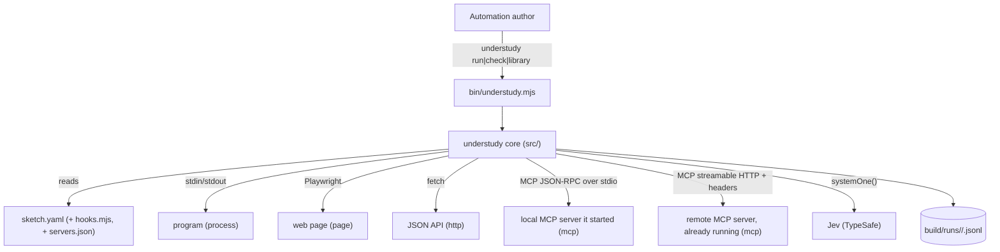
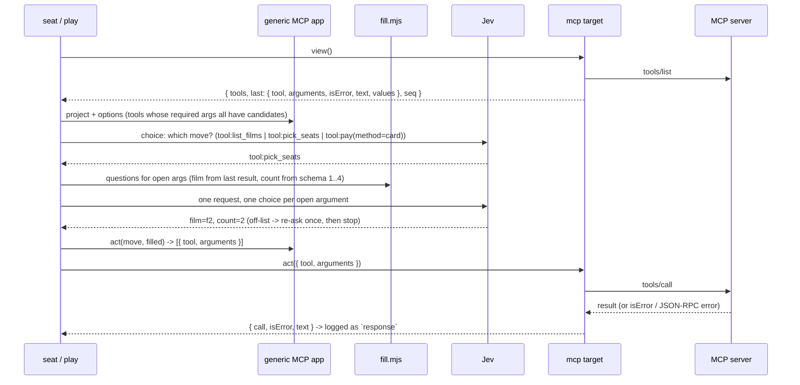

# Architecture Document: Understudy Sprint 3 — one sketch file, and an MCP target

*   **Status**: Approved at Smith Gate 2 (2026-10-15), notes folded in
*   **Author**: Morpheus
*   **Last Updated**: 2026-10-15
*   **Scope**: Sprint 3 Architecture (stories: `docs/sprints/USER_STORIES_SPRINT3.md`)

---

## 1. Executive Summary & System Overview

Two changes. (1) **The sketch file**: `src/part.mjs` becomes `src/sketch.mjs`, which loads one
`sketch.yaml` (name, target, app, player, steps, questions, turn, and for MCP `calls`/`values`)
and, only when named, a `hooks.mjs`. `parseTurn` takes the parsed `turn:` object instead of a
file's text. The adapter/part layout is deleted, not kept (owner: no back-compat). (2) **The MCP
target**: `kind: mcp`, built on `@modelcontextprotocol/sdk`'s `Client`. A server is one
`mcpServers` entry, inline or by reference; local servers run over stdio through understudy's own
`program.mjs` (so exit codes, stderr and stopping work as for the other targets); remote servers
use the SDK's `StreamableHTTPClientTransport` with headers. A built-in **generic MCP app** offers
the tools as moves; open arguments are **chosen** by Jev from finite value sets, in a second
request after the tool is picked. Nothing changes in the run loop except one optional app hook for
a clearer idle message.

## 2. System Context & Boundaries



Trust: a local server is a program the author named, started in the sketch directory as for
`process`. A remote server is contacted only at the sketch's URL. Header values (tokens) come from
the environment via `${VAR}` and are never logged or printed (see §6).

## 3. Component & Container Architecture

| Component | Change | Responsibility |
|---|---|---|
| `src/sketch.mjs` (replaces `part.mjs`) | new | find `sketch.yaml` (dir or file path); check top-level keys, `target`, `app`/hooks, `questions`, `turn`, `calls`/`values`; load `hooks.mjs`; refuse the old layout; `checkSketch`, `sketchLibrary` |
| `src/machine.mjs` | `parseTurn(config, { file, where: 'turn', ... })` | takes the parsed object; error paths are prefixed `turn.` |
| `src/mcpConfig.mjs` (new) | — | pure: resolve the server entry (inline or `config:` + `server:`), validate the `mcpServers` shape, expand `${VAR}` / `${VAR:-default}` at run time |
| `src/targets/program.mjs` | adds stderr tail | keeps the last 20 stderr lines (`stderrTail()`); used in "did not start" messages |
| `src/targets/mcp.mjs` (new) | — | connect (stdio via `ProgramTransport`, or HTTP), handshake within 10 s; `view` = tools + last result; `act` = one `callTool`; errors from the server are returned, a lost transport is a `RunError` |
| `src/targets/mcpTransport.mjs` (new) | — | `ProgramTransport`: the SDK `Transport` interface over a `program.mjs` child, using the SDK's `ReadBuffer`/`serializeMessage` |
| `src/apps/mcp.mjs` (new) | — | the generic MCP app, built per sketch from `calls`/`values`: `phase/project/options/act`, plus `idle(view)` naming tools not offered and why |
| `src/fill.mjs` (new) | — | pure: candidate values for each open argument (schema, sketch, last result), and the choice questions that ask Jev to pick them |
| `src/library.mjs` | `play` | after the move is picked, if it has open arguments, one more Jev request fills them (ADR-U4 off-list rule applies) |
| `src/run.mjs` | idle message, name | log dir uses the sketch `name`; `checkIdle` uses `app.idle?.(view)` when present |
| `src/cli.mjs` | wording | `<sketch>` = a directory holding `sketch.yaml` or the file; usage and messages say "sketch" |
| `examples/{cli,web,http}` | converted | `sketch.yaml` (+ `hooks.mjs` for cli/http); `adapter.mjs` and `part/` deleted |
| `examples/mcp/` (new) | — | `server.mjs` (box office; stdio by default, `--http --port N --token T`), `sketch.yaml` (inline entry) |
| `examples/mcp-remote/` (new) | — | `sketch.yaml` (`config: servers.json`), `servers.json` (`type: http`, `Bearer ${MCP_TOKEN}`), `README.md` |

### The sketch file

```yaml
name: boxoffice-mcp                 # required; logs go to build/runs/<name>/
description: >-                     # optional; what the stand-in does (was turn.yaml's description)
  ...
target: { kind: mcp, server: { command: node, args: [server.mjs] } }
app: hooks.mjs                      # required for process and http; not allowed for page and mcp
player: { floor: 0.4 }              # optional, as the adapter's `player` before
steps: 30                           # optional; --steps wins; default 50
calls:                              # mcp only: fixed calls; a listed tool is offered only as listed
  - { tool: pay, arguments: { method: card } }   # `hold` is still open -> filled by Jev
values:                             # mcp only: candidate values for open arguments
  pick_seats: { count: [2, 3] }
questions: { next: { type: choice, instructions: ... } }
turn: { initial: waiting, states: { ... } }
```

Known top-level keys: `name, description, target, app, player, steps, questions, turn, calls,
values`. `hooks.mjs` default-exports the four app hooks (`phase, project, options, act`, optional
`propose`) and may export `library` (guards/actions/actors, each with `doc`), exactly what an
adapter's `app` and `library` were.

Target fields per kind: `process: command, args`; `page: root, page`; `http: command, args, url,
state`; `mcp: server` (an inline entry) **or** `config` + `server` (a file and a name).

### MCP server entry (the `mcpServers` shape)

| Form | Fields | Transport |
|---|---|---|
| local | `command` (req.), `args`, `env`, optional `type: stdio` | stdio via `ProgramTransport`; `env` merged over understudy's environment; cwd = sketch dir |
| remote | `type: http` (req.), `url` (req.), `headers` | SDK `StreamableHTTPClientTransport(url, { requestInit: { headers } })` |

A `config:` file is read with the YAML parser (JSON is valid YAML), must have `mcpServers`, and is
resolved relative to the sketch. `type: sse` and unknown fields are refused with the known ones.

## 4. Runtime Interaction & Critical Flows

### One MCP step with an open argument



### Candidate values (`fill.mjs`), per open argument

Order of precedence, first non-empty wins: (1) the sketch's `values.<tool>.<arg>`; (2) the
schema's `enum`, `boolean` → `[true, false]`, `integer` with `minimum`/`maximum` ≤ 19 apart → each
whole number; (3) the leaves of the argument's JSON type in the last result that was **not an error** (Phase 2:
a refused call must not take away what the call before it offered) (strings for `string`,
numbers for `number`/`integer`) from `structuredContent` and from any text content that parses as
JSON, deduplicated, at most 20. Required arguments with no candidates make the tool not offered;
optional arguments are sent only when the sketch fixes them or lists values. Each argument
question is a `choice` whose instructions are the play question's instructions plus a generated
sentence naming the tool, the argument and its schema description; criteria are `v1..vn` → the
value in backticks. Arguments are independent questions in one request.

### Starting a local server

`program.mjs` starts the command (cwd = sketch dir, env merged), `ProgramTransport` wraps its
stdio, `client.connect(transport, { timeout: 10_000 })` raced against the program's exit. Exit
before the handshake → `RunError` naming the command, its exit code and stderr tail; timeout → same
with "did not answer the MCP handshake within 10 s". `close()` = `client.close()` then
`program.close()` (SIGTERM, SIGKILL after 2 s).

### Connecting to a remote server

`client.connect` retried every 250 ms until 10 s while the error is a connection failure. An HTTP
error status from the server (`error.code` 401/403/404...) is final: `RunError` "the MCP server at
<url> refused the connection (HTTP 401)". `close()` closes the client only; the server is left
running.

## 5. Interface & Contract Specifications

* **Commands:** `understudy run <sketch> [--steps N]`, `check <sketch>`, `library [<sketch>]`;
  `<sketch>` is a directory with `sketch.yaml` or a path to a `.yaml` file. Exit codes unchanged
  (ADR-0005).
* **check line:** `examples/mcp: sketch OK - boxoffice-mcp (mcp, generic app) - 5 states, 1 question`;
  with hooks: `... (process, hooks.mjs) ...`.
* **Old layout:** `<dir>: no sketch.yaml - adapter.mjs and part/ are no longer read; see docs/SKETCHES.md` (exit 2).
* **MCP view:** `{ tools: [{ name, description, inputSchema }], last: { tool, arguments, isError, text } | null, seq }`.
  `showing` searches every string in the view, tool descriptions included - an end text should be
  one only a result says (documented in `docs/SKETCHES.md`, and the example's end text is checked
  not to appear in any tool description by a unit test - Smith Gate 2).
* **MCP move ids:** `tool:<name>` for an unlisted tool, `tool:<name>(k=v,...)` for a fixed call
  (fixed arguments only). Step log `response`: `{ call: { tool, arguments }, isError, text }`
  (`text` = text content joined, first 2000 characters).
* **Not offered:** first time a tool is left out of a look, one stderr line:
  `understudy: not offering tool:<name> yet - argument "<arg>" (<type>) has nothing to choose from; list values for it in sketch.yaml`
  (Smith Gate 2: "yet", because a result can supply values later). It is offered as soon as candidates appear (e.g. from a result).
* **Idle:** the generic MCP app's `idle(view)` lists each tool and why; `checkIdle` uses it in the
  `no-first-move` / `stalled` messages.

## 6. Cross-Cutting Concepts & Resilience

### Failure Modes & Error Handling
| Failure Mode | Trigger | Behaviour | User sees | Blast radius |
|---|---|---|---|---|
| Bad sketch | unknown key, bad target field, bad turn/questions, missing hooks | refused in `loadSketch` | exit 2, `sketch.yaml: <path>: <message>` | nothing started |
| Old layout | `adapter.mjs`/`part/` without `sketch.yaml` | refused | exit 2, the old-layout line | nothing started |
| Bad server ref | missing `config` file, unknown server name, `type: sse` | refused at load (check too) | exit 2 naming the file and the names it has | nothing started |
| Unset variable | `${VAR}` with no value and no default | refused at run start | exit 2 naming the variable and file | nothing started |
| No handshake | local server silent 10 s / exits early | `RunError` | exit 1, command + exit code + stderr tail | server stopped |
| Remote down | nothing at URL for 10 s | `RunError` | exit 1 naming the URL | none |
| Remote refuses | HTTP 401/403 on connect | `RunError` | exit 1, URL + status, never the header | none |
| Tool error | `isError: true` or JSON-RPC error on `tools/call` | returned as the answer | logged in `response`; run continues | none |
| Lost transport | server exits / connection drops mid-run | `RunError` `app-exited` / `connection-lost` | exit 1 | server stopped (local) |
| Nothing offerable | every tool lacks candidates | idle rule (ADR-0010) | exit 1 `no-first-move`/`stalled`, each tool + why | server stopped |
| Off-list argument | Jev picks a value not offered | re-ask once, then `RunError` `off-list` | exit 1 naming the argument | server stopped |

### Security & Privacy
* **Authentication:** remote servers get the entry's `headers`, nothing else (no OAuth).
* **Sensitive data:** expanded header values are held only in the transport; the target's
  `describe()` is the URL, errors carry status codes, the log carries tool calls and results only.
  A test asserts a token never appears in stdout, stderr or the log.

## 7. Technical Stack & SDLC / Build Impact

* **Languages & Runtime:** Node ≥ 24, ESM — unchanged.
* **Dependencies:** `@modelcontextprotocol/sdk ^1.32.1` (client in `src/`, server in the example)
  and `zod ^4` (the example server's tool schemas; the SDK's peer). Ordinary dependencies added by
  Neo through SDLC §4 — **no Tank Phase 0**.
* **Make targets:** none new. **`make test-live` recipe change** (UND-11 AC5: start the example
  server in HTTP mode with a throwaway token, play `examples/mcp-remote`, stop it). A recipe edit
  of an existing target is a mechanism change under SDLC §6 → **Tank owns it**, in the remote
  phase; the owner approved the outcome through the sprint scope.
* **Tests:** unit tests never call Jev or start a real server except the in-repo example server
  over stdio and HTTP (local, fast), as the http target tests do (ADR-0006).

## 8. Decisions (for Oracle to record)

* **ADR-0011** One `sketch.yaml` per sketch; `hooks.mjs` only where code is needed; the
  adapter/part layout is removed. Supersedes the layout in ADR-0001's context and ADR-0003's
  "adapter decides" wording (the hooks still decide).
* **ADR-0012** MCP target: SDK `Client`; local servers over understudy's own `ProgramTransport` on
  `program.mjs` (exit codes, stderr tail, one way to stop), remote over the SDK's streamable HTTP;
  config is the `mcpServers` entry, inline or by reference, `${VAR}` expanded at run.
* **ADR-0013** Jev chooses argument values, never writes them: candidates from sketch, schema, last
  result; a second request after the tool is picked; off-list rule as ADR-0004.

## 9. Risks

* `ProgramTransport` depends on SDK internals being exported (`shared/stdio.js`). If they are not,
  fall back to the SDK's `StdioClientTransport` with `stderr: 'pipe'` and report exits without a
  code. Neo checks this first in the MCP phase.
* Result-derived candidates can be noisy (every string in a large result). Capped at 20; the
  sketch's `values` override them.
