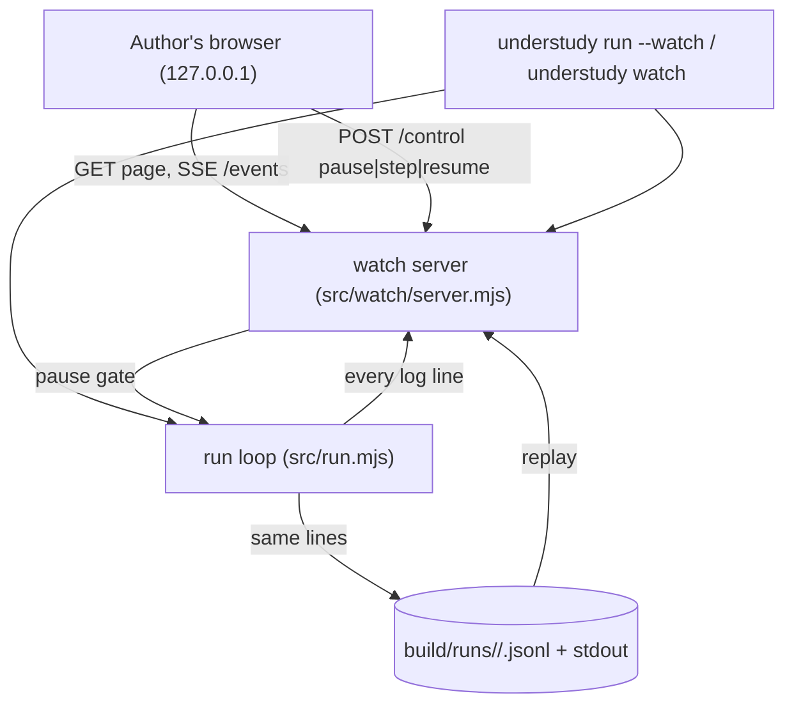
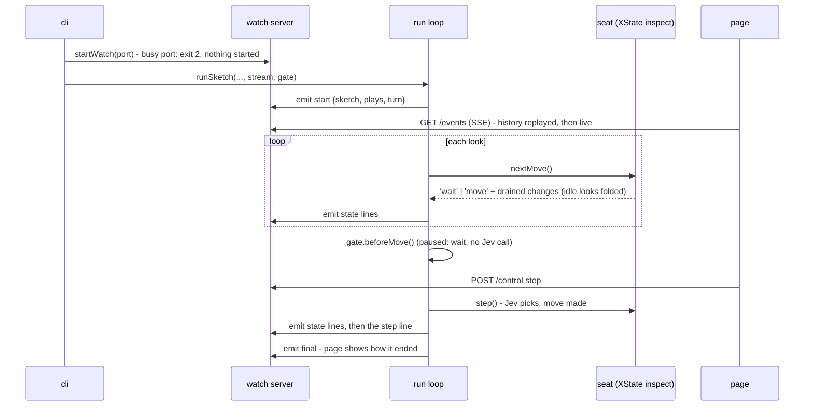

# Architecture Document: Understudy Sprint 4 — watch the understudy live

*   **Status**: Approved at Smith Gate 2 (2026-10-15), note folded in
*   **Author**: Morpheus
*   **Last Updated**: 2026-10-15
*   **Scope**: Sprint 4 Architecture (stories: `docs/sprints/USER_STORIES_SPRINT4.md`)

---

## 1. Executive Summary & System Overview

Three pieces. (1) **The run log becomes an event stream**: a `start` line (sketch, what it plays,
its `turn:`), `state` lines taken from XState's inspection API, and the existing step and final
lines. Idle looks are folded into a count. (2) **A watch server** inside understudy - plain
`node:http`, Server-Sent Events, no new dependency - serves a page that draws the statechart as
SVG with a small layered layout of our own, highlights states and transitions, and lists
decisions. `run --watch` feeds it live; `understudy watch <log>` feeds it a finished log. (3) **A
pause gate** in the run loop, before each move (so before any Jev call), driven by the page.

## 2. System Context & Boundaries

Trust: the server binds `127.0.0.1` only. Every URL carries a random per-run token
(`/w/<token>/`), so another site open in the same browser cannot drive `/control`. Nothing is
fetched from the internet: the page, its script and its styles are files in `src/watch/`.

## 3. Component & Container Architecture

| Component | Change | Responsibility |
|---|---|---|
| `src/seat.mjs` | inspection | `createActor(machine, { inspect })` collects microsteps as `{ from, to, on }`; `drainChanges()` hands them to the run; an idle look (ends where it began, no move) is dropped and counted |
| `src/stream.mjs` (new) | — | the run's lines: `start`, `state` (with `idle_looks` when some were folded), step, final; one `emit(line)` that writes stdout + log and tells listeners |
| `src/run.mjs` | uses stream; pause gate | writes the `start` line; flushes state lines after each look and step; before each move awaits `gate.beforeMove()`; idle limits measure running time only; `--watch` starts the server first |
| `src/watch/turnGraph.mjs` (new) | — | pure, Node and browser: `turn:` → `{ nodes, edges }` with labels (`OBSERVE`, `STEP`, `done: phase is asking`); shared label function with the state lines |
| `src/watch/layout.mjs` (new) | — | pure: nodes ranked by distance from the initial state, columns left to right, back edges arced; returns SVG geometry |
| `src/watch/server.mjs` (new) | — | `startWatch({ port, mode, history })`: serves `page.html`, `page.mjs`, `turnGraph.mjs`, `layout.mjs`, `page.css`; `GET /events` (SSE: history, then live); `POST /control` (live only); refuses a busy port with a `UsageError` |
| `src/watch/gate.mjs` (new) | — | pause state: `pause()`, `step()`, `resume()`, `beforeMove()` (resolves when allowed, or at Ctrl-C), `pausedMs()`; emits `{ event: 'control', paused, before_step }` |
| `src/watch/page.html`, `page.mjs`, `page.css` (new) | — | the page: diagram (SVG), status bar, controls, decision feed; live (EventSource) or replay (client-side playback over the same events) |
| `src/watch/replay.mjs` (new) | — | read and check a log (`start` line first; every line JSON), hand it to the server in replay mode |
| `src/cli.mjs` | options, command | `run ... --watch [--port N] [--pause]`; `watch <log> [--port N]` |
| `eslint.config.js` | browser globals | a files block for `src/watch/page.mjs` (Tank, like `examples/web`) |

## 4. Runtime Interaction & Critical Flows

### Live run with a page open

### Idle-look folding (UND-13 AC3)

During `nextMove()` the seat records the microsteps. If the call returns `'wait'` and the machine
is back in the state it started from, the look was idle: its changes are discarded and
`idleLooks` grows. The next non-idle batch's first `state` line carries `idle_looks: n` and resets
it. A look that moves on (to a move state, or the final state) is listed in full.

### Pause gate (UND-15)

`playUntilDone` calls `await gate.beforeMove()` when the seat says `'move'`, before `takeStep` -
the Jev request is inside `takeStep`, so a paused run makes none. `beforeMove()` resolves when
running, after one `step()`, on `resume()`, or when Ctrl-C is pressed (then the loop's next
`nextMove` sends `QUIT` as today and the run ends `interrupted`). `checkIdle` subtracts
`gate.pausedMs()` from the idle time, so limits count running time only. Without `--watch` the
gate is a no-op that always resolves.

### Replay (UND-16)

`understudy watch <log>` reads the file, checks the first line is a `start` line and every line is
JSON (else `UsageError` naming the line number), and starts the server with `mode: 'replay'` and
the lines as history. The page receives the same events as live, all at once, and plays them
itself: Play advances one step line per second (state lines in between animate the highlight);
Step back/forward and clicking a step recompute the view at that point from the history.

## 5. Interface & Contract Specifications

* **Commands:** `understudy run <sketch> [--steps N] [--watch [--port N] [--pause]]`;
  `understudy watch <log.jsonl> [--port N]`. `--port`/`--pause` without `--watch` (on `run`) are
  refused, exit 2. Exit codes unchanged (ADR-0005); `watch` exits 0 on Ctrl-C.
* **stderr:** `understudy: watch at http://127.0.0.1:<port>/w/<token>/` before the first move;
  with `--pause`: `understudy: paused - step or resume from the page, or Ctrl-C`.
* **Log lines (stdout and file, in order):**
  * `{"event":"start","sketch":"coffee-cli","plays":"node app.mjs","turn":{...as written...},"at":"..."}`
  * `{"event":"state","from":"looking","to":"answering","on":"done: phase is asking","at":"...","idle_looks":12}` (`idle_looks` only when non-zero)
  * step lines and the final line: unchanged fields.
  * Live only (not in the log): `{"event":"control","paused":true,"before_step":3}`.
* **Labels:** `OBSERVE`, `STEP`, `QUIT`; an invoke's completion is `done`, followed by its guard as
  `: <type> <param> <value>` (`done: phase is asking`, `done: showing text Ticket issued`);
  `always` transitions are `always` (+ guard). The diagram uses the same function.
* **HTTP (all under `/w/<token>/`):** `GET /` page; `GET /page.mjs|turnGraph.mjs|layout.mjs|page.css`;
  `GET /events` (SSE, `data: <line>` per event, `event: end` after the final line);
  `POST /control` with `{"action":"pause"|"step"|"resume"}` → 204, 409 when not applicable or
  in replay. Any other path or a wrong token: 404.

## 6. Cross-Cutting Concepts & Resilience

### Failure Modes & Error Handling
| Failure Mode | Trigger | Behaviour | User sees | Blast radius |
|---|---|---|---|---|
| Port in use | `--port N` taken | `UsageError` before judge/target | exit 2, `port N is in use - choose another with --port` | nothing started |
| No page open | author never opens it | run proceeds; events buffered for late joiners | nothing different (AC6) | memory: one run's lines |
| Page closed while paused | tab closed | stays paused (assumption) | stderr already said how to resume / Ctrl-C | the run waits |
| Ctrl-C while paused | SIGINT | gate releases, QUIT, `interrupted` | final line; page shows it | app closed as today |
| Bad replay file | no start line / not JSON | `UsageError` | exit 2 naming the file and line | nothing served |
| Log with no final line | run killed (e.g. `kill -9`) | replayed as far as it goes | page says `log ends without a final line (the run was killed?)` (Smith Gate 2) | none |
| Page loses the stream | process exited | page shows the last known state and "run ended"/"connection lost" | no reconnect loop | none |

### Security & Privacy
* **Authentication:** none; `127.0.0.1` and an unguessable path token per run.
* **Sensitive data:** the page shows what the log holds (no new data). MCP header values never
  enter events (ADR-0012 unchanged).

## 7. Technical Stack & SDLC / Build Impact

* **Languages & Runtime:** Node ≥ 24 + a browser ES module (no bundler, no build step).
* **Dependencies:** **none added.** Mermaid was considered and rejected: 122 MB unpacked, heavy to
  serve and parse on the Pi, and highlighting needs a re-render; a 150-line layered SVG layout fits
  flat turns of 5-15 states.
* **Make targets:** none new. **`eslint.config.js`**: one `files` block giving
  `src/watch/page.mjs` browser globals - a lint-config edit, scheduled for Tank in Phase 2 (as the
  `examples/web` block was).
* **Tests:** pure modules (`turnGraph`, `layout`, idle folding, gate, replay reader) in `node:test`;
  the server over real HTTP/SSE on a free port; the page driven end to end with Playwright's
  Chromium in a test that `test-live`/UAT runs (ADR-0006: `make test` launches no browser), the
  page's logic kept in `page.mjs` functions testable without a DOM where possible.

## 8. Decisions (for Oracle to record)

* **ADR-0014** The run log is an event stream: `start` + `state` lines from XState inspection,
  idle looks folded into `idle_looks`; step and final lines unchanged.
* **ADR-0015** The watch page is served by understudy itself (node:http + SSE, per-run token,
  127.0.0.1), and draws the statechart with its own layered SVG layout - no diagram dependency.
* **ADR-0016** Pause is a gate before each move in the run loop: no Jev call while paused; idle
  limits count running time only; Ctrl-C releases it.

## 9. Risks

* The layered layout may be cramped for turns with many back edges; acceptable for the examples
  (5 states), revisit with a real sketch that needs it.
* SSE through some SSH tunnels buffers; the page also shows the last event time so staleness is
  visible.
