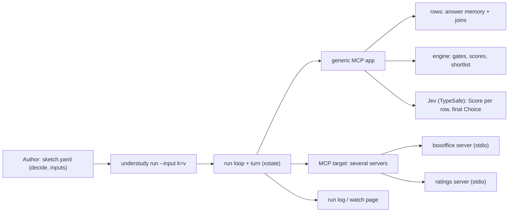

# Architecture Document: Sprint 5 decision engine

*   **Author**: Morpheus
*   **Last Updated**: 2026-10-16
*   **Scope**: Sprint 5 Architecture (stories `USER_STORIES_SPRINT5.md`, UND-18..26)
*   **Status**: Approved at Smith Gate 2 (2026-10-16), one note folded into §4 "Walk away"

## 1. Executive Summary & System Overview

Today an MCP sketch's open arguments are filled by Jev from a flat list of leaf values found in
the **last** answer. Sprint 5 keeps that path for sketches that do not opt in, and adds a
**decision** path for arguments the sketch names under `decide:`: each candidate value keeps the
**answer row** it came from (joined with other servers' rows about the same thing), passes
**gates**, is **scored** by weighted curves (one factor may be a Jev Score), and the
**shortlist** goes to one Jev Choice coloured by the run's **inputs**. An empty shortlist with
nothing held back fires a guard the turn can use to **walk away**. The target grows from one MCP
server to several. The decision engine is pure code over JSON rows - reusable beyond MCP later.

## 2. System Context & Boundaries



- **Trust**: servers are the author's own local programs or token-protected URLs, as in sprint 3.
  Answers are data; nothing in an answer is executed or used as an instruction.
- **Jev boundary**: Jev only ever chooses (a Score level or a Choice among shortlisted values);
  it never writes a value or a weight (ADR-0013, owner rule).
- **Statechart boundary**: the turn decides *when* (look, act, leave); the engine decides *which
  values* are offered for an argument. Scoring is not expressed as xstate guards (owner asked;
  see ADR-0019) - only its outcome is, through one new guard.

## 3. Component & Container Architecture

| Component | Responsibility | Input | Output |
|---|---|---|---|
| `src/targets/mcp.mjs` (changed) | One client per named server; a look lists every server's tools, each tagged with its server; a move calls the named server. | `servers: { name: entry }` | view `{ tools[{ server, name, ... }], last, answers }` |
| `src/mcpConfig.mjs` (changed) | Resolve `server:` (one) or `servers:` (several), inline or from `servers.json`. | sketch target | `[{ name, entry }]` |
| `src/rows.mjs` (new) | Remember every non-error answer of the run; split it into **rows**; find the rows that offer a value for a field; **join** rows across answers by a key field. | answers | `rowsFor(field)`, `facts(row, join)` |
| `src/engine.mjs` (new, pure) | Gates, factor curves, product, shortlist bounds; classify each value as shortlisted, removed (with why) or held back (with the missing fact). | candidates with facts, decision, inputs, Jev scores | `{ shortlist[{ value, factors, total }], removed[], held[] }` |
| `src/inputs.mjs` (new) | Declared inputs, `--input` parsing and range checks, defaults. | sketch `inputs:`, CLI pairs | `{ name: value }` |
| `src/apps/mcp.mjs` (changed) | For a decided argument: candidates from rows (not leaves), drop spent values, run the engine, ask Jev's Scores for unscored rows, then the final Choice; report the decision for the log and guards. | view, decide, inputs | moves with shortlisted candidates; `decisions` |
| `src/fill.mjs` (changed) | The final Choice over a shortlist carries the pick instructions and the listed inputs in its state. | shortlist, pick | Choice question, `read()` |
| `src/library.mjs` (changed) | New guard `nothing_qualifies`; the look actor's output carries the app's `decisions`. | look output | boolean |
| `src/sketch.mjs` (changed) | Load and check `servers`, `inputs`, `decide`, `pick`, and `type: score` questions with `looks_at`/`levels`. | sketch.yaml | `UsageError` naming file and path |
| `src/run.mjs` / `src/cli.mjs` (changed) | `--input`; inputs on the start line; outcome `walked-away`; the decision on each step line. | | log lines, exit code |
| `src/watch/page.mjs` (changed) | Show a step's score table, removed and held values. | step event | DOM |
| `examples/evening/` (new) | Richer box office (`boxoffice.mjs`), ratings server (`ratings.mjs`), the owner's sketch. | | |

`examples/mcp` and `examples/mcp-remote` keep their sprint 4 box office and behaviour.

## 4. Runtime Interaction & Critical Flows

### Answer rows (ADR-0017)

Every non-error answer (structured content, or text that is JSON) is kept for the run, per
server and tool. A **row** is any JSON object inside an answer; its **fields** are its own scalar
fields plus the scalar fields of the objects enclosing it (nearest wins). So a showing nested in
a film inherits the film's `title` and `genre`:

```json
[{ "film": "f1", "title": "Night Shift", "genre": "horror",
   "showings": [{ "showing": "s4", "starts": "19:30", "screen": "small" }] }]
```
→ row `{ showing: s4, starts: 19:30, screen: small, film: f1, title: Night Shift, genre: horror }`.

A decided argument's **candidates** are the values of its field (the argument's name, or the
entry's `field:`) across all remembered rows - not only the last answer. Its **facts** are the
row merged with every row from other answers whose `join` field (e.g. `title`) has the same
value; on a clash the value's own row wins. A fact a gate or factor needs that no row has yet
makes the value **held back** (UND-21 AC3), never removed.

**Spent values**: a value of a decided argument already used in a successful call to that tool is
not offered again for it. Answers are remembered, so re-asking gains nothing - and this is what
lets the shortlist run out (a showing whose seat map was read and had no fitting seat is spent).

### One decided step

```mermaid
sequenceDiagram
    participant Run
    participant App as mcp app
    participant Rows
    participant Engine
    participant Jev
    Run->>App: options(view)
    App->>Rows: remember(view.last); rowsFor("seat")
    Rows-->>App: candidates + joined facts
    App->>Engine: gates(candidates)
    Engine-->>App: passing, removed[why], held[missing]
    App->>Jev: Score questions for passing rows not yet scored (one request)
    Jev-->>App: 0..1 per row (cached by row value for the run)
    App->>Engine: scores + shortlist(inputs)
    Engine-->>App: shortlist[{value, factors, total}]
    App-->>Run: moves (decided args carry the shortlist)
    Run->>Jev: Choice of move, then Choice per open argument (shortlist + pick + inputs)
    Note over Run,Jev: a shortlist of one skips the Choice (UND-24 AC4)
    Run->>Run: step line with `decided: { argument, table, removed, held }`
```

Jev Score requests happen only for rows that passed the gates and were not scored before, so a
look that changes nothing makes no Jev call. Scores are computed in the order: gates → Jev
Scores → curves → product → shortlist bounds.

### Scoring (ADR-0018)

- `range: [from, to]`: position = (x - from) / (to - from), clamped to 0..1 (either direction;
  numbers, or `HH:MM` as minutes).
- `order: [a, b, c]`: position of item i (0-based) of n = (n - i) / n; a value not in the list = 0.
- `ask: <score question>`: position = Jev's Score answer (0..1).
- factor score = position ^ weight; weight 0 → 1 for every value (factor off; `0^0` is defined as 1).
- total = product of factor scores; total 0 → removed (why: the zero factor).
- shortlist = totals > 0, highest first, ties by first seen; bounded by `shortlist:` with
  `at_most: N` and/or `total: { at_least: X }`.
- a weight may name an input (`weight: centre`) - read from `--input` or the input's default.

### Walk away (ADR-0020)

The look actor's output carries the app's `decisions` (per decided argument: candidates seen,
shortlist size, held count). Guard `nothing_qualifies` with `params: { for: [<tool>.<arg>, ...] }`
is true when at least one listed argument has seen a candidate and no listed argument has a
shortlisted or held-back value. (An argument that never saw a candidate - no seat map read
because every showing was removed - does not block leaving: Smith Gate 2 note.) A final state tagged `walked-away` ends the run with outcome `walked-away`,
exit 0, after one `{"event":"walked-away","removed":{...}}` line and the stderr sentence. With no
such state, the stall timer ends the run as `stalled`; `idle()` now includes what was removed.

## 5. Interface & Contract Specifications

### sketch.yaml (MCP)

```yaml
target:
  kind: mcp
  servers:                                   # several; `server:` (one) still works unchanged
    boxoffice: { command: node, args: [boxoffice.mjs], env: { BOX_STATE: '${BOX_STATE:-normal}' } }
    ratings:   { command: node, args: [ratings.mjs] }
  # or: { kind: mcp, config: servers.json, servers: [boxoffice, ratings] }

inputs:
  mood:   { choose: [fun, serious, dramatic, romantic], default: fun }
  row:    { weight: [0, 3], default: 2 }
  centre: { weight: [0, 3], default: 3 }

questions:
  audience:
    type: score
    looks_at: reviews
    instructions: Judging by these audience reviews, how much would someone who loves horror enjoy this film?
    levels: [Bored or walked out, Mixed - a few good scares, Solid fun - would recommend, Loved it - best of the year]

decide:
  seat_map.showing:                          # <tool>.<argument>; `<server>/<tool>.<argument>` if ambiguous
    join: title
    gates:
      starts: { at_least: '17:00' }
      any:
        - { genre: horror, tomato: { at_least: 70 } }
        - { tomato: { at_least: 91 } }
    scores:
      tomato:   { range: [70, 100], weight: 1 }
      audience: { ask: audience, weight: 2 }
  pick_seats.seat:
    gates: { together: { at_least: 2 }, row: { in: [E, F, D] } }
    scores:
      row:    { order: [E, F, D], weight: row }
      centre: { range: [0.3, 1], weight: centre }
    shortlist: { at_most: 5 }

pick:                                        # the final Choice for every decided argument
  instructions: You are choosing for yourself and a friend tonight; you are in the mood for `inputs.mood`.
  with: [mood]
```

- **Move ids**: one server - `tool:pick_seats` as today. Several - `tool:boxoffice/pick_seats`;
  step lines gain `server`.
- **Gate words**: bare value / `is`, `in`, `at_least`, `at_most`, `any` (list of gate groups).
- **Factor words**: `range`, `order`, `ask`, and `weight` (number ≥ 0 or an input name; default 1).
- **Turn**: guard `{ type: nothing_qualifies, params: { for: [seat_map.showing, pick_seats.seat] } }`;
  a final state with `tags: [walked-away]`.

### CLI

- `understudy run <sketch> [--input name=value]...` - repeatable. Refusals (exit 2, nothing runs):
  `understudy: no input "x" in sketch.yaml - it declares mood, row, centre`,
  `understudy: input "centre" must be between 0 and 3, got 5`,
  `understudy: input "mood" must be one of fun, serious, dramatic, romantic, got "sad"`.
- `understudy check` validates everything above without starting any server.

### Log (additions; ADR-0014 stream)

- start line: `inputs: { mood: "fun", row: 2, centre: 3 }`, `servers: ["boxoffice", "ratings"]`.
- step line: `server`, and for a decided argument `decided: { argument: "pick_seats.seat",
  table: [{ value: "E7", factors: { row: 1, centre: 0.58 }, total: 0.58 }], removed: [{ value: "D1",
  why: "row D1 not in [E, F, D]" }], held: [{ value: "s4", missing: "tomato for Night Shift" }] }`.
  `table` holds the shortlist plus at most 10 removed-by-zero values, so lines stay bounded.
- `{"event":"held","argument":...,"value":...,"missing":...}` once per held value (stderr says it once).
- final line outcome `walked-away` (exit 0).

### Box office and ratings (examples/evening)

- `boxoffice.mjs`: `list_films` (films with genre and nested showings: `showing`, `starts`,
  `screen`), `seat_map(showing)` (free seats: `seat` e.g. `s4-E7`, `row`, `number`, `together`,
  `centre`), `pick_seats(seat, count)`, `pay(hold, method)`. `BOX_STATE=full` makes every evening
  horror showing fail the seat gates (the walk-away case).
- `ratings.mjs`: `rating(title)` → `{ title, tomato, reviews[] }`; unknown title → tool error.
- Centre: `1 - |n - mid| / (width - 1) * 2`, clamped at 0, where `mid = (width + 1) / 2`.

## 6. Cross-Cutting Concepts & Resilience

### Failure Modes & Error Handling

| Failure | Cause | Handling | User sees | Blast radius |
|---|---|---|---|---|
| A server will not start | bad command, crash on start | refuse the run; stop servers already started | `understudy: server "ratings" did not start: ... - it printed: ...` exit 2 | none started stays running |
| A server dies mid-run | crash | as sprint 3 `connection-lost`, naming the server; all others stopped | outcome `connection-lost` | run ends |
| Ratings refuses a title | unknown film | tool error is an answer; the film's facts stay missing → held | `holding back showing s9 - no "tomato" for "Xyz" yet` once | that film only |
| Jev Score request fails | network/key | same as any Jev failure today (run error) | existing message | run ends |
| Bad decide/inputs YAML | typo, wrong word | `UsageError` at load | file + path + word, e.g. `sketch.yaml: decide.pick_seats.seat.gates.row: unknown word "among" - use is, in, at_least, at_most, any` | nothing starts |
| Input out of range | CLI | refuse before start | messages in §5 | nothing starts |
| Shortlist empty, no leaving state | everything removed | stall timer as today; reason lists removals | `stalled - nothing qualifies: ...` | exit as today |
| Rows explode | huge answers | at most 500 rows kept per field (oldest dropped, said once) | `understudy: keeping the last 500 rows for "seat"` | bounded memory |

### Security & Privacy

- **Authentication**: unchanged (token headers for remote servers, never printed).
- **Sensitive data**: none new. Review text is made-up; answers are logged as today (bounded).

## 7. Technical Stack & SDLC / Build Impact

* **Languages & Runtime:** Node (`.nvmrc`), ES modules - unchanged.
* **Core Libraries & Tools:** `xstate`, `@modelcontextprotocol/sdk`, `@typesafe-ai/sdk` (Score
  is already a supported question type), `yaml`, `zod` (example servers) - no new dependencies.
* **Build-environment change?** **No** new language, package manager, runtime or dependency.
  **One make-target change**: `test-live` gains the evening buy and walk-away runs and checks each
  run's final `outcome` (UND-26 AC4). That is a Mechanism-class change (`docs/SDLC.md` §6) -
  **Tank owns it**; Mouse should schedule it as a Tank task in the example phase, not a Phase 0
  (nothing earlier depends on it).

## 8. Architectural Decisions (ADRs) & Technical Debt

### Decision Records (for Oracle to record in `docs/DECISIONS.md`)

* `ADR-0017`: **Values carry their answer row; facts join by a named key.** Rows inherit
  enclosing scalars; candidates for decided arguments come from all remembered answers; spent
  values are not re-offered. Alternative: keep last-answer leaves and look facts up by value
  equality - rejected, a seat number or `19:30` is not unique and the film's genre lives a level up.
* `ADR-0018`: **Gates, then weighted curves multiplied** (weighted geometric mean, score =
  position^weight, weight 0 = off). Alternative: weighted sum - rejected by the owner's intent
  that the strongest preference dominates and a zero drops a value; a sum lets a great tomato
  hide an end-of-row seat. Consequence: a single zero factor always removes - authors must use
  `range` floors deliberately.
* `ADR-0019`: **Scoring lives in the app, not in the statechart.** xstate guards are booleans
  choosing transitions; ranking values inside one move is a different job. The turn sees one
  outcome (`nothing_qualifies`). Alternative: per-factor guards - rejected, cannot rank.
* `ADR-0020`: **Jev at the edges**: Score per row (cached for the run, one batched request per
  look) and the final Choice from the shortlist with the declared inputs; never weights.
  Alternative: Jev sets weights from prose - deferred (it would write numbers).
* `ADR-0021`: **Walking away is a guard plus a tagged final state**, outcome `walked-away`, exit 0.
* `ADR-0022`: **Several servers in one MCP target**; ids are qualified by server only when there
  is more than one, so one-server sketches, logs and tests are unchanged.

### Acknowledged Technical Debt & Trade-offs

* **Spent values never come back**: a value whose call answered fine is not re-offered even if
  the app changed (a seat freed later). Accepted for sprint 5; revisit with app freshness.
* **Join by one key field**: no composite keys or fuzzy matching of titles.
* **Showing chosen before seats**: no joint showing×seat scoring (out of scope, owner agreed).
* **Score cost**: one Jev request per look with new passing rows; with many films that is several
  questions per request. Bounded by gates first; measured in UND-26's live run.
* **Engine is MCP-only for now**, though pure over rows; a standalone `understudy rank` is later.
