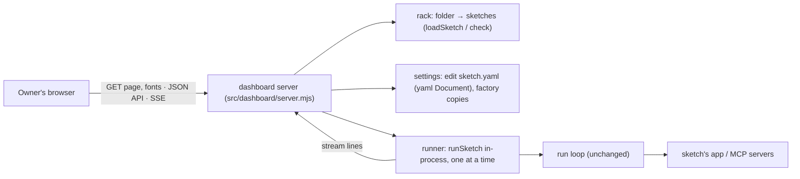
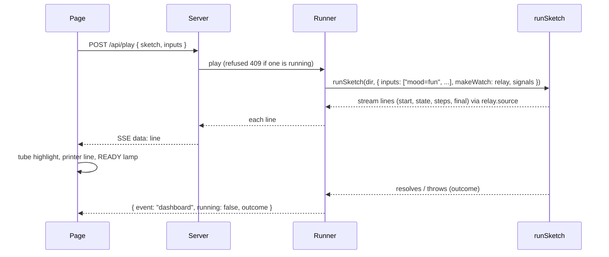

# Architecture Document: Sprint 6 dashboard

*   **Author**: Morpheus
*   **Last Updated**: 2026-10-16
*   **Scope**: Sprint 6 Architecture (stories `USER_STORIES_SPRINT6.md`, UND-27..33; design `docs/design/DASHBOARD.md`)
*   **Status**: Approved at Smith Gate 2 (2026-10-16), one note folded into §5 (refusal wording)

## 1. Executive Summary & System Overview

`understudy dashboard <folder>` is a second local web app beside the sprint 4 watch page, built
the same way: plain `node:http`, an unguessable token path, every file served locally, Server-Sent
Events for live lines. It adds a small JSON API (list sketches, describe one, save an edit, play,
stop, power) and runs sketches **in-process** through the existing `runSketch`, reading its
stream exactly as the watch page does. Two engine additions: the **switch** input and `when:` on a
gate. Saving edits keeps `sketch.yaml`'s comments by editing a YAML Document, not re-serialising.

## 2. System Context & Boundaries



- **Trust**: as the watch page - 127.0.0.1 by default, token path, no login. `--host` widens it
  (said on stderr, as for `run --watch --host`). The API only ever touches sketches inside the
  folder given on the command line (names are directory names from the listing; anything else is
  a 404). Request bodies are capped at 16 KB.
- **The run is unchanged**: the dashboard is a caller of `runSketch`, like the CLI.

## 3. Component & Container Architecture

| Component | Responsibility | In | Out |
|---|---|---|---|
| `src/dashboard/server.mjs` (new) | HTTP: static files (page, modules, css, fonts), API, SSE `/events` | requests | JSON, files, events |
| `src/dashboard/rack.mjs` (new) | list the folder's sketches; describe one: name, description, inputs (kind, range/options, default, current), factors per input (from `decide:`), statechart graph (`turnGraph`), check error | folder | sketch summaries |
| `src/dashboard/settings.mjs` (new) | apply one edit to `sketch.yaml` via `yaml.parseDocument` + `setIn`, validate by loading the result with `loadSketch` in a temp copy first, write; keep `.factory/<name>.yaml` before the first edit; restore all on power-on | edit `{ sketch, path, value }` | ok \| refusal message |
| `src/dashboard/runner.mjs` (new) | one run at a time: `runSketch(dir, { inputs, makeWatch: relay })`; STOP / POWER-off emit `SIGINT` on the run's own `signals` emitter; capture stderr lines for the printer | play / stop | stream lines + `{ event: 'dashboard', ... }` notes |
| `src/dashboard/page.html`, `page.mjs`, `page.css` (new) | the console: rack, dial, faders, switches, Play, READY, POWER, access panels, tube, printer | API + SSE | DOM |
| `src/dashboard/tube.mjs` (new, pure) | statechart → circle layout (states in turn order, finals inside), edge paths and label points; power ring arcs; colour blend | graph, weights | geometry |
| `src/inputs.mjs` (changed) | `switch` inputs (`on`/`off`, `true`/`false` on the CLI) | | |
| `src/engine.mjs` (changed) | a test may carry `when: <switch>`; skipped while the switch is off | inputs | |
| `src/apps/mcp.mjs`, `src/sketch.mjs` (changed) | pass inputs to gates; check `when:` names a switch | | |
| `src/cli.mjs` (changed) | `dashboard <folder> [--port N] [--host ADDR]` | | |

The page reuses the watch page's pure modules where they fit (`turnGraph.mjs`, `decisionOf` /
`decidedOf` from `src/watch/page.mjs`) - served from the same files, not copied.

## 4. Runtime Interaction & Critical Flows

### Play



`relay` is a `makeWatch` that subscribes to the run's stream and forwards each line - no change to
`run.mjs`. A refusal before start (`UsageError`: no key, bad input, server will not start) comes
back as `{ event: "dashboard", refused: "<message>" }` and is printed.

### Save an edit

1. `POST /api/edit { sketch, path: ["decide","boxoffice/pick_seats.seat","scores","centre","range",0], value: 0.4 }`
   (or `["inputs","mood","choose"]`, `["inputs","centre","default"]`).
2. Paths are allow-listed: `inputs.<name>.{default,choose}`, `decide.<key>.scores.<field>.{range,order,ask}`,
   `questions.<name>.looks_at`. Anything else is a 400.
3. Replace only the edited value's text, found through `yaml.parseDocument` source ranges (a full
   re-serialise reflowed lines - Phase 6 review), write the result into a temp copy of the sketch
   directory and `loadSketch` it - a `UsageError` is returned as the refusal, nothing written.
4. First edit of a sketch: copy the original to `<folder>/.factory/<name>.yaml`. Then write.
5. Power on: for each `.factory/<name>.yaml`, write it back over the sketch and delete it.

### Switch and `when:`

```yaml
inputs:
  together: { switch: true, default: true }
decide:
  boxoffice/pick_seats.seat:
    gates: { together: { at_least: 2, when: together }, row: { in: [E, F, D] } }
```

`gate(facts, gates, { inputs })` skips a test whose `when` names a switch that is off. `when` is a
word of a test, so `check` keeps naming unknown words.

## 5. Interface & Contract Specifications

- **CLI**: `understudy dashboard <folder> [--port N] [--host ADDR]` →
  `understudy: dashboard at http://127.0.0.1:<port>/d/<token>/` (one URL per interface with `--host
  0.0.0.0`), Ctrl-C stops it (and any run), exit 0. `<folder>` not a folder or holding no sketch:
  exit 2, one line.
- **API** (all under `/d/<token>/`): `GET api/sketches` → `[{ name, description, ok, problem }]`;
  every API refusal is `{ problem: "<one sentence the page prints as is>" }`, never a stack (Smith Gate 2);
  `GET api/sketch/<name>` → `{ name, description, inputs: [{ name, kind, options|range, default,
  value, factor }], graph, decisionEdge }`; `POST api/edit` → `{ ok: true }` | 422 `{ problem }`;
  `POST api/play` → 202 | 409; `POST api/stop`; `POST api/power { on }`; `GET events` (SSE).
- **Line on the stream**: the run's own lines unchanged, plus `{ event: "dashboard", running,
  sketch, outcome?, refused?, stderr? }`.
- **Inputs**: `{ switch: true, default: true|false }`; CLI `--input together=off|on|true|false`.

## 6. Cross-Cutting Concepts & Resilience

### Failure Modes & Error Handling

| Failure | Cause | Handling | User sees | Blast radius |
|---|---|---|---|---|
| A sketch fails check | bad YAML | listed greyed with the message | rack tab greyed, message on hover/focus | that sketch |
| Play with no key | env | `UsageError` before start | printed refusal, READY stays green | none |
| Edit invalid | from = to, empty mood | validated on a temp copy | box marked with the check message | nothing written |
| Write fails | permissions | 500 with the error | box marked "could not save: ..." | nothing changed |
| Browser closes mid-run | | run continues; a reload rejoins (SSE history) | | none |
| Ctrl-C on the server | | stop the run (SIGINT), close | `understudy: dashboard stopped` | |
| Two tabs press Play | | second gets 409 | "a run is going" printed | none |

### Security & Privacy
- No secrets on the page; header values never shown (as `run`). The API never takes a path from
  the request - sketch names are matched against the listing.

## 7. Technical Stack & SDLC / Build Impact

* **New runtime dependencies (routine, SDLC §4)**: `@fontsource/cinzel`, `@fontsource/spectral`,
  `@fontsource/vt323`, `@fontsource/dotgothic16` - the design's fonts as local woff2 files (OFL),
  served from `node_modules` so the page fetches nothing from the internet. No new mechanism.
* **eslint**: `src/dashboard/page.mjs` needs the browser-globals block the watch page has
  (Tank, a one-line addition to the existing block) - Mechanism class, small.
* `.factory/` is git-ignored (`.gitignore` gains one line).

## 8. Architectural Decisions (ADRs) & Technical Debt

* `ADR-0023`: **The dashboard is its own server beside the watch page**, sharing its patterns and
  pure modules; runs go through `runSketch` in-process with a `makeWatch` relay. Alternative:
  extend the watch server - rejected, the watch page is per-run and read-only.
* `ADR-0024`: **Edits go through a YAML Document and a full `loadSketch` on a temp copy** - comments
  survive and nothing invalid is ever written. Alternative: re-serialise - rejected, loses comments.
* `ADR-0025`: **Factory defaults are a copy kept at first edit**, restored by POWER on.
  Alternative: git - rejected, sketches need not be in git.
* `ADR-0026`: **Switch inputs and `when:`** - an input gates a gate; no new rule language.

### Acknowledged Technical Debt & Trade-offs
* One run at a time, one console's worth of state on the server; two browsers see the same run.
* The tube's circle layout is generic; a sketch with many states gets crowded labels.
